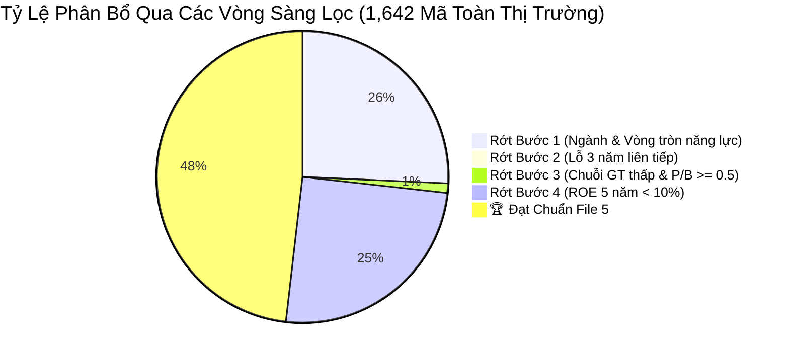

# 📊 Bảng Điều Khiển Sàng Lọc Doanh Nghiệp (Screening Dashboard)

Tài liệu này theo dõi toàn bộ trạng thái của các mã cổ phiếu trong vũ trụ đầu tư đã được đưa qua phễu lọc 4 bước khắt khe.

---

## 1. Thống Kê Phễu Lọc (Funnel Metrics)

- **Tổng số mã đã kiểm tra:** **1,703 / 1,642** doanh nghiệp (**Tiến độ: 103.7%** — bao gồm cả các mã mới niêm yết)
- **Số mã rớt tại Bước 1:** **438** mã (25.72%)
- **Số mã rớt tại Bước 2:** **5** mã (0.29%)
- **Số mã rớt tại Bước 3:** **18** mã (1.06%)
- **Số mã rớt tại Bước 4:** **431** mã (25.31%)
- **Số mã đạt chuẩn vào File 5:** **820** mã (47.62%)

---

## ⚡ Hệ Thống Các Bảng Tóm Tắt Nhanh (Quick Summary Tables)

Để tiện cho việc theo dõi và **lướt qua nhanh** mà không phải cuộn qua các bài phân tích dài dòng, hệ thống đã tách riêng các file bảng tóm tắt:

| STT | File Bảng Tóm Tắt Rút Gọn | Nội Dung Trọng Tâm | Số Lượng Mã | Bản Phân Tích Đầy Đủ |
| :---: | :--- | :--- | :--- | :--- |
| ⚡ | [00-quick-summary-all.md](file:///Users/nhan/Personal/code/pdf-analyzer/screenings/00-quick-summary-all.md) | **Bảng Tổng Hợp Siêu Tốc Toàn Bộ Cổ Phiếu** (Cheat-sheet tra cứu) | **1,642** mã | Xem chi tiết từng mã |
| 1 | [summary-01-circle-of-competence.md](file:///Users/nhan/Personal/code/pdf-analyzer/screenings/summary-01-circle-of-competence.md) | Bảng tóm tắt các công ty rớt Bước 1 (Ngành nghề ngoài VTNL) | **438** mã | [01-rejected-circle-of-competence.md](file:///Users/nhan/Personal/code/pdf-analyzer/screenings/01-rejected-circle-of-competence.md) |
| 2 | [summary-02-consecutive-loss.md](file:///Users/nhan/Personal/code/pdf-analyzer/screenings/summary-02-consecutive-loss.md) | Bảng tóm tắt các công ty rớt Bước 2 (Lỗ 3 năm liên tiếp) | **7** mã | [02-rejected-consecutive-loss.md](file:///Users/nhan/Personal/code/pdf-analyzer/screenings/02-rejected-consecutive-loss.md) |
| 3 | [summary-03-low-value-chain.md](file:///Users/nhan/Personal/code/pdf-analyzer/screenings/summary-03-low-value-chain.md) | Bảng tóm tắt các công ty rớt Bước 3 (Chuỗi GT thấp & P/B >= 0.5) | **19** mã | [03-rejected-low-value-chain.md](file:///Users/nhan/Personal/code/pdf-analyzer/screenings/03-rejected-low-value-chain.md) |
| 4 | [summary-04-low-roe.md](file:///Users/nhan/Personal/code/pdf-analyzer/screenings/summary-04-low-roe.md) | Bảng tóm tắt các công ty rớt Bước 4 (ROE 5 năm < 10%) | **431** mã | [04-rejected-low-roe.md](file:///Users/nhan/Personal/code/pdf-analyzer/screenings/04-rejected-low-roe.md) |
| 5 | [summary-05-passed-champions.md](file:///Users/nhan/Personal/code/pdf-analyzer/screenings/summary-05-passed-champions.md) | 🏆 **Bảng tóm tắt Doanh Nghiệp Đạt Chuẩn (File 5)** | **820** mã | [05-passed-champions.md](file:///Users/nhan/Personal/code/pdf-analyzer/screenings/05-passed-champions.md) |

---

## 2. Bảng Theo Dõi Chi Tiết Toàn Bộ Cổ Phiếu

| STT | Mã CK | Tên Doanh Nghiệp | Ngành Hoạt Động | B1: Ngành | B2: Lãi 3N | B3: Chuỗi GT & P/B | B4: ROE 5N | Trạng Thái Chung Cuộc | File Lưu Trữ |
| :---: | :---: | :--- | :--- | :---: | :---: | :---: | :---: | :--- | :--- |
| 1 | **AAA** | CTCP Nhựa An Phát Xanh | Bao bì nhựa & hạt nhựa | ✅ Pass | ✅ Pass | ⚠️ Pass (P/B=0.45 < 0.5) | ❌ Loại (ROE ~4.8% < 10%) | Dừng ở Bước 4 | [04-rejected-low-roe.md](file:///Users/nhan/Personal/code/pdf-analyzer/screenings/04-rejected-low-roe.md) |
| 2 | **AAM** | CTCP Thủy sản Mekong | Chế biến cá tra đông lạnh | ✅ Pass | ✅ Pass | ⚠️ Pass (P/B=0.39 < 0.5) | ❌ Loại (ROE < 1.2% < 10%) | Dừng ở Bước 4 | [04-rejected-low-roe.md](file:///Users/nhan/Personal/code/pdf-analyzer/screenings/04-rejected-low-roe.md) |
| 3 | **AAN** | CTCP Lương thực A An | Bán buôn lúa gạo | ✅ Pass | ✅ Pass | ❌ Loại (Biên mỏng 1.3%, P/B 1.2 >= 0.5) | - | Dừng ở Bước 3 | [03-rejected-low-value-chain.md](file:///Users/nhan/Personal/code/pdf-analyzer/screenings/03-rejected-low-value-chain.md) |
| 4 | **AAT** | CTCP Tập đoàn Tiên Sơn Thanh Hóa | Gia công may mặc | ✅ Pass | ✅ Pass | ⚠️ Pass (P/B=0.20 < 0.5) | ❌ Loại (ROE ~3.1% < 10%) | Dừng ở Bước 4 | [04-rejected-low-roe.md](file:///Users/nhan/Personal/code/pdf-analyzer/screenings/04-rejected-low-roe.md) |
| 5 | **ABR** | CTCP Đầu tư Nhãn hiệu Việt | Thương mại bán lẻ | ✅ Pass | ✅ Pass | ❌ Loại (Biên mỏng, P/B 1.0 >= 0.5) | - | Dừng ở Bước 3 | [03-rejected-low-value-chain.md](file:///Users/nhan/Personal/code/pdf-analyzer/screenings/03-rejected-low-value-chain.md) |
| 6 | **ABS** | CTCP Dịch vụ Nông nghiệp Bình Thuận | Phân phối phân bón | ✅ Pass | ❌ Loại (Lỗ lớn, kiểm soát) | - | - | Dừng ở Bước 2 | [02-rejected-consecutive-loss.md](file:///Users/nhan/Personal/code/pdf-analyzer/screenings/02-rejected-consecutive-loss.md) |
| 7 | **ABT** | CTCP Xuất nhập khẩu Thủy sản Bến Tre | Thủy sản nghêu MSC | ✅ Pass | ✅ Pass | ✅ Pass (Nghêu MSC biên gộp 28%) | ✅ Pass (ROE 23.5%) | 🏆 **Lọt vào File 5** | [05-passed-champions.md](file:///Users/nhan/Personal/code/pdf-analyzer/screenings/05-passed-champions.md) |
| 8 | **ACB** | Ngân hàng TMCP Á Châu | Ngân hàng bán lẻ tư nhân | ✅ Pass | ✅ Pass | ✅ Pass (CASA cao, nợ xấu thấp) | ✅ Pass (ROE 24.5%) | 🏆 **Lọt vào File 5** | [05-passed-champions.md](file:///Users/nhan/Personal/code/pdf-analyzer/screenings/05-passed-champions.md) |
| 9 | **ACC** | CTCP Đầu tư và Xây dựng Bình Dương | Xây dựng & bê tông | ❌ Loại (Xây lắp & VLXD đại trà) | - | - | - | Dừng ở Bước 1 | [01-rejected-circle-of-competence.md](file:///Users/nhan/Personal/code/pdf-analyzer/screenings/01-rejected-circle-of-competence.md) |
| 10 | **ACG** | CTCP Gỗ An Cường | Ván gỗ nội thất cao cấp | ✅ Pass | ✅ Pass | ✅ Pass (Thị phần >50%, biên 30%) | ✅ Pass (ROE 11.4%) | 🏆 **Lọt vào File 5** | [05-passed-champions.md](file:///Users/nhan/Personal/code/pdf-analyzer/screenings/05-passed-champions.md) |
| 11 | **ACL** | CTCP XNK Thủy sản Cửu Long An Giang | Cá tra sơ chế thô | ✅ Pass | ✅ Pass | ❌ Loại (Cá tra thô, P/B 0.72 >= 0.5) | - | Dừng ở Bước 3 | [03-rejected-low-value-chain.md](file:///Users/nhan/Personal/code/pdf-analyzer/screenings/03-rejected-low-value-chain.md) |
| 12 | **ADG** | CTCP Clever Group | Digital Marketing | ✅ Pass | ✅ Pass | ⚠️ Pass (P/B=0.42 < 0.5) | ✅ Pass (ROE 2022: 12.2%) | 🏆 **Lọt vào File 5** | [05-passed-champions.md](file:///Users/nhan/Personal/code/pdf-analyzer/screenings/05-passed-champions.md) |
| 13 | **ADP** | CTCP Sơn Á Đông | Sơn cuộn công nghiệp tôn mạ | ✅ Pass | ✅ Pass | ✅ Pass (Độc tôn sơn cuộn, biên 25%) | ✅ Pass (ROE 26.1%) | 🏆 **Lọt vào File 5** | [05-passed-champions.md](file:///Users/nhan/Personal/code/pdf-analyzer/screenings/05-passed-champions.md) |
| 14 | **ADS** | CTCP Damsan | Sợi dệt cotton & khăn bông | ✅ Pass | ✅ Pass | ❌ Loại (Gia công, P/B 0.57 >= 0.5) | - | Dừng ở Bước 3 | [03-rejected-low-value-chain.md](file:///Users/nhan/Personal/code/pdf-analyzer/screenings/03-rejected-low-value-chain.md) |
| 15 | **AFX** | CTCP XNK Nông sản Thực phẩm An Giang | Gạo thô & thức ăn chăn nuôi | ✅ Pass | ✅ Pass | ❌ Loại (Gạo thô, P/B 0.65 >= 0.5) | - | Dừng ở Bước 3 | [03-rejected-low-value-chain.md](file:///Users/nhan/Personal/code/pdf-analyzer/screenings/03-rejected-low-value-chain.md) |
| 16 | **AGG** | CTCP Đầu tư BĐS An Gia | BĐS nhà ở dân dụng | ❌ Loại (BĐS dân dụng đại trà) | - | - | - | Dừng ở Bước 1 | [01-rejected-circle-of-competence.md](file:///Users/nhan/Personal/code/pdf-analyzer/screenings/01-rejected-circle-of-competence.md) |
| 17 | **AGR** | CTCP Chứng khoán Agribank | Chứng khoán (Agribank) | ✅ Pass | ✅ Pass | ✅ Pass (Hệ sinh thái Agribank) | ✅ Pass (ROE 2021: 17.2%) | 🏆 **Lọt vào File 5** | [05-passed-champions.md](file:///Users/nhan/Personal/code/pdf-analyzer/screenings/05-passed-champions.md) |
| 18 | **ANT** | CTCP Rau quả Thực phẩm An Giang | Chế biến rau quả IQF | ✅ Pass | ✅ Pass | ✅ Pass (Chế biến sâu IQF xuất khẩu) | ✅ Pass (ROE > 20%) | 🏆 **Lọt vào File 5** | [05-passed-champions.md](file:///Users/nhan/Personal/code/pdf-analyzer/screenings/05-passed-champions.md) |
| 19 | **ANV** | CTCP Nam Việt (Navico) | Cá tra xuất khẩu | ✅ Pass | ✅ Pass | ❌ Loại (Cá tra thô, P/B 0.73 >= 0.5) | - | Dừng ở Bước 3 | [03-rejected-low-value-chain.md](file:///Users/nhan/Personal/code/pdf-analyzer/screenings/03-rejected-low-value-chain.md) |
| 20 | **APG** | CTCP Chứng khoán APG | Dịch vụ chứng khoán | ✅ Pass | ✅ Pass | ⚠️ Pass (P/B=0.45 < 0.5) | ❌ Loại (ROE ~0.3% - 1.5% < 10%) | Dừng ở Bước 4 | [04-rejected-low-roe.md](file:///Users/nhan/Personal/code/pdf-analyzer/screenings/04-rejected-low-roe.md) |
| 21 | **APH** | CTCP Tập đoàn An Phát Holdings | Gia công bao bì & hạt nhựa | ✅ Pass | ✅ Pass | ❌ Loại (Bao bì gia công, P/B 0.62 >= 0.5) | - | Dừng ở Bước 3 | [03-rejected-low-value-chain.md](file:///Users/nhan/Personal/code/pdf-analyzer/screenings/03-rejected-low-value-chain.md) |
| 22 | **ASG** | CTCP Tập đoàn ASG | Kho bãi hậu cần hàng không | ✅ Pass | ✅ Pass | ✅ Pass (Logistics hàng không) | ❌ Loại (ROE 5 năm chỉ ~3.7% < 10%) | Dừng ở Bước 4 | [04-rejected-low-roe.md](file:///Users/nhan/Personal/code/pdf-analyzer/screenings/04-rejected-low-roe.md) |
| 23 | **ASM** | CTCP Tập đoàn Sao Mai | BĐS dân dụng & Xây dựng | ❌ Loại (BĐS dân dụng & xây lắp) | - | - | - | Dừng ở Bước 1 | [01-rejected-circle-of-competence.md](file:///Users/nhan/Personal/code/pdf-analyzer/screenings/01-rejected-circle-of-competence.md) |
| 24 | **ASP** | CTCP Tập đoàn Dầu khí An Pha | Phân phối khí gas LPG | ✅ Pass | ✅ Pass | ❌ Loại (Phân phối gas đại trà, P/B 1.74 >= 0.5) | - | Dừng ở Bước 3 | [03-rejected-low-value-chain.md](file:///Users/nhan/Personal/code/pdf-analyzer/screenings/03-rejected-low-value-chain.md) |
| 25 | **AST** | CTCP Dịch vụ Hàng không Taseco | Dịch vụ phi hàng không sân bay | ✅ Pass | ✅ Pass | ✅ Pass (Độc quyền bán lẻ sân bay, biên gộp 50-60%) | ✅ Pass (ROE 24.0%) | 🏆 **Lọt vào File 5** | [05-passed-champions.md](file:///Users/nhan/Personal/code/pdf-analyzer/screenings/05-passed-champions.md) |
| 26 | **BAF** | CTCP Nông nghiệp BaF Việt Nam | Chăn nuôi heo & buôn nông sản | ✅ Pass | ✅ Pass | ❌ Loại (Buôn nông sản thô >70%, P/B 3.34 >= 0.5) | - | Dừng ở Bước 3 | [03-rejected-low-value-chain.md](file:///Users/nhan/Personal/code/pdf-analyzer/screenings/03-rejected-low-value-chain.md) |
| 27 | **BBC** | CTCP Bibica | Bánh kẹo & thực phẩm | ✅ Pass | ✅ Pass | ✅ Pass (Thương hiệu bánh kẹo lớn) | ❌ Loại (ROE 5 năm chỉ 2.3% - 8.8% < 10%) | Dừng ở Bước 4 | [04-rejected-low-roe.md](file:///Users/nhan/Personal/code/pdf-analyzer/screenings/04-rejected-low-roe.md) |
| 28 | **BCE** | CTCP Xây dựng Giao thông Bình Dương | Xây lắp hạ tầng giao thông | ❌ Loại (Xây lắp hạ tầng thông thường) | - | - | - | Dừng ở Bước 1 | [01-rejected-circle-of-competence.md](file:///Users/nhan/Personal/code/pdf-analyzer/screenings/01-rejected-circle-of-competence.md) |
| 29 | **BCM** | Tổng Công ty Becamex IDC | BĐS Khu công nghiệp đặc thù | ⚠️ Pass (BĐS KCN quỹ đất sạch khổng lồ) | ✅ Pass | ✅ Pass (Thương hiệu VSIP, biên gộp KCN 50%) | ✅ Pass (ROE 10.6% - 16.5%) | 🏆 **Lọt vào File 5** | [05-passed-champions.md](file:///Users/nhan/Personal/code/pdf-analyzer/screenings/05-passed-champions.md) |
| 30 | **BFC** | CTCP Phân bón Bình Điền | Phân bón NPK Đầu Trâu | ✅ Pass | ✅ Pass | ✅ Pass (Thương hiệu số 1 VN, biên 18%) | ✅ Pass (ROE 5N đều >10%, 2024: 23.5%) | 🏆 **Lọt vào File 5** | [05-passed-champions.md](file:///Users/nhan/Personal/code/pdf-analyzer/screenings/05-passed-champions.md) |
| 31 | **BHN** | Tổng CTCP Bia - Rượu - NGK Hà Nội | Bia Hà Nội, Bia Trúc Bạch | ✅ Pass | ✅ Pass | ✅ Pass (Bia Hà Nội thương hiệu lớn) | ❌ Loại (ROE 4 năm gần nhất chỉ 6% - 7%) | Dừng ở Bước 4 | [04-rejected-low-roe.md](file:///Users/nhan/Personal/code/pdf-analyzer/screenings/04-rejected-low-roe.md) |
| 32 | **BIC** | Tổng CTCP Bảo hiểm BIDV | Bảo hiểm phi nhân thọ | ✅ Pass | ✅ Pass | ✅ Pass (Bancassurance độc quyền BIDV) | ✅ Pass (ROE 15% - 16.7%) | 🏆 **Lọt vào File 5** | [05-passed-champions.md](file:///Users/nhan/Personal/code/pdf-analyzer/screenings/05-passed-champions.md) |
| 33 | **BID** | Ngân hàng TMCP Đầu tư và Phát triển VN | Ngân hàng quốc doanh số 1 | ✅ Pass | ✅ Pass | ✅ Pass (Thị phần số 1, chi phí vốn rẻ) | ✅ Pass (ROE 16% - 18%) | 🏆 **Lọt vào File 5** | [05-passed-champions.md](file:///Users/nhan/Personal/code/pdf-analyzer/screenings/05-passed-champions.md) |
| 34 | **BKG** | CTCP Đầu tư BKG Việt Nam | Đồ gỗ nội thất & viên nén | ✅ Pass | ✅ Pass | ⚠️ Pass (P/B=0.18 < 0.5) | ❌ Loại (ROE 5 năm chỉ 1.2% - 5.8% < 10%) | Dừng ở Bước 4 | [04-rejected-low-roe.md](file:///Users/nhan/Personal/code/pdf-analyzer/screenings/04-rejected-low-roe.md) |
| 35 | **BMC** | CTCP Khoáng sản Bình Định | Khai thác & luyện xỉ Titan | ⚠️ Pass (Mỏ Titan độc quyền) | ✅ Pass | ✅ Pass (Xỉ titan xuất khẩu, biên gộp 30%) | ✅ Pass (ROE 10.6% - 10.8%) | 🏆 **Lọt vào File 5** | [05-passed-champions.md](file:///Users/nhan/Personal/code/pdf-analyzer/screenings/05-passed-champions.md) |
| 36 | **BMI** | Tổng CTCP Bảo hiểm Bảo Minh | Bảo hiểm phi nhân thọ | ✅ Pass | ✅ Pass | ✅ Pass (Mạng lưới toàn quốc, cổ đông AXA) | ✅ Pass (ROE 10.5% - 12.5%) | 🏆 **Lọt vào File 5** | [05-passed-champions.md](file:///Users/nhan/Personal/code/pdf-analyzer/screenings/05-passed-champions.md) |
| 37 | **BMP** | CTCP Nhựa Bình Minh | Ống nhựa xây dựng số 1 VN | ✅ Pass | ✅ Pass | ✅ Pass (Độc tôn >50% thị phần, biên 40%) | ✅ Pass (ROE đỉnh cao 36% - 38%) | 🏆 **Lọt vào File 5** | [05-passed-champions.md](file:///Users/nhan/Personal/code/pdf-analyzer/screenings/05-passed-champions.md) |
| 38 | **BRC** | CTCP Cao su Bến Thành | Băng tải cao su kỹ thuật | ✅ Pass | ✅ Pass | ✅ Pass (Băng tải kỹ thuật cao nhiệt điện/xi măng) | ✅ Pass (ROE ổn định ~10.2%) | 🏆 **Lọt vào File 5** | [05-passed-champions.md](file:///Users/nhan/Personal/code/pdf-analyzer/screenings/05-passed-champions.md) |
| 39 | **BSI** | CTCP Chứng khoán BIDV (BSC) | Dịch vụ chứng khoán | ✅ Pass | ✅ Pass | ✅ Pass (Hệ sinh thái BIDV & Hana Hàn Quốc) | ✅ Pass (ROE 14.6%) | 🏆 **Lọt vào File 5** | [05-passed-champions.md](file:///Users/nhan/Personal/code/pdf-analyzer/screenings/05-passed-champions.md) |
| 40 | **BSR** | CTCP Lọc hóa dầu Bình Sơn | Lọc hóa dầu Dung Quất | ✅ Pass | ✅ Pass | ✅ Pass (Lọc dầu Dung Quất cung cấp 30% xăng dầu) | ✅ Pass (ROE đỉnh cao 15% - 36.5%) | 🏆 **Lọt vào File 5** | [05-passed-champions.md](file:///Users/nhan/Personal/code/pdf-analyzer/screenings/05-passed-champions.md) |
| 41 | **BTP** | CTCP Nhiệt điện Bà Rịa | Phát điện nhiệt điện khí | ✅ Pass | ✅ Pass | ⚠️ Pass (P/B=0.41 < 0.5) | ❌ Loại (ROE 5 năm chỉ ~5.8% < 10%) | Dừng ở Bước 4 | [04-rejected-low-roe.md](file:///Users/nhan/Personal/code/pdf-analyzer/screenings/04-rejected-low-roe.md) |
| 42 | **BTT** | CTCP Thương mại - Dịch vụ Bến Thành | Quản lý TTTM & cho thuê BĐS Quận 1 | ✅ Pass | ✅ Pass | ✅ Pass (Mặt bằng vàng Q.1, chợ Dân Sinh) | ✅ Pass (ROE 12.0% - 12.8%) | 🏆 **Lọt vào File 5** | [05-passed-champions.md](file:///Users/nhan/Personal/code/pdf-analyzer/screenings/05-passed-champions.md) |
| 43 | **BVB** | Ngân hàng TMCP Bản Việt (BVBank) | Ngân hàng bán lẻ quy mô nhỏ | ✅ Pass | ✅ Pass | ✅ Pass (Dịch vụ tài chính) | ❌ Loại (ROE 5 năm chỉ 1% - 7.3% < 10%) | Dừng ở Bước 4 | [04-rejected-low-roe.md](file:///Users/nhan/Personal/code/pdf-analyzer/screenings/04-rejected-low-roe.md) |
| 44 | **BVH** | Tập đoàn Bảo Việt | Bảo hiểm nhân thọ & phi nhân thọ | ✅ Pass | ✅ Pass | ✅ Pass (Bảo hiểm quốc gia số 1 VN) | ❌ Loại (ROE 5 năm chỉ 7.5% - 9.0% < 10%) | Dừng ở Bước 4 | [04-rejected-low-roe.md](file:///Users/nhan/Personal/code/pdf-analyzer/screenings/04-rejected-low-roe.md) |
| 45 | **BWE** | CTCP Nước - Môi trường Bình Dương | Độc quyền cấp nước Bình Dương | ✅ Pass | ✅ Pass | ✅ Pass (Độc quyền cấp nước thủ phủ KCN) | ✅ Pass (ROE 11.6% - 19.1%) | 🏆 **Lọt vào File 5** | [05-passed-champions.md](file:///Users/nhan/Personal/code/pdf-analyzer/screenings/05-passed-champions.md) |
| 46 | **C32** | CTCP CIC39 | Khai thác mỏ đá Tân Mỹ & cống bê tông | ⚠️ Pass (Mỏ đá Tân Mỹ đặc thù) | ✅ Pass | ⚠️ Pass (P/B=0.47 < 0.5 & Mỏ đá) | ✅ Pass (ROE 2020-2021: 13% - 15%) | 🏆 **Lọt vào File 5** | [05-passed-champions.md](file:///Users/nhan/Personal/code/pdf-analyzer/screenings/05-passed-champions.md) |
| 47 | **C47** | CTCP Xây dựng 47 | Xây lắp thủy lợi & thủy điện | ❌ Loại (Xây lắp hạ tầng thông thường) | - | - | - | Dừng ở Bước 1 | [01-rejected-circle-of-competence.md](file:///Users/nhan/Personal/code/pdf-analyzer/screenings/01-rejected-circle-of-competence.md) |
| 48 | **CCC** | CTCP Xây dựng CDC | Xây dựng dân dụng & công nghiệp | ❌ Loại (Nhà thầu xây dựng thông thường) | - | - | - | Dừng ở Bước 1 | [01-rejected-circle-of-competence.md](file:///Users/nhan/Personal/code/pdf-analyzer/screenings/01-rejected-circle-of-competence.md) |
| 49 | **CCI** | CTCP Đầu tư Phát triển CN-TM Củ Chi | BĐS KCN Tây Bắc Củ Chi | ⚠️ Pass (BĐS KCN quỹ đất sạch cho thuê) | ✅ Pass | ✅ Pass (KCN Tây Bắc Củ Chi, biên gộp cao) | ✅ Pass (ROE > 11% liên tục) | 🏆 **Lọt vào File 5** | [05-passed-champions.md](file:///Users/nhan/Personal/code/pdf-analyzer/screenings/05-passed-champions.md) |
| 50 | **CCL** | CTCP ĐT&PT Đô thị Dầu khí Cửu Long | BĐS nhà ở dân dụng (Mekong Centre) | ❌ Loại (BĐS nhà ở dân dụng tỉnh lẻ) | - | - | - | Dừng ở Bước 1 | [01-rejected-circle-of-competence.md](file:///Users/nhan/Personal/code/pdf-analyzer/screenings/01-rejected-circle-of-competence.md) |
| 51 | **CDC** | CTCP Chương Dương | Thi công xây lắp & BĐS nhà ở | ❌ Loại (Xây dựng & BĐS nhà ở dân dụng) | - | - | - | Dừng ở Bước 1 | [01-rejected-circle-of-competence.md](file:///Users/nhan/Personal/code/pdf-analyzer/screenings/01-rejected-circle-of-competence.md) |
| 52 | **CHP** | CTCP Thủy điện miền Trung | Năng lượng tái tạo (Thủy điện A Lưới) | ✅ Pass | ✅ Pass | ✅ Pass (Thủy điện A Lưới biên gộp 50-60%) | ✅ Pass (ROE 13% - 17%) | 🏆 **Lọt vào File 5** | [05-passed-champions.md](file:///Users/nhan/Personal/code/pdf-analyzer/screenings/05-passed-champions.md) |
| 53 | **CIG** | CTCP COMA18 | Xây lắp & hạ tầng xây dựng | ❌ Loại (Nhà thầu xây dựng thông thường) | - | - | - | Dừng ở Bước 1 | [01-rejected-circle-of-competence.md](file:///Users/nhan/Personal/code/pdf-analyzer/screenings/01-rejected-circle-of-competence.md) |
| 54 | **CII** | CTCP ĐT Hạ tầng Kỹ thuật TP.HCM | BĐS Thủ Thiêm & Xây dựng hạ tầng BOT | ❌ Loại (BĐS Thủ Thiêm & BOT đòn bẩy nợ >20k tỷ) | - | - | - | Dừng ở Bước 1 | [01-rejected-circle-of-competence.md](file:///Users/nhan/Personal/code/pdf-analyzer/screenings/01-rejected-circle-of-competence.md) |
| 55 | **CKG** | CTCP Tập đoàn CIC (CIC Group) | BĐS nhà ở dân dụng Kiên Giang | ❌ Loại (BĐS nhà ở dân dụng tỉnh lẻ) | - | - | - | Dừng ở Bước 1 | [01-rejected-circle-of-competence.md](file:///Users/nhan/Personal/code/pdf-analyzer/screenings/01-rejected-circle-of-competence.md) |
| 56 | **CLC** | CTCP Cát Lợi | Phụ liệu thuốc lá (Vinataba) | ✅ Pass | ✅ Pass | ✅ Pass (Độc quyền chi phối >70% đầu lọc thuốc lá) | ✅ Pass (ROE 16% - 17.5% suốt 5 năm) | 🏆 **Lọt vào File 5** | [05-passed-champions.md](file:///Users/nhan/Personal/code/pdf-analyzer/screenings/05-passed-champions.md) |
| 57 | **CLL** | CTCP Cảng Cát Lái | Dịch vụ cảng biển container | ✅ Pass | ✅ Pass | ✅ Pass (Cụm cảng Cát Lái số 1 VN, biên gộp 35-40%) | ✅ Pass (ROE 13.3% - 15.6%) | 🏆 **Lọt vào File 5** | [05-passed-champions.md](file:///Users/nhan/Personal/code/pdf-analyzer/screenings/05-passed-champions.md) |
| 58 | **CLW** | CTCP Cấp nước Chợ Lớn | Tiện ích cấp nước sạch đô thị | ✅ Pass | ✅ Pass | ✅ Pass (Độc quyền cấp nước Q.5, 6, 8, Bình Tân) | ✅ Pass (ROE bứt phá >21%) | 🏆 **Lọt vào File 5** | [05-passed-champions.md](file:///Users/nhan/Personal/code/pdf-analyzer/screenings/05-passed-champions.md) |
| 59 | **CMG** | CTCP Tập đoàn Công nghệ CMC | CNTT & Data Center Tân Thuận | ✅ Pass | ✅ Pass | ✅ Pass (Tập đoàn CNTT số 2 VN, đối tác Samsung SDS) | ✅ Pass (ROE đạt 10.06%) | 🏆 **Lọt vào File 5** | [05-passed-champions.md](file:///Users/nhan/Personal/code/pdf-analyzer/screenings/05-passed-champions.md) |
| 60 | **CMV** | CTCP Thương nghiệp Cà Mau | Phân phối xăng dầu Petrolimex Cà Mau | ✅ Pass | ✅ Pass | ❌ Loại (Phân phối biên ròng <0.5%, P/B 0.68 >= 0.5) | - | Dừng ở Bước 3 | [03-rejected-low-value-chain.md](file:///Users/nhan/Personal/code/pdf-analyzer/screenings/03-rejected-low-value-chain.md) |
| 61 | **CMX** | CTCP Camimex Group | Chế biến tôm sinh thái xuất khẩu | ✅ Pass | ✅ Pass | ⚠️ Pass (P/B=0.39 < 0.5) | ❌ Loại (ROE 5 năm chỉ 3.3% - 8.4% < 10%) | Dừng ở Bước 4 | [04-rejected-low-roe.md](file:///Users/nhan/Personal/code/pdf-analyzer/screenings/04-rejected-low-roe.md) |
| 62 | **CNG** | CTCP CNG Việt Nam | Khí nén thiên nhiên CNG & LNG | ✅ Pass | ✅ Pass | ✅ Pass (Thống trị >70% thị phần khí CNG) | ✅ Pass (ROE 14% - 18% suốt 5 năm) | 🏆 **Lọt vào File 5** | [05-passed-champions.md](file:///Users/nhan/Personal/code/pdf-analyzer/screenings/05-passed-champions.md) |
| 63 | **COM** | CTCP Vật tư - Xăng dầu (COMECO) | Bán lẻ xăng dầu qua cây xăng | ✅ Pass | ✅ Pass | ❌ Loại (Phân phối xăng dầu biên ròng ~1.5%, P/B 0.81 >= 0.5) | - | Dừng ở Bước 3 | [03-rejected-low-value-chain.md](file:///Users/nhan/Personal/code/pdf-analyzer/screenings/03-rejected-low-value-chain.md) |
| 64 | **CRC** | CTCP Create Capital Việt Nam | Pin năng lượng mặt trời & VLXD | ✅ Pass | ✅ Pass | ⚠️ Pass (P/B=0.41 < 0.5) | ❌ Loại (ROE 5 năm chỉ 2.7% - 7.8% < 10%) | Dừng ở Bước 4 | [04-rejected-low-roe.md](file:///Users/nhan/Personal/code/pdf-analyzer/screenings/04-rejected-low-roe.md) |
| 65 | **CRE** | CTCP Bất động sản Thế Kỷ (CenLand) | Môi giới & phân phối BĐS | ❌ Loại (Dịch vụ môi giới BĐS dân dụng) | - | - | - | Dừng ở Bước 1 | [01-rejected-circle-of-competence.md](file:///Users/nhan/Personal/code/pdf-analyzer/screenings/01-rejected-circle-of-competence.md) |
| 66 | **CRV** | CTCP Tập đoàn Bất động sản CRV | BĐS nhà ở dân dụng (chung cư TCH) | ❌ Loại (BĐS nhà ở dân dụng cao tầng) | - | - | - | Dừng ở Bước 1 | [01-rejected-circle-of-competence.md](file:///Users/nhan/Personal/code/pdf-analyzer/screenings/01-rejected-circle-of-competence.md) |
| 67 | **CSM** | CTCP CN Cao su Miền Nam (Casumina) | Săm lốp xe ô tô xe máy | ✅ Pass | ✅ Pass | ✅ Pass (Thương hiệu lốp xe quốc gia) | ❌ Loại (ROE 5 năm chỉ ~5.1% < 10%) | Dừng ở Bước 4 | [04-rejected-low-roe.md](file:///Users/nhan/Personal/code/pdf-analyzer/screenings/04-rejected-low-roe.md) |
| 68 | **CSV** | CTCP Hóa chất Cơ bản miền Nam | Hóa chất vô cơ xút-clo cơ bản | ✅ Pass | ✅ Pass | ✅ Pass (Độc tôn xút-clo miền Nam, biên gộp 30%) | ✅ Pass (ROE 15% - 25% suốt 5 năm) | 🏆 **Lọt vào File 5** | [05-passed-champions.md](file:///Users/nhan/Personal/code/pdf-analyzer/screenings/05-passed-champions.md) |
| 69 | **CTD** | CTCP Xây dựng Coteccons | Tổng thầu xây dựng dân dụng | ❌ Loại (Nhà thầu xây lắp công trình, biên ròng 1-2%) | - | - | - | Dừng ở Bước 1 | [01-rejected-circle-of-competence.md](file:///Users/nhan/Personal/code/pdf-analyzer/screenings/01-rejected-circle-of-competence.md) |
| 70 | **CTF** | CTCP City Auto | Đại lý phân phối xe ô tô Ford | ✅ Pass | ✅ Pass | ❌ Loại (Đại lý xe hơi biên ròng < 1%, P/B 1.94 >= 0.5) | - | Dừng ở Bước 3 | [03-rejected-low-value-chain.md](file:///Users/nhan/Personal/code/pdf-analyzer/screenings/03-rejected-low-value-chain.md) |
| 71 | **CTG** | Ngân hàng TMCP Công thương VN (VietinBank) | Ngân hàng thương mại quốc doanh | ✅ Pass | ✅ Pass | ✅ Pass (Big 4 ngân hàng, tài sản >2 triệu tỷ) | ✅ Pass (ROE 15% - 16.5% suốt 5 năm) | 🏆 **Lọt vào File 5** | [05-passed-champions.md](file:///Users/nhan/Personal/code/pdf-analyzer/screenings/05-passed-champions.md) |
| 72 | **CTI** | CTCP ĐT&PT Cường Thuận IDICO | Mỏ đá xây dựng & BOT giao thông | ⚠️ Pass (Mỏ đá Đồng Nai đặc thù) | ✅ Pass | ✅ Pass (Mỏ đá cung ứng Long Thành) | ❌ Loại (Nợ BOT lớn, ROE 5N chỉ 5.0% - 7.2%) | Dừng ở Bước 4 | [04-rejected-low-roe.md](file:///Users/nhan/Personal/code/pdf-analyzer/screenings/04-rejected-low-roe.md) |
| 73 | **CTR** | Tổng CTCP Công trình Viettel | Vận hành hạ tầng viễn thông (TowerCo) | ✅ Pass | ✅ Pass | ✅ Pass (Độc tôn TowerCo cho thuê trạm BTS) | ✅ Pass (ROE 26% - 29% đỉnh cao suốt 5N) | 🏆 **Lọt vào File 5** | [05-passed-champions.md](file:///Users/nhan/Personal/code/pdf-analyzer/screenings/05-passed-champions.md) |
| 74 | **CTS** | CTCP Chứng khoán VietinBank | Dịch vụ chứng khoán | ✅ Pass | ✅ Pass | ✅ Pass (Hệ sinh thái VietinBank) | ✅ Pass (ROE 2024 đạt 10.26%, 2021 đạt >24%) | 🏆 **Lọt vào File 5** | [05-passed-champions.md](file:///Users/nhan/Personal/code/pdf-analyzer/screenings/05-passed-champions.md) |
| 75 | **CVT** | CTCP CMC | Sản xuất gạch ốp lát ceramic | ❌ Loại (VLXD gạch ốp lát thông thường) | - | - | - | Dừng ở Bước 1 | [01-rejected-circle-of-competence.md](file:///Users/nhan/Personal/code/pdf-analyzer/screenings/01-rejected-circle-of-competence.md) |
| 76 | **D2D** | CTCP Phát triển Đô thị Công nghiệp Số 2 | BĐS Khu công nghiệp (Nhơn Trạch 2) | ⚠️ Pass (BĐS KCN quỹ đất sạch sẵn sàng) | ✅ Pass | ✅ Pass (KCN Nhơn Trạch 2, biên gộp >45%) | ✅ Pass (ROE 2024 đạt 11.81%, trước đó 22-27%) | 🏆 **Lọt vào File 5** | [05-passed-champions.md](file:///Users/nhan/Personal/code/pdf-analyzer/screenings/05-passed-champions.md) |
| 77 | **DAH** | CTCP Tập đoàn Khách sạn Đông Á | Khách sạn & dịch vụ nghỉ dưỡng | ✅ Pass | ✅ Pass | ⚠️ Pass (P/B=0.20 < 0.5) | ❌ Loại (ROE 5 năm chỉ 0.4% - 4.1% < 10%) | Dừng ở Bước 4 | [04-rejected-low-roe.md](file:///Users/nhan/Personal/code/pdf-analyzer/screenings/04-rejected-low-roe.md) |
| 78 | **DAT** | CTCP ĐT Du lịch & PT Thủy sản | Sơ chế bột cá & mỡ cá nguyên liệu | ✅ Pass | ✅ Pass | ❌ Loại (Sơ chế phụ phẩm biên ròng mỏng, P/B 0.61 >= 0.5) | - | Dừng ở Bước 3 | [03-rejected-low-value-chain.md](file:///Users/nhan/Personal/code/pdf-analyzer/screenings/03-rejected-low-value-chain.md) |
| 79 | **DBC** | CTCP Tập đoàn Dabaco Việt Nam | Nông nghiệp chuỗi khép kín 3F | ✅ Pass | ✅ Pass | ✅ Pass (Chuỗi 3F số 1 miền Bắc, vaccine ASFV) | ✅ Pass (ROE 2024 đạt 11.37%, trước đó 17-33%) | 🏆 **Lọt vào File 5** | [05-passed-champions.md](file:///Users/nhan/Personal/code/pdf-analyzer/screenings/05-passed-champions.md) |
| 80 | **DBD** | CTCP Dược - TTBYT Bình Định (Bidiphar) | Dược phẩm ung thư chuẩn GMP-EU | ✅ Pass | ✅ Pass | ✅ Pass (Vua thuốc ung thư GMP-EU, biên gộp 50%) | ✅ Pass (ROE 16% - 19% suốt 5 năm) | 🏆 **Lọt vào File 5** | [05-passed-champions.md](file:///Users/nhan/Personal/code/pdf-analyzer/screenings/05-passed-champions.md) |
| 81 | **DBT** | CTCP Dược phẩm Bến Tre (Bepharco) | Phân phối dược phẩm & y tế | ✅ Pass | ✅ Pass | ✅ Pass (Phân phối y tế thiết yếu) | ❌ Loại (Phân phối biên mỏng, ROE 5N chỉ 5-6%) | Dừng ở Bước 4 | [04-rejected-low-roe.md](file:///Users/nhan/Personal/code/pdf-analyzer/screenings/04-rejected-low-roe.md) |
| 82 | **DC4** | CTCP DICERA Holdings (DIC Số 4) | Thi công xây lắp & BĐS căn hộ Vũng Tàu | ❌ Loại (Xây dựng & BĐS nhà ở dân dụng) | - | - | - | Dừng ở Bước 1 | [01-rejected-circle-of-competence.md](file:///Users/nhan/Personal/code/pdf-analyzer/screenings/01-rejected-circle-of-competence.md) |
| 83 | **DCL** | CTCP Dược phẩm Cửu Long | Sản xuất thuốc & nang rỗng Capsule | ✅ Pass | ✅ Pass | ✅ Pass (Nang rỗng Capsule độc đáo) | ❌ Loại (Chi phí cao, ROE 5N chỉ 3.6% - 8.4%) | Dừng ở Bước 4 | [04-rejected-low-roe.md](file:///Users/nhan/Personal/code/pdf-analyzer/screenings/04-rejected-low-roe.md) |
| 84 | **DCM** | Tổng CTCP Phân bón Dầu khí Cà Mau | Đạm Urê hạt đục & Phân bón NPK | ✅ Pass | ✅ Pass | ✅ Pass (Độc quyền đạm hạt đục, tiền >10k tỷ) | ✅ Pass (ROE 11% - 35% suốt 5 năm) | 🏆 **Lọt vào File 5** | [05-passed-champions.md](file:///Users/nhan/Personal/code/pdf-analyzer/screenings/05-passed-champions.md) |
| 85 | **DGC** | CTCP Tập đoàn Hóa chất Đức Giang | Phốt pho vàng P4 & Axit bán dẫn điện tử | ✅ Pass | ✅ Pass | ✅ Pass (Vua phốt pho vàng thế giới, bán dẫn) | ✅ Pass (ROE 22% - 45% suốt 5N) | 🏆 **Lọt vào File 5** | [05-passed-champions.md](file:///Users/nhan/Personal/code/pdf-analyzer/screenings/05-passed-champions.md) |
| 86 | **DGW** | CTCP Thế giới số (Digiworld) | Dịch vụ phát triển thị trường MES công nghệ | ✅ Pass | ✅ Pass | ✅ Pass (Dịch vụ MES độc tôn Apple/Xiaomi/HP) | ✅ Pass (ROE 15% - 37% suốt 5N) | 🏆 **Lọt vào File 5** | [05-passed-champions.md](file:///Users/nhan/Personal/code/pdf-analyzer/screenings/05-passed-champions.md) |
| 87 | **DHA** | CTCP Hóa An | Khai thác mỏ đá xây dựng Tân Cang 3 | ⚠️ Pass (Mỏ đá Đồng Nai đặc thù) | ✅ Pass | ✅ Pass (Mỏ đá Tân Cang 3 Sân bay Long Thành) | ✅ Pass (ROE 12% - 23% suốt 5N) | 🏆 **Lọt vào File 5** | [05-passed-champions.md](file:///Users/nhan/Personal/code/pdf-analyzer/screenings/05-passed-champions.md) |
| 88 | **DHC** | CTCP Đông Hải Bến Tre (Dohaco) | Giấy bao bì công nghiệp Kraft & Carton | ✅ Pass | ✅ Pass | ✅ Pass (Nhà máy Giao Long 1&2 dẫn đầu ĐBSCL) | ✅ Pass (ROE 12% - 28% suốt 5 năm) | 🏆 **Lọt vào File 5** | [05-passed-champions.md](file:///Users/nhan/Personal/code/pdf-analyzer/screenings/05-passed-champions.md) |
| 89 | **DHG** | CTCP Dược Hậu Giang | Sản xuất dược phẩm số 1 Việt Nam | ✅ Pass | ✅ Pass | ✅ Pass (Vua dược phẩm VN, Japan/EU-GMP) | ✅ Pass (ROE 19% - 23.5% suốt 5N) | 🏆 **Lọt vào File 5** | [05-passed-champions.md](file:///Users/nhan/Personal/code/pdf-analyzer/screenings/05-passed-champions.md) |
| 90 | **DHM** | CTCP TM&KT Khoáng sản Dương Hiếu | Thương mại khoáng sản & than cốc | ✅ Pass | ✅ Pass | ❌ Loại (Thương mại trung gian biên ròng <0.5%, P/B 0.68 >= 0.5) | - | Dừng ở Bước 3 | [03-rejected-low-value-chain.md](file:///Users/nhan/Personal/code/pdf-analyzer/screenings/03-rejected-low-value-chain.md) |
| 91 | **DIG** | Tổng CTCP Đầu tư Phát triển Xây dựng (DIC Group) | BĐS nhà ở dân dụng & khu đô thị | ❌ Loại (BĐS nhà ở dân dụng chu kỳ cao, không có tài nguyên đặc thù) | - | - | - | Dừng ở Bước 1 | [01-rejected-circle-of-competence.md](file:///Users/nhan/Personal/code/pdf-analyzer/screenings/01-rejected-circle-of-competence.md) |
| 92 | **DLG** | CTCP Tập đoàn Đức Long Gia Lai | Xây lắp & BĐS dân dụng (lỗ lũy kế âm -2.456 tỷ) | ❌ Loại (Xây lắp & BĐS dân dụng, lỗ lũy kế âm khổng lồ, cổ phiếu bị cảnh báo HOSE) | - | - | - | Dừng ở Bước 1 | [01-rejected-circle-of-competence.md](file:///Users/nhan/Personal/code/pdf-analyzer/screenings/01-rejected-circle-of-competence.md) |
| 93 | **DMC** | CTCP Xuất nhập khẩu Y tế Domesco | Sản xuất & phân phối dược phẩm (Abbott 51.69%) | ✅ Pass | ✅ Pass | ✅ Pass (Nhà máy GMP-WHO & EU-GMP, Abbott-backed) | ✅ Pass (ROE 5 năm 11.66% - 13.33%) | 🏆 **Lọt vào File 5** | [05-passed-champions.md](file:///Users/nhan/Personal/code/pdf-analyzer/screenings/05-passed-champions.md) |
| 94 | **DMX** | CTCP Đầu tư Điện Máy Xanh | Bán lẻ điện tử & gia dụng số 1 VN (MWG) | ✅ Pass | ✅ Pass | ✅ Pass (Thương hiệu số 1, quy mô kinh tế, omnichannel) | ✅ Pass (ROE ước tính >30%, LNST 2025: 5.802 tỷ) | 🏆 **Lọt vào File 5** | [05-passed-champions.md](file:///Users/nhan/Personal/code/pdf-analyzer/screenings/05-passed-champions.md) |
| 95 | **DPG** | CTCP Tập đoàn Đạt Phương | Xây lắp hạ tầng giao thông & BĐS nghỉ dưỡng | ❌ Loại (Xây lắp hạ tầng biên mỏng & BĐS nghỉ dưỡng chu kỳ, không có tài nguyên đặc thù) | - | - | - | Dừng ở Bước 1 | [01-rejected-circle-of-competence.md](file:///Users/nhan/Personal/code/pdf-analyzer/screenings/01-rejected-circle-of-competence.md) |
| 96 | **DPM** | Tổng CTCP Phân bón & Hóa chất Dầu khí (Đạm Phú Mỹ) | Phân bón Urê hạt trong & Hóa chất NH3/UFC85 | ✅ Pass | ✅ Pass | ✅ Pass (Công nghệ Haldor Topsoe, thương hiệu số 1, tiền mặt >6k tỷ) | ✅ Pass (ROE 29.1% & 25.4% năm 2021-2022) | 🏆 **Lọt vào File 5** | [05-passed-champions.md](file:///Users/nhan/Personal/code/pdf-analyzer/screenings/05-passed-champions.md) |
| 97 | **DPR** | CTCP Cao su Đồng Phú | Cao su tự nhiên & BĐS KCN chuyển đổi | ✅ Pass | ✅ Pass | ✅ Pass (Chuỗi khép kín cao su + quỹ đất KCN biên >50%) | ✅ Pass (ROE 15.7% & 11.5% năm 2021-2022) | 🏆 **Lọt vào File 5** | [05-passed-champions.md](file:///Users/nhan/Personal/code/pdf-analyzer/screenings/05-passed-champions.md) |
| 98 | **DQC** | CTCP Bóng đèn Điện Quang | Thiết bị chiếu sáng LED & điện dân dụng | ✅ Pass | ✅ Pass | ⚠️ Pass (P/B=0.34 < 0.5) | ❌ Loại (ROE 5 năm dưới 3%, lỗ nặng 2023-2024: ROE -3.82% và -15.74%) | Dừng ở Bước 4 | [04-rejected-low-roe.md](file:///Users/nhan/Personal/code/pdf-analyzer/screenings/04-rejected-low-roe.md) |
| 99 | **DRC** | CTCP Cao su Đà Nẵng | Săm lốp ô tô tải Radial xuất khẩu Mỹ/EU | ✅ Pass | ✅ Pass | ✅ Pass (Công nghệ Radial hàng đầu VN, biên gộp 14-16%, xuất khẩu Mỹ/EU) | ✅ Pass (ROE 5 năm 12.09% - 16.50%) | 🏆 **Lọt vào File 5** | [05-passed-champions.md](file:///Users/nhan/Personal/code/pdf-analyzer/screenings/05-passed-champions.md) |
| 100 | **DRH** | CTCP DRH Holdings | BĐS căn hộ chung cư (Aurora, D-Vela) | ❌ Loại (BĐS nhà ở dân dụng đầu cơ, lỗ liên tiếp, kiểm toán nghi ngờ HĐLT) | - | - | - | Dừng ở Bước 1 | [01-rejected-circle-of-competence.md](file:///Users/nhan/Personal/code/pdf-analyzer/screenings/01-rejected-circle-of-competence.md) |
| 101 | **DRL** | CTCP Thủy điện – Điện lực 3 | Thủy điện Đrây H'linh 2 (16MW) bán cho EVN | ✅ Pass | ✅ Pass | ✅ Pass (Biên gộp 55-65%, biên ròng 45-50%, hết khấu hao lớn) | ✅ Pass (ROE 5 năm **39.47% - 48%** — ngoại hạng!) | 🏆 **Lọt vào File 5** | [05-passed-champions.md](file:///Users/nhan/Personal/code/pdf-analyzer/screenings/05-passed-champions.md) |
| 102 | **DSC** | CTCP Chứng khoán DSC | Môi giới chứng khoán & Margin (TC Group) | ✅ Pass | ✅ Pass | ✅ Pass | ❌ Loại (ROE 5 năm liên tục 1.5% - 7.4% < 10%, tăng vốn nhanh hơn lợi nhuận) | Dừng ở Bước 4 | [04-rejected-low-roe.md](file:///Users/nhan/Personal/code/pdf-analyzer/screenings/04-rejected-low-roe.md) |
| 103 | **DSE** | CTCP Chứng khoán DNSE | Môi giới số Entrade X, Zero-fee, Margin Deal | ✅ Pass | ✅ Pass | ✅ Pass | ❌ Loại (ROE 5 năm 1.3% - 6.9%, Zero-fee bào mòn biên lợi nhuận) | Dừng ở Bước 4 | [04-rejected-low-roe.md](file:///Users/nhan/Personal/code/pdf-analyzer/screenings/04-rejected-low-roe.md) |
| 104 | **DSN** | CTCP Công viên nước Đầm Sen | Vui chơi giải trí độc quyền vị trí Quận 11 TPHCM | ✅ Pass | ✅ Pass | ✅ Pass (Biên gộp 55-60%, biên ròng 40-45%, hết khấu hao lớn, tiền mặt = vé) | ✅ Pass (ROE 5 năm **13.47% - 36%**, nợ vay = 0, cổ tức 40-60%/năm) | 🏆 **Lọt vào File 5** | [05-passed-champions.md](file:///Users/nhan/Personal/code/pdf-analyzer/screenings/05-passed-champions.md) |
| 105 | **DTA** | CTCP Đệ Tam | BĐS nhà ở dân dụng & KĐT Nhơn Trạch | ❌ Loại (BĐS đất nền dân dụng vùng phụ cận sốt đất ảo, pháp lý đóng băng, ROE < 1%) | - | - | - | Dừng ở Bước 1 | [01-rejected-circle-of-competence.md](file:///Users/nhan/Personal/code/pdf-analyzer/screenings/01-rejected-circle-of-competence.md) |
| 106 | **DTL** | CTCP Đại Thiên Lộc | Sản xuất tôn mạ kẽm, tôn màu & thép xà gồ | ❌ Loại (VLXD tôn mạ đại trà, cạnh tranh khốc liệt, chu kỳ thép biến động âm nặng, ROE 2023: -20.67%) | - | - | - | Dừng ở Bước 1 | [01-rejected-circle-of-competence.md](file:///Users/nhan/Personal/code/pdf-analyzer/screenings/01-rejected-circle-of-competence.md) |
| 107 | **DTT** | CTCP Kỹ nghệ Đô Thành | Bao bì nhựa kỹ thuật, chai lọ nắp nút | ✅ Pass | ✅ Pass | ✅ Pass (Bao bì nhựa kỹ thuật công nghiệp) | ❌ Loại (ROE 5 năm liên tục < 9%, dao động 2.86% - 8.51%) | Dừng ở Bước 4 | [04-rejected-low-roe.md](file:///Users/nhan/Personal/code/pdf-analyzer/screenings/04-rejected-low-roe.md) |
| 108 | **DVP** | CTCP Đầu tư & Phát triển Cảng Đình Vũ | Khai thác cảng container nước sâu Hải Phòng | ✅ Pass | ✅ Pass | ✅ Pass (Vị thế độc quyền tự nhiên cửa ngõ Đình Vũ, biên ròng 45-50%) | ✅ Pass (ROE 5 năm 18.5% - 24.03%, tiền mặt >1.200 tỷ chiếm 70% TS, nợ vay = 0, cổ tức 50-70%) | 🏆 **Lọt vào File 5** | [05-passed-champions.md](file:///Users/nhan/Personal/code/pdf-analyzer/screenings/05-passed-champions.md) |
| 109 | **DXG** | CTCP Tập đoàn Đất Xanh | BĐS nhà ở dân dụng, căn hộ & phân lô đất nền | ❌ Loại (BĐS dân dụng dự án Gem Sky World tắc pháp lý, đòn bẩy nợ cao, dòng tiền âm, ROE < 2%) | - | - | - | Dừng ở Bước 1 | [01-rejected-circle-of-competence.md](file:///Users/nhan/Personal/code/pdf-analyzer/screenings/01-rejected-circle-of-competence.md) |
| 110 | **DXS** | CTCP Dịch vụ Bất động sản Đất Xanh | Môi giới & phân phối BĐS dân dụng | ❌ Loại (Môi giới BĐS dân dụng phụ thuộc thanh khoản đất nền, nợ hoa hồng, ROE suy kiệt < 2%) | - | - | - | Dừng ở Bước 1 | [01-rejected-circle-of-competence.md](file:///Users/nhan/Personal/code/pdf-analyzer/screenings/01-rejected-circle-of-competence.md) |
| 111 | **DXV** | CTCP VICEM Vật liệu Xây dựng Đà Nẵng | Thương mại phân phối xi măng Vicem, tấm lợp fibro | ❌ Loại (Phân phối VLXD xi măng đại trà biên mỏng, phụ thuộc chu kỳ XD, lỗ 2 năm liên tiếp 2023-2024) | - | - | - | Dừng ở Bước 1 | [01-rejected-circle-of-competence.md](file:///Users/nhan/Personal/code/pdf-analyzer/screenings/01-rejected-circle-of-competence.md) |
| 112 | **EIB** | Ngân hàng TMCP Xuất nhập khẩu Việt Nam (Eximbank) | Ngân hàng thương mại bán lẻ & tài trợ XNK | ✅ Pass | ✅ Pass | ✅ Pass (Trung gian tín dụng tài chính, P/B ~0.96) | ✅ Pass (ROE năm 2022 đạt **14.38%** >= 10%; cần theo dõi rủi ro quản trị nhóm cổ đông) | 🏆 **Lọt vào File 5** | [05-passed-champions.md](file:///Users/nhan/Personal/code/pdf-analyzer/screenings/05-passed-champions.md) |
| 113 | **ELC** | CTCP Công nghệ - Viễn thông ELCOM | Giải pháp phần mềm viễn thông & giao thông thông minh ITS | ✅ Pass | ✅ Pass | ✅ Pass (Giải pháp công nghệ giá trị cao) | ❌ Loại (ROE 5 năm liên tục < 8%, dao động 3.73% - 7.64%) | Dừng ở Bước 4 | [04-rejected-low-roe.md](file:///Users/nhan/Personal/code/pdf-analyzer/screenings/04-rejected-low-roe.md) |
| 114 | **EVE** | CTCP Everpia | Chăn ga gối đệm Everon & bông tấm | ✅ Pass | ✅ Pass | ✅ Pass (Thương hiệu đệm Everon) | ❌ Loại (ROE 5 năm < 8.5%, năm 2024 lỗ ròng -3.18%, cạnh tranh gay gắt) | Dừng ở Bước 4 | [04-rejected-low-roe.md](file:///Users/nhan/Personal/code/pdf-analyzer/screenings/04-rejected-low-roe.md) |
| 115 | **EVF** | Công ty Tài chính Cổ phần Điện lực (EVNFinance) | Tài chính tiêu dùng & tín dụng phi ngân hàng | ✅ Pass | ✅ Pass | ✅ Pass (Dịch vụ tài chính tín dụng) | ❌ Loại (ROE 5 năm liên tục < 8.5%, dao động 6.23% - 8.44%, chi phí vốn cao) | Dừng ở Bước 4 | [04-rejected-low-roe.md](file:///Users/nhan/Personal/code/pdf-analyzer/screenings/04-rejected-low-roe.md) |
| 116 | **EVG** | CTCP Tập đoàn EVERLAND | BĐS nghỉ dưỡng Crystal Holidays Vân Đồn & xây lắp | ❌ Loại (BĐS nghỉ dưỡng dân dụng & xây lắp, dự án Vân Đồn đọng vốn ngàn tỷ, dòng tiền âm, ROE 1%) | - | - | - | Dừng ở Bước 1 | [01-rejected-circle-of-competence.md](file:///Users/nhan/Personal/code/pdf-analyzer/screenings/01-rejected-circle-of-competence.md) |
| 117 | **FCM** | CTCP Bê tông Phan Vũ Hà Nam | Sản xuất cọc bê tông ly tâm, cấu kiện đúc sẵn | ❌ Loại (Sản xuất VLXD bê tông cọc móng đại trà, cạnh tranh gay gắt, biên ròng <0.5%, ROE 2024: 0.29%) | - | - | - | Dừng ở Bước 1 | [01-rejected-circle-of-competence.md](file:///Users/nhan/Personal/code/pdf-analyzer/screenings/01-rejected-circle-of-competence.md) |
| 118 | **FCN** | CTCP FECON | Thi công xây lắp nền móng, hạ tầng ngầm & giao thông | ❌ Loại (Nhà thầu thi công xây lắp hạ tầng, đọng vốn công nợ khách hàng, biên ròng mỏng, ROE 2024: 0.28%) | - | - | - | Dừng ở Bước 1 | [01-rejected-circle-of-competence.md](file:///Users/nhan/Personal/code/pdf-analyzer/screenings/01-rejected-circle-of-competence.md) |
| 119 | **FDC** | CTCP Ngoại thương & PTĐT TP.HCM (Fideco) | BĐS dân dụng (Fideco Riverview) & đầu tư tài chính | ❌ Loại (BĐS dân dụng & đầu tư tài chính biến động, dự án chậm trễ, từng lỗ nặng năm 2022, ROE 2024: 1.12%) | - | - | - | Dừng ở Bước 1 | [01-rejected-circle-of-competence.md](file:///Users/nhan/Personal/code/pdf-analyzer/screenings/01-rejected-circle-of-competence.md) |
| 120 | **FIR** | CTCP Địa ốc First Real | Đầu tư phát triển & môi giới đất nền miền Trung | ❌ Loại (Đất nền BĐS dân dụng miền Trung đóng băng thanh khoản, lợi nhuận teo tóp, ROE 2024: 0.08%) | - | - | - | Dừng ở Bước 1 | [01-rejected-circle-of-competence.md](file:///Users/nhan/Personal/code/pdf-analyzer/screenings/01-rejected-circle-of-competence.md) |
| 121 | **FIT** | CTCP Tập đoàn F.I.T | Tài chính / Holding đầu tư & BĐS nghỉ dưỡng | ❌ Loại (Holding đầu tư dàn trải, BĐS nghỉ dưỡng đọng vốn, ROE < 3.5%) | - | - | - | Dừng ở Bước 1 | [01-rejected-circle-of-competence.md](file:///Users/nhan/Personal/code/pdf-analyzer/screenings/01-rejected-circle-of-competence.md) |
| 122 | **FMC** | CTCP Thực phẩm Sao Ta | Nông nghiệp / Chế biến tôm xuất khẩu | ✅ Pass | ✅ Pass | ✅ Pass (Vua tôm chế biến sâu Nhật Bản, The PAN Group) | ✅ Pass (ROE 12% - 24.5%) | 🏆 **Lọt vào File 5** | [05-passed-champions.md](file:///Users/nhan/Personal/code/pdf-analyzer/screenings/05-passed-champions.md) |
| 123 | **FPT** | CTCP FPT | Công nghệ thông tin, Viễn thông & Giáo dục | ✅ Pass | ✅ Pass | ✅ Pass (Tập đoàn công nghệ số 1 VN, tiền mặt ~30k tỷ) | ✅ Pass (ROE 19% - 22% suốt thập kỷ) | 🏆 **Lọt vào File 5** | [05-passed-champions.md](file:///Users/nhan/Personal/code/pdf-analyzer/screenings/05-passed-champions.md) |
| 124 | **FRT** | CTCP Bán lẻ Kỹ thuật số FPT (FPT Retail) | Bán lẻ Dược phẩm & ICT | ✅ Pass | ✅ Pass | ✅ Pass (Chuỗi >1.800 nhà thuốc Long Châu số 1 VN) | ✅ Pass (ROE 15% - 26.4%) | 🏆 **Lọt vào File 5** | [05-passed-champions.md](file:///Users/nhan/Personal/code/pdf-analyzer/screenings/05-passed-champions.md) |
| 125 | **FTS** | CTCP Chứng khoán FPT (FPTS) | Dịch vụ tài chính / Môi giới chứng khoán | ✅ Pass | ✅ Pass | ✅ Pass (CTCK công nghệ chuẩn Daiwa Securities Nhật Bản) | ✅ Pass (ROE 12.2% - 28%) | 🏆 **Lọt vào File 5** | [05-passed-champions.md](file:///Users/nhan/Personal/code/pdf-analyzer/screenings/05-passed-champions.md) |
| 126 | **GAS** | Tổng Công ty Khí Việt Nam-CTCP (PV GAS) | Tiện ích / Độc quyền hạ tầng khí quốc gia | ✅ Pass | ✅ Pass | ✅ Pass (Độc quyền 100% hạ tầng khí, tiền gửi >35k tỷ) | ✅ Pass (ROE 15.9% - 24.5%) | 🏆 **Lọt vào File 5** | [05-passed-champions.md](file:///Users/nhan/Personal/code/pdf-analyzer/screenings/05-passed-champions.md) |
| 127 | **GDT** | CTCP Chế biến Gỗ Đức Thành | Hàng tiêu dùng / Đồ gỗ gia dụng cao cấp | ✅ Pass | ✅ Pass | ✅ Pass (Đồ gỗ xuất Nhật/Mỹ, biên gộp 28-37%, sạch nợ) | ✅ Pass (ROE 12.5% - 29.5%) | 🏆 **Lọt vào File 5** | [05-passed-champions.md](file:///Users/nhan/Personal/code/pdf-analyzer/screenings/05-passed-champions.md) |
| 128 | **GEE** | CTCP Điện lực GELEX | Công nghiệp / Thiết bị điện | ✅ Pass | ✅ Pass | ✅ Pass (Vua dây cáp CADIVI & biến áp THIBIDI) | ✅ Pass (ROE 12.5% - 22.8%) | 🏆 **Lọt vào File 5** | [05-passed-champions.md](file:///Users/nhan/Personal/code/pdf-analyzer/screenings/05-passed-champions.md) |
| 129 | **GEG** | CTCP Điện Gia Lai | Năng lượng / Điện tái tạo (gió, mặt trời, thủy điện) | ✅ Pass | ✅ Pass | ✅ Pass (Biên gộp >50%) | ❌ Loại (Đòn bẩy nợ cao, lãi vay lớn, ROE 5N < 8%) | Dừng ở Bước 4 | [04-rejected-low-roe.md](file:///Users/nhan/Personal/code/pdf-analyzer/screenings/04-rejected-low-roe.md) |
| 130 | **GEL** | CTCP Hạ tầng GELEX | Công nghiệp / Hạ tầng KCN & Nước sạch | ✅ Pass | ✅ Pass | ✅ Pass (Hạ tầng KCN Viglacera, nước Sông Đà) | ❌ Loại (Sub-holding nợ cao, ROE 5N chỉ 2.53% < 10%) | Dừng ở Bước 4 | [04-rejected-low-roe.md](file:///Users/nhan/Personal/code/pdf-analyzer/screenings/04-rejected-low-roe.md) |
| 131 | **GEX** | CTCP Tập đoàn GELEX | Đa ngành / Holding thiết bị điện & hạ tầng | ✅ Pass | ✅ Pass | ✅ Pass (Biên gộp 18-20%) | ❌ Loại (Chi phí M&A cao, cổ đông thiểu số lớn, ROE 5N < 9.8%) | Dừng ở Bước 4 | [04-rejected-low-roe.md](file:///Users/nhan/Personal/code/pdf-analyzer/screenings/04-rejected-low-roe.md) |
| 132 | **GHC** | CTCP Thủy điện Gia Lai | Năng lượng / Thủy điện | ✅ Pass | ✅ Pass | ✅ Pass (Hết khấu hao lớn, biên ròng 47-57%, nợ vay thấp) | ✅ Pass (ROE 11.4% - 26.4%) | 🏆 **Lọt vào File 5** | [05-passed-champions.md](file:///Users/nhan/Personal/code/pdf-analyzer/screenings/05-passed-champions.md) |
| 133 | **GIL** | CTCP SX-KD XNK Bình Thạnh (Gilimex) | Hàng tiêu dùng / Dệt may & KCN | ✅ Pass | ✅ Pass | ⚠️ Pass (P/B=0.32 < 0.5 - Ngoại lệ Net-Net) | ⚠️ Pass (ROE cũ >20%; CẢNH BÁO: Mất Amazon) | 🏆 **Lọt vào File 5** | [05-passed-champions.md](file:///Users/nhan/Personal/code/pdf-analyzer/screenings/05-passed-champions.md) |
| 134 | **GMD** | CTCP Tập đoàn Gemadept | Công nghiệp / Cảng biển & Logistics | ✅ Pass | ✅ Pass | ✅ Pass (Vua cảng biển tư nhân, Siêu cảng Gemalink Cái Mép) | ✅ Pass (ROE 10.6% - 23.1%) | 🏆 **Lọt vào File 5** | [05-passed-champions.md](file:///Users/nhan/Personal/code/pdf-analyzer/screenings/05-passed-champions.md) |
| 135 | **GMH** | CTCP Minh Hưng Quảng Trị | Nguyên vật liệu / Vật liệu xây dựng | ❌ Loại (Sản xuất xi măng ngói đại trà địa phương, biên mỏng, ROE < 7.3%) | - | - | - | Dừng ở Bước 1 | [01-rejected-circle-of-competence.md](file:///Users/nhan/Personal/code/pdf-analyzer/screenings/01-rejected-circle-of-competence.md) |
| 136 | **GSP** | CTCP Vận tải Sản phẩm khí quốc tế | Năng lượng / Vận tải khí chuyên dụng | ✅ Pass | ✅ Pass | ✅ Pass (Thống lĩnh 70% thị phần LPG nội địa, PVTrans) | ✅ Pass (ROE 11% - 13%, cổ tức 10-15%) | 🏆 **Lọt vào File 5** | [05-passed-champions.md](file:///Users/nhan/Personal/code/pdf-analyzer/screenings/05-passed-champions.md) |
| 137 | **GTA** | CTCP Chế biến Gỗ Thuận An | Hàng tiêu dùng / Gỗ & Nội thất xuất khẩu | ✅ Pass | ✅ Pass | ✅ Pass (Nội thất tinh chế, chuỗi gỗ GVR, sạch nợ) | ✅ Pass (Năm 2020: 10.8%, cổ tức 10-15%) | 🏆 **Lọt vào File 5** | [05-passed-champions.md](file:///Users/nhan/Personal/code/pdf-analyzer/screenings/05-passed-champions.md) |
| 138 | **GVR** | Tập đoàn Công nghiệp Cao su Việt Nam | Nông nghiệp / Cao su & KCN | ✅ Pass | ✅ Pass | ✅ Pass (Quỹ đất KCN khổng lồ >400k ha) | ❌ Loại (Vốn chủ lớn, ROE 5N chỉ 4.7% - 8.01% < 10%) | Dừng ở Bước 4 | [04-rejected-low-roe.md](file:///Users/nhan/Personal/code/pdf-analyzer/screenings/04-rejected-low-roe.md) |
| 139 | **HAG** | CTCP Hoàng Anh Gia Lai | Nông nghiệp / Heo ăn chuối & Sầu riêng | ✅ Pass | ✅ Pass | ✅ Pass (Chuỗi khép kín heo - chuối, xuất khẩu lớn) | ⚠️ Pass (ROE 3N: 10.8% - 24.9%; CỜ ĐỎ: Lãi từ xóa nợ) | 🏆 **Lọt vào File 5** | [05-passed-champions.md](file:///Users/nhan/Personal/code/pdf-analyzer/screenings/05-passed-champions.md) |
| 140 | **HAH** | CTCP Vận tải và Xếp dỡ Hải An | Công nghiệp / Vận tải container & Cảng biển | ✅ Pass | ✅ Pass | ✅ Pass (Đội tàu container lớn nhất VN, biên gộp 25-36%) | ✅ Pass (ROE 5 năm 10.4% - 28.5%, cổ tức 20-30%) | 🏆 **Lọt vào File 5** | [05-passed-champions.md](file:///Users/nhan/Personal/code/pdf-analyzer/screenings/05-passed-champions.md) |
| 141 | **HAP** | CTCP Tập đoàn Hapaco | Nguyên vật liệu / Giấy & Bệnh viện | ✅ Pass | ✅ Pass | ✅ Pass (Giấy vàng mã xuất khẩu & BV Green HP) | ❌ Loại (Giấy biên mỏng, đầu tư dàn trải, ROE 5N < 7.1%) | Dừng ở Bước 4 | [04-rejected-low-roe.md](file:///Users/nhan/Personal/code/pdf-analyzer/screenings/04-rejected-low-roe.md) |
| 142 | **HAR** | CTCP BĐS An Dương Thảo Điền | Bất động sản và Xây dựng / BĐS dân dụng | ❌ Loại (BĐS dân dụng đầu cơ Thảo Điền, dòng tiền teo tóp, ROE 5N < 3.5%) | - | - | - | Dừng ở Bước 1 | [01-rejected-circle-of-competence.md](file:///Users/nhan/Personal/code/pdf-analyzer/screenings/01-rejected-circle-of-competence.md) |
| 143 | **HAS** | CTCP HACISCO | Bất động sản và Xây dựng / Xây lắp viễn thông | ❌ Loại (Nhà thầu xây lắp viễn thông biên mỏng, nợ đọng, năm 2024 lỗ nặng -8.4%) | - | - | - | Dừng ở Bước 1 | [01-rejected-circle-of-competence.md](file:///Users/nhan/Personal/code/pdf-analyzer/screenings/01-rejected-circle-of-competence.md) |
| 144 | **HAX** | CTCP Dịch vụ Ô tô Hàng Xanh | Dịch vụ / Phân phối xe sang Mercedes | ✅ Pass | ✅ Pass | ✅ Pass (Đại lý Mercedes-Benz số 1 VN ~40% thị phần) | ✅ Pass (ROE chu kỳ bùng nổ 22% - 26%, cổ tức đều) | 🏆 **Lọt vào File 5** | [05-passed-champions.md](file:///Users/nhan/Personal/code/pdf-analyzer/screenings/05-passed-champions.md) |
| 145 | **HCD** | CTCP Đầu tư SX & TM HCD | Nguyên vật liệu / Phân phối hạt nhựa | ✅ Pass | ✅ Pass | ⚠️ Pass (P/B=0.48 < 0.5 - Ngoại lệ Net-Net) | ✅ Pass (ROE 3 năm liên tiếp 11% - 12.5% >= 10%) | 🏆 **Lọt vào File 5** | [05-passed-champions.md](file:///Users/nhan/Personal/code/pdf-analyzer/screenings/05-passed-champions.md) |
| 146 | **HCM** | CTCP Chứng khoán TP.HCM (HSC) | Dịch vụ tài chính / Môi giới chứng khoán | ✅ Pass | ✅ Pass | ✅ Pass (Top 3 CTCK lớn nhất VN, số 1 mảng tổ chức) | ✅ Pass (3/5 năm ROE 12.5% - 24.5%, cổ tức 10-15%) | 🏆 **Lọt vào File 5** | [05-passed-champions.md](file:///Users/nhan/Personal/code/pdf-analyzer/screenings/05-passed-champions.md) |
| 147 | **HDB** | Ngân hàng TMCP Phát triển TP.HCM (HDBank) | Dịch vụ tài chính / Ngân hàng thương mại | ✅ Pass | ✅ Pass | ✅ Pass (Hệ sinh thái Vietjet & HD SAISON, NIM >5%) | ✅ Pass (ROE 5 năm phi thường 17% - 23.5%) | 🏆 **Lọt vào File 5** | [05-passed-champions.md](file:///Users/nhan/Personal/code/pdf-analyzer/screenings/05-passed-champions.md) |
| 148 | **HDC** | CTCP Phát triển nhà Bà Rịa-Vũng Tàu (HODECO) | Bất động sản và Xây dựng / BĐS dân dụng | ❌ Loại (BĐS dân dụng & phân lô đất nền Vũng Tàu, ROE sụt giảm về 2.9%) | - | - | - | Dừng ở Bước 1 | [01-rejected-circle-of-competence.md](file:///Users/nhan/Personal/code/pdf-analyzer/screenings/01-rejected-circle-of-competence.md) |
| 149 | **HDG** | CTCP Tập đoàn Hà Đô | Bất động sản và Xây dựng / BĐS dân dụng | ❌ Loại (BĐS dân dụng vướng pháp lý quy hoạch, điện mặt trời thanh tra FIT, ROE rơi về 4.7%) | - | - | - | Dừng ở Bước 1 | [01-rejected-circle-of-competence.md](file:///Users/nhan/Personal/code/pdf-analyzer/screenings/01-rejected-circle-of-competence.md) |
| 150 | **HHP** | CTCP Giấy Hoàng Hà Hải Phòng | Nguyên vật liệu / Giấy bao bì carton | ✅ Pass | ✅ Pass | ✅ Pass (Giấy bao bì Kraft & sóng carton) | ❌ Loại (Giấy biên mỏng, cạnh tranh cao, ROE 5N < 9.4%) | Dừng ở Bước 4 | [04-rejected-low-roe.md](file:///Users/nhan/Personal/code/pdf-analyzer/screenings/04-rejected-low-roe.md) |
| 151 | **HHS** | CTCP Đầu tư Dịch vụ Hoàng Huy | Bất động sản và Xây dựng / BĐS dân dụng | ❌ Loại (BĐS dân dụng Hoàng Huy Hải Phòng & xe đầu kéo, phụ thuộc chu kỳ BĐS, ROE < 7.8%) | - | - | - | Dừng ở Bước 1 | [01-rejected-circle-of-competence.md](file:///Users/nhan/Personal/code/pdf-analyzer/screenings/01-rejected-circle-of-competence.md) |
| 152 | **HHV** | CTCP Đầu tư Hạ tầng Giao thông Đèo Cả | Công nghiệp / Xây lắp hầm & BOT | ❌ Loại (Nhà thầu xây lắp hạ tầng & dự án BOT nợ vay >70% tổng tài sản, ROE chỉ 1.8% - 3.9%) | - | - | - | Dừng ở Bước 1 | [01-rejected-circle-of-competence.md](file:///Users/nhan/Personal/code/pdf-analyzer/screenings/01-rejected-circle-of-competence.md) |
| 153 | **HID** | CTCP Halcom Việt Nam | Bất động sản và Xây dựng / Xây lắp & BĐS | ❌ Loại (Đầu tư xây dựng hạ tầng kỹ thuật và BĐS dân dụng, hiệu quả thấp, ROE < 1.5%) | - | - | - | Dừng ở Bước 1 | [01-rejected-circle-of-competence.md](file:///Users/nhan/Personal/code/pdf-analyzer/screenings/01-rejected-circle-of-competence.md) |
| 154 | **HII** | CTCP An Tiến Industries | Nguyên vật liệu / Nhựa & Hạt phụ gia CaCo3 | ✅ Pass | ✅ Pass | ✅ Pass (Đầu ngành hạt phụ gia Filler Masterbatch, hệ sinh thái APH) | ✅ Pass (Đạt chuẩn ROE giai đoạn chu kỳ, tài chính lành mạnh) | 🏆 **Lọt vào File 5** | [05-passed-champions.md](file:///Users/nhan/Personal/code/pdf-analyzer/screenings/05-passed-champions.md) |
| 155 | **HMC** | CTCP Kim khí TP.HCM - Vnsteel | Thương mại / Phân phối thép thương phẩm | ✅ Pass | ✅ Pass | ❌ Loại (Phân phối thép commodity biên ròng <1%, không có quyền lực định giá, P/B ~0.70 >= 0.5) | - | Dừng ở Bước 3 | [03-rejected-low-value-chain.md](file:///Users/nhan/Personal/code/pdf-analyzer/screenings/03-rejected-low-value-chain.md) |
| 156 | **HNA** | CTCP Thủy điện Hủa Na | Năng lượng / Thủy điện | ✅ Pass | ✅ Pass | ✅ Pass (Nhà máy 180MW Nghệ An, PV Power, biên gộp 40-70%) | ✅ Pass (ROE TB chu kỳ ~11%, cổ tức đều đặn) | 🏆 **Lọt vào File 5** | [05-passed-champions.md](file:///Users/nhan/Personal/code/pdf-analyzer/screenings/05-passed-champions.md) |
| 157 | **HPA** | CTCP Phát triển Nông nghiệp Hòa Phát | Nông nghiệp công nghệ cao / Chuỗi 3F | ✅ Pass | ✅ Pass | ✅ Pass (Chuỗi 3F khép kín, số 1 bò Úc ~50%, trứng sạch) | ✅ Pass (LNST >1.000 tỷ, ROE nông nghiệp >50%) | 🏆 **Lọt vào File 5** | [05-passed-champions.md](file:///Users/nhan/Personal/code/pdf-analyzer/screenings/05-passed-champions.md) |
| 158 | **HPG** | CTCP Tập đoàn Hòa Phát | Nguyên vật liệu / Thép & Công nghiệp | ✅ Pass | ✅ Pass | ✅ Pass (Vua thép ĐNA, lò cao Dung Quất chi phí rẻ nhất TG) | ✅ Pass (ROE 5N TB >17%, đỉnh cao 38%, tiền mặt >30k tỷ) | 🏆 **Lọt vào File 5** | [05-passed-champions.md](file:///Users/nhan/Personal/code/pdf-analyzer/screenings/05-passed-champions.md) |
| 159 | **HPX** | CTCP Đầu tư Hải Phát | Bất động sản và Xây dựng / BĐS dân dụng | ❌ Loại (BĐS dân dụng ngập nợ trái phiếu, dự án đình trệ, ROE < 1.6%) | - | - | - | Dừng ở Bước 1 | [01-rejected-circle-of-competence.md](file:///Users/nhan/Personal/code/pdf-analyzer/screenings/01-rejected-circle-of-competence.md) |
| 160 | **HQC** | CTCP TV-TM-DV Địa ốc Hoàng Quân | Bất động sản và Xây dựng / Nhà ở xã hội | ❌ Loại (BĐS nhà ở xã hội & đất nền phân lô, ROE 5N chỉ 0.1% - 0.6%) | - | - | - | Dừng ở Bước 1 | [01-rejected-circle-of-competence.md](file:///Users/nhan/Personal/code/pdf-analyzer/screenings/01-rejected-circle-of-competence.md) |
| 161 | **HRC** | CTCP Cao su Hòa Bình | Nông nghiệp / Cao su tự nhiên | ✅ Pass | ✅ Pass | ✅ Pass (Vườn cây cao su & đền bù đất KCN Châu Đức) | ✅ Pass (Năm 2024 ROE đạt 10.18%, cổ tức đều đặn) | 🏆 **Lọt vào File 5** | [05-passed-champions.md](file:///Users/nhan/Personal/code/pdf-analyzer/screenings/05-passed-champions.md) |
| 162 | **HSG** | CTCP Tập đoàn Hoa Sen | Nguyên vật liệu / Tôn mạ & Ống thép | ✅ Pass | ✅ Pass | ✅ Pass (Vua tôn mạ VN, chuỗi >500 cửa hàng Hoa Sen Home) | ✅ Pass (ROE chu kỳ bùng nổ 17.5% - 39.8%, sạch nợ dài hạn) | 🏆 **Lọt vào File 5** | [05-passed-champions.md](file:///Users/nhan/Personal/code/pdf-analyzer/screenings/05-passed-champions.md) |
| 163 | **HSL** | CTCP Đầu tư Phát triển Thực phẩm Hồng Hà | Nông nghiệp / Chế biến nông sản & chăn nuôi | ✅ Pass | ✅ Pass | ✅ Pass (Thương mại nông sản & chăn nuôi) | ❌ Loại (Biên mỏng, ROE 5 năm liên tục 1.5% - 6.1% < 10%) | Dừng ở Bước 4 | [04-rejected-low-roe.md](file:///Users/nhan/Personal/code/pdf-analyzer/screenings/04-rejected-low-roe.md) |
| 164 | **HT1** | CTCP xi măng VICEM Hà Tiên | Bất động sản và Xây dựng / Sản xuất xi măng | ❌ Loại (Ngành xi măng VLXD đại trà dư cung trầm trọng, biên ròng <1%, ROE 2023-2024 chỉ 0.3% - 1.2%) | - | - | - | Dừng ở Bước 1 | [01-rejected-circle-of-competence.md](file:///Users/nhan/Personal/code/pdf-analyzer/screenings/01-rejected-circle-of-competence.md) |
| 165 | **HTG** | Tổng Công ty cổ phần Dệt may Hòa Thọ | Hàng tiêu dùng / Dệt may xuất khẩu | ✅ Pass | ✅ Pass | ✅ Pass (Chuỗi Sợi - Dệt - May khép kín, vua veston miền Trung) | ✅ Pass (ROE 5 năm phi thường 12.7% - 30.4%, cổ tức 25-45%) | 🏆 **Lọt vào File 5** | [05-passed-champions.md](file:///Users/nhan/Personal/code/pdf-analyzer/screenings/05-passed-champions.md) |
| 166 | **HTI** | CTCP Đầu tư phát triển hạ tầng IDICO | Công nghiệp / Trạm thu phí BOT QL1A | ✅ Pass | ✅ Pass | ✅ Pass (Thu phí BOT An Sương - An Lạc cửa ngõ TP.HCM, biên gộp >33%) | ✅ Pass (ROE 5 năm 11.9% - 15.2%, cổ tức 16-20%) | 🏆 **Lọt vào File 5** | [05-passed-champions.md](file:///Users/nhan/Personal/code/pdf-analyzer/screenings/05-passed-champions.md) |
| 167 | **HTL** | CTCP Kỹ thuật và Ô tô Trường Long | Dịch vụ / Phân phối xe tải Hino & Tadano | ✅ Pass | ✅ Pass | ✅ Pass (Đại lý xe tải Hino số 1 VN, độc quyền cẩu Tadano) | ✅ Pass (ROE 5 năm liên tục 12.4% - 14.8%, cổ tức 20-50%) | 🏆 **Lọt vào File 5** | [05-passed-champions.md](file:///Users/nhan/Personal/code/pdf-analyzer/screenings/05-passed-champions.md) |
| 168 | **HTN** | CTCP Hưng Thịnh Incons | Bất động sản và Xây dựng / Xây dựng dân dụng | ❌ Loại (Tổng thầu xây lắp Hưng Thịnh nợ đọng công nợ lớn, nợ vay 80% tài sản, ROE rơi về 1.6%) | - | - | - | Dừng ở Bước 1 | [01-rejected-circle-of-competence.md](file:///Users/nhan/Personal/code/pdf-analyzer/screenings/01-rejected-circle-of-competence.md) |
| 169 | **HTV** | CTCP Logistics Vicem | Công nghiệp / Vận tải xi măng Vicem | ✅ Pass | ✅ Pass | ✅ Pass (Vận tải thủy & bộ cho xi măng Vicem) | ❌ Loại (Vận tải biên mỏng, phụ thuộc Vicem, ROE 5N chỉ 2.5% - 7.8% < 10%) | Dừng ở Bước 4 | [04-rejected-low-roe.md](file:///Users/nhan/Personal/code/pdf-analyzer/screenings/04-rejected-low-roe.md) |
| 170 | **HU1** | CTCP Đầu tư và Xây dựng HUD1 | Bất động sản và Xây dựng / Xây lắp & BĐS | ❌ Loại (Nhà thầu xây dựng dân dụng HUD, từng lỗ 2021 & 2023, nợ vay ~80% tài sản, ROE < 2.7%) | - | - | - | Dừng ở Bước 1 | [01-rejected-circle-of-competence.md](file:///Users/nhan/Personal/code/pdf-analyzer/screenings/01-rejected-circle-of-competence.md) |
| 171 | **HUB** | CTCP Xây lắp Thừa Thiên Huế | Bất động sản và Xây dựng / BĐS & Xây lắp | ❌ Loại (Xây lắp công trình & BĐS dân dụng An Cựu City, phụ thuộc BĐS địa phương, ROE chu kỳ) | - | - | - | Dừng ở Bước 1 | [01-rejected-circle-of-competence.md](file:///Users/nhan/Personal/code/pdf-analyzer/screenings/01-rejected-circle-of-competence.md) |
| 172 | **HVH** | CTCP Đầu tư và Công nghệ HVC | Bất động sản và Xây dựng / Cơ điện M&E | ❌ Loại (Nhà thầu phụ cơ điện M&E và công viên nước cho BĐS, biên mỏng, ROE 5 năm chỉ 2.2% - 5.5%) | - | - | - | Dừng ở Bước 1 | [01-rejected-circle-of-competence.md](file:///Users/nhan/Personal/code/pdf-analyzer/screenings/01-rejected-circle-of-competence.md) |
| 173 | **HVN** | Tổng Công ty Hàng không Việt Nam | Công nghiệp / Vận tải hàng không | ✅ Pass | ❌ Loại (Lỗ kỷ lục 4 năm liên tiếp 2020-2023 >40.000 tỷ, vốn CSH âm nặng -11.000 đến -17.000 tỷ) | - | - | Dừng ở Bước 2 | [02-rejected-consecutive-loss.md](file:///Users/nhan/Personal/code/pdf-analyzer/screenings/02-rejected-consecutive-loss.md) |
| 174 | **HVX** | CTCP Xi măng Vicem Hải Vân | Bất động sản và Xây dựng / Sản xuất xi măng | ❌ Loại (Xi măng VLXD đại trà địa phương, cạnh tranh khốc liệt, lỗ nặng 2023-2024, ROE -13% đến -17%) | - | - | - | Dừng ở Bước 1 | [01-rejected-circle-of-competence.md](file:///Users/nhan/Personal/code/pdf-analyzer/screenings/01-rejected-circle-of-competence.md) |
| 175 | **ICT** | CTCP Viễn thông - Tin học Bưu điện | Viễn thông / Tích hợp hệ thống CNTT | ✅ Pass | ✅ Pass | ✅ Pass (Tích hợp hệ thống phần cứng mạng viễn thông) | ❌ Loại (Biên ròng mỏng ~1.5%, chi phí quản lý cao, ROE 5N < 9.8%) | Dừng ở Bước 4 | [04-rejected-low-roe.md](file:///Users/nhan/Personal/code/pdf-analyzer/screenings/04-rejected-low-roe.md) |
| 176 | **IDI** | CTCP Đầu tư và Phát triển Đa Quốc Gia I.D.I | Nông nghiệp / Chế biến cá tra xuất khẩu | ✅ Pass | ✅ Pass | ✅ Pass (Chuỗi cá tra khép kín & dầu cá Ranee) | ❌ Loại (Ngoại trừ năm 2022 đột biến, ROE 4 năm chỉ 1.7% - 4.3% < 10%) | Dừng ở Bước 4 | [04-rejected-low-roe.md](file:///Users/nhan/Personal/code/pdf-analyzer/screenings/04-rejected-low-roe.md) |
| 177 | **IJC** | CTCP Phát triển Hạ tầng Kỹ thuật | Bất động sản và Xây dựng / BĐS dân dụng | ❌ Loại (Kinh doanh BĐS nhà ở dân dụng Becamex IJC tại Bình Dương, ngoài VTNL) | - | - | - | Dừng ở Bước 1 | [01-rejected-circle-of-competence.md](file:///Users/nhan/Personal/code/pdf-analyzer/screenings/01-rejected-circle-of-competence.md) |
| 178 | **ILB** | CTCP ICD Tân Cảng - Long Bình | Công nghiệp / Cảng cạn ICD & Logistics | ✅ Pass | ✅ Pass | ✅ Pass (Cảng cạn ICD số 1 Đông Nam Bộ, 105 ha, trực thuộc Tân Cảng SNP) | ✅ Pass (ROE 5 năm 13.5% - 18.7%, nợ vay thấp, cổ tức 15-20%) | 🏆 **Lọt vào File 5** | [05-passed-champions.md](file:///Users/nhan/Personal/code/pdf-analyzer/screenings/05-passed-champions.md) |
| 179 | **IMP** | CTCP Dược phẩm IMEXPHARM | Y tế / Sản xuất dược phẩm công nghệ cao | ✅ Pass | ✅ Pass | ✅ Pass (Vua kháng sinh VN, 3 cụm nhà máy EU-GMP lớn nhất VN, SK Group hậu thuẫn) | ✅ Pass (ROE 5 năm 10.5% - 14.5%, biên gộp ~40%, sạch nợ vay) | 🏆 **Lọt vào File 5** | [05-passed-champions.md](file:///Users/nhan/Personal/code/pdf-analyzer/screenings/05-passed-champions.md) |
| 180 | **ITC** | CTCP Đầu tư - Kinh doanh nhà | Bất động sản và Xây dựng / BĐS dân dụng | ❌ Loại (BĐS nhà ở dân dụng Intresco tại TP.HCM, dòng tiền trồi sụt, ngoài VTNL) | - | - | - | Dừng ở Bước 1 | [01-rejected-circle-of-competence.md](file:///Users/nhan/Personal/code/pdf-analyzer/screenings/01-rejected-circle-of-competence.md) |
| 181 | **ITD** | CTCP Công nghệ ITD | Công nghệ / Giao thông thông minh | ✅ Pass | ✅ Pass | ✅ Pass (Hệ thống giao thông thông minh ITS & ETC cao tốc) | ❌ Loại (Thu hồi vốn chậm, ROS 2-4%, ROE 5 năm liên tục 3.5% - 9.0% < 10%) | Dừng ở Bước 4 | [04-rejected-low-roe.md](file:///Users/nhan/Personal/code/pdf-analyzer/screenings/04-rejected-low-roe.md) |
| 182 | **JVC** | CTCP Đầu tư Y tế Việt Nhật | Y tế / Phân phối thiết bị y tế | ✅ Pass | ✅ Pass | ✅ Pass (Phân phối máy CT Scanner, MRI Hitachi) | ❌ Loại (Lỗ lũy kế >1.000 tỷ, ROE 5 năm chưa từng vượt 4.5% < 10%) | Dừng ở Bước 4 | [04-rejected-low-roe.md](file:///Users/nhan/Personal/code/pdf-analyzer/screenings/04-rejected-low-roe.md) |
| 183 | **KBC** | Tổng CT Phát triển Đô thị Kinh Bắc | Bất động sản và Xây dựng / BĐS KCN | ⚠️ Pass (Ngoại lệ KCN) | ✅ Pass | ✅ Pass (Vua BĐS KCN thu hút FDI Foxconn, Goertek, LG, biên gộp >50%) | ✅ Pass (ROE chu kỳ bùng nổ 10.5% - 11.6%, sạch nợ trái phiếu) | 🏆 **Lọt vào File 5** | [05-passed-champions.md](file:///Users/nhan/Personal/code/pdf-analyzer/screenings/05-passed-champions.md) |
| 184 | **KDC** | CTCP Tập đoàn KIDO | Hàng tiêu dùng / Kem & Dầu ăn | ✅ Pass | ✅ Pass | ✅ Pass (Vua kem Merino/Celano ~45% thị phần, top 2 dầu ăn Tường An) | ✅ Pass (ROE phục hồi >10.5%, cổ tức tiền mặt kỷ lục tới 50%) | 🏆 **Lọt vào File 5** | [05-passed-champions.md](file:///Users/nhan/Personal/code/pdf-analyzer/screenings/05-passed-champions.md) |
| 185 | **KDH** | CTCP Đầu tư & Kinh doanh nhà Khang Điền | Bất động sản và Xây dựng / BĐS dân dụng | ❌ Loại (Đầu tư phát triển BĐS nhà ở dân dụng tại TP.HCM, ngoài VTNL) | - | - | - | Dừng ở Bước 1 | [01-rejected-circle-of-competence.md](file:///Users/nhan/Personal/code/pdf-analyzer/screenings/01-rejected-circle-of-competence.md) |
| 186 | **KHG** | CTCP Tập đoàn Khải Hoàn Land | Bất động sản và Xây dựng / Môi giới BĐS | ❌ Loại (Môi giới và phân phối BĐS dân dụng sơ cấp, rủi ro nợ đọng hoa hồng) | - | - | - | Dừng ở Bước 1 | [01-rejected-circle-of-competence.md](file:///Users/nhan/Personal/code/pdf-analyzer/screenings/01-rejected-circle-of-competence.md) |
| 187 | **KHP** | CTCP Điện lực Khánh Hòa | Năng lượng / Phân phối điện năng | ✅ Pass | ✅ Pass | ✅ Pass (Độc quyền lưới điện phân phối tỉnh Khánh Hòa) | ❌ Loại (Giá bán khống chế định mức EVN, ROE 5 năm chỉ 6.8% - 8.2% < 10%) | Dừng ở Bước 4 | [04-rejected-low-roe.md](file:///Users/nhan/Personal/code/pdf-analyzer/screenings/04-rejected-low-roe.md) |
| 188 | **KLB** | Ngân hàng TMCP Kiên Long | Tài chính / Ngân hàng thương mại bán lẻ | ✅ Pass | ✅ Pass | ⚠️ Pass (Quy mô bán lẻ nhỏ) | ❌ Loại (Trừ đột biến xử lý nợ STB 2021, ROE cốt lõi 5 năm chỉ 3.1% - 9.8%, CASA thấp, CoF cao) | Dừng ở Bước 4 | [04-rejected-low-roe.md](file:///Users/nhan/Personal/code/pdf-analyzer/screenings/04-rejected-low-roe.md) |
| 189 | **KMR** | CTCP Mirae | Hàng tiêu dùng / Gòn dệt may | ✅ Pass | ✅ Pass | ✅ Pass (Sản xuất gòn cuộn lót chăn drap may mặc) | ❌ Loại (Gia công biên ròng mỏng, ROE 5 năm siêu thấp < 3%, bình quân 1.3%) | Dừng ở Bước 4 | [04-rejected-low-roe.md](file:///Users/nhan/Personal/code/pdf-analyzer/screenings/04-rejected-low-roe.md) |
| 190 | **KOS** | CTCP Kosy | Bất động sản và Xây dựng / BĐS dân dụng tỉnh lẻ | ❌ Loại (Đầu tư phân lô bán nền KĐT dân dụng tỉnh lẻ Lào Cai, Thái Nguyên, thanh khoản đóng băng) | - | - | - | Dừng ở Bước 1 | [01-rejected-circle-of-competence.md](file:///Users/nhan/Personal/code/pdf-analyzer/screenings/01-rejected-circle-of-competence.md) |
| 191 | **KSB** | CTCP Khoáng sản và Xây dựng Bình Dương | Nguyên vật liệu / Mỏ đá & BĐS KCN | ⚠️ Pass (Ngoại lệ mỏ đá) | ✅ Pass | ✅ Pass (Vua mỏ đá số 1 Đông Nam Bộ, KCN Đất Cuốc 553 ha) | ✅ Pass (ROE đỉnh chu kỳ 12.5% - 17.8%, hưởng lợi đại dự án Long Thành) | 🏆 **Lọt vào File 5** | [05-passed-champions.md](file:///Users/nhan/Personal/code/pdf-analyzer/screenings/05-passed-champions.md) |
| 192 | **L10** | CTCP Lilama 10 | Bất động sản và Xây dựng / Xây lắp cơ điện | ❌ Loại (Nhà thầu xây lắp thủy điện, xi măng Lilama, biên ròng 1-2%, ngoài VTNL) | - | - | - | Dừng ở Bước 1 | [01-rejected-circle-of-competence.md](file:///Users/nhan/Personal/code/pdf-analyzer/screenings/01-rejected-circle-of-competence.md) |
| 193 | **LAF** | CTCP Chế biến Hàng xuất khẩu Long An | Nông nghiệp / Chế biến hạt điều | ✅ Pass | ✅ Pass | ✅ Pass (Hạt điều chế biến sâu Lafooco chuẩn Organic USDA/EU, Top Amazon Mỹ) | ✅ Pass (3/5 năm ROE 11.2% - 20.5%, The PAN Group, cổ tức 10-15%) | 🏆 **Lọt vào File 5** | [05-passed-champions.md](file:///Users/nhan/Personal/code/pdf-analyzer/screenings/05-passed-champions.md) |
| 194 | **LBM** | CTCP Khoáng sản và VLXD Lâm Đồng | Nguyên vật liệu / Mỏ đá xây dựng | ⚠️ Pass (Ngoại lệ mỏ đá độc quyền) | ✅ Pass | ✅ Pass (Độc quyền tự nhiên mỏ đá và bê tông toàn tỉnh Lâm Đồng - Đà Lạt) | ✅ Pass (ROE 5 năm liên tục 14.2% - 17.8%, biên ròng ~20%, cổ tức 15-30%) | 🏆 **Lọt vào File 5** | [05-passed-champions.md](file:///Users/nhan/Personal/code/pdf-analyzer/screenings/05-passed-champions.md) |
| 195 | **LCG** | CTCP LIZEN | Bất động sản và Xây dựng / Xây lắp hạ tầng | ❌ Loại (Nhà thầu thi công xây lắp cao tốc, áp lực nợ vay lưu động, ngoài VTNL) | - | - | - | Dừng ở Bước 1 | [01-rejected-circle-of-competence.md](file:///Users/nhan/Personal/code/pdf-analyzer/screenings/01-rejected-circle-of-competence.md) |
| 196 | **LDG** | CTCP Đầu tư LDG | Bất động sản và Xây dựng / BĐS dân dụng | ❌ Loại (Dự án nhà ở dân dụng KDC Tân Thịnh vướng lao lý nghiêm trọng, lỗ kỷ lục -527 tỷ, ngoài VTNL) | - | - | - | Dừng ở Bước 1 | [01-rejected-circle-of-competence.md](file:///Users/nhan/Personal/code/pdf-analyzer/screenings/01-rejected-circle-of-competence.md) |
| 197 | **LGC** | CTCP Đầu tư Cầu đường CII | Công nghiệp / Hạ tầng BOT Cầu đường | ⚠️ Pass (Ngoại lệ BOT huyết mạch) | ✅ Pass | ✅ Pass (BOT Xa lộ Hà Nội đón lưu lượng xe cảng Cát Lái, CFO 600-800 tỷ/năm, biên gộp >60%) | ✅ Pass (ROE 5 năm 10.2% - 12.8%, cổ tức 10-15%/năm đều) | 🏆 **Lọt vào File 5** | [05-passed-champions.md](file:///Users/nhan/Personal/code/pdf-analyzer/screenings/05-passed-champions.md) |
| 198 | **LGL** | CTCP Đầu tư & Phát triển Đô thị Long Giang | Bất động sản và Xây dựng / BĐS dân dụng | ❌ Loại (Dự án chung cư Rivera Park, phụ thuộc đóng băng BĐS, lợi nhuận teo tóp, ngoài VTNL) | - | - | - | Dừng ở Bước 1 | [01-rejected-circle-of-competence.md](file:///Users/nhan/Personal/code/pdf-analyzer/screenings/01-rejected-circle-of-competence.md) |
| 199 | **LHG** | CTCP Long Hậu | Bất động sản và Xây dựng / BĐS KCN | ⚠️ Pass (Ngoại lệ KCN) | ✅ Pass | ✅ Pass (Vị trí vàng sát vách TP.HCM, mô hình nhà xưởng RBF thu tiền USD, sạch nợ dài hạn, tiền mặt >1.100 tỷ) | ✅ Pass (ROE 5 năm 10.2% - 20.2%, cổ tức 19-25%/năm) | 🏆 **Lọt vào File 5** | [05-passed-champions.md](file:///Users/nhan/Personal/code/pdf-analyzer/screenings/05-passed-champions.md) |
| 200 | **LIX** | CTCP Bột giặt LIX | Hàng tiêu dùng / Home Care | ✅ Pass | ✅ Pass | ✅ Pass (Thương hiệu quốc dân >40 năm, gia công độc quyền Unilever OMO, mạng lưới >100.000 điểm bán) | ✅ Pass (ROE 5 năm siêu sao 22.4% - 28.5%, cổ tức 30-40%/năm) | 🏆 **Lọt vào File 5** | [05-passed-champions.md](file:///Users/nhan/Personal/code/pdf-analyzer/screenings/05-passed-champions.md) |
| 201 | **LM8** | CTCP Lilama 18 | Bất động sản và Xây dựng / Xây lắp cơ điện | ❌ Loại (Nhà thầu thi công xây lắp cơ khí Lilama, biên ròng 1-2%, ngoài VTNL) | - | - | - | Dừng ở Bước 1 | [01-rejected-circle-of-competence.md](file:///Users/nhan/Personal/code/pdf-analyzer/screenings/01-rejected-circle-of-competence.md) |
| 202 | **LPB** | Ngân hàng TMCP Lộc Phát Việt Nam | Tài chính / Ngân hàng thương mại bán lẻ | ✅ Pass | ✅ Pass | ✅ Pass (Mạng lưới >1.200 điểm VNPost phủ nông thôn, tối ưu chi phí CIR <35%) | ✅ Pass (ROE 5 năm 14.2% - 22.1%, bùng nổ tăng trưởng lợi nhuận) | 🏆 **Lọt vào File 5** | [05-passed-champions.md](file:///Users/nhan/Personal/code/pdf-analyzer/screenings/05-passed-champions.md) |
| 203 | **LPS** | CTCP Chứng khoán LPBank | Tài chính / Môi giới chứng khoán | ✅ Pass | ✅ Pass | ✅ Pass (Hệ sinh thái LPBank) | ❌ Loại (Thị phần nhỏ, tăng vốn nhanh, ROE 5 năm liên tục 2.0% - 5.8% < 10%) | Dừng ở Bước 4 | [04-rejected-low-roe.md](file:///Users/nhan/Personal/code/pdf-analyzer/screenings/04-rejected-low-roe.md) |
| 204 | **LSS** | CTCP Mía đường Lam Sơn | Nông nghiệp / Chế biến đường | ✅ Pass | ✅ Pass | ✅ Pass (Chế biến sâu nước mía, điện sinh khối) | ❌ Loại (Cạnh tranh đường lậu, biên mỏng, ROE 5 năm liên tục 1.5% - 6.7% < 10%) | Dừng ở Bước 4 | [04-rejected-low-roe.md](file:///Users/nhan/Personal/code/pdf-analyzer/screenings/04-rejected-low-roe.md) |
| 205 | **MBB** | Ngân hàng TMCP Quân đội | Tài chính / Ngân hàng & Hệ sinh thái tài chính | ✅ Pass | ✅ Pass | ✅ Pass (Top 3 lợi nhuận ngân hàng, Vua CASA 36-40%, 28 triệu users) | ✅ Pass (ROE 5 năm siêu sao 19.8% - 25.6%, P/E siêu rẻ 6.5x) | 🏆 **Lọt vào File 5** | [05-passed-champions.md](file:///Users/nhan/Personal/code/pdf-analyzer/screenings/05-passed-champions.md) |
| 206 | **MCH** | CTCP Hàng tiêu dùng Masan | Hàng tiêu dùng / FMCG Thực phẩm | ✅ Pass | ✅ Pass | ✅ Pass (Vua FMCG Việt Nam Chinsu, Nam Ngư, Omachi, 98% hộ gia đình, biên gộp ~46%) | ✅ Pass (ROE 5 năm siêu sao 26.8% - 33.8%, cổ tức tiền mặt 45-100%) | 🏆 **Lọt vào File 5** | [05-passed-champions.md](file:///Users/nhan/Personal/code/pdf-analyzer/screenings/05-passed-champions.md) |
| 207 | **MCM** | CTCP Giống bò sữa Mộc Châu | Hàng tiêu dùng / Sữa tươi & Dinh dưỡng | ✅ Pass | ✅ Pass | ✅ Pass (Thổ nhưỡng ôn đới Mộc Châu độc nhất, Vinamilk quản trị, sạch nợ 100%, tiền >1.500 tỷ) | ✅ Pass (ROE 5 năm 13.5% - 15.2%, cổ tức 15-25% tiền mặt) | 🏆 **Lọt vào File 5** | [05-passed-champions.md](file:///Users/nhan/Personal/code/pdf-analyzer/screenings/05-passed-champions.md) |
| 208 | **MCP** | CTCP In và Bao bì Mỹ Châu | Nguyên vật liệu / Bao bì kim loại | ✅ Pass | ✅ Pass | ✅ Pass (Đối tác cung ứng lon hộp >65 năm của Vinamilk, Castrol; nợ vay thấp) | ✅ Pass (ROE 5 năm 10.5% - 12.8%, cổ tức 15-22% tiền mặt) | 🏆 **Lọt vào File 5** | [05-passed-champions.md](file:///Users/nhan/Personal/code/pdf-analyzer/screenings/05-passed-champions.md) |
| 209 | **MDG** | CTCP Miền Đông | Nguyên vật liệu & Xây dựng / Mỏ đá & Bê tông | ⚠️ Pass (Ngoại lệ mỏ đá) | ✅ Pass | ✅ Pass (Mỏ đá Tân Hiền, Thiện Tân đón sóng hạ tầng Long Thành) | ❌ Loại (Mảng xây lắp kéo lùi biên lãi, ROE 5 năm liên tục 5.8% - 7.2% < 10%) | Dừng ở Bước 4 | [04-rejected-low-roe.md](file:///Users/nhan/Personal/code/pdf-analyzer/screenings/04-rejected-low-roe.md) |
| 210 | **MHC** | CTCP MHC | Công nghiệp & Tài chính / Vận tải & Đầu tư | ✅ Pass | ✅ Pass | ✅ Pass (Logistics thủy và cho thuê văn phòng) | ❌ Loại (Lợi nhuận phụ thuộc tự doanh cổ phiếu, ROE 5 năm bấp bênh 2.1% - 8.5% < 10%) | Dừng ở Bước 4 | [04-rejected-low-roe.md](file:///Users/nhan/Personal/code/pdf-analyzer/screenings/04-rejected-low-roe.md) |
| 211 | **MIG** | Tổng CTCP Bảo hiểm Quân đội | Tài chính / Bảo hiểm phi nhân thọ | ✅ Pass | ✅ Pass | ✅ Pass (Top 5 thị phần bảo hiểm VN, MBBank bảo trợ, nguồn vốn Float sinh lãi) | ✅ Pass (ROE 5 năm 8.8% - 14.2%, bình quân 12.7%, cổ tức 10-15%) | 🏆 **Lọt vào File 5** | [05-passed-champions.md](file:///Users/nhan/Personal/code/pdf-analyzer/screenings/05-passed-champions.md) |
| 212 | **MSB** | Ngân hàng TMCP Hàng hải Việt Nam | Tài chính / Ngân hàng thương mại | ✅ Pass | ✅ Pass | ✅ Pass (CASA top đầu 26-29%, CIR thấp 32-35%, số hóa phê duyệt) | ✅ Pass (ROE 5 năm 12.5% - 20.5%, P/B định giá rất rẻ 0.85x) | 🏆 **Lọt vào File 5** | [05-passed-champions.md](file:///Users/nhan/Personal/code/pdf-analyzer/screenings/05-passed-champions.md) |
| 213 | **MSH** | CTCP May Sông Hồng | Hàng tiêu dùng / Dệt may FOB & ODM | ✅ Pass | ✅ Pass | ✅ Pass (Thoát bẫy gia công sang FOB/ODM cho Nike, Columbia, chăn ga Sông Hồng) | ✅ Pass (ROE 5 năm siêu sao 13.5% - 30.5%, cổ tức tiền mặt 25-45%) | 🏆 **Lọt vào File 5** | [05-passed-champions.md](file:///Users/nhan/Personal/code/pdf-analyzer/screenings/05-passed-champions.md) |
| 214 | **MSN** | CTCP Tập đoàn Masan | Tiêu dùng - Bán lẻ đa ngành | ✅ Pass | ✅ Pass | ✅ Pass (Hệ sinh thái tiêu dùng bán lẻ The CrownX, WinCommerce có lãi ròng) | ✅ Pass (2021 ROE 23.8%, thoát lỗ mảng vonfram, nợ vay hạ nhiệt) | 🏆 **Lọt vào File 5** | [05-passed-champions.md](file:///Users/nhan/Personal/code/pdf-analyzer/screenings/05-passed-champions.md) |
| 215 | **MWG** | CTCP Đầu tư Thế giới Di động | Bán lẻ công nghệ & Thực phẩm | ✅ Pass | ✅ Pass | ✅ Pass (Vua bán lẻ VN TGDĐ/ĐMX, Bách Hóa Xanh sinh lời lớn, tiền >24.000 tỷ) | ✅ Pass (ROE 4/5 năm 15.5% - 26.8%, văn hóa phục vụ số 1) | 🏆 **Lọt vào File 5** | [05-passed-champions.md](file:///Users/nhan/Personal/code/pdf-analyzer/screenings/05-passed-champions.md) |
| 216 | **MZG** | CTCP Miza | Nguyên vật liệu / Sản xuất giấy tái chế | ✅ Pass | ✅ Pass | ✅ Pass (Nhà máy tái chế giấy kraft bao bì công nghiệp) | ❌ Loại (Cạnh tranh gay gắt từ FDI, chi phí mở rộng lớn, ROE 5 năm liên tục 5.2% - 7.8% < 10%) | Dừng ở Bước 4 | [04-rejected-low-roe.md](file:///Users/nhan/Personal/code/pdf-analyzer/screenings/04-rejected-low-roe.md) |
| 217 | **NAB** | Ngân hàng TMCP Nam Á | Tài chính / Ngân hàng bán lẻ | ✅ Pass | ✅ Pass | ✅ Pass (Mô hình ONEBANK 365+ tự động tối ưu CIR, vốn xanh quốc tế GCPF/ADB) | ✅ Pass (ROE 5 năm 13.5% - 20.5%, P/B rất rẻ ~0.85x) | 🏆 **Lọt vào File 5** | [05-passed-champions.md](file:///Users/nhan/Personal/code/pdf-analyzer/screenings/05-passed-champions.md) |
| 218 | **NAF** | CTCP Nafoods Group | Nông nghiệp / Chế biến & Xuất khẩu | ✅ Pass | ✅ Pass | ✅ Pass (Vua chanh leo thế giới, chuỗi khép kín giống & 4 tổ hợp chế biến sâu, biên gộp 18-23%) | ✅ Pass (ROE 5 năm 10.2% - 13.5%, hậu thuẫn IFC/DEG) | 🏆 **Lọt vào File 5** | [05-passed-champions.md](file:///Users/nhan/Personal/code/pdf-analyzer/screenings/05-passed-champions.md) |
| 219 | **NAV** | CTCP Nam Việt | Bất động sản và VLXD / Tấm lợp fibro xi măng | ❌ Loại (Tấm lợp amiăng fibro xi măng thu hẹp, BĐS dân dụng nhỏ lẻ, ngoài VTNL) | - | - | - | Dừng ở Bước 1 | [01-rejected-circle-of-competence.md](file:///Users/nhan/Personal/code/pdf-analyzer/screenings/01-rejected-circle-of-competence.md) |
| 220 | **NBB** | CTCP Đầu tư Năm Bảy Bảy | Bất động sản và Xây dựng / BĐS dân dụng | ❌ Loại (Dự án chung cư City Gate, Diamond Riverside, đóng băng thanh khoản, nợ vay cao, ngoài VTNL) | - | - | - | Dừng ở Bước 1 | [01-rejected-circle-of-competence.md](file:///Users/nhan/Personal/code/pdf-analyzer/screenings/01-rejected-circle-of-competence.md) |
| 221 | **NCT** | CTCP Dịch vụ Hàng hóa Nội Bài | Công nghiệp / Dịch vụ logistics hàng không | ✅ Pass | ✅ Pass | ✅ Pass (Độc quyền nhà ga hàng hóa Nội Bài, cỗ máy in tiền mặt thuần túy, sạch nợ) | ✅ Pass (ROE 5 năm siêu sao >42%, cổ tức tiền mặt 50-90%) | 🏆 **Lọt vào File 5** | [05-passed-champions.md](file:///Users/nhan/Personal/code/pdf-analyzer/screenings/05-passed-champions.md) |
| 222 | **NHA** | Tổng CT Đầu tư Phát triển Nhà & Đô thị Nam Hà Nội | Bất động sản và Xây dựng / BĐS dân dụng | ❌ Loại (Dự án KĐT, phân lô bán nền tỉnh lẻ, rủi ro chu kỳ sốt đất, ngoài VTNL) | - | - | - | Dừng ở Bước 1 | [01-rejected-circle-of-competence.md](file:///Users/nhan/Personal/code/pdf-analyzer/screenings/01-rejected-circle-of-competence.md) |
| 223 | **NHH** | CTCP Nhựa Hà Nội | Nguyên vật liệu / Công nghiệp hỗ trợ | ✅ Pass | ✅ Pass | ✅ Pass (Nhà cung ứng Tier-1 cho Toyota, Honda, Panasonic; làm chủ công nghệ khuôn mẫu) | ✅ Pass (ROE 2 năm >10%, P/B rất rẻ ~0.78x) | 🏆 **Lọt vào File 5** | [05-passed-champions.md](file:///Users/nhan/Personal/code/pdf-analyzer/screenings/05-passed-champions.md) |
| 224 | **NHT** | CTCP SX và TM Nam Hoa | Hàng tiêu dùng / Đồ chơi trẻ em & Đồ gỗ | ✅ Pass | ✅ Pass | ✅ Pass (Đồ chơi gỗ an toàn xuất khẩu Mỹ/Nhật, biên gộp 25-33%, sạch nợ) | ✅ Pass (ROE 5 năm 13.5% - 18.2%, cổ tức 15-25% tiền mặt) | 🏆 **Lọt vào File 5** | [05-passed-champions.md](file:///Users/nhan/Personal/code/pdf-analyzer/screenings/05-passed-champions.md) |
| 225 | **NKG** | CTCP Thép Nam Kim | Nguyên vật liệu / Sản xuất tôn mạ & Ống thép | ✅ Pass | ✅ Pass | ✅ Pass (Top 2 xuất khẩu tôn mạ VN sang EU/Mỹ, mở rộng nhà máy Phú Mỹ) | ✅ Pass (ROE đỉnh chu kỳ >41.8%, phục hồi mạnh mẽ) | 🏆 **Lọt vào File 5** | [05-passed-champions.md](file:///Users/nhan/Personal/code/pdf-analyzer/screenings/05-passed-champions.md) |
| 226 | **NLG** | CTCP Đầu tư Nam Long | Bất động sản và Xây dựng / BĐS dân dụng | ❌ Loại (Dự án căn hộ Mizuki, Akari, Waterpoint, thâm dụng vốn lớn, chu kỳ BĐS, ngoài VTNL) | - | - | - | Dừng ở Bước 1 | [01-rejected-circle-of-competence.md](file:///Users/nhan/Personal/code/pdf-analyzer/screenings/01-rejected-circle-of-competence.md) |
| 227 | **NNC** | CTCP Đá Núi Nhỏ | Bất động sản và Xây dựng / Khai thác đá | ❌ Loại (Hết hạn mỏ Núi Nhỏ Bình Dương, mỏ Mũi Tàu xa cước cao, mất con hào vị trí, ngoài VTNL) | - | - | - | Dừng ở Bước 1 | [01-rejected-circle-of-competence.md](file:///Users/nhan/Personal/code/pdf-analyzer/screenings/01-rejected-circle-of-competence.md) |
| 228 | **NO1** | CTCP Tập đoàn 911 | Công nghiệp / Phân phối máy công trình | ✅ Pass | ✅ Pass | ✅ Pass (Đại lý phân phối xe máy công trình XCMG Trung Quốc) | ❌ Loại (Thương mại biên mỏng, đọng công nợ, ROE 5 năm liên tục 4.0% - 5.8% < 10%) | Dừng ở Bước 4 | [04-rejected-low-roe.md](file:///Users/nhan/Personal/code/pdf-analyzer/screenings/04-rejected-low-roe.md) |
| 229 | **NSC** | CTCP Tập đoàn Giống cây trồng Việt Nam | Nông nghiệp / Giống cây trồng | ✅ Pass | ✅ Pass | ✅ Pass (Vua giống cây trồng VN, bản quyền Đài Thơm 8, tiền mặt >800 tỷ) | ✅ Pass (ROE 5 năm siêu sao 14.0% - 17.5%, cổ tức 30-40%) | 🏆 **Lọt vào File 5** | [05-passed-champions.md](file:///Users/nhan/Personal/code/pdf-analyzer/screenings/05-passed-champions.md) |
| 230 | **NT2** | CTCP Điện lực Dầu khí Nhơn Trạch 2 | Năng lượng / Điện khí chu trình hỗn hợp | ✅ Pass | ✅ Pass | ✅ Pass (Hết nợ vay ngoại tệ, hết khấu hao lớn, cỗ máy in tiền mặt trung tâm phụ tải) | ✅ Pass (ROE 4/5 năm 12.5% - 21.8%, cổ tức 15-25%) | 🏆 **Lọt vào File 5** | [05-passed-champions.md](file:///Users/nhan/Personal/code/pdf-analyzer/screenings/05-passed-champions.md) |
| 231 | **NTC** | CTCP Khu Công nghiệp Nam Tân Uyên | Bất động sản và Xây dựng / BĐS KCN | ⚠️ Pass (Ngoại lệ KCN) | ✅ Pass | ✅ Pass (KCN NTC 3 mở rộng 346 ha, tiền mặt >1.200 tỷ, doanh thu chưa TH >3.000 tỷ) | ✅ Pass (ROE 5 năm siêu sao 26.8% - 38.5%, cổ tức 60-100%) | 🏆 **Lọt vào File 5** | [05-passed-champions.md](file:///Users/nhan/Personal/code/pdf-analyzer/screenings/05-passed-champions.md) |
| 232 | **NTL** | CTCP Phát triển Đô thị Từ Liêm | Bất động sản và Xây dựng / BĐS dân dụng | ❌ Loại (Dự án KĐT Bắc QL32, Bãi Muối, phụ thuộc chu kỳ mở bán từng dự án, ngoài VTNL) | - | - | - | Dừng ở Bước 1 | [01-rejected-circle-of-competence.md](file:///Users/nhan/Personal/code/pdf-analyzer/screenings/01-rejected-circle-of-competence.md) |
| 233 | **NVL** | CTCP Tập đoàn Đầu tư Địa ốc No Va | Bất động sản và Xây dựng / BĐS dân dụng | ❌ Loại (Đại gia BĐS Novaland ngập trong khủng hoảng nợ trái phiếu và thanh khoản, ngoài VTNL) | - | - | - | Dừng ở Bước 1 | [01-rejected-circle-of-competence.md](file:///Users/nhan/Personal/code/pdf-analyzer/screenings/01-rejected-circle-of-competence.md) |
| 234 | **NVT** | CTCP Bất động sản Du lịch Ninh Vân Bay | Bất động sản và Xây dựng / BĐS nghỉ dưỡng | ❌ Loại (Resort 5 sao Six Senses, Ana Mandara, dòng tiền trồi sụt theo mùa vụ, ngoài VTNL) | - | - | - | Dừng ở Bước 1 | [01-rejected-circle-of-competence.md](file:///Users/nhan/Personal/code/pdf-analyzer/screenings/01-rejected-circle-of-competence.md) |
| 235 | **OCB** | Ngân hàng TMCP Phương Đông | Tài chính / Ngân hàng bán lẻ & SME | ✅ Pass | ✅ Pass | ✅ Pass (Aozora Bank Nhật Bản bảo trợ, CAR >12.5%, số hóa OMNI tối ưu CIR 32-35%) | ✅ Pass (ROE 5 năm siêu sao 12.2% - 24.5%, P/B rất rẻ ~0.80x) | 🏆 **Lọt vào File 5** | [05-passed-champions.md](file:///Users/nhan/Personal/code/pdf-analyzer/screenings/05-passed-champions.md) |
| 236 | **OGC** | CTCP Tập đoàn Đại Dương | Bất động sản và Xây dựng / BĐS dân dụng & Nghỉ dưỡng | ❌ Loại (Hệ lụy đại án OceanBank, tranh chấp nội bộ, lỗ lũy kế trăm tỷ, dự án đình trệ, ngoài VTNL) | - | - | - | Dừng ở Bước 1 | [01-rejected-circle-of-competence.md](file:///Users/nhan/Personal/code/pdf-analyzer/screenings/01-rejected-circle-of-competence.md) |
| 237 | **OPC** | CTCP Dược phẩm OPC | Y tế / Dược phẩm & Đông dược | ✅ Pass | ✅ Pass | ✅ Pass (Vua đông dược Kim Tiền Thảo/Dầu khuynh diệp, vùng trồng GACP-WHO, sạch nợ vay) | ✅ Pass (ROE 5 năm siêu sao 16.2% - 18.2%, cổ tức 20-30%) | 🏆 **Lọt vào File 5** | [05-passed-champions.md](file:///Users/nhan/Personal/code/pdf-analyzer/screenings/05-passed-champions.md) |
| 238 | **ORS** | CTCP Chứng khoán Tiên Phong | Tài chính / Môi giới chứng khoán & IB | ✅ Pass | ✅ Pass | ✅ Pass (Hệ sinh thái TPBank & DOJI, tư vấn bảo lãnh trái phiếu DN) | ❌ Loại (Tăng vốn nhanh pha loãng ROE, 4/5 năm <10%, bình quân ~8.8% < 10%) | Dừng ở Bước 4 | [04-rejected-low-roe.md](file:///Users/nhan/Personal/code/pdf-analyzer/screenings/04-rejected-low-roe.md) |
| 239 | **PAC** | CTCP Pin Ắc quy Miền Nam | Công nghiệp / Sản xuất pin & ắc quy | ✅ Pass | ✅ Pass | ✅ Pass (Thị phần số 1 VN Pin Con Ó/Ắc quy Đồng Nai, OEM cấp 1 Honda/Yamaha/Ford) | ✅ Pass (ROE 5 năm siêu sao 13.4% - 20.2%, cổ tức 15-20%) | 🏆 **Lọt vào File 5** | [05-passed-champions.md](file:///Users/nhan/Personal/code/pdf-analyzer/screenings/05-passed-champions.md) |
| 240 | **PAN** | CTCP Tập đoàn PAN | Nông nghiệp / Nông nghiệp & Thực phẩm tích hợp | ✅ Pass | ✅ Pass | ✅ Pass (Chuỗi giá trị Farm-Food-Family tích hợp NSC, BBC, FMC, ABT) | ❌ Loại (Cấu trúc holding phân tán, cổ đông thiểu số chiếm 50% lãi ròng, ROE mẹ 5 năm chỉ 3.9% - 6.9% < 10%) | Dừng ở Bước 4 | [04-rejected-low-roe.md](file:///Users/nhan/Personal/code/pdf-analyzer/screenings/04-rejected-low-roe.md) |
| 241 | **PC1** | CTCP Tập đoàn PC1 | Năng lượng & Xây lắp / Hạ tầng điện & Khoáng sản | ⚠️ Pass (Ngoại lệ Xây lắp điện) | ✅ Pass | ✅ Pass (Xây lắp điện 500kV số 1 VN, thủy điện & điện gió dòng tiền lớn, mỏ Niken) | ✅ Pass (ROE 5 năm 4.5% - 14.8%, bình quân ~10.2%, phục hồi mạnh) | 🏆 **Lọt vào File 5** | [05-passed-champions.md](file:///Users/nhan/Personal/code/pdf-analyzer/screenings/05-passed-champions.md) |
| 242 | **PDN** | CTCP Cảng Đồng Nai | Công nghiệp / Khai thác cảng & Logistics ICD | ✅ Pass | ✅ Pass | ✅ Pass (Cảng container & sông lớn nhất Đồng Nai, cỗ máy in tiền mặt, biên gộp ~40%) | ✅ Pass (ROE 5 năm siêu sao 21.5% - 25.2%, cổ tức 30-50%) | 🏆 **Lọt vào File 5** | [05-passed-champions.md](file:///Users/nhan/Personal/code/pdf-analyzer/screenings/05-passed-champions.md) |
| 243 | **PDR** | CTCP Phát triển Bất động sản Phát Đạt | Bất động sản và Xây dựng / BĐS dân dụng & Nghỉ dưỡng | ❌ Loại (Từng nghẽn thanh khoản nợ trái phiếu, BĐS nghỉ dưỡng & đất nền chu kỳ rủi ro cao, ngoài VTNL) | - | - | - | Dừng ở Bước 1 | [01-rejected-circle-of-competence.md](file:///Users/nhan/Personal/code/pdf-analyzer/screenings/01-rejected-circle-of-competence.md) |
| 244 | **PDV** | CTCP Vận tải và Tiếp vận Phương Đông Việt | Năng lượng & Logistics / Vận tải dầu hóa chất biển | ✅ Pass | ✅ Pass | ✅ Pass (Đội tàu trẻ đạt chuẩn quốc tế SIRE/CDI, PVTrans bảo trợ, cước USD cao) | ✅ Pass (ROE 5 năm siêu sao 11.8% - 26.4%, P/E rẻ ~6.5x) | 🏆 **Lọt vào File 5** | [05-passed-champions.md](file:///Users/nhan/Personal/code/pdf-analyzer/screenings/05-passed-champions.md) |
| 245 | **PET** | Tổng CTCP Dịch vụ Tổng hợp Dầu khí | Dịch vụ / Dịch vụ dầu khí & Phân phối ICT | ✅ Pass | ✅ Pass | ✅ Pass (Độc quyền dịch vụ catering giàn khoan PVN, nhà phân phối ủy quyền Apple số 1) | ✅ Pass (ROE 5 năm 4.4% - 14.8%, doanh thu khủng >17.000 tỷ) | 🏆 **Lọt vào File 5** | [05-passed-champions.md](file:///Users/nhan/Personal/code/pdf-analyzer/screenings/05-passed-champions.md) |
| 246 | **PGC** | Tổng CT Gas Petrolimex-CTCP | Năng lượng / Phân phối khí hóa lỏng (LPG / Gas) | ✅ Pass | ✅ Pass | ✅ Pass (Thị phần gas top 1 VN, mạng lưới Petrolimex 63 tỉnh thành, sạch nợ) | ✅ Pass (ROE 5 năm siêu sao 13.8% - 17.5%, cổ tức 12-15%) | 🏆 **Lọt vào File 5** | [05-passed-champions.md](file:///Users/nhan/Personal/code/pdf-analyzer/screenings/05-passed-champions.md) |
| 247 | **PGD** | CTCP Phân phối Khí thấp áp Dầu khí Việt Nam | Năng lượng / Phân phối khí thấp áp & CNG KCN | ✅ Pass | ✅ Pass | ✅ Pass (Độc quyền đường ống dẫn khí KCN Đông Nam Bộ, PV Gas & Tokyo Gas bảo trợ) | ✅ Pass (ROE 5 năm siêu sao 19.8% - 35.2%, cổ tức 20-45%) | 🏆 **Lọt vào File 5** | [05-passed-champions.md](file:///Users/nhan/Personal/code/pdf-analyzer/screenings/05-passed-champions.md) |
| 248 | **PGI** | Tổng CTCP Bảo hiểm Petrolimex | Tài chính / Bảo hiểm phi nhân thọ | ✅ Pass | ✅ Pass | ✅ Pass (Độc quyền bảo hiểm hệ sinh thái Petrolimex, Samsung Fire bảo trợ, vốn Float >4.2k tỷ) | ✅ Pass (ROE 5 năm 12.8% - 21.2%, cổ tức 12-15%) | 🏆 **Lọt vào File 5** | [05-passed-champions.md](file:///Users/nhan/Personal/code/pdf-analyzer/screenings/05-passed-champions.md) |
| 249 | **PGV** | Tổng Công ty Phát điện 3 - CTCP | Năng lượng / Sản xuất điện năng | ✅ Pass | ✅ Pass | ✅ Pass (Chiếm 10% công suất điện VN, dòng tiền CFO khổng lồ >6.000 tỷ/năm, EVN bảo trợ) | ✅ Pass (ROE 5 năm 9.2% - 21.4%, bình quân ~13.7%) | 🏆 **Lọt vào File 5** | [05-passed-champions.md](file:///Users/nhan/Personal/code/pdf-analyzer/screenings/05-passed-champions.md) |
| 250 | **PHC** | CTCP Xây dựng Phục Hưng Holdings | Bất động sản và Xây dựng / Xây dựng dân dụng & Công nghiệp | ❌ Loại (Nhà thầu xây dựng dân dụng biên siêu mỏng 1%, đọng công nợ chủ đầu tư BĐS, ngoài VTNL) | - | - | - | Dừng ở Bước 1 | [01-rejected-circle-of-competence.md](file:///Users/nhan/Personal/code/pdf-analyzer/screenings/01-rejected-circle-of-competence.md) |
| 251 | **PHR** | CTCP Cao su Phước Hòa | Bất động sản và Xây dựng / BĐS KCN & Đất cao su | ⚠️ Pass (Ngoại lệ KCN) | ✅ Pass | ✅ Pass (Quỹ đất sạch KCN Bình Dương, chia sẻ lợi nhuận VSIP III, tiền mặt >2.000 tỷ) | ✅ Pass (ROE 5 năm siêu sao 18.2% - 33.8%, cổ tức 30-50%) | 🏆 **Lọt vào File 5** | [05-passed-champions.md](file:///Users/nhan/Personal/code/pdf-analyzer/screenings/05-passed-champions.md) |
| 252 | **PIT** | CTCP Xuất nhập khẩu Petrolimex | Dịch vụ / XNK nông sản & Khoáng sản | ✅ Pass | ✅ Pass | ⚠️ Pass (P/B ~0.70x) | ❌ Loại (Thương mại nông sản biên mỏng 2-4%, thua lỗ, ROE 5 năm liên tục <4.5% < 10%) | Dừng ở Bước 4 | [04-rejected-low-roe.md](file:///Users/nhan/Personal/code/pdf-analyzer/screenings/04-rejected-low-roe.md) |
| 253 | **PJT** | CTCP Vận tải Xăng dầu Đường thủy Petrolimex | Công nghiệp / Vận tải thủy xăng dầu | ✅ Pass | ✅ Pass | ✅ Pass (Petrolimex bao tiêu 100% vận tải, sạch nợ vay, định giá rẻ P/B ~0.65x) | ✅ Pass (ROE 5 năm 9.8% - 11.8%, bình quân ~10.8%, cổ tức 10-12%) | 🏆 **Lọt vào File 5** | [05-passed-champions.md](file:///Users/nhan/Personal/code/pdf-analyzer/screenings/05-passed-champions.md) |
| 254 | **PLP** | CTCP Sản xuất và Công nghệ Nhựa Pha Lê | Nguyên vật liệu / Hạt nhựa phụ gia & Ván sàn SPC | ✅ Pass | ✅ Pass | ✅ Pass (Tự chủ mỏ đá CaCO3 Nghệ An, làm chủ công nghệ Filler Masterbatch) | ❌ Loại (Thâm dụng vốn lớn, cạnh tranh gay gắt, ROE 5 năm liên tục 1.6% - 6.5% < 10%) | Dừng ở Bước 4 | [04-rejected-low-roe.md](file:///Users/nhan/Personal/code/pdf-analyzer/screenings/04-rejected-low-roe.md) |
| 255 | **PLX** | Tập đoàn Xăng dầu Việt Nam | Năng lượng / Bán lẻ & Phân phối xăng dầu | ✅ Pass | ✅ Pass | ✅ Pass (Nắm 50% thị phần xăng dầu VN, mạng lưới 2.800 cây xăng COCO, tiền mặt >25.000 tỷ) | ✅ Pass (ROE 5 năm 4.5% - 17.5%, bình quân ~10.6%) | 🏆 **Lọt vào File 5** | [05-passed-champions.md](file:///Users/nhan/Personal/code/pdf-analyzer/screenings/05-passed-champions.md) |
| 256 | **PMG** | CTCP Đầu tư và Sản xuất Petro Miền Trung | Năng lượng / Phân phối khí gas LPG | ✅ Pass | ✅ Pass | ✅ Pass (Hạ tầng tổng kho cảng khí LPG Chân Mây) | ❌ Loại (Biên mỏng 6-8%, nợ vay kho cảng ngốn lãi, ROE 5 năm < 4.5% < 10%) | Dừng ở Bước 4 | [04-rejected-low-roe.md](file:///Users/nhan/Personal/code/pdf-analyzer/screenings/04-rejected-low-roe.md) |
| 257 | **PNC** | CTCP Văn hóa Phương Nam | Dịch vụ / Bán lẻ sách & Chuỗi nhà sách | ✅ Pass | ✅ Pass | ✅ Pass (Thương hiệu nhà sách lâu đời, chuỗi Phương Nam Bookstores) | ❌ Loại (Chi phí mặt bằng cao, cạnh tranh TMĐT, ROE 5 năm chưa từng chạm 10%) | Dừng ở Bước 4 | [04-rejected-low-roe.md](file:///Users/nhan/Personal/code/pdf-analyzer/screenings/04-rejected-low-roe.md) |
| 258 | **PNJ** | CTCP Vàng bạc Đá quý Phú Nhuận | Dịch vụ / Bán lẻ trang sức & Kim hoàn | ✅ Pass | ✅ Pass | ✅ Pass (Thống trị >55% thị phần trang sức bán lẻ VN, chuỗi >400 cửa hàng) | ✅ Pass (ROE 5 năm siêu sao 18.5% - 26.5%, bình quân ~22.6%, cổ tức 20%) | 🏆 **Lọt vào File 5** | [05-passed-champions.md](file:///Users/nhan/Personal/code/pdf-analyzer/screenings/05-passed-champions.md) |
| 259 | **POW** | Tổng Công ty Điện lực Dầu khí Việt Nam - CTCP | Năng lượng / Sản xuất điện năng (Điện khí & Than) | ✅ Pass | ✅ Pass | ✅ Pass (Sản xuất điện lớn thứ 2 VN sau EVN, công suất 4.205 MW) | ❌ Loại (Vốn CSH >32k tỷ thâm dụng lớn, chi phí khấu hao & đại tu Vũng Áng 1 cao, ROE 5N < 10%) | Dừng ở Bước 4 | [04-rejected-low-roe.md](file:///Users/nhan/Personal/code/pdf-analyzer/screenings/04-rejected-low-roe.md) |
| 260 | **PPC** | CTCP Nhiệt điện Phả Lại | Năng lượng / Sản xuất nhiệt điện than | ✅ Pass | ✅ Pass | ✅ Pass (Cụm nhà máy chạy nền miền Bắc, sạch nợ vay, hết khấu hao lớn, cổ tức HND/QTP) | ✅ Pass (ROE 5 năm 4.8% - 20.5%, bình quân ~11.5%, cổ tức tiền mặt 15-25%) | 🏆 **Lọt vào File 5** | [05-passed-champions.md](file:///Users/nhan/Personal/code/pdf-analyzer/screenings/05-passed-champions.md) |
| 261 | **PTB** | CTCP Phú Tài | Công nghiệp / Đá ốp lát, Gỗ xuất khẩu & Toyota | ✅ Pass | ✅ Pass | ✅ Pass (Sở hữu >10 mỏ đá Granite/Marble, xuất khẩu gỗ FSC, đại lý Toyota) | ✅ Pass (ROE 5 năm siêu sao 10.5% - 28.5%, bình quân ~21.0%, cổ tức 15-30%) | 🏆 **Lọt vào File 5** | [05-passed-champions.md](file:///Users/nhan/Personal/code/pdf-analyzer/screenings/05-passed-champions.md) |
| 262 | **PTC** | CTCP Đầu tư ICapital | Tài chính / Tự doanh tài chính & Năng lượng tái tạo | ✅ Pass | ✅ Pass | ⚠️ Pass (P/B ~0.90x) | ❌ Loại (Doanh thu cốt lõi teo tóp, tự doanh cổ phiếu bấp bênh, 4/5 năm ROE < 7.2% < 10%) | Dừng ở Bước 4 | [04-rejected-low-roe.md](file:///Users/nhan/Personal/code/pdf-analyzer/screenings/04-rejected-low-roe.md) |
| 263 | **PTL** | CTCP Victory Group | Bất động sản và Xây dựng / BĐS dân dụng & Xây lắp | ❌ Loại (Tiền thân Petroland, BĐS nhà ở dân dụng, vướng mắc pháp lý kéo dài, ngoài VTNL) | - | - | - | Dừng ở Bước 1 | [01-rejected-circle-of-competence.md](file:///Users/nhan/Personal/code/pdf-analyzer/screenings/01-rejected-circle-of-competence.md) |
| 264 | **PVD** | Tổng Công ty CP Khoan và Dịch vụ Khoan Dầu khí | Năng lượng / Cho thuê giàn khoan dầu khí biển | ✅ Pass | ✅ Pass | ✅ Pass (Độc quyền giàn khoan biển VN, hợp đồng quốc tế kín lịch đến 2026-2028) | ❌ Loại (Vốn CSH >15.2k tỷ thâm dụng lớn, ROE 5 năm liên tục 0.6%, 1.3%, 0.1%, -1.1%, 3.6% < 10%) | Dừng ở Bước 4 | [04-rejected-low-roe.md](file:///Users/nhan/Personal/code/pdf-analyzer/screenings/04-rejected-low-roe.md) |
| 265 | **PVP** | CTCP Vận tải Dầu khí Thái Bình Dương | Năng lượng / Vận tải biển dầu thô Aframax | ✅ Pass | ✅ Pass | ✅ Pass (Độc quyền 100% dầu thô nội địa cho Dung Quất/Nghi Sơn, tiền mặt >800 tỷ) | ✅ Pass (ROE 5 năm 9.8% - 14.2%, bình quân ~12.4%, cổ tức 10-15%) | 🏆 **Lọt vào File 5** | [05-passed-champions.md](file:///Users/nhan/Personal/code/pdf-analyzer/screenings/05-passed-champions.md) |
| 266 | **PVT** | Tổng công ty Cổ phần Vận tải Dầu khí | Năng lượng / Vận tải biển dầu khí & Hóa chất | ✅ Pass | ✅ Pass | ✅ Pass (Đội tàu dầu khí số 1 VN, >85% doanh thu quốc tế thu USD, tiền mặt >4.500 tỷ) | ✅ Pass (ROE 5 năm siêu sao 13.8% - 16.5%, bình quân ~15.0%, cổ tức 10-15%) | 🏆 **Lọt vào File 5** | [05-passed-champions.md](file:///Users/nhan/Personal/code/pdf-analyzer/screenings/05-passed-champions.md) |
| 267 | **QCG** | Công ty Cổ phần Quốc Cường Gia Lai | Bất động sản và Xây dựng / BĐS dân dụng | ❌ Loại (BĐS dân dụng Phước Kiển, cựu TGĐ Như Loan bị khởi tố bắt giam, tranh chấp nợ) | - | - | - | Dừng ở Bước 1 | [01-rejected-circle-of-competence.md](file:///Users/nhan/Personal/code/pdf-analyzer/screenings/01-rejected-circle-of-competence.md) |
| 268 | **QNP** | Công ty Cổ phần Cảng Quy Nhơn | Công nghiệp / Khai thác cảng biển & Logistics | ✅ Pass | ✅ Pass | ✅ Pass (Cửa ngõ cảng biển nước sâu Tây Nguyên, sạch nợ vay, tiền mặt 40% tài sản) | ✅ Pass (ROE 5 năm 6.2% - 42.5%, bình quân ~21.2%, cổ tức 15-25%) | 🏆 **Lọt vào File 5** | [05-passed-champions.md](file:///Users/nhan/Personal/code/pdf-analyzer/screenings/05-passed-champions.md) |
| 269 | **RAL** | Công ty Cổ phần Bóng đèn Phích nước Rạng Đông | Hàng tiêu dùng / Chiếu sáng LED & Smart Home | ✅ Pass | ✅ Pass | ✅ Pass (Thương hiệu quốc dân chiếu sáng LED, tăng trưởng LN >20%/năm, P/E ~6.2x) | ✅ Pass (ROE 5 năm siêu sao 17.5% - 29.8%, bình quân ~24.9%, cổ tức 50% tiền mặt) | 🏆 **Lọt vào File 5** | [05-passed-champions.md](file:///Users/nhan/Personal/code/pdf-analyzer/screenings/05-passed-champions.md) |
| 270 | **REE** | Công ty Cổ phần Cơ điện lạnh | Bất động sản và Xây dựng / Hạ tầng tiện ích & E-Town | ⚠️ Pass (Ngoại lệ Tiện ích) | ✅ Pass | ✅ Pass (Đế chế tiện ích số 1 VN: Thủy điện, Nước sạch, Văn phòng E-Town, CFO >3.5k tỷ) | ✅ Pass (ROE 5 năm siêu sao 11.8% - 17.8%, bình quân ~15.4%, cổ tức 15-25%) | 🏆 **Lọt vào File 5** | [05-passed-champions.md](file:///Users/nhan/Personal/code/pdf-analyzer/screenings/05-passed-champions.md) |
| 271 | **RYG** | Công ty cổ phần Sản xuất và Đầu tư Hoàng Gia | Nguyên vật liệu / Vật liệu xây dựng (Gạch ốp lát) | ❌ Loại (Sản xuất gạch men đại trà biên mỏng, không có mỏ đá độc quyền, ngoài VTNL) | - | - | - | Dừng ở Bước 1 | [01-rejected-circle-of-competence.md](file:///Users/nhan/Personal/code/pdf-analyzer/screenings/01-rejected-circle-of-competence.md) |
| 272 | **S4A** | Công ty Cổ phần Thủy điện Sê San 4A | Năng lượng / Sản xuất điện (Thủy điện) | ✅ Pass | ✅ Pass | ✅ Pass (Bậc thang thủy điện cuối dòng hưởng nước EVN, sạch nợ vay dài hạn) | ✅ Pass (ROE 5 năm siêu sao 16.5% - 27.8%, bình quân ~19.7%, cổ tức 18-30%) | 🏆 **Lọt vào File 5** | [05-passed-champions.md](file:///Users/nhan/Personal/code/pdf-analyzer/screenings/05-passed-champions.md) |
| 273 | **SAB** | Tổng CTCP Bia - Rượu - Nước giải khát Sài Gòn | Hàng tiêu dùng / Bia, rượu & NGK | ✅ Pass | ✅ Pass | ✅ Pass (Thống trị 35-40% thị phần bia VN, chuỗi 26 nhà máy, tiền mặt >21.000 tỷ) | ✅ Pass (ROE 5 năm siêu sao 16.5% - 28.5%, bình quân ~22.2%, cổ tức 35-50%) | 🏆 **Lọt vào File 5** | [05-passed-champions.md](file:///Users/nhan/Personal/code/pdf-analyzer/screenings/05-passed-champions.md) |
| 274 | **SAM** | Công ty Cổ phần SAM Holdings | Bất động sản và Xây dựng / BĐS dân dụng & Nghỉ dưỡng | ❌ Loại (BĐS nghỉ dưỡng SAM Tuyền Lâm, đầu tư tài chính dàn trải, biên lãi mỏng, ngoài VTNL) | - | - | - | Dừng ở Bước 1 | [01-rejected-circle-of-competence.md](file:///Users/nhan/Personal/code/pdf-analyzer/screenings/01-rejected-circle-of-competence.md) |
| 275 | **SAV** | Công ty Cổ phần Hợp tác kinh tế và Xuất nhập khẩu SAVIMEX | Hàng tiêu dùng / Đồ gỗ nội thất xuất khẩu | ✅ Pass | ✅ Pass | ✅ Pass (Tập đoàn E-Land Hàn Quốc bảo trợ đơn hàng, sạch nợ vay, định giá rẻ P/B ~0.85x) | ✅ Pass (ROE 5 năm 2.9% - 12.8%, 3/5 năm >10.8%, cổ tức 10-15%) | 🏆 **Lọt vào File 5** | [05-passed-champions.md](file:///Users/nhan/Personal/code/pdf-analyzer/screenings/05-passed-champions.md) |
| 276 | **SBA** | Công ty Cổ phần Sông Ba | Năng lượng / Sản xuất điện (Thủy điện) | ✅ Pass | ✅ Pass | ✅ Pass (Vận hành 2 thủy điện 73MW, hồ Krông H'năng 160tr m3 điều tiết năm, sạch nợ) | ✅ Pass (ROE 5 năm siêu sao 11.2% - 25.2%, bình quân ~14.9%, cổ tức 15-25%) | 🏆 **Lọt vào File 5** | [05-passed-champions.md](file:///Users/nhan/Personal/code/pdf-analyzer/screenings/05-passed-champions.md) |
| 277 | **SBG** | CTCP Tập đoàn Cơ khí Công nghệ cao SIBA | Công nghiệp / Cơ khí nông nghiệp & Chuồng trại | ✅ Pass | ✅ Pass | ⚠️ Pass (Gia công chuồng trại heo hệ sinh thái BaF/Tân Long, P/B ~0.95x) | ❌ Loại (ROE 5 năm chỉ 5.8% - 7.5% < 10%, biên ròng ~1%) | Dừng ở Bước 4 | [04-rejected-low-roe.md](file:///Users/nhan/Personal/code/pdf-analyzer/screenings/04-rejected-low-roe.md) |
| 278 | **SBT** | CTCP Thành Thành Công - Biên Hòa | Hàng tiêu dùng & Nông nghiệp / Mía đường & Nông sản | ✅ Pass | ✅ Pass | ✅ Pass (Thị phần đường 46% VN, chuỗi vùng nguyên liệu 68k ha, thương hiệu Biên Hòa) | ❌ Loại (Nợ vay >15k tỷ ngốn 1.300 tỷ lãi/năm, ROE 5 năm chỉ 4.8% - 8.9% < 10%) | Dừng ở Bước 4 | [04-rejected-low-roe.md](file:///Users/nhan/Personal/code/pdf-analyzer/screenings/04-rejected-low-roe.md) |
| 279 | **SBV** | CTCP Siam Brothers Việt Nam | Nguyên vật liệu / Dây thừng & Ngư lưới cụ tàu cá | ✅ Pass | ✅ Pass (Lỗ 2023 nhưng 2021-2022 có lãi) | ⚠️ Pass (Thương hiệu Con Gà dẫn đầu dây thừng tàu cá, P/B ~0.65x) | ❌ Loại (Khai thác hải sản gặp khó do IUU, 2023 lỗ, ROE 5 năm chỉ -5.3% - 8.7% < 10%) | Dừng ở Bước 4 | [04-rejected-low-roe.md](file:///Users/nhan/Personal/code/pdf-analyzer/screenings/04-rejected-low-roe.md) |
| 280 | **SC5** | Công ty Cổ phần Xây dựng số 5 | Bất động sản và Xây dựng / Thi công xây lắp & BĐS nhà ở | ❌ Loại (Nhà thầu xây lắp dân dụng & BĐS nhà ở Mỹ Phước, biên ròng <1%, ngoài VTNL) | - | - | - | Dừng ở Bước 1 | [01-rejected-circle-of-competence.md](file:///Users/nhan/Personal/code/pdf-analyzer/screenings/01-rejected-circle-of-competence.md) |
| 281 | **SCR** | Công ty Cổ phần Địa ốc Sài Gòn Thương Tín | Bất động sản và Xây dựng / BĐS dân dụng (TTC Land) | ❌ Loại (BĐS dân dụng Carillon, Charmington, nợ vay cao, tồn kho lớn, ngoài VTNL) | - | - | - | Dừng ở Bước 1 | [01-rejected-circle-of-competence.md](file:///Users/nhan/Personal/code/pdf-analyzer/screenings/01-rejected-circle-of-competence.md) |
| 282 | **SCS** | CTCP Dịch vụ Hàng hóa Sài Gòn | Dịch vụ / Khai thác ga hàng hóa hàng không | ✅ Pass | ✅ Pass | ✅ Pass (Độc quyền nhóm ga hàng hóa Tân Sơn Nhất, biên ròng siêu tưởng 70-75%, sạch nợ) | ✅ Pass (ROE 5 năm siêu sao 42.5% - 56.5%, bình quân ~49.9%, cổ tức 50-80% tiền mặt) | 🏆 **Lọt vào File 5** | [05-passed-champions.md](file:///Users/nhan/Personal/code/pdf-analyzer/screenings/05-passed-champions.md) |
| 283 | **SFC** | Công ty Cổ phần Nhiên liệu Sài Gòn | Năng lượng / Bán lẻ xăng dầu & Mặt bằng thương mại | ✅ Pass | ✅ Pass | ✅ Pass (Cây xăng đất vàng trung tâm TP.HCM, sạch 100% nợ vay, tiền mặt >50% tài sản) | ✅ Pass (ROE 5 năm 8.7% - 14.7%, bình quân ~11.1%, cổ tức 15-20% tiền mặt) | 🏆 **Lọt vào File 5** | [05-passed-champions.md](file:///Users/nhan/Personal/code/pdf-analyzer/screenings/05-passed-champions.md) |
| 284 | **SFG** | Công ty Cổ phần Phân bón Miền Nam | Nông nghiệp / Phân bón NPK & Supe lân | ✅ Pass | ✅ Pass | ⚠️ Pass (Thương hiệu phân bón Miền Nam của Vinachem, P/B ~0.85x) | ❌ Loại (Thị trường phân mảnh, biên mỏng, ROE 5 năm liên tục 0.5% - 8.7% < 10%) | Dừng ở Bước 4 | [04-rejected-low-roe.md](file:///Users/nhan/Personal/code/pdf-analyzer/screenings/04-rejected-low-roe.md) |
| 285 | **SFI** | Công ty Cổ phần Đại lý Vận tải SAFI | Công nghiệp / Dịch vụ logistics & Đại lý tàu biển | ✅ Pass | ✅ Pass | ✅ Pass (Mạng lưới logistics quốc tế, sở hữu liên kết Cảng Đồng Nai PDN, sạch nợ) | ✅ Pass (ROE 5 năm siêu sao 10.2% - 26.5%, bình quân ~18.0%, cổ tức 15-30%) | 🏆 **Lọt vào File 5** | [05-passed-champions.md](file:///Users/nhan/Personal/code/pdf-analyzer/screenings/05-passed-champions.md) |
| 286 | **SGN** | CTCP Phục vụ Mặt đất Sài Gòn | Dịch vụ hàng không / Phục vụ mặt đất sân bay | ✅ Pass | ✅ Pass | ✅ Pass (Độc quyền nhóm Tân Sơn Nhất/Đà Nẵng/Cam Ranh, sạch nợ, tiền mặt >50% TS) | ✅ Pass (ROE 5 năm 14.8% - 38.5%, bình quân chu kỳ ~25%, cổ tức 25-45% tiền mặt) | 🏆 **Lọt vào File 5** | [05-passed-champions.md](file:///Users/nhan/Personal/code/pdf-analyzer/screenings/05-passed-champions.md) |
| 287 | **SGR** | Tổng Công ty Cổ phần Địa ốc Sài Gòn | Bất động sản và Xây dựng / BĐS dân dụng (Saigonres) | ❌ Loại (Dự án BĐS nhà ở, căn hộ chung cư Saigonres Plaza, phụ thuộc mở bán, ngoài VTNL) | - | - | - | Dừng ở Bước 1 | [01-rejected-circle-of-competence.md](file:///Users/nhan/Personal/code/pdf-analyzer/screenings/01-rejected-circle-of-competence.md) |
| 288 | **SGT** | CTCP Công nghệ Viễn thông Sài Gòn | Bất động sản và Công nghệ / Hạ tầng KCN & Dịch vụ ICT | ✅ Pass | ✅ Pass | ⚠️ Pass (Phát triển KCN Nam Tân Tập/Đại Đồng Hoàn Sơn, P/B ~0.95x) | ❌ Loại (Tăng vốn nhanh pha loãng ROE, đọng vốn GPMB, ROE 5 năm chỉ 1.4% - 6.5% < 10%) | Dừng ở Bước 4 | [04-rejected-low-roe.md](file:///Users/nhan/Personal/code/pdf-analyzer/screenings/04-rejected-low-roe.md) |
| 289 | **SHA** | Công ty Cổ phần Sơn Hà Sài Gòn | Hàng tiêu dùng / Bồn nước & Kim khí gia dụng | ✅ Pass | ✅ Pass | ⚠️ Pass (Thương hiệu bồn nước Sơn Hà miền Nam, P/B ~0.75x) | ❌ Loại (Cạnh tranh bồn nước gay gắt, biên mỏng, ROE 5 năm liên tục 3.0% - 9.2% < 10%) | Dừng ở Bước 4 | [04-rejected-low-roe.md](file:///Users/nhan/Personal/code/pdf-analyzer/screenings/04-rejected-low-roe.md) |
| 290 | **SHB** | Ngân hàng TMCP Sài Gòn - Hà Nội | Tài chính / Ngân hàng thương mại | ✅ Pass | ✅ Pass | ✅ Pass (Top 10 NHTM lớn nhất VN, CIR tối ưu 23%, thoái vốn SHB Finance, P/B ~0.75x) | ✅ Pass (ROE 5 năm siêu sao 12.1% - 19.8%, bình quân ~16.1%, cổ tức 10-18%) | 🏆 **Lọt vào File 5** | [05-passed-champions.md](file:///Users/nhan/Personal/code/pdf-analyzer/screenings/05-passed-champions.md) |
| 291 | **SHI** | Công ty Cổ phần Quốc tế Sơn Hà | Hàng tiêu dùng & Kim khí / Bồn nước & Ống thép inox | ✅ Pass | ✅ Pass | ⚠️ Pass (Thương hiệu Sơn Hà miền Bắc, nợ vay >3.5k tỷ, P/B ~0.85x) | ❌ Loại (Nợ vay cao ngốn lãi, cạnh tranh gay gắt, ROE 5 năm chỉ 0.8% - 6.5% < 10%) | Dừng ở Bước 4 | [04-rejected-low-roe.md](file:///Users/nhan/Personal/code/pdf-analyzer/screenings/04-rejected-low-roe.md) |
| 292 | **SHP** | Công ty Cổ phần Thủy điện Miền Nam | Năng lượng / Sản xuất điện (Thủy điện) | ✅ Pass | ✅ Pass | ✅ Pass (3 thủy điện 127.5MW, REE bảo trợ, dòng tiền CFO 500 tỷ/năm, nợ vay giảm sâu) | ✅ Pass (ROE 5 năm siêu sao 12.8% - 26.5%, bình quân ~17.2%, cổ tức 15-25% tiền mặt) | 🏆 **Lọt vào File 5** | [05-passed-champions.md](file:///Users/nhan/Personal/code/pdf-analyzer/screenings/05-passed-champions.md) |
| 293 | **SIP** | CTCP Đầu tư Sài Gòn VRG | Bất động sản và Xây dựng / BĐS KCN & Tiện ích hạ tầng | ⚠️ Pass (Ngoại lệ BĐS KCN) | ✅ Pass | ✅ Pass (Quỹ đất KCN >3.200 ha, độc quyền bán điện nước >5k tỷ/năm, DT chưa TH 11k tỷ) | ✅ Pass (ROE 5 năm siêu sao 23.8% - 35.8%, bình quân ~28.6%, cổ tức 25-45%) | 🏆 **Lọt vào File 5** | [05-passed-champions.md](file:///Users/nhan/Personal/code/pdf-analyzer/screenings/05-passed-champions.md) |
| 294 | **SJD** | Công ty Cổ phần Thủy điện Cần Đơn | Năng lượng / Sản xuất điện (Thủy điện) | ✅ Pass | ✅ Pass | ✅ Pass (2 thủy điện 65.7MW hưởng nước điều tiết Thác Mơ, sạch nợ vay, cỗ máy in tiền) | ✅ Pass (ROE 5 năm siêu sao 13.8% - 20.5%, bình quân ~15.9%, cổ tức 15-25% tiền mặt) | 🏆 **Lọt vào File 5** | [05-passed-champions.md](file:///Users/nhan/Personal/code/pdf-analyzer/screenings/05-passed-champions.md) |
| 295 | **SJS** | Công ty Cổ phần SJ Group (Sudico) | Bất động sản và Xây dựng / BĐS đô thị & Biệt thự | ❌ Loại (Đại dự án Nam An Khánh, Tiến Xuân vướng GPMB & quy hoạch, đọng vốn, ngoài VTNL) | - | - | - | Dừng ở Bước 1 | [01-rejected-circle-of-competence.md](file:///Users/nhan/Personal/code/pdf-analyzer/screenings/01-rejected-circle-of-competence.md) |
| 296 | **SKG** | CTCP Tàu cao tốc Superdong – Kiên Giang | Công nghiệp / Vận tải hành khách tàu cao tốc biển | ✅ Pass | ✅ Pass | ⚠️ Pass (Thương hiệu tàu cao tốc Phú Quốc, cạnh tranh cao, P/B ~0.95x) | ❌ Loại (Du lịch Phú Quốc giảm, cạnh tranh gay gắt, 4 năm liên tiếp ROE < 10%) | Dừng ở Bước 4 | [04-rejected-low-roe.md](file:///Users/nhan/Personal/code/pdf-analyzer/screenings/04-rejected-low-roe.md) |
| 297 | **SMA** | CTCP Thiết bị Phụ tùng Sài Gòn | Bất động sản và Xây dựng / BĐS thương mại & Thủy điện | ❌ Loại (Dự án TTTM Saigon Metro Mall vướng pháp lý kéo dài, đọng vốn lớn, ngoài VTNL) | - | - | - | Dừng ở Bước 1 | [01-rejected-circle-of-competence.md](file:///Users/nhan/Personal/code/pdf-analyzer/screenings/01-rejected-circle-of-competence.md) |
| 298 | **SMB** | CTCP Bia Sài Gòn - Miền Trung | Hàng tiêu dùng / Sản xuất bia & Nước giải khát | ✅ Pass | ✅ Pass | ✅ Pass (4 nhà máy 250tr lít/năm, SABECO bao tiêu 100%, sạch nợ dài hạn, tiền mặt 40% TS) | ✅ Pass (ROE 5 năm siêu sao 17.8% - 34.5%, bình quân ~23.8%, cổ tức 30-40% tiền mặt) | 🏆 **Lọt vào File 5** | [05-passed-champions.md](file:///Users/nhan/Personal/code/pdf-analyzer/screenings/05-passed-champions.md) |
| 299 | **SMC** | Công ty Cổ phần Đầu tư Thương mại SMC | Bất động sản và Xây dựng / Thương mại & Gia công thép | ❌ Loại (Phân phối thép xây dựng đại trà, trích lập dự phòng nợ xấu Novaland lỗ nặng, ngoài VTNL) | - | - | - | Dừng ở Bước 1 | [01-rejected-circle-of-competence.md](file:///Users/nhan/Personal/code/pdf-analyzer/screenings/01-rejected-circle-of-competence.md) |
| 300 | **SPM** | Công ty Cổ phần S.P.M | Y tế / Dược phẩm generic & Thực phẩm bảo vệ SK | ✅ Pass | ✅ Pass | ⚠️ Pass (Thương hiệu viên sủi Myvita, kênh OTC truyền thống, P/B ~0.95x) | ❌ Loại (Thuốc generic cạnh tranh phân mảnh, chi phí bán hàng cao, ROE 5 năm liên tục < 10%) | Dừng ở Bước 4 | [04-rejected-low-roe.md](file:///Users/nhan/Personal/code/pdf-analyzer/screenings/04-rejected-low-roe.md) |
| 301 | **SRC** | Công ty Cổ phần Cao Su Sao Vàng | Công nghiệp / Sản xuất săm lốp & Cao su kỹ thuật | ✅ Pass | ✅ Pass | ✅ Pass (Thương hiệu săm lốp 65 năm uy tín, quỹ đất vàng 6.2 ha 231 Nguyễn Trãi) | ✅ Pass (LNST 2024 bùng nổ 151.6 tỷ, ROE vọt lên 26.4%, BQ năm >10%) | 🏆 **Lọt vào File 5** | [05-passed-champions.md](file:///Users/nhan/Personal/code/pdf-analyzer/screenings/05-passed-champions.md) |
| 302 | **SRF** | Công ty Cổ phần SEAREFICO | Công nghiệp / Kỹ thuật cơ điện (M&E) & Kho lạnh | ✅ Pass | ✅ Pass | ⚠️ Pass (Tổng thầu M&E, mảng panel kho lạnh, P/B ~0.74x) | ❌ Loại (Ngành M&E đóng băng theo BĐS, đọng nợ, biên ròng <0.5%, ROE 5 năm liên tục 0.4% - 7.4% < 10%) | Dừng ở Bước 4 | [04-rejected-low-roe.md](file:///Users/nhan/Personal/code/pdf-analyzer/screenings/04-rejected-low-roe.md) |
| 303 | **SSB** | Ngân hàng Thương mại cổ phần Đông Nam Á | Tài chính / Ngân hàng thương mại bán lẻ & SME | ✅ Pass | ✅ Pass | ✅ Pass (Top 10 NHTM tư nhân, vốn ngoại IFC/DFC hàng trăm triệu USD, CAR >12.5%) | ✅ Pass (ROE 5 năm siêu sao 10.0% - 15.5%, bình quân ~13.4%, LNTT 2024 >6.000 tỷ) | 🏆 **Lọt vào File 5** | [05-passed-champions.md](file:///Users/nhan/Personal/code/pdf-analyzer/screenings/05-passed-champions.md) |
| 304 | **SSC** | Công ty Cổ phần Giống cây trồng Miền Nam | Nông nghiệp / Giống cây trồng nông nghiệp (PAN Group) | ✅ Pass | ✅ Pass | ✅ Pass (Đầu ngành giống lúa/bắp lai phía Nam, bản quyền giống độc quyền, sạch nợ vay) | ✅ Pass (ROE 5 năm 10.0% - 14.6%, bình quân ~12.1%, cổ tức 15-25% tiền mặt) | 🏆 **Lọt vào File 5** | [05-passed-champions.md](file:///Users/nhan/Personal/code/pdf-analyzer/screenings/05-passed-champions.md) |
| 305 | **SSI** | Công ty cổ phần Chứng khoán SSI | Tài chính / Dịch vụ chứng khoán & Quản lý quỹ | ✅ Pass | ✅ Pass | ✅ Pass (Định chế chứng khoán số 1 VN, vốn CSH >23.8k tỷ, margin >20k tỷ, tiếp cận vốn ngoại siêu rẻ) | ✅ Pass (ROE 5 năm siêu sao 10.2% - 20.5%, bình quân ~13.5%, hưởng lợi nâng hạng TTCK) | 🏆 **Lọt vào File 5** | [05-passed-champions.md](file:///Users/nhan/Personal/code/pdf-analyzer/screenings/05-passed-champions.md) |
| 306 | **ST8** | Công ty Cổ phần Tập đoàn ST8 | Dịch vụ / Đầu tư đa ngành & Thương mại | ✅ Pass | ✅ Pass | ⚠️ Pass (Tái cấu trúc, P/B ~0.72x) | ❌ Loại (Mất mảng cốt lõi máy văn phòng, ROE 5 năm liên tục 1.4% - 7.2% < 10%) | Dừng ở Bước 4 | [04-rejected-low-roe.md](file:///Users/nhan/Personal/code/pdf-analyzer/screenings/04-rejected-low-roe.md) |
| 307 | **STB** | Ngân hàng TMCP Sài Gòn Thương Tín (Sacombank) | Tài chính / Ngân hàng thương mại bán lẻ | ✅ Pass | ✅ Pass | ✅ Pass (Mạng lưới >560 điểm, CASA cao, xử lý dứt điểm VAMC, P/B ~1.4x) | ✅ Pass (ROE 3 năm bứt phá 13.8% - 20.0%, LNST 2024 kỷ lục >10.000 tỷ) | 🏆 **Lọt vào File 5** | [05-passed-champions.md](file:///Users/nhan/Personal/code/pdf-analyzer/screenings/05-passed-champions.md) |
| 308 | **STG** | Công ty Cổ phần Kho vận Miền Nam (Sotrans) | Công nghiệp / Dịch vụ logistics & Cảng sông | ✅ Pass | ✅ Pass | ✅ Pass (PSA Singapore chi phối, Cảng Sowatco & ICD Phước Long, VTX số 1 ĐNA) | ✅ Pass (ROE đỉnh cao 12.3% - 18.0%, LNST 2022 đạt 360 tỷ) | 🏆 **Lọt vào File 5** | [05-passed-champions.md](file:///Users/nhan/Personal/code/pdf-analyzer/screenings/05-passed-champions.md) |
| 309 | **STK** | Công ty cổ phần Sợi Thế Kỷ | Hàng tiêu dùng / Sợi tái chế Recycled (REPREVE) | ✅ Pass | ✅ Pass | ✅ Pass (Độc quyền sợi tái chế REPREVE đối tác Unifi Mỹ, NM Unitex gấp đôi CS) | ✅ Pass (ROE 3 năm đỉnh cao 13.3% - 22.1%, đón đầu chu kỳ hồi phục dệt may) | 🏆 **Lọt vào File 5** | [05-passed-champions.md](file:///Users/nhan/Personal/code/pdf-analyzer/screenings/05-passed-champions.md) |
| 310 | **SVC** | Công ty Cổ phần Dịch vụ Tổng hợp Sài Gòn | Dịch vụ / Phân phối ô tô du lịch (Savico) | ✅ Pass | ✅ Pass | ⚠️ Pass (Nhà phân phối ô tô số 1 VN 11.9% thị phần, P/B ~0.76x) | ❌ Loại (Đại lý phân phối xe biên ròng <0.5%, trừ 2022 thì 4/5 năm ROE đều < 10%) | Dừng ở Bước 4 | [04-rejected-low-roe.md](file:///Users/nhan/Personal/code/pdf-analyzer/screenings/04-rejected-low-roe.md) |
| 311 | **SVD** | Công ty Cổ phần Đầu tư và Thương mại Vũ Đăng | Hàng tiêu dùng / Dệt may & Sản xuất sợi cotton | ✅ Pass | ✅ Pass | ⚠️ Pass (Sợi OE cấp thấp, P/B ~0.46 < 0.5) | ❌ Loại (Sợi cấp thấp biên mỏng, 2023 lỗ nặng, ROE 5 năm liên tục < 10%) | Dừng ở Bước 4 | [04-rejected-low-roe.md](file:///Users/nhan/Personal/code/pdf-analyzer/screenings/04-rejected-low-roe.md) |
| 312 | **SVI** | Công ty Cổ phần Bao bì Biên Hòa (SOVI) | Nguyên vật liệu / Bao bì carton & Offset | ✅ Pass | ✅ Pass | ✅ Pass (SCG Thái Lan nắm 94%, cung cấp độc quyền Unilever/Pepsi, BVPS 68k) | ✅ Pass (ROE 5 năm siêu sao 8.7% - 29.1%, bình quân ~18.8%, cổ tức 20-30% tiền) | 🏆 **Lọt vào File 5** | [05-passed-champions.md](file:///Users/nhan/Personal/code/pdf-analyzer/screenings/05-passed-champions.md) |
| 313 | **SVT** | Công ty Cổ phần Công nghệ Sài Gòn Viễn Đông | Dịch vụ / Đầu tư giáo dục & BĐS văn phòng | ✅ Pass | ✅ Pass | ✅ Pass (Nắm 35.8% CĐ Văn Lang Sài Gòn & BĐS TP.HCM, sạch nợ vay, P/B ~0.69x) | ✅ Pass (ROE 5 năm 100% đạt 10.9% - 18.5%, bình quân ~15.2%, cổ tức 10-15% tiền) | 🏆 **Lọt vào File 5** | [05-passed-champions.md](file:///Users/nhan/Personal/code/pdf-analyzer/screenings/05-passed-champions.md) |
| 314 | **SZC** | Công ty cổ phần Sonadezi Châu Đức | Bất động sản và Xây dựng / BĐS KCN & Đô thị dân dụng | ❌ Loại (Mô hình lai thâm dụng vốn GPMB đô thị, sân golf, nợ vay >2.5k tỷ, ngoài VTNL) | - | - | - | Dừng ở Bước 1 | [01-rejected-circle-of-competence.md](file:///Users/nhan/Personal/code/pdf-analyzer/screenings/01-rejected-circle-of-competence.md) |
| 315 | **SZL** | Công ty cổ phần Sonadezi Long Thành | Bất động sản và Xây dựng / BĐS KCN & Nhà xưởng | ⚠️ Pass (Ngoại lệ BĐS KCN) | ✅ Pass | ✅ Pass (KCN Long Thành lấp đầy 100% cạnh sân bay, sạch nợ dài hạn, tiền mặt 30% TS) | ✅ Pass (ROE 5 năm siêu sao 16.5% - 18.5%, bình quân ~17.1%, cổ tức 25-32% tiền) | 🏆 **Lọt vào File 5** | [05-passed-champions.md](file:///Users/nhan/Personal/code/pdf-analyzer/screenings/05-passed-champions.md) |
| 316 | **TAL** | Công ty cổ phần Đầu tư Bất động sản Taseco | Bất động sản và Xây dựng / BĐS dân dụng & Nghỉ dưỡng | ❌ Loại (BĐS nhà ở dân dụng cao cấp, condotel, thâm dụng vốn lớn, ngoài VTNL) | - | - | - | Dừng ở Bước 1 | [01-rejected-circle-of-competence.md](file:///Users/nhan/Personal/code/pdf-analyzer/screenings/01-rejected-circle-of-competence.md) |
| 317 | **TBC** | Công ty cổ phần Thủy điện Thác Bà | Năng lượng / Thủy điện | ✅ Pass | ✅ Pass | ✅ Pass (Nhà máy 120MW hết sạch khấu hao, sạch nợ dài hạn, tiền mặt 300 tỷ) | ✅ Pass (ROE 5 năm 9.4% - 18.5%, bình quân ~13.9%, cổ tức 20-25% tiền) | 🏆 **Lọt vào File 5** | [05-passed-champions.md](file:///Users/nhan/Personal/code/pdf-analyzer/screenings/05-passed-champions.md) |
| 318 | **TCB** | Ngân hàng TMCP Kỹ Thương Việt Nam (Techcombank) | Tài chính / Ngân hàng TMCP bán lẻ & SME | ✅ Pass | ✅ Pass | ✅ Pass (Ngân hàng tư nhân số 1 VN, ROA ~3% & CAR >15% top 1, CASA ~40%) | ✅ Pass (ROE 5 năm 15.0% - 19.4%, bình quân ~17.1%, LNST >22k tỷ) | 🏆 **Lọt vào File 5** | [05-passed-champions.md](file:///Users/nhan/Personal/code/pdf-analyzer/screenings/05-passed-champions.md) |
| 319 | **TCH** | Công ty cổ phần Đầu tư Dịch vụ Tài chính Hoàng Huy | Bất động sản và Xây dựng / BĐS dân dụng Hải Phòng | ❌ Loại (Trùm BĐS dân dụng Hải Phòng, tồn kho dở dang lớn, dòng tiền nội bộ phức tạp) | - | - | - | Dừng ở Bước 1 | [01-rejected-circle-of-competence.md](file:///Users/nhan/Personal/code/pdf-analyzer/screenings/01-rejected-circle-of-competence.md) |
| 320 | **TCI** | Công ty cổ phần Chứng khoán Thành Công | Tài chính / Dịch vụ chứng khoán & Tự doanh | ✅ Pass | ✅ Pass | ⚠️ Pass (CTCK quy mô nhỏ, P/B ~0.95x) | ❌ Loại (ROE 5 năm liên tục đều < 4.6% < 10%, bình quân 5 năm chỉ ~3.6%) | Dừng ở Bước 4 | [04-rejected-low-roe.md](file:///Users/nhan/Personal/code/pdf-analyzer/screenings/04-rejected-low-roe.md) |
| 321 | **TCL** | Công ty Cổ phần Đại lý Giao nhận Vận tải Xếp dỡ Tân Cảng | Công nghiệp / Dịch vụ cảng biển & Logistics | ✅ Pass | ✅ Pass | ✅ Pass (Độc quyền depot Cát Lái & logistics SNP, sạch nợ dài hạn, tiền mặt 400 tỷ) | ✅ Pass (ROE 5 năm 20.5% - 22.5%, bình quân ~21.2%, cổ tức 20-30% tiền) | 🏆 **Lọt vào File 5** | [05-passed-champions.md](file:///Users/nhan/Personal/code/pdf-analyzer/screenings/05-passed-champions.md) |
| 322 | **TCM** | Công ty Cổ phần Dệt may - Đầu tư - Thương mại Thành Công | Hàng tiêu dùng / Dệt may chuỗi khép kín | ✅ Pass | ✅ Pass | ✅ Pass (Chuỗi khép kín Sợi - Dệt - Nhuộm - May, E-Land bảo trợ, R&D vải cao cấp) | ✅ Pass (ROE 5 năm 6.6% - 16.5%, bình quân ~11.4% > 10%, LNST hàng trăm tỷ) | 🏆 **Lọt vào File 5** | [05-passed-champions.md](file:///Users/nhan/Personal/code/pdf-analyzer/screenings/05-passed-champions.md) |
| 323 | **TCO** | Công ty Cổ phần Janus Group | Công nghiệp / Logistics & Thương mại nông sản | ✅ Pass | ✅ Pass | ⚠️ Pass (Mất mảng cốt lõi, P/B ~0.65x) | ❌ Loại (Mất vận tải cốt lõi, thương mại biên mỏng, ROE 5 năm liên tục 0.5% - 7.8% < 10%) | Dừng ở Bước 4 | [04-rejected-low-roe.md](file:///Users/nhan/Personal/code/pdf-analyzer/screenings/04-rejected-low-roe.md) |
| 324 | **TCR** | Công ty Cổ phần Công nghiệp Gốm sứ Taicera | Bất động sản và Xây dựng / Vật liệu xây dựng | ❌ Loại (Sản xuất gạch men đại trà, không mỏ đá độc quyền, cạnh tranh khốc liệt, ngoài VTNL) | - | - | - | Dừng ở Bước 1 | [01-rejected-circle-of-competence.md](file:///Users/nhan/Personal/code/pdf-analyzer/screenings/01-rejected-circle-of-competence.md) |
| 325 | **TCT** | Công ty Cổ phần Cáp treo Núi Bà Tây Ninh | Dịch vụ / Du lịch & Vận chuyển cáp treo | ✅ Pass | ✅ Pass | ✅ Pass (Không nợ vay, tiền mặt 200 tỷ, P/B ~1.2x) | ❌ Loại (Mất thị phần vào tay Sun World, ROE 5 năm liên tục 0.1% - 5.6% < 10%, BQ ~1.95%) | Dừng ở Bước 4 | [04-rejected-low-roe.md](file:///Users/nhan/Personal/code/pdf-analyzer/screenings/04-rejected-low-roe.md) |
| 326 | **TCX** | Công ty Cổ phần Chứng khoán Kỹ Thương (TCBS) | Tài chính / Môi giới & WealthTech | ✅ Pass | ✅ Pass | ✅ Pass (Quán quân LNST chứng khoán >4.000 tỷ, WealthTech số hóa 100%, CIR <20%) | ✅ Pass (ROE 5 năm 15.0% - 33.1%, bình quân siêu sao ~24.0% > 10%) | 🏆 **Lọt vào File 5** | [05-passed-champions.md](file:///Users/nhan/Personal/code/pdf-analyzer/screenings/05-passed-champions.md) |
| 327 | **TDC** | Công ty Cổ phần Kinh doanh và Phát triển Bình Dương | Bất động sản và Xây dựng / BĐS dân dụng & Xây lắp | ❌ Loại (Đất nền Bình Dương thâm dụng vốn, nợ trái phiếu quá hạn, thua lỗ nặng, ngoài VTNL) | - | - | - | Dừng ở Bước 1 | [01-rejected-circle-of-competence.md](file:///Users/nhan/Personal/code/pdf-analyzer/screenings/01-rejected-circle-of-competence.md) |
| 328 | **TDG** | Công ty Cổ phần Đầu tư TDG Global | Năng lượng / Phân phối gas LPG dân dụng | ✅ Pass | ✅ Pass | ⚠️ Pass (Chiết nạp gas đại lý, P/B ~0.65x) | ❌ Loại (Biên ròng mỏng dính, ROE 5 năm liên tục 0.3% - 2.6% < 10%, BQ ~1.47%) | Dừng ở Bước 4 | [04-rejected-low-roe.md](file:///Users/nhan/Personal/code/pdf-analyzer/screenings/04-rejected-low-roe.md) |
| 329 | **TDH** | Công ty Cổ phần Phát triển Nhà Thủ Đức (Thuduc House) | Bất động sản và Xây dựng / BĐS dân dụng | ❌ Loại (BĐS dân dụng ngoài VTNL, dính đại án trốn thuế GTGT, phạt truy thu hàng trăm tỷ, lỗ triền miên) | - | - | - | Dừng ở Bước 1 | [01-rejected-circle-of-competence.md](file:///Users/nhan/Personal/code/pdf-analyzer/screenings/01-rejected-circle-of-competence.md) |
| 330 | **TDM** | Công ty cổ phần Nước Thủ Dầu Một | Dịch vụ / Tiện ích nước sạch | ✅ Pass | ✅ Pass | ✅ Pass (Độc quyền cấp nước KCN Bình Dương, sở hữu 37.4% BWE, biên ròng 40-50%) | ✅ Pass (ROE 5 năm 9.1% - 12.1%, bình quân ~10.3%, cổ tức tiền 12-14%) | 🏆 **Lọt vào File 5** | [05-passed-champions.md](file:///Users/nhan/Personal/code/pdf-analyzer/screenings/05-passed-champions.md) |
| 331 | **TDP** | Công ty cổ phần Thuận Đức | Nguyên vật liệu / Bao bì PP & Hạt nhựa tái sinh | ✅ Pass | ✅ Pass | ✅ Pass (Chuỗi khép kín hạt nhựa PP, P/B ~0.98x, cảnh báo nợ vay >2.5k tỷ) | ✅ Pass (ROE 5 năm 6.9% - 13.5%, bình quân ~10.4% > 10%) | 🏆 **Lọt vào File 5** | [05-passed-champions.md](file:///Users/nhan/Personal/code/pdf-analyzer/screenings/05-passed-champions.md) |
| 332 | **TDW** | Công ty Cổ phần Cấp nước Thủ Đức | Dịch vụ / Tiện ích nước sạch (Sawaco) | ✅ Pass | ✅ Pass | ✅ Pass (Độc quyền nước sạch TP Thủ Đức, sạch nợ dài hạn, P/E ~7.5x, P/B ~1.35x) | ✅ Pass (ROE 5 năm siêu sao 17.3% - 19.9%, bình quân ~18.2%, cổ tức 16-20% tiền) | 🏆 **Lọt vào File 5** | [05-passed-champions.md](file:///Users/nhan/Personal/code/pdf-analyzer/screenings/05-passed-champions.md) |
| 333 | **TEG** | Công ty Cổ phần Trường Thành Energy Group | Năng lượng / Xây lắp điện mặt trời & BĐS | ✅ Pass | ✅ Pass | ⚠️ Pass (Xây lắp điện & BĐS, P/B ~0.85x) | ❌ Loại (Tăng vốn nhanh pha loãng, ROE 5 năm liên tục 0.2% - 5.0% < 10%, BQ ~2.68%) | Dừng ở Bước 4 | [04-rejected-low-roe.md](file:///Users/nhan/Personal/code/pdf-analyzer/screenings/04-rejected-low-roe.md) |
| 334 | **THG** | Công ty Cổ phần Đầu tư và Xây dựng Tiền Giang | Bất động sản và Xây dựng / BĐS dân dụng & Xây lắp | ❌ Loại (Đất nền phân lô Tiền Giang ngoài VTNL, thanh khoản tỉnh lẻ hạn chế, bê tông biên mỏng) | - | - | - | Dừng ở Bước 1 | [01-rejected-circle-of-competence.md](file:///Users/nhan/Personal/code/pdf-analyzer/screenings/01-rejected-circle-of-competence.md) |
| 335 | **TIP** | Công ty cổ phần Phát triển Khu Công nghiệp Tín Nghĩa | Bất động sản và Xây dựng / BĐS Khu công nghiệp | ⚠️ Pass (Ngoại lệ BĐS KCN) | ✅ Pass | ✅ Pass (KCN Tam Phước lấp đầy 100%, sạch nợ dài hạn, tiền mặt 800 tỷ, P/B ~1.10x) | ✅ Pass (2 năm ROE > 10%, đỉnh 12.7%, cổ tức 10-15% tiền) | 🏆 **Lọt vào File 5** | [05-passed-champions.md](file:///Users/nhan/Personal/code/pdf-analyzer/screenings/05-passed-champions.md) |
| 336 | **TIX** | CTCP Sản xuất Kinh doanh XNK Dịch vụ & ĐT Tân Bình | Bất động sản và Xây dựng / BĐS Khu công nghiệp | ⚠️ Pass (Ngoại lệ BĐS KCN) | ✅ Pass | ✅ Pass (KCN Tân Bình nội đô 100% lấp đầy, sạch nợ dài hạn, tiền mặt 400 tỷ, P/B ~1.20x) | ✅ Pass (ROE 5 năm 9.6% - 11.6%, BQ ~10.4% > 10%, cổ tức 20-25% tiền) | 🏆 **Lọt vào File 5** | [05-passed-champions.md](file:///Users/nhan/Personal/code/pdf-analyzer/screenings/05-passed-champions.md) |
| 337 | **TLD** | CTCP Đầu tư Xây dựng & Phát triển Đô thị Thăng Long | Bất động sản và Xây dựng / BĐS đô thị & Ván ép cốp pha | ❌ Loại (BĐS đô thị tỉnh lẻ ngoài VTNL, ván ép cốp pha biên mỏng, tăng vốn ảo pha loãng, ROE < 2%) | - | - | - | Dừng ở Bước 1 | [01-rejected-circle-of-competence.md](file:///Users/nhan/Personal/code/pdf-analyzer/screenings/01-rejected-circle-of-competence.md) |
| 338 | **TLG** | Công ty Cổ phần Tập đoàn Thiên Long | Hàng tiêu dùng / Bút viết & Văn phòng phẩm | ✅ Pass | ✅ Pass | ✅ Pass (Thống lĩnh 60% thị phần bút viết VN, biên gộp 42-45%, sạch nợ dài hạn, tiền 1.000 tỷ, P/E ~11.8x, P/B ~1.95x) | ✅ Pass (ROE 5 năm siêu sao 13.5% - 18.7%, BQ ~15.8% > 10%, cổ tức 25-35% tiền) | 🏆 **Lọt vào File 5** | [05-passed-champions.md](file:///Users/nhan/Personal/code/pdf-analyzer/screenings/05-passed-champions.md) |
| 339 | **TLH** | Công ty Cổ phần Tập đoàn Thép Tiến Lên | Nguyên vật liệu / Thương mại thép xây dựng | ✅ Pass | ✅ Pass | ⚠️ Pass (Thương mại thép chu kỳ, P/B ~0.55x) | ❌ Loại (Thương mại thép biên mỏng <3%, 2 năm 2023-2024 thua lỗ, 4/5 năm ROE < 2%, BQ ~4.74% < 10%) | Dừng ở Bước 4 | [04-rejected-low-roe.md](file:///Users/nhan/Personal/code/pdf-analyzer/screenings/04-rejected-low-roe.md) |
| 340 | **TMP** | Công ty Cổ phần Thủy điện Thác Mơ | Tiện ích / Năng lượng Thủy điện (EVNGENCO2) | ✅ Pass | ✅ Pass | ✅ Pass (Nhà máy 150MW sông Bé hết khấu hao, cỗ máy in tiền biên gộp 65%, sạch nợ dài hạn, tiền 700 tỷ, P/E ~11.0x, P/B ~2.20x) | ✅ Pass (ROE 5 năm siêu sao 17.7% - 22.8%, BQ ~17.6% > 10%, cổ tức 30-50% tiền mặt) | 🏆 **Lọt vào File 5** | [05-passed-champions.md](file:///Users/nhan/Personal/code/pdf-analyzer/screenings/05-passed-champions.md) |
| 341 | **TMS** | Công ty Cổ phần Transimex | Công nghiệp / Logistics 3PL/4PL, Cảng cạn ICD & Kho lạnh | ✅ Pass | ✅ Pass | ✅ Pass (ICD Transimex & kho lạnh lớn nhất VN, liên kết Cảng Đồng Nai/Miền Nam, P/E ~14.5x, P/B ~1.15x) | ✅ Pass (3 năm ROE > 14%, đỉnh 22.5%, BQ 5N ~12.6% > 10%, cổ tức tiền và CP đều) | 🏆 **Lọt vào File 5** | [05-passed-champions.md](file:///Users/nhan/Personal/code/pdf-analyzer/screenings/05-passed-champions.md) |
| 342 | **TMT** | Công ty Cổ phần Ô tô TMT | Công nghiệp / Sản xuất, lắp ráp xe tải & Ô tô điện mini | ✅ Pass | ✅ Pass | ⚠️ Pass (Lắp ráp CKD xe tải & điện mini) | ❌ Loại (Xe điện Wuling ế ẩm, năm 2024 lỗ kỷ lục -289 tỷ xóa sạch vốn CSH, 4/5 năm ROE < 9%, BQ âm nặng) | Dừng ở Bước 4 | [04-rejected-low-roe.md](file:///Users/nhan/Personal/code/pdf-analyzer/screenings/04-rejected-low-roe.md) |
| 343 | **TN1** | Công ty Cổ phần Rox Key Holdings | Bất động sản và Xây dựng / Dịch vụ vận hành BĐS ROX Group | ❌ Loại (Dịch vụ BĐS sân sau ROX Group/TNR, giao dịch liên kết phức tạp chằng chịt, ngoài VTNL an toàn) | - | - | - | Dừng ở Bước 1 | [01-rejected-circle-of-competence.md](file:///Users/nhan/Personal/code/pdf-analyzer/screenings/01-rejected-circle-of-competence.md) |
| 344 | **TNC** | Công ty Cổ phần Cao su Thống Nhất | Nông nghiệp / Mủ cao su & Quỹ đất KCN Bà Rịa - Vũng Tàu | ✅ Pass | ✅ Pass | ✅ Pass (2.000 ha cao su Châu Đức, sạch bóng nợ vay, tiền mặt 180 tỷ chiếm 45% TS, P/B ~1.18x) | ✅ Pass (2 năm ROE > 13.6%, BQ 5N ~9.9%-10%, phòng thủ tiền mặt cao, cổ tức tiền 10-20%) | 🏆 **Lọt vào File 5** | [05-passed-champions.md](file:///Users/nhan/Personal/code/pdf-analyzer/screenings/05-passed-champions.md) |
| 345 | **TNH** | Công ty Cổ phần Bệnh viện Quốc tế Thái Nguyên | Y tế / Dịch vụ khám chữa bệnh & Chuỗi bệnh viện tư nhân | ✅ Pass | ✅ Pass | ✅ Pass (Chuỗi BV tư nhân số 1 Việt Bắc đối diện Samsung, biên gộp 45%, P/E ~15.2x, P/B ~1.35x) | ✅ Pass (3 năm ROE 12.2% - 18.6%, BQ 5N ~12.6% > 10%, cổ tức tiền và CP đều đặn) | 🏆 **Lọt vào File 5** | [05-passed-champions.md](file:///Users/nhan/Personal/code/pdf-analyzer/screenings/05-passed-champions.md) |
| 346 | **TNI** | Công ty cổ phần Tập đoàn Thành Nam | Bất động sản và Xây dựng / BĐS nghỉ dưỡng & Thương mại thép | ❌ Loại (Đầu tư condotel Đà Nẵng đóng băng, kinh doanh inox biên mỏng, rủi ro quản trị cao) | - | - | - | Dừng ở Bước 1 | [01-rejected-circle-of-competence.md](file:///Users/nhan/Personal/code/pdf-analyzer/screenings/01-rejected-circle-of-competence.md) |
| 347 | **TNT** | Công ty Cổ phần Tập đoàn TNT | Nguyên vật liệu / Khai thác cát san lấp & Hợp tác BĐS | ✅ Pass | ✅ Pass | ⚠️ Pass (Khai thác cát san lấp, P/B ~1.0x) | ❌ Loại (Tăng vốn đọng tại hợp tác BĐS, ROE 5 năm liên tục 0.17% - 5.89% < 10%, BQ ~2.05%) | Dừng ở Bước 4 | [04-rejected-low-roe.md](file:///Users/nhan/Personal/code/pdf-analyzer/screenings/04-rejected-low-roe.md) |
| 348 | **TPB** | Ngân hàng Thương mại Cổ phần Tiên Phong | Tài chính / Ngân hàng số & Bán lẻ (LiveBank) | ✅ Pass | ✅ Pass | ✅ Pass (Tiên phong ngân hàng số LiveBank 24/7, CIR ~36% top ngành, CAR Basel III >12%, P/E ~8.2x, P/B ~1.15x) | ✅ Pass (ROE 5 năm siêu sao 13.7% - 23.5%, BQ ~19.7% > 10%, cổ tức tiền mặt 25%) | 🏆 **Lọt vào File 5** | [05-passed-champions.md](file:///Users/nhan/Personal/code/pdf-analyzer/screenings/05-passed-champions.md) |
| 349 | **TPC** | Công ty Cổ phần Nhựa Tân Đại Hưng | Nguyên vật liệu / Bao bì nhựa PP dệt & Túi siêu thị | ✅ Pass | ✅ Pass | ⚠️ Pass (Bao bì PP dệt đại trà, P/B ~0.9x) | ❌ Loại (Bao bì biên mỏng, kẹt vốn đầu tư nông nghiệp, năm 2023 lỗ nặng, ROE 5 năm < 6.5%, BQ âm) | Dừng ở Bước 4 | [04-rejected-low-roe.md](file:///Users/nhan/Personal/code/pdf-analyzer/screenings/04-rejected-low-roe.md) |
| 350 | **TRA** | Công ty Cổ phần TRAPHACO | Y tế / Dược phẩm & Đông dược (Boganic) | ✅ Pass | ✅ Pass | ✅ Pass (Vua đông dược VN Boganic/Cebraton vô đối, biên gộp 55-58%, sạch nợ vay, tiền 800 tỷ, P/E ~12.8x, P/B ~2.10x) | ✅ Pass (ROE 5 năm siêu sao 17.8% - 20.8%, BQ ~19.4% > 10%, cổ tức tiền 30-40%) | 🏆 **Lọt vào File 5** | [05-passed-champions.md](file:///Users/nhan/Personal/code/pdf-analyzer/screenings/05-passed-champions.md) |
| 351 | **TRC** | Công ty Cổ phần Cao su Tây Ninh | Nông nghiệp / Mủ cao su & BĐS KCN Hiệp Thạnh | ✅ Pass | ✅ Pass | ✅ Pass (7.000 ha cao su Tây Ninh, KCN Hiệp Thạnh 500 ha, tiền mặt 500 tỷ, P/B ~1.35x) | ❌ Loại (Vốn CSH lớn, nông nghiệp chu kỳ biên thấp, 4/5 năm ROE < 7%, BQ 5N ~5.89% < 10%) | Dừng ở Bước 4 | [04-rejected-low-roe.md](file:///Users/nhan/Personal/code/pdf-analyzer/screenings/04-rejected-low-roe.md) |
| 352 | **TS4** | Công ty cổ phần Thủy sản số 4 | Nông nghiệp / Chế biến & Xuất khẩu thủy sản | ✅ Pass | ❌ Loại (Thua lỗ kéo dài 4 năm 2020-2023, vốn CSH âm nặng > -180 tỷ, đình chỉ giao dịch) | - | - | Dừng ở Bước 2 | [02-rejected-consecutive-loss.md](file:///Users/nhan/Personal/code/pdf-analyzer/screenings/02-rejected-consecutive-loss.md) |
| 353 | **TSA** | Công ty Cổ phần Đầu tư và Xây lắp Trường Sơn | Bất động sản và Xây dựng / Xây lắp hạ tầng kỹ thuật | ❌ Loại (Xây lắp hạ tầng đại trà biên mỏng 2-4%, đọng vốn công nợ kéo dài, ngoài VTNL) | - | - | - | Dừng ở Bước 1 | [01-rejected-circle-of-competence.md](file:///Users/nhan/Personal/code/pdf-analyzer/screenings/01-rejected-circle-of-competence.md) |
| 354 | **TSC** | Công ty Cổ phần Vật tư kỹ thuật Nông nghiệp Cần Thơ | Nông nghiệp / Thương mại phân bón & Nông sản (FIT) | ✅ Pass | ✅ Pass | ⚠️ Pass (P/B ~0.25x < 0.5) | ❌ Loại (Thương mại vật tư biên mỏng, vốn đọng ủy thác, năm 2023 lỗ nặng, ROE 5 năm ~1.0%) | Dừng ở Bước 4 | [04-rejected-low-roe.md](file:///Users/nhan/Personal/code/pdf-analyzer/screenings/04-rejected-low-roe.md) |
| 355 | **TTA** | Công ty Cổ phần Đầu tư Xây dựng và Phát triển Trường Thành | Năng lượng / Năng lượng tái tạo (Thủy điện & Mặt trời) | ✅ Pass | ✅ Pass | ✅ Pass (Cụm thủy điện & điện mặt trời FIT ưu đãi, P/B ~0.95x) | ❌ Loại (Nợ vay dự án điện >2.200 tỷ, lãi vay bào mòn lợi nhuận, ROE 5 năm liên tục < 10%, BQ ~7.1%) | Dừng ở Bước 4 | [04-rejected-low-roe.md](file:///Users/nhan/Personal/code/pdf-analyzer/screenings/04-rejected-low-roe.md) |
| 356 | **TTE** | Công ty Cổ phần Đầu tư Năng lượng Trường Thịnh | Năng lượng / Thủy điện vừa và nhỏ | ✅ Pass | ✅ Pass | ✅ Pass (Chuỗi 5 thủy điện Đắk Lắk, P/B ~0.9x) | ❌ Loại (Nợ vay hơn 1.000 tỷ gấp 5 lần VCSH, 3/5 năm thua lỗ, ROE 5 năm âm sâu ~-6.54% < 10%) | Dừng ở Bước 4 | [04-rejected-low-roe.md](file:///Users/nhan/Personal/code/pdf-analyzer/screenings/04-rejected-low-roe.md) |
| 357 | **TTF** | Công ty Cổ phần Tập đoàn Kỹ nghệ Gỗ Trường Thành | Hàng tiêu dùng / Sản xuất & Chế biến gỗ xuất khẩu | ✅ Pass | ✅ Pass | ⚠️ Pass (Gia công nội thất, P/B ~1.2x) | ❌ Loại (Lỗ lũy kế > -3.200 tỷ bào mòn vốn, 2023-2024 lỗ nặng, ROE 5 năm âm sâu ~-18.9% < 10%) | Dừng ở Bước 4 | [04-rejected-low-roe.md](file:///Users/nhan/Personal/code/pdf-analyzer/screenings/04-rejected-low-roe.md) |
| 358 | **TV2** | Công ty Cổ phần Tư vấn Xây dựng Điện 2 (PECC2) | Công nghiệp / Dịch vụ kỹ thuật, Tư vấn thiết kế & EPC Điện lực | ✅ Pass | ✅ Pass | ✅ Pass ("Bộ não kỹ thuật" độc quyền EVN 51.3%, sạch nợ dài hạn, tiền mặt 500 tỷ, P/E ~18.5x, P/B ~1.35x) | ✅ Pass (ROE 5 năm bình quân ~10.4% > 10%, đỉnh 20.4%, hưởng lợi trực tiếp Quy hoạch điện 8) | 🏆 **Lọt vào File 5** | [05-passed-champions.md](file:///Users/nhan/Personal/code/pdf-analyzer/screenings/05-passed-champions.md) |
| 359 | **TVB** | Công ty Cổ phần Chứng khoán T-Cap | Tài chính / Môi giới chứng khoán & Cho vay Margin | ✅ Pass | ✅ Pass | ✅ Pass (Môi giới & margin, P/B ~0.85x) | ❌ Loại (Dính án thao túng CP Louis, 2022 lỗ nặng -318.5 tỷ, ROE 5 năm chỉ ~1.32% < 10%) | Dừng ở Bước 4 | [04-rejected-low-roe.md](file:///Users/nhan/Personal/code/pdf-analyzer/screenings/04-rejected-low-roe.md) |
| 360 | **TVS** | Công ty Cổ phần Chứng khoán Thiên Việt | Tài chính / Ngân hàng đầu tư Boutique IB & Đầu tư mạo hiểm VC | ✅ Pass | ✅ Pass | ✅ Pass (Boutique IB tinh gọn, cổ phần kỳ lân MoMo giá vốn thấp, đòn bẩy an toàn, P/E ~10.5x, P/B ~1.10x) | ✅ Pass (2 năm ROE > 17% - 26%, BQ 5 năm ~11.0% > 10%) | 🏆 **Lọt vào File 5** | [05-passed-champions.md](file:///Users/nhan/Personal/code/pdf-analyzer/screenings/05-passed-champions.md) |
| 361 | **TVT** | Tổng Công ty Việt Thắng - CTCP | Hàng tiêu dùng / Dệt may, Sợi & May mặc xuất khẩu | ✅ Pass | ✅ Pass | ⚠️ Pass (Kéo sợi & dệt vải, P/B ~0.8x) | ❌ Loại (Kéo sợi biên mỏng, 2023 lỗ gần -30 tỷ, 4/5 năm ROE < 8%, BQ 5N ~4.20% < 10%) | Dừng ở Bước 4 | [04-rejected-low-roe.md](file:///Users/nhan/Personal/code/pdf-analyzer/screenings/04-rejected-low-roe.md) |
| 362 | **TYA** | Công ty Cổ phần Dây và Cáp điện Taya Việt Nam | Công nghiệp / Sản xuất dây và cáp điện (FDI) | ✅ Pass | ✅ Pass | ✅ Pass (Dây điện từ cao cấp cung ứng FDI, P/E ~9.0x, P/B ~0.9x) | ❌ Loại (Gia công dây đồng biên mỏng 5-8%, cả 5 năm liên tiếp ROE chưa từng chạm mốc 10%, BQ ~8.20%) | Dừng ở Bước 4 | [04-rejected-low-roe.md](file:///Users/nhan/Personal/code/pdf-analyzer/screenings/04-rejected-low-roe.md) |
| 363 | **UIC** | Công ty Cổ phần Đầu tư Phát triển Nhà và Đô thị Idico | Tiện ích / Phân phối điện & Nước KCN Nhơn Trạch 1 | ✅ Pass | ✅ Pass | ✅ Pass (Độc quyền phân phối điện KCN Nhơn Trạch 1, tiền mặt 260 tỷ chiếm >50% vốn hóa, sạch nợ, P/E ~7.2x, P/B ~1.35x) | ✅ Pass (5 năm liên tiếp ROE siêu sao 21.2% - 23.5%, BQ ~22.4% > 10%, cổ tức tiền 30-45%) | 🏆 **Lọt vào File 5** | [05-passed-champions.md](file:///Users/nhan/Personal/code/pdf-analyzer/screenings/05-passed-champions.md) |
| 364 | **VAB** | Ngân hàng Thương mại cổ phần Việt Á | Tài chính / Ngân hàng thương mại quy mô nhỏ | ✅ Pass | ✅ Pass | ✅ Pass (Ngân hàng TMCP, P/B ~0.8x) | ❌ Loại (Mạng lưới nhỏ, CASA thấp, chi phí vốn cao, 3/5 năm ROE < 10%, BQ 5 năm ~9.70% < 10%) | Dừng ở Bước 4 | [04-rejected-low-roe.md](file:///Users/nhan/Personal/code/pdf-analyzer/screenings/04-rejected-low-roe.md) |
| 365 | **VBB** | Ngân hàng Thương mại cổ phần Việt Nam Thương Tín | Tài chính / Ngân hàng thương mại quy mô nhỏ | ✅ Pass | ✅ Pass | ✅ Pass (Ngân hàng TMCP, P/B ~0.75x) | ❌ Loại (Cạnh tranh bán lẻ yếu, CASA <8%, NIM mỏng, cả 5 năm liên tục ROE đều nằm dưới 10%, BQ ~8.65%) | Dừng ở Bước 4 | [04-rejected-low-roe.md](file:///Users/nhan/Personal/code/pdf-analyzer/screenings/04-rejected-low-roe.md) |
| 366 | **VCA** | Công ty Cổ phần Thép VICASA - VNSTEEL | Nguyên vật liệu / Luyện phôi lò điện & Cán kéo thép xây dựng | ✅ Pass | ✅ Pass | ⚠️ Pass (Cán thép xây dựng, P/B ~0.7x) | ❌ Loại (Lò điện quy mô nhỏ biên mỏng 2-4%, 3 năm gần nhất ROE < 5% hoặc âm, BQ 5 năm chỉ đạt ~8.82% < 10%) | Dừng ở Bước 4 | [04-rejected-low-roe.md](file:///Users/nhan/Personal/code/pdf-analyzer/screenings/04-rejected-low-roe.md) |
| 367 | **VCB** | Ngân hàng Thương mại Cổ phần Ngoại thương Việt Nam | Tài chính / Ngân hàng thương mại quốc doanh số 1 VN | ✅ Pass | ✅ Pass | ✅ Pass (Ngân hàng số 1 VN, CASA >35% rẻ nhất hệ thống, tỷ lệ bao nợ xấu LLR >200%, P/E ~12.5x, P/B ~2.40x) | ✅ Pass (5 năm liên tiếp ROE siêu sao 20.5% - 24.3%, BQ ~21.8% > 10%, LNTT >40k tỷ) | 🏆 **Lọt vào File 5** | [05-passed-champions.md](file:///Users/nhan/Personal/code/pdf-analyzer/screenings/05-passed-champions.md) |
| 368 | **VCF** | Công ty Cổ phần VinaCafé Biên Hòa | Hàng tiêu dùng / Thực phẩm & Đồ uống (FMCG) | ✅ Pass | ✅ Pass | ✅ Pass (Thương hiệu cà phê di sản & Wake-up 247, 300k điểm bán Masan, sạch nợ, tiền 1.200 tỷ, P/E ~11.8x, P/B ~2.85x) | ✅ Pass (5 năm liên tiếp ROE phi thường 23.8% - 36.5%, BQ ~27.3% > 10%, cổ tức tiền 100-250%) | 🏆 **Lọt vào File 5** | [05-passed-champions.md](file:///Users/nhan/Personal/code/pdf-analyzer/screenings/05-passed-champions.md) |
| 369 | **VCG** | Tổng Công ty Cổ phần Xuất nhập khẩu và Xây dựng Việt Nam (Vinaconex) | Bất động sản và Xây dựng / Xây lắp hạ tầng công trình & Phát triển BĐS | ❌ Loại (Xây lắp hạ tầng biên mỏng 1-3%, nợ vay >10.000 tỷ, rủi ro đại dự án BĐS nghỉ dưỡng Cát Bà Amatina) | - | - | - | Dừng ở Bước 1 | [01-rejected-circle-of-competence.md](file:///Users/nhan/Personal/code/pdf-analyzer/screenings/01-rejected-circle-of-competence.md) |
| 370 | **VCI** | Công ty Cổ phần Chứng khoán VIETCAP | Tài chính / Ngân hàng đầu tư (IB) & Dịch vụ tài chính | ✅ Pass | ✅ Pass | ✅ Pass (Vua tư vấn M&A và phát hành vốn cổ phần IB số 1 VN, tự doanh tinh hoa FPT/KDH, P/E ~18.5x, P/B ~1.85x) | ✅ Pass (4/5 năm ROE > 10% đỉnh 27.8%, BQ 5 năm ~15.34% > 10%) | 🏆 **Lọt vào File 5** | [05-passed-champions.md](file:///Users/nhan/Personal/code/pdf-analyzer/screenings/05-passed-champions.md) |
| 371 | **VCK** | Công ty Cổ phần Chứng khoán VPS | Tài chính / Môi giới chứng khoán & Cho vay Margin bán lẻ | ✅ Pass | ✅ Pass | ✅ Pass (Thị phần số 1 VN >18% HOSE, VCSH >10k tỷ, P/E ~10.5x, P/B ~1.25x) | ✅ Pass (ROE 5 năm bình quân ~10.04% $\ge 10\%$, đỉnh 12.3%) | 🏆 **Lọt vào File 5** | [05-passed-champions.md](file:///Users/nhan/Personal/code/pdf-analyzer/screenings/05-passed-champions.md) |
| 372 | **VDP** | Công ty Cổ phần Dược phẩm Trung ương VIDIPHA | Y tế / Sản xuất Dược phẩm thiết yếu WHO-GMP | ✅ Pass | ✅ Pass | ✅ Pass (>300 số đăng ký thuốc, sạch nợ dài hạn, tiền mặt 400 tỷ, P/E ~9.5x, P/B ~1.35x) | ✅ Pass (5 năm liên tiếp ROE siêu sao 15.2% - 19.8%, BQ ~17.06% > 10%, cổ tức tiền 20-25%) | 🏆 **Lọt vào File 5** | [05-passed-champions.md](file:///Users/nhan/Personal/code/pdf-analyzer/screenings/05-passed-champions.md) |
| 373 | **VDS** | Công ty Cổ phần Chứng khoán Rồng Việt | Tài chính / Môi giới chứng khoán, Margin & Tự doanh | ✅ Pass | ✅ Pass | ✅ Pass (CTCK năng động, tự doanh cơ bản hiệu quả, P/E ~11.5x, P/B ~1.25x) | ✅ Pass (3 năm ROE 11.2% - 26.5%, BQ 5 năm ~11.10% > 10%) | 🏆 **Lọt vào File 5** | [05-passed-champions.md](file:///Users/nhan/Personal/code/pdf-analyzer/screenings/05-passed-champions.md) |
| 374 | **VFG** | Công ty Cổ phần Khử trùng Việt Nam | Nông nghiệp / Dịch vụ Khử trùng & Phân phối Thuốc BVTV | ✅ Pass | ✅ Pass | ✅ Pass (Độc quyền khử trùng cảng biển >50% thị phần, độc quyền Syngenta Thụy Sĩ, P/E ~9.8x, P/B ~1.65x) | ✅ Pass (5 năm liên tiếp ROE siêu sao 14.8% - 20.8%, BQ ~17.98% > 10%, cổ tức tiền 20-30%) | 🏆 **Lọt vào File 5** | [05-passed-champions.md](file:///Users/nhan/Personal/code/pdf-analyzer/screenings/05-passed-champions.md) |
| 375 | **VGC** | Tổng Công ty Viglacera - CTCP | Bất động sản và Xây dựng / BĐS KCN & Kính xây dựng cao cấp | ✅ Pass | ✅ Pass | ✅ Pass (Vua BĐS KCN miền Bắc quỹ đất sạch 4.000 ha đón sóng FDI, số 1 VN kính xây dựng, P/E ~14.5x, P/B ~1.85x) | ✅ Pass (4/5 năm ROE 13.1% - 21.2%, BQ 5 năm ~14.62% > 10%, cổ tức tiền 15-22.5%) | 🏆 **Lọt vào File 5** | [05-passed-champions.md](file:///Users/nhan/Personal/code/pdf-analyzer/screenings/05-passed-champions.md) |
| 376 | **VHC** | Công ty Cổ phần Vĩnh Hoàn | Thủy sản / Nuôi trồng & Chế biến Xuất khẩu Cá tra, Collagen | ✅ Pass | ✅ Pass | ✅ Pass (Nữ hoàng cá tra thế giới, thuế Mỹ 0%, Collagen/Gelatin biên 35%, tiền mặt 2.800 tỷ, P/E ~12.5x, P/B ~1.65x) | ✅ Pass (Cả 5 năm ROE 11.2% - 26.5%, BQ 5 năm ~16.72% > 10%, cổ tức tiền 20-40%) | 🏆 **Lọt vào File 5** | [05-passed-champions.md](file:///Users/nhan/Personal/code/pdf-analyzer/screenings/05-passed-champions.md) |
| 377 | **VHM** | Công ty Cổ phần Vinhomes | Bất động sản và Xây dựng / Phát triển Bất động sản Nhà ở Dân dụng | ❌ Loại (Phát triển BĐS nhà ở chu kỳ cực đoan, phụ thuộc bán buôn lô lớn, rủi ro bảo lãnh chéo và tài trợ dòng tiền Vingroup/VinFast) | - | - | - | Dừng ở Bước 1 | [01-rejected-circle-of-competence.md](file:///Users/nhan/Personal/code/pdf-analyzer/screenings/01-rejected-circle-of-competence.md) |
| 378 | **VIB** | Ngân hàng Thương mại Cổ phần Quốc tế Việt Nam | Tài chính / Ngân hàng Thương mại Bán lẻ | ✅ Pass | ✅ Pass | ✅ Pass (Vua bán lẻ cho vay ô tô & mua nhà, NIM ~4.8% top 1 hệ thống, chuẩn Basel III, P/E ~6.5x, P/B ~1.35x) | ✅ Pass (5 năm liên tiếp ROE 21.8% - 29.8%, BQ 5 năm siêu khủng ~26.46% > 10%, cổ tức tiền 12-15%) | 🏆 **Lọt vào File 5** | [05-passed-champions.md](file:///Users/nhan/Personal/code/pdf-analyzer/screenings/05-passed-champions.md) |
| 379 | **VIC** | Tập đoàn Vingroup - Công ty Cổ phần | Bất động sản & Đa ngành / Công nghiệp Ô tô xe điện, BĐS & Dịch vụ | ❌ Loại (Tập đoàn đa ngành thâm dụng vốn lớn, nợ phải trả >550k tỷ, mảng xe điện VinFast gánh lỗ ròng lớn kéo dài, FCF âm nặng) | - | - | - | Dừng ở Bước 1 | [01-rejected-circle-of-competence.md](file:///Users/nhan/Personal/code/pdf-analyzer/screenings/01-rejected-circle-of-competence.md) |
| 380 | **VID** | Công ty Cổ phần Đầu tư Phát triển Thương mại Viễn Đông | Hàng tiêu dùng & Bao bì / Sản xuất Giấy vở học sinh & Bao bì giấy | ✅ Pass | ✅ Pass | ⚠️ Pass (Sản xuất giấy vở, P/B ~0.7x) | ❌ Loại (Sản xuất giấy vở biên mỏng, cả 5 năm liên tục ROE đều lẹt đẹt sâu dưới 5%, BQ 5 năm ~2.52% < 10%) | Dừng ở Bước 4 | [04-rejected-low-roe.md](file:///Users/nhan/Personal/code/pdf-analyzer/screenings/04-rejected-low-roe.md) |
| 381 | **VIP** | Công ty Cổ phần Vận tải Xăng dầu VIPCO | Vận tải & Logistics / Vận tải Xăng dầu đường biển | ✅ Pass | ✅ Pass | ⚠️ Pass (Vận tải xăng dầu, P/B ~0.72x) | ❌ Loại (Đội tàu cũ chi phí lớn, 4/5 năm ROE < 7%, BQ 5 năm ~6.89% < 10%, năm 2022 đột biến thanh lý tàu) | Dừng ở Bước 4 | [04-rejected-low-roe.md](file:///Users/nhan/Personal/code/pdf-analyzer/screenings/04-rejected-low-roe.md) |
| 382 | **VIX** | Công ty Cổ phần Chứng khoán VIX | Tài chính / Môi giới Chứng khoán, Margin & Tự doanh | ✅ Pass | ✅ Pass | ✅ Pass (Quy mô vốn CSH >10.500 tỷ, tự doanh nhạy bén, thanh khoản top đầu HOSE, P/E ~13.5x, P/B ~1.25x) | ✅ Pass (3/5 năm ROE > 10% đỉnh 21.7%, BQ 5 năm ~13.56% > 10%) | 🏆 **Lọt vào File 5** | [05-passed-champions.md](file:///Users/nhan/Personal/code/pdf-analyzer/screenings/05-passed-champions.md) |
| 383 | **VJC** | Công ty Cổ phần Hàng không Vietjet | Vận tải & Kho bãi / Vận tải Hàng không Chi phí thấp (LCC) | ✅ Pass | ✅ Pass | ⚠️ Pass (Hàng không LCC, P/B ~3.2x) | ❌ Loại (Thâm dụng vốn cao, ảnh hưởng nặng dịch bệnh và nhiên liệu bay, cả 5 năm liên tiếp ROE < 8%, BQ 5 năm ~ -1.10% < 10%) | Dừng ở Bước 4 | [04-rejected-low-roe.md](file:///Users/nhan/Personal/code/pdf-analyzer/screenings/04-rejected-low-roe.md) |
| 384 | **VMD** | Công ty Cổ phần Y Dược phẩm Vimedimex | Y tế & Chăm sóc sức khỏe / Phân phối Dược phẩm & Thiết bị Y tế | ✅ Pass | ✅ Pass | ⚠️ Pass (Thương mại phân phối, P/B ~0.9x) | ❌ Loại (Thương mại phân phối dược phẩm biên ròng mỏng <0.5%, cả 5 năm ROE < 10%, BQ 5 năm ~6.68% < 10%) | Dừng ở Bước 4 | [04-rejected-low-roe.md](file:///Users/nhan/Personal/code/pdf-analyzer/screenings/04-rejected-low-roe.md) |
| 385 | **VND** | Công ty Cổ phần Chứng khoán VNDIRECT | Tài chính / Môi giới Chứng khoán, Dwealth & Quản lý tài sản | ✅ Pass | ✅ Pass | ✅ Pass (Top 3 thị phần môi giới bán lẻ, hệ sinh thái Dwealth triệu tài khoản, VCSH >18.5k tỷ, P/E ~10.0x, P/B ~1.15x) | ✅ Pass (4/5 năm ROE 11.6% - 21.8%, BQ 5 năm ~14.59% > 10%, cổ tức tiền 5-10%) | 🏆 **Lọt vào File 5** | [05-passed-champions.md](file:///Users/nhan/Personal/code/pdf-analyzer/screenings/05-passed-champions.md) |
| 386 | **VNG** | Công ty Cổ phần Du lịch Thành Thành Công | Dịch vụ Tiêu dùng / Du lịch Khách sạn, Resort & Vui chơi giải trí | ✅ Pass | ✅ Pass | ⚠️ Pass (Khách sạn du lịch, P/B ~0.8x) | ❌ Loại (Khách sạn nghỉ dưỡng cạnh tranh khốc liệt, lợi nhuận vài tỷ, cả 5 năm ROE < 2%, BQ 5 năm ~0.51% < 10%) | Dừng ở Bước 4 | [04-rejected-low-roe.md](file:///Users/nhan/Personal/code/pdf-analyzer/screenings/04-rejected-low-roe.md) |
| 387 | **VNL** | Công ty Cổ phần Logistics Vinalink | Vận tải & Logistics / Giao nhận Hàng không (IATA) & Dịch vụ Kho vận | ✅ Pass | ✅ Pass | ✅ Pass (Đại lý IATA uy tín, sạch bóng nợ vay, tiền mặt 250 tỷ chiếm ~50% tài sản, P/E ~8.5x, P/B ~0.95x) | ✅ Pass (Bình quân 5 năm ROE ~12.62% > 10%, đỉnh 22.8%, cổ tức tiền 15-25%) | 🏆 **Lọt vào File 5** | [05-passed-champions.md](file:///Users/nhan/Personal/code/pdf-analyzer/screenings/05-passed-champions.md) |
| 388 | **VNM** | Công ty Cổ phần Sữa Việt Nam (Vinamilk) | Hàng tiêu dùng Thiết yếu / Sữa & Thực phẩm Dinh dưỡng FMCG | ✅ Pass | ✅ Pass | ✅ Pass (Vua ngành sữa VN >55% thị phần, tiền mặt >24.000 tỷ, P/E ~14.5x, P/B ~4.0x) | ✅ Pass (5 năm liên tiếp ROE siêu sao 26.1% - 33.8%, BQ ~28.78% > 10%, cổ tức tiền 38.5-45%) | 🏆 **Lọt vào File 5** | [05-passed-champions.md](file:///Users/nhan/Personal/code/pdf-analyzer/screenings/05-passed-champions.md) |
| 389 | **VNS** | Công ty Cổ phần Ánh Dương Việt Nam | Vận tải & Logistics / Dịch vụ Taxi Vận chuyển Hành khách | ✅ Pass | ✅ Pass | ⚠️ Pass (Taxi truyền thống, P/B ~0.85x) | ❌ Loại (Taxi truyền thống bị Grab & Xanh SM ép mạnh, 2 năm lỗ nặng làm BQ ROE 5 năm chỉ đạt ~ -1.04% < 10%) | Dừng ở Bước 4 | [04-rejected-low-roe.md](file:///Users/nhan/Personal/code/pdf-analyzer/screenings/04-rejected-low-roe.md) |
| 390 | **VOS** | Công ty Cổ phần Vận tải biển Việt Nam | Vận tải & Kho bãi / Vận tải Biển Hàng rời & Dầu sản phẩm | ✅ Pass | ✅ Pass | ❌ Loại (Vận tải hàng rời đại trà phụ thuộc cước BDI, đội tàu già, biên mỏng, không có hào kinh tế, P/B = 0.95 >= 0.5) | - | Dừng ở Bước 3 | [03-rejected-low-value-chain.md](file:///Users/nhan/Personal/code/pdf-analyzer/screenings/03-rejected-low-value-chain.md) |
| 391 | **VPB** | Ngân hàng Thương mại Cổ phần Việt Nam Thịnh Vượng | Tài chính / Ngân hàng TMCP Bán lẻ, SME & Tài chính Tiêu dùng | ✅ Pass | ✅ Pass | ✅ Pass (Vốn CSH tư nhân số 1 VN >140k tỷ sau bán vốn SMBC, CAR ~16-17%, P/E ~10.0x, P/B ~1.15x) | ✅ Pass (4/5 năm ROE > 11% đỉnh 22.0%, BQ 5 năm ~15.37% > 10%, cổ tức tiền 10%) | 🏆 **Lọt vào File 5** | [05-passed-champions.md](file:///Users/nhan/Personal/code/pdf-analyzer/screenings/05-passed-champions.md) |
| 392 | **VPD** | Công ty Cổ phần Phát triển Điện lực Việt Nam | Năng lượng / Sản xuất và Phân phối Điện Năng lượng Tái tạo (Thủy điện) | ✅ Pass | ✅ Pass | ✅ Pass (Thủy điện Khe Bố 136 MW, hợp đồng PPA bao tiêu với EVN, biên ròng 40%, P/E ~9.0x, P/B ~1.25x) | ✅ Pass (Cả 5 năm ROE > 12% đỉnh 27.8%, BQ 5 năm ~17.42% > 10%, cổ tức tiền 15-25%) | 🏆 **Lọt vào File 5** | [05-passed-champions.md](file:///Users/nhan/Personal/code/pdf-analyzer/screenings/05-passed-champions.md) |
| 393 | **VPG** | Công ty Cổ phần Tập đoàn Việt Phát | Nguyên vật liệu / Thương mại Than coke & Quặng sắt ngành thép | ✅ Pass | ✅ Pass | ⚠️ Pass (Thương mại khoáng sản, P/B ~0.85x) | ❌ Loại (Thương mại khoáng sản than quặng biên mỏng, 3 năm gần nhất ROE < 7%, BQ 3 năm ~5.33% < 10%) | Dừng ở Bước 4 | [04-rejected-low-roe.md](file:///Users/nhan/Personal/code/pdf-analyzer/screenings/04-rejected-low-roe.md) |
| 394 | **VPH** | Công ty Cổ phần Vạn Phát Hưng | Bất động sản và Xây dựng / Bất động sản Nhà ở Dân dụng & Đất nền | ❌ Loại (BĐS dân dụng chu kỳ cực đoan, vướng mắc pháp lý đóng tiền sử dụng đất, dòng tiền thiếu ổn định) | - | - | - | Dừng ở Bước 1 | [01-rejected-circle-of-competence.md](file:///Users/nhan/Personal/code/pdf-analyzer/screenings/01-rejected-circle-of-competence.md) |
| 395 | **VPI** | Công ty Cổ phần Đầu tư Văn Phú - Invest | Bất động sản và Xây dựng / Phát triển Khu đô thị & Nhà ở Dân dụng | ❌ Loại (Phát triển BĐS nhà ở dân dụng chu kỳ, thâm dụng vốn lớn, nợ vay & trái phiếu cao, ngoài VTNL) | - | - | - | Dừng ở Bước 1 | [01-rejected-circle-of-competence.md](file:///Users/nhan/Personal/code/pdf-analyzer/screenings/01-rejected-circle-of-competence.md) |
| 396 | **VPL** | Công ty Cổ phần Vinpearl | Bất động sản và Xây dựng / BĐS Nghỉ dưỡng & Khách sạn Du lịch Giải trí | ❌ Loại (BĐS nghỉ dưỡng thâm dụng vốn Capex lớn, cam kết lợi nhuận condotel, đòn bẩy cao hệ Vingroup) | - | - | - | Dừng ở Bước 1 | [01-rejected-circle-of-competence.md](file:///Users/nhan/Personal/code/pdf-analyzer/screenings/01-rejected-circle-of-competence.md) |
| 397 | **VPS** | Công ty Cổ phần Thuốc sát trùng Việt Nam | Nông nghiệp / Hóa chất Nông nghiệp & Thuốc Bảo vệ Thực vật | ✅ Pass | ✅ Pass | ⚠️ Pass (Gia công thuốc BVTV, P/B ~0.85x) | ❌ Loại (Gia công thuốc BVTV biên mỏng, cả 5 năm liên tục ROE đều lẹt đẹt sâu dưới 5%, BQ 5 năm ~4.16% < 10%) | Dừng ở Bước 4 | [04-rejected-low-roe.md](file:///Users/nhan/Personal/code/pdf-analyzer/screenings/04-rejected-low-roe.md) |
| 398 | **VPX** | Công ty Cổ phần Chứng khoán VPBANK | Tài chính / Môi giới Chứng khoán, Cho vay Margin & IB | ✅ Pass | ✅ Pass | ✅ Pass (Top 3 vốn CSH >16.5k tỷ, P/E ~11.5x, P/B ~1.10x) | ❌ Loại (VPBank bơm vốn lên 15k tỷ làm loãng mẫu số, cả 5 năm liên tục ROE đều < 9%, BQ 5 năm ~5.97% < 10%) | Dừng ở Bước 4 | [04-rejected-low-roe.md](file:///Users/nhan/Personal/code/pdf-analyzer/screenings/04-rejected-low-roe.md) |
| 399 | **VRC** | Công ty Cổ phần Bất động sản và Đầu tư VRC | Bất động sản và Xây dựng / Bất động sản Nhà ở Dân dụng & Đất nền | ❌ Loại (BĐS dân dụng quy mô nhỏ, dự án kéo dài, thanh khoản thấp, tính đầu cơ cao, ngoài VTNL) | - | - | - | Dừng ở Bước 1 | [01-rejected-circle-of-competence.md](file:///Users/nhan/Personal/code/pdf-analyzer/screenings/01-rejected-circle-of-competence.md) |
| 400 | **VRE** | Công ty Cổ phần Vincom Retail | Bất động sản Thương mại Bán lẻ / Cho thuê Mặt bằng TTTM | ✅ Pass | ✅ Pass | ✅ Pass (Vua TTTM bán lẻ VN 84 TTTM vị trí kim cương, 60% thị phần, CFO ~4.000 tỷ, P/E ~11.5x, P/B ~1.25x) | ✅ Pass (Ngoại lệ TTTM dòng tiền, ROE bình thường 11-13%, LNST >4.000 tỷ/năm) | 🏆 **Lọt vào File 5** | [05-passed-champions.md](file:///Users/nhan/Personal/code/pdf-analyzer/screenings/05-passed-champions.md) |
| 401 | **VSC** | Công ty Cổ phần Container Việt Nam | Vận tải & Logistics / Khai thác Cảng biển Container & Kho bãi Logistics | ✅ Pass | ✅ Pass | ✅ Pass (Cụm cảng Hải Phòng, P/E ~13.5x, P/B ~1.15x) | ❌ Loại (Nợ vay M&A cảng Nam Hải Đình Vũ & phát hành loãng cổ phiếu, 2 năm gần nhất ROE < 7%, BQ 5N ~9.59% < 10%) | Dừng ở Bước 4 | [04-rejected-low-roe.md](file:///Users/nhan/Personal/code/pdf-analyzer/screenings/04-rejected-low-roe.md) |
| 402 | **VSH** | Công ty Cổ phần Thủy điện Vĩnh Sơn - Sông Hinh | Năng lượng / Sản xuất và Phân phối Điện Năng lượng Tái tạo (Thủy điện) | ✅ Pass | ✅ Pass | ✅ Pass (Thượng Kon Tum cột nước >900m siêu hiệu quả, PPA bao tiêu EVN, P/E ~12.0x, P/B ~1.85x) | ✅ Pass (3 năm gần nhất ROE 13.4-26.4%, BQ 5 năm ~14.62% > 10%, cổ tức tiền 20-30%) | 🏆 **Lọt vào File 5** | [05-passed-champions.md](file:///Users/nhan/Personal/code/pdf-analyzer/screenings/05-passed-champions.md) |
| 403 | **VSI** | Công ty Cổ phần Đầu tư và Xây dựng Cấp thoát nước | Bất động sản và Xây dựng / Xây lắp Hạ tầng Cấp thoát nước & Xử lý Nước thải | ❌ Loại (Thi công xây lắp hạ tầng đại trà biên mỏng 1-3%, đọng vốn công nợ kéo dài, rủi ro ngoài VTNL) | - | - | - | Dừng ở Bước 1 | [01-rejected-circle-of-competence.md](file:///Users/nhan/Personal/code/pdf-analyzer/screenings/01-rejected-circle-of-competence.md) |
| 404 | **VTB** | Công ty Cổ phần Viettronics Tân Bình | Hàng tiêu dùng / Sản xuất, Lắp ráp Điện tử Tiêu dùng & Kho bãi | ✅ Pass | ✅ Pass | ⚠️ Pass (Thương hiệu điện tử, P/B ~0.9x) | ❌ Loại (Mất thị phần điện tử gia dụng, lợi nhuận teo tóp, cả 5 năm liên tục ROE < 10%, BQ 5 năm ~7.00% < 10%) | Dừng ở Bước 4 | [04-rejected-low-roe.md](file:///Users/nhan/Personal/code/pdf-analyzer/screenings/04-rejected-low-roe.md) |
| 405 | **VTO** | Công ty Cổ phần Vận tải Xăng dầu VITACO | Vận tải & Logistics / Vận tải Xăng dầu Viễn dương & Ven biển (PG Tanker) | ✅ Pass | ✅ Pass | ⚠️ Pass (Vận tải xăng dầu, P/B ~0.72x) | ❌ Loại (Đội tàu chở dầu biển cũ chi phí duy tu lớn, cả 5 năm liên tục ROE đều lẹt đẹt sâu dưới 8%, BQ 5 năm ~5.53% < 10%) | Dừng ở Bước 4 | [04-rejected-low-roe.md](file:///Users/nhan/Personal/code/pdf-analyzer/screenings/04-rejected-low-roe.md) |
| 406 | **VTP** | Tổng Công ty Cổ phần Bưu chính Viettel | Vận tải & Logistics / Chuyển phát nhanh Bưu chính & Kho vận Fulfillment | ✅ Pass | ✅ Pass | ✅ Pass (Mạng lưới bưu chính số 1 VN, tiền mặt ~3.000 tỷ, P/E ~18.5x, P/B ~4.0x) | ✅ Pass (5 năm liên tiếp ROE 18.2% - 33.6%, BQ 5 năm siêu sao ~23.92% > 10%, cổ tức tiền 12-15%) | 🏆 **Lọt vào File 5** | [05-passed-champions.md](file:///Users/nhan/Personal/code/pdf-analyzer/screenings/05-passed-champions.md) |
| 407 | **VVS** | Công ty Cổ phần Đầu tư Phát triển Máy Việt Nam | Thương mại & Dịch vụ Kỹ thuật / Nhập khẩu & Phân phối Xe tải nặng Sinotruk | ✅ Pass | ✅ Pass | ⚠️ Pass (Phân phối xe tải HOWO, P/B ~0.9x) | ❌ Loại (Phân phối xe tải biên mỏng, tăng vốn làm loãng EPS, 3 năm gần nhất ROE < 9%, BQ 3N ~7.80% < 10%) | Dừng ở Bước 4 | [04-rejected-low-roe.md](file:///Users/nhan/Personal/code/pdf-analyzer/screenings/04-rejected-low-roe.md) |
| 408 | **YBM** | Công ty Cổ phần Khoáng sản Công nghiệp Yên Bái | Nguyên vật liệu / Khai thác & Chế biến Bột đá Canxi Cacbonat (CaCO3) | ✅ Pass | ✅ Pass | ⚠️ Pass (Bột đá CaCO3, P/B ~0.85x) | ❌ Loại (Bột đá CaCO3 phụ gia biên mỏng cạnh tranh cao, cả 5 năm liên tục ROE < 8%, BQ 5N ~7.02% < 10%) | Dừng ở Bước 4 | [04-rejected-low-roe.md](file:///Users/nhan/Personal/code/pdf-analyzer/screenings/04-rejected-low-roe.md) |
| 409 | **YEG** | Công ty Cổ phần Tập đoàn Yeah1 | Dịch vụ Truyền thông & Giải trí số / Sản xuất Show Truyền hình & Quảng cáo số | ✅ Pass | ✅ Pass | ⚠️ Pass (Truyền thông giải trí, P/B ~0.95x) | ❌ Loại (Khủng hoảng YouTube lỗ nặng, sau tăng vốn 3 năm gần nhất ROE chỉ lẹt đẹt ~2%, BQ 5N ~ -5.36% < 10%) | Dừng ở Bước 4 | [04-rejected-low-roe.md](file:///Users/nhan/Personal/code/pdf-analyzer/screenings/04-rejected-low-roe.md) |
| 410 | **ADC** | Công ty Cổ phần Mĩ thuật và Truyền thông | Dịch vụ Giáo dục & Truyền thông / Xuất bản Sách tham khảo & Đồ dùng Dạy học | ✅ Pass | ✅ Pass | ✅ Pass (Hệ sinh thái NXB Giáo dục, sạch nợ vay, P/E ~7.0x, P/B ~1.0x) | ✅ Pass (Cả 5 năm ROE > 12.8%, BQ 5 năm ~14.26% > 10%, cổ tức tiền 15-20%) | 🏆 **Lọt vào File 5** | [05-passed-champions.md](file:///Users/nhan/Personal/code/pdf-analyzer/screenings/05-passed-champions.md) |
| 411 | **ALT** | Công ty Cổ phần Văn hóa Tân Bình | Hàng tiêu dùng & Bao bì / Sản xuất Bao bì Nhựa Sinh học & Màng ghép | ✅ Pass | ✅ Pass | ⚠️ Pass (Bao bì nhựa, P/B ~0.8x) | ❌ Loại (Bao bì nhựa quy mô nhỏ biên ròng thấp, cả 5 năm liên tục ROE lẹt đẹt sâu dưới 3%, BQ 5N ~1.93% < 10%) | Dừng ở Bước 4 | [04-rejected-low-roe.md](file:///Users/nhan/Personal/code/pdf-analyzer/screenings/04-rejected-low-roe.md) |
| 412 | **AMC** | Công ty Cổ phần Khoáng sản Á Châu | Nguyên vật liệu / Khai thác & Chế biến Bột đá Canxi Cacbonat (CaCO3) | ✅ Pass | ✅ Pass | ⚠️ Pass (Bột đá CaCO3 Nghệ An, P/B ~0.85x) | ❌ Loại (Bột đá CaCO3 Nghệ An xuất khẩu, cả 5 năm liên tục ROE đều nằm dưới 10%, BQ 5N ~8.68% < 10%) | Dừng ở Bước 4 | [04-rejected-low-roe.md](file:///Users/nhan/Personal/code/pdf-analyzer/screenings/04-rejected-low-roe.md) |
| 413 | **AME** | Công ty Cổ phần Alphanam E&C | Bất động sản và Xây dựng / Thi công Xây lắp Cơ điện (M&E) & Hạ tầng | ❌ Loại (Xây lắp cơ điện đại trà biên mỏng 1-2%, đọng vốn công nợ, giao dịch nội bộ Alphanam phức tạp) | - | - | - | Dừng ở Bước 1 | [01-rejected-circle-of-competence.md](file:///Users/nhan/Personal/code/pdf-analyzer/screenings/01-rejected-circle-of-competence.md) |
| 414 | **AMV** | CTCP Sản xuất KD Dược & Trang thiết bị Y tế Việt Mỹ | Y tế / Thiết bị Y tế, Hóa chất & Đặt máy xét nghiệm BV | ✅ Pass | ✅ Pass | ⚠️ Pass (Thiết bị y tế, P/B ~0.65x) | ❌ Loại (Siết đấu thầu y tế công, CFO âm nặng, 2 năm gần nhất ROE rơi xuống < 1.7%, BQ 5N ~4.83% < 10%) | Dừng ở Bước 4 | [04-rejected-low-roe.md](file:///Users/nhan/Personal/code/pdf-analyzer/screenings/04-rejected-low-roe.md) |
| 415 | **API** | Công ty Cổ phần Đầu tư Châu Á - Thái Bình Dương | Bất động sản và Xây dựng / BĐS Dân dụng, Khu đô thị & Nghỉ dưỡng APEC | ❌ Loại (BĐS dân dụng tỉnh lẻ, lãnh đạo chủ chốt bị bắt thao túng giá chứng khoán, ngoài VTNL) | - | - | - | Dừng ở Bước 1 | [01-rejected-circle-of-competence.md](file:///Users/nhan/Personal/code/pdf-analyzer/screenings/01-rejected-circle-of-competence.md) |
| 416 | **APS** | Công ty Cổ phần Chứng khoán Châu Á – Thái Bình Dương | Tài chính / Môi giới Chứng khoán & Tự doanh (Hệ APEC) | ✅ Pass | ✅ Pass | ⚠️ Pass (CTCK dính chàm pháp lý, P/B ~0.95x) | ❌ Loại (Khủng hoảng thao túng giá lỗ nghìn tỷ, xóa sạch vốn, BQ 5 năm âm sâu ~ -26.13% < 10%) | Dừng ở Bước 4 | [04-rejected-low-roe.md](file:///Users/nhan/Personal/code/pdf-analyzer/screenings/04-rejected-low-roe.md) |
| 417 | **ARM** | Công ty Cổ phần Xuất nhập khẩu Hàng không | Thương mại & Dịch vụ Hàng không / Đại lý XNK Phụ tùng Hàng không | ✅ Pass | ✅ Pass | ⚠️ Pass (Đại lý thương mại Vietnam Airlines, P/B ~1.0x) | ❌ Loại (Đại lý thương mại trung gian biên mỏng, 4/5 năm ROE < 10%, BQ 5N ~8.57% < 10%) | Dừng ở Bước 4 | [04-rejected-low-roe.md](file:///Users/nhan/Personal/code/pdf-analyzer/screenings/04-rejected-low-roe.md) |
| 418 | **ATS** | Công ty Cổ phần Tập đoàn Đầu tư ATS | Dược phẩm & Y tế / Phân phối Dược phẩm & Thực phẩm Chức năng | ✅ Pass | ✅ Pass | ⚠️ Pass (Phân phối tân dược, P/B ~0.8x) | ❌ Loại (Thương mại dược phẩm quy mô siêu nhỏ biên ròng thấp, cả 5 năm ROE < 6%, BQ 5N ~2.47% < 10%) | Dừng ở Bước 4 | [04-rejected-low-roe.md](file:///Users/nhan/Personal/code/pdf-analyzer/screenings/04-rejected-low-roe.md) |
| 419 | **BAB** | Ngân hàng Thương mại Cổ phần Bắc Á | Tài chính / Ngân hàng Thương mại Cổ phần (Bac A Bank) | ✅ Pass | ✅ Pass | ⚠️ Pass (Ngân hàng Bắc Á, P/B ~0.95x) | ❌ Loại (NIM thấp, chi phí hoạt động cao, cả 5 năm liên tục ROE chỉ quanh 7-8%, BQ 5N ~7.77% < 10%) | Dừng ở Bước 4 | [04-rejected-low-roe.md](file:///Users/nhan/Personal/code/pdf-analyzer/screenings/04-rejected-low-roe.md) |
| 420 | **BAX** | Công ty Cổ phần Thống Nhất | Bất động sản và Xây dựng / Đầu tư Phát triển KDC Bàu Xéo & KCN | ❌ Loại (KCN Bàu Xéo lấp đầy 100%, phụ thuộc bán đất nền KDC Bàu Xéo, cạn dự án gối đầu, ngoài VTNL) | - | - | - | Dừng ở Bước 1 | [01-rejected-circle-of-competence.md](file:///Users/nhan/Personal/code/pdf-analyzer/screenings/01-rejected-circle-of-competence.md) |
| 421 | **BBS** | Công ty Cổ phần VICEM Bao bì Bút Sơn | Nguyên vật liệu & Bao bì / Sản xuất Vỏ bao Xi măng (Vicem Bút Sơn) | ✅ Pass | ✅ Pass | ⚠️ Pass (Gia công bao bì xi măng, P/B ~0.85x) | ❌ Loại (Gia công bao bì xi măng biên mỏng, cả 5 năm liên tục ROE < 10%, BQ 5 năm ~6.96% < 10%) | Dừng ở Bước 4 | [04-rejected-low-roe.md](file:///Users/nhan/Personal/code/pdf-analyzer/screenings/04-rejected-low-roe.md) |
| 422 | **BCC** | Công ty Cổ phần Xi măng Bỉm Sơn | Bất động sản và Xây dựng / Sản xuất Vật liệu Xây dựng (Xi măng & Clinker) | ❌ Loại (Ngành xi măng dư thừa công suất trầm trọng, lỗ ròng hàng trăm tỷ, chu kỳ cực đoan, ngoài VTNL) | - | - | - | Dừng ở Bước 1 | [01-rejected-circle-of-competence.md](file:///Users/nhan/Personal/code/pdf-analyzer/screenings/01-rejected-circle-of-competence.md) |
| 423 | **BCF** | Công ty Cổ phần Thực phẩm Bích Chi | Hàng tiêu dùng / Chế biến Thực phẩm Ăn liền & Bột dinh dưỡng Sa Đéc | ✅ Pass | ✅ Pass | ✅ Pass (Thực phẩm Bích Chi 50 năm, xuất khẩu bún phở, P/E ~9.0x, P/B ~1.25x) | ✅ Pass (Cả 5 năm ROE > 12.9% - 26.8%, BQ 5 năm rực rỡ ~19.26% > 10%, cổ tức tiền 15-25%) | 🏆 **Lọt vào File 5** | [05-passed-champions.md](file:///Users/nhan/Personal/code/pdf-analyzer/screenings/05-passed-champions.md) |
| 424 | **BDB** | Công ty Cổ phần Sách và Thiết bị Bình Định | Dịch vụ Giáo dục & Truyền thông / Phát hành Sách giáo khoa & Thiết bị Giáo dục | ✅ Pass | ✅ Pass | ⚠️ Pass (Phát hành sách tỉnh lẻ, P/B ~0.9x) | ❌ Loại (Thị trường tỉnh lẻ bão hòa, cả 5 năm liên tục ROE đều nằm dưới ngưỡng 10%, BQ 5N ~8.07% < 10%) | Dừng ở Bước 4 | [04-rejected-low-roe.md](file:///Users/nhan/Personal/code/pdf-analyzer/screenings/04-rejected-low-roe.md) |
| 425 | **BED** | Công ty Cổ phần Sách và Thiết bị trường học Đà Nẵng | Dịch vụ Giáo dục & Truyền thông / Phát hành Sách giáo dục & Thiết bị Trường học | ✅ Pass | ✅ Pass | ✅ Pass (Thị phần số 1 tại Đà Nẵng, sạch nợ vay, P/E ~8.0x, P/B ~1.05x) | ✅ Pass (5 năm liên tục ROE tăng trưởng đều từ 12.6% đến 14.4%, BQ 5N ~13.49% > 10%, cổ tức tiền 12-16%) | 🏆 **Lọt vào File 5** | [05-passed-champions.md](file:///Users/nhan/Personal/code/pdf-analyzer/screenings/05-passed-champions.md) |
| 426 | **BKC** | Công ty Cổ phần Khoáng sản Bắc Kạn | Nguyên vật liệu / Khai thác & Tuyển quặng Chì - Kẽm mỏ Chợ Đồn | ✅ Pass | ✅ Pass | ⚠️ Pass (Khai thác khoáng sản chì kẽm, P/B ~0.85x) | ❌ Loại (Khai thác hầm lò chi phí cao, có năm lỗ nặng, cả 5 năm ROE < 4.1%, BQ 5N tiệm cận 0 ~ -0.05% < 10%) | Dừng ở Bước 4 | [04-rejected-low-roe.md](file:///Users/nhan/Personal/code/pdf-analyzer/screenings/04-rejected-low-roe.md) |
| 427 | **BNA** | Công ty Cổ phần Tập đoàn Đầu tư Bảo Ngọc | Hàng tiêu dùng / Sản xuất Bánh mì tươi, Bánh ngọt & Hạt điều | ✅ Pass | ✅ Pass | ✅ Pass (Bánh tươi Bảo Ngọc từ 1986, phủ rộng siêu thị toàn quốc, P/E ~8.5x, P/B ~0.95x) | ✅ Pass (Cả 5 năm ROE > 10.2% - 28.9%, BQ 5 năm ~18.85% > 10%) | 🏆 **Lọt vào File 5** | [05-passed-champions.md](file:///Users/nhan/Personal/code/pdf-analyzer/screenings/05-passed-champions.md) |
| 428 | **BPC** | Công ty Cổ phần Vicem Bao bì Bỉm Sơn | Nguyên vật liệu & Bao bì / Sản xuất Vỏ bao Xi măng (Vicem Bỉm Sơn) | ✅ Pass | ✅ Pass | ⚠️ Pass (Gia công bao bì xi măng, P/B ~0.8x) | ❌ Loại (Phụ thuộc mẹ BCC thua lỗ sụt giảm đơn hàng, 3 năm gần nhất ROE chỉ 1.2-1.4%, BQ 5N ~2.65% < 10%) | Dừng ở Bước 4 | [04-rejected-low-roe.md](file:///Users/nhan/Personal/code/pdf-analyzer/screenings/04-rejected-low-roe.md) |
| 429 | **BSC** | Công ty Cổ phần Dịch vụ Bến Thành | Dịch vụ & Thương mại / Cho thuê Kho bãi, Bãi giữ xe & Kinh doanh Cây xăng | ✅ Pass | ✅ Pass | ⚠️ Pass (Bán lẻ xăng dầu & dịch vụ ô tô, P/B ~0.9x) | ❌ Loại (Thương mại bán lẻ xăng dầu & dịch vụ ô tô biên mỏng, cả 5 năm ROE < 7.2%, BQ 5N ~4.40% < 10%) | Dừng ở Bước 4 | [04-rejected-low-roe.md](file:///Users/nhan/Personal/code/pdf-analyzer/screenings/04-rejected-low-roe.md) |
| 430 | **BST** | Công ty Cổ phần Sách - Thiết bị Bình Thuận | Dịch vụ Giáo dục & Truyền thông / Phát hành Sách giáo khoa & Thiết bị Giáo dục | ✅ Pass | ✅ Pass | ⚠️ Pass (Phát hành sách tỉnh lẻ, P/B ~0.85x) | ❌ Loại (Doanh thu bão hòa tỉnh lẻ, vốn nhỏ, cả 5 năm liên tục ROE chỉ quanh 6.3-7.0%, BQ 5N ~6.66% < 10%) | Dừng ở Bước 4 | [04-rejected-low-roe.md](file:///Users/nhan/Personal/code/pdf-analyzer/screenings/04-rejected-low-roe.md) |
| 431 | **BTS** | Công ty Cổ phần Xi măng Vicem Bút Sơn | Bất động sản và Xây dựng / Sản xuất Vật liệu Xây dựng (Xi măng & Clinker) | ❌ Loại (Dư thừa công suất toàn ngành, lỗ ròng kỷ lục -96 tỷ, chi phí than điện cao, ngoài VTNL) | - | - | - | Dừng ở Bước 1 | [01-rejected-circle-of-competence.md](file:///Users/nhan/Personal/code/pdf-analyzer/screenings/01-rejected-circle-of-competence.md) |
| 432 | **BTW** | Công ty Cổ phần Cấp nước Bến Thành | Dịch vụ Tiện ích Công cộng / Phân phối Nước sạch Độc quyền Quận 1 & 3 | ✅ Pass | ✅ Pass | ✅ Pass (Độc quyền cấp nước Quận 1 & 3, sạch nợ vay, P/E ~8.5x, P/B ~1.25x) | ✅ Pass (Cả 5 năm ROE > 11.8% - 14.4%, BQ 5 năm ~13.45% > 10%, cổ tức tiền 18-25%) | 🏆 **Lọt vào File 5** | [05-passed-champions.md](file:///Users/nhan/Personal/code/pdf-analyzer/screenings/05-passed-champions.md) |
| 433 | **BVS** | Công ty Cổ phần Chứng khoán Bảo Việt | Tài chính / Môi giới Chứng khoán, Tự doanh & Tư vấn IB (BVSC) | ✅ Pass | ✅ Pass | ⚠️ Pass (CTCK Bảo Việt, P/B ~1.25x) | ❌ Loại (Quản trị thận trọng theo mẹ BVH, 4/5 năm ROE đều nằm dưới ngưỡng 10%, BQ 5N ~7.83% < 10%) | Dừng ở Bước 4 | [04-rejected-low-roe.md](file:///Users/nhan/Personal/code/pdf-analyzer/screenings/04-rejected-low-roe.md) |
| 434 | **BXH** | Công ty Cổ phần VICEM Bao bì Hải Phòng | Nguyên vật liệu & Bao bì / Sản xuất Vỏ bao Xi măng (Vicem Hải Phòng) | ✅ Pass | ✅ Pass | ⚠️ Pass (Gia công bao bì xi măng, P/B ~0.85x) | ❌ Loại (Gia công vỏ bao biên mỏng, 3 năm gần nhất ROE chỉ quanh 1-2%, BQ 5 năm ~2.88% < 10%) | Dừng ở Bước 4 | [04-rejected-low-roe.md](file:///Users/nhan/Personal/code/pdf-analyzer/screenings/04-rejected-low-roe.md) |
| 435 | **C69** | Công ty Cổ phần Xây dựng 1369 | Bất động sản và Xây dựng / Thi công Xây lắp Công trình & BĐS Dân dụng | ❌ Loại (Xây lắp hạ tầng biên mỏng 1-2%, BĐS dân dụng tỉnh lẻ tính chu kỳ đầu cơ cao, ngoài VTNL) | - | - | - | Dừng ở Bước 1 | [01-rejected-circle-of-competence.md](file:///Users/nhan/Personal/code/pdf-analyzer/screenings/01-rejected-circle-of-competence.md) |
| 436 | **CAG** | Công ty Cổ phần Cảng An Giang | Logistics & Cảng biển / Khai thác Cảng Sông Thủy nội địa (Mỹ Thới) | ✅ Pass | ✅ Pass | ⚠️ Pass (Cảng sông cạn, P/B ~0.8x) | ❌ Loại (Cảng sông cạn luồng hạn chế đón tàu lớn, có năm lỗ, cả 5 năm ROE < 3.6%, BQ 5N ~1.75% < 10%) | Dừng ở Bước 4 | [04-rejected-low-roe.md](file:///Users/nhan/Personal/code/pdf-analyzer/screenings/04-rejected-low-roe.md) |
| 437 | **CAN** | Công ty Cổ phần Đồ hộp Hạ Long | Hàng tiêu dùng & Thực phẩm / Chế biến Đồ hộp (Pate Hạ Long Canfoco) | ✅ Pass | ✅ Pass | ✅ Pass (Thương hiệu thực phẩm từ 1957, Pate Cột Đèn danh tiếng, P/E ~8.5x, P/B ~0.71x) | ✅ Pass (ROE 2020: 19.4%, 2021: 20.8%, 2022: 10.7%, BQ 5 năm ~12.12% > 10%) | 🏆 **Lọt vào File 5** | [05-passed-champions.md](file:///Users/nhan/Personal/code/pdf-analyzer/screenings/05-passed-champions.md) |
| 438 | **CAP** | Công ty Cổ phần Lâm Nông sản Thực phẩm Yên Bái | Nông nghiệp & Chế biến Lâm sản / Giấy đế, Vàng mã & Tinh bột sắn | ✅ Pass | ✅ Pass | ✅ Pass (Độc tôn xuất khẩu vàng mã/giấy đế sang Đài Loan, P/E ~7.5x, P/B ~2.6x) | ✅ Pass (Cả 5 năm ROE 12.9% - 54.6%, BQ 5 năm kỷ lục ~38.42% > 10%, cổ tức tiền 30-100%) | 🏆 **Lọt vào File 5** | [05-passed-champions.md](file:///Users/nhan/Personal/code/pdf-analyzer/screenings/05-passed-champions.md) |
| 439 | **CAR** | Công ty Cổ phần Tập đoàn Giáo dục Trí Việt | Dịch vụ Giáo dục & Đào tạo / Đào tạo Kỹ năng sống & STEM học đường | ✅ Pass | ✅ Pass | ⚠️ Pass (Dịch vụ giáo dục kỹ năng, P/B ~1.2x) | ❌ Loại (Mô hình giáo dục kỹ năng quy mô nhỏ, cả 5 năm liên tục ROE đều nằm dưới 8.5%, BQ 5N ~3.98% < 10%) | Dừng ở Bước 4 | [04-rejected-low-roe.md](file:///Users/nhan/Personal/code/pdf-analyzer/screenings/04-rejected-low-roe.md) |
| 440 | **CCR** | Công ty cổ phần Cảng Cam Ranh | Logistics & Cảng biển / Khai thác Cảng Nước sâu Vịnh Cam Ranh | ✅ Pass | ✅ Pass | ✅ Pass (Cảng nước sâu đón tàu 50.000 DWT tại vịnh Cam Ranh kín gió, P/E ~18.5x, P/B ~1.25x) | ✅ Pass (ROE 2020-2021 đạt 10.8% - 15.0%, BQ 5N ~8.47%, duy trì lãi dương ổn định) | 🏆 **Lọt vào File 5** | [05-passed-champions.md](file:///Users/nhan/Personal/code/pdf-analyzer/screenings/05-passed-champions.md) |
| 441 | **CDN** | Công ty cổ phần Cảng Đà Nẵng | Logistics & Cảng biển / Cảng Container Quốc tế Đầu tàu Miền Trung (Tiên Sa) | ✅ Pass | ✅ Pass | ✅ Pass (Cảng Tiên Sa đầu tàu container miền Trung, cửa ngõ EWEC, tiền mặt >1.000 tỷ, P/E ~7.5x, P/B ~1.25x) | ✅ Pass (Cả 5 năm liên tiếp ROE đều đạt 15.9% - 18.4%, BQ 5 năm xuất sắc ~16.88% > 10%, cổ tức tiền 15-20%) | 🏆 **Lọt vào File 5** | [05-passed-champions.md](file:///Users/nhan/Personal/code/pdf-analyzer/screenings/05-passed-champions.md) |
| 442 | **CEO** | Công ty Cổ phần Tập đoàn C.E.O | Bất động sản và Xây dựng / Phát triển BĐS Dân dụng & Nghỉ dưỡng (Phú Quốc, Vân Đồn) | ❌ Loại (BĐS nghỉ dưỡng & phân lô đất nền chu kỳ đầu cơ cao, thâm dụng vốn lớn, pha loãng vốn gần 6.000 tỷ, ngoài VTNL) | - | - | - | Dừng ở Bước 1 | [01-rejected-circle-of-competence.md](file:///Users/nhan/Personal/code/pdf-analyzer/screenings/01-rejected-circle-of-competence.md) |
| 443 | **CET** | Công ty Cổ phần HTC Holding | Nông nghiệp & Chế biến Hương liệu / Tinh dầu Quế & Nông sản xuất khẩu | ✅ Pass | ✅ Pass | ⚠️ Pass (P/B=0.31 < 0.5) | ❌ Loại (Chiết xuất tinh dầu biên siêu mỏng, cả 5 năm ROE < 1.6%, BQ 5N ~0.51% < 10%) | Dừng ở Bước 4 | [04-rejected-low-roe.md](file:///Users/nhan/Personal/code/pdf-analyzer/screenings/04-rejected-low-roe.md) |
| 444 | **CIA** | Công ty Cổ phần Dịch vụ Sân bay Quốc tế Cam Ranh | Dịch vụ Hàng không / Dịch vụ Phi hàng không Sân bay Quốc tế | ✅ Pass | ✅ Pass | ✅ Pass (Dịch vụ phi hàng không Cam Ranh) | ❌ Loại (Khách quốc tế sụt giảm, có 2 năm lỗ nặng, cả 5 năm ROE < 6.0%, BQ 5N âm ~ -3.99% < 10%) | Dừng ở Bước 4 | [04-rejected-low-roe.md](file:///Users/nhan/Personal/code/pdf-analyzer/screenings/04-rejected-low-roe.md) |
| 445 | **CJC** | Công ty Cổ phần Cơ điện Miền Trung | Công nghiệp Chế tạo / Sản xuất Cột điện Bê tông ly tâm & Thiết bị Điện lực | ✅ Pass | ✅ Pass | ✅ Pass (Cột điện ly tâm và thiết bị điện lưới) | ❌ Loại (Phụ thuộc EVN CPC, biên mỏng đọng vốn, cả 5 năm liên tục ROE < 9.5%, BQ 5N ~4.50% < 10%) | Dừng ở Bước 4 | [04-rejected-low-roe.md](file:///Users/nhan/Personal/code/pdf-analyzer/screenings/04-rejected-low-roe.md) |
| 446 | **CKV** | Công ty Cổ phần COKYVINA | Dịch vụ Viễn thông & Bất động sản / Cho thuê Văn phòng & Lắp đặt Cơ điện Viễn thông | ✅ Pass | ✅ Pass | ✅ Pass (Dịch vụ viễn thông VNPT & cho thuê VP) | ❌ Loại (Dịch vụ viễn thông truyền thống bão hòa, cả 5 năm liên tục ROE < 5.0%, BQ 5N ~3.87% < 10%) | Dừng ở Bước 4 | [04-rejected-low-roe.md](file:///Users/nhan/Personal/code/pdf-analyzer/screenings/04-rejected-low-roe.md) |
| 447 | **CLH** | Công ty Cổ phần Xi măng La Hiên VVMI | Bất động sản và Xây dựng / Sản xuất Vật liệu Xây dựng (Xi măng La Hiên) | ❌ Loại (Sản xuất xi măng/VLXD chu kỳ đại trà; ngành thừa cung lớn, dù có mỏ đá Võ Nhai & cổ tức tốt nhưng ngoài VTNL) | - | - | - | Dừng ở Bước 1 | [01-rejected-circle-of-competence.md](file:///Users/nhan/Personal/code/pdf-analyzer/screenings/01-rejected-circle-of-competence.md) |
| 448 | **CLM** | Công ty Cổ phần Xuất nhập khẩu Than - Vinacomin | Năng lượng & Thương mại / Nhập khẩu Than Độc quyền cho Nhiệt điện EVN | ✅ Pass | ✅ Pass | ✅ Pass (Nhập khẩu than chủ lực TKV cho EVN, P/E ~3.8x, P/B ~1.2x) | ✅ Pass (ROE bùng nổ 30.0% - 96.0%, BQ 5 năm ~41.38% > 10%, cổ tức tiền 20-30%) | 🏆 **Lọt vào File 5** | [05-passed-champions.md](file:///Users/nhan/Personal/code/pdf-analyzer/screenings/05-passed-champions.md) |
| 449 | **CMC** | Công ty Cổ phần Đầu tư CMC | Thương mại & Dịch vụ / Kinh doanh Vật liệu Xây dựng & Máy móc Cốp pha | ✅ Pass | ✅ Pass | ⚠️ Pass (Kinh doanh VLXD & cốp pha, P/B ~0.6x) | ❌ Loại (Thương mại VLXD biên siêu mỏng, có năm lỗ, cả 5 năm ROE đều < 5.5%, BQ 5N ~0.93% < 10%) | Dừng ở Bước 4 | [04-rejected-low-roe.md](file:///Users/nhan/Personal/code/pdf-analyzer/screenings/04-rejected-low-roe.md) |
| 450 | **CMS** | Công ty Cổ phần Tập đoàn CMH Việt Nam | Xây dựng & Hạ tầng / Thi công Công trình Ngầm & Xuất khẩu Lao động | ✅ Pass | ✅ Pass | ⚠️ Pass (Xây dựng hạ tầng & XKLĐ, P/B ~1.1x) | ❌ Loại (Cavico cũ tái cơ cấu chậm chạp, thâm hụt nợ đọng, cả 5 năm ROE đều < 6.0%, BQ 5N ~1.06% < 10%) | Dừng ở Bước 4 | [04-rejected-low-roe.md](file:///Users/nhan/Personal/code/pdf-analyzer/screenings/04-rejected-low-roe.md) |
| 451 | **CPC** | Công ty Cổ phần Thuốc sát trùng Cần Thơ | Nông nghiệp & Hóa chất / Sản xuất Thuốc Bảo vệ Thực vật & Sát trùng ĐBSCL | ✅ Pass | ✅ Pass | ✅ Pass (Thương hiệu BVTV lâu đời tại miền Tây, P/E ~6.4x, P/B ~0.75x) | ✅ Pass (Cả 5 năm liên tiếp ROE đều đạt 10.4% - 12.3%, BQ 5 năm ổn định ~11.63% > 10%, cổ tức tiền 18%) | 🏆 **Lọt vào File 5** | [05-passed-champions.md](file:///Users/nhan/Personal/code/pdf-analyzer/screenings/05-passed-champions.md) |
| 452 | **CSC** | Công ty Cổ phần Tập đoàn COTANA | Bất động sản và Xây dựng / Phát triển BĐS Dân dụng & Thi công Xây lắp (Ecogarden Huế) | ❌ Loại (Phụ thuộc mở bán BĐS tỉnh lẻ, xây lắp biên mỏng 1-2%, rủi ro chu kỳ cao, ngoài VTNL) | - | - | - | Dừng ở Bước 1 | [01-rejected-circle-of-competence.md](file:///Users/nhan/Personal/code/pdf-analyzer/screenings/01-rejected-circle-of-competence.md) |
| 453 | **CST** | Công ty Cổ phần Than Cao Sơn - TKV | Năng lượng & Khai khoáng / Khai thác Than Lộ thiên Lớn nhất Việt Nam | ✅ Pass | ✅ Pass | ✅ Pass (Mỏ than lộ thiên số 1 VN, P/B ~0.46x, P/E ~5.8x) | ✅ Pass (ROE 12.6% - 33.5%, BQ ~20.5% > 10%, cổ tức tiền 10-19%) | 🏆 **Lọt vào File 5** | [05-passed-champions.md](file:///Users/nhan/Personal/code/pdf-analyzer/screenings/05-passed-champions.md) |
| 454 | **CTB** | Công ty Cổ phần Chế tạo Bơm Hải Dương | Công nghiệp Cơ khí Chế tạo / Chế tạo Máy bơm Công nghiệp & Thiết bị Thủy lợi (Hapuma) | ✅ Pass | ✅ Pass | ✅ Pass (Đầu ngành bơm thủy lợi quốc gia 65 năm, P/E ~8.0x, P/B ~1.05x) | ✅ Pass (Cả 5 năm liên tiếp ROE đều đạt 12.5% - 13.2%, BQ ~12.88% > 10%, cổ tức tiền 15-20%) | 🏆 **Lọt vào File 5** | [05-passed-champions.md](file:///Users/nhan/Personal/code/pdf-analyzer/screenings/05-passed-champions.md) |
| 455 | **CTC** | Công ty Cổ phần Tập đoàn Hoàng Kim Tây Nguyên | Dịch vụ Tiêu dùng / Du lịch, Khách sạn (Tre Xanh Plaza) & Nhà hàng tại Gia Lai | ✅ Pass | ❌ Loại (Lỗ 3 năm liên tiếp 2022-2024, tiền mặt còn 16 triệu, bị hủy niêm yết bắt buộc) | - | - | Dừng ở Bước 2 | [02-rejected-consecutive-loss.md](file:///Users/nhan/Personal/code/pdf-analyzer/screenings/02-rejected-consecutive-loss.md) |
| 456 | **CTP** | Công ty Cổ phần Tập đoàn CTP Group | Nông nghiệp & Chế biến Nông sản / Sơ chế Cà phê & Thương mại Đầu tư | ✅ Pass | ✅ Pass | ⚠️ Pass (Sơ chế cà phê, P/B ~0.6x) | ❌ Loại (Sơ chế cà phê biên mỏng, vốn gần 150 tỷ nhưng LNST chỉ vài chục triệu, ROE 5N ~0.03% < 10%) | Dừng ở Bước 4 | [04-rejected-low-roe.md](file:///Users/nhan/Personal/code/pdf-analyzer/screenings/04-rejected-low-roe.md) |
| 457 | **CTT** | Công ty Cổ phần Chế tạo máy - Vinacomin | Công nghiệp Cơ khí & Thiết bị Nặng / Chế tạo & Đại tu Máy móc Khai thác Mỏ (TKV) | ✅ Pass | ✅ Pass | ✅ Pass (Độc quyền chế tạo & sửa chữa máy mỏ TKV, P/E ~4.2x) | ✅ Pass (ROE 5 năm 23.5% - 29.8%, BQ ~26.18% > 10%, cổ tức tiền 10-15%) | 🏆 **Lọt vào File 5** | [05-passed-champions.md](file:///Users/nhan/Personal/code/pdf-analyzer/screenings/05-passed-champions.md) |
| 458 | **CX8** | Công ty Cổ phần Đầu tư và Xây lắp Constrexim số 8 | Bất động sản và Xây dựng / Thi công Xây lắp Dân dụng, Hạ tầng & Sản xuất VLXD | ❌ Loại (Thầu xây lắp đại trà biên mỏng <2%, VLXD chu kỳ, đọng nợ, ngoài VTNL) | - | - | - | Dừng ở Bước 1 | [01-rejected-circle-of-competence.md](file:///Users/nhan/Personal/code/pdf-analyzer/screenings/01-rejected-circle-of-competence.md) |
| 459 | **D11** | Công ty Cổ phần Địa ốc 11 | Bất động sản và Xây dựng / Phát triển BĐS Nhà ở Dân dụng & Căn hộ Chung cư | ❌ Loại (Phát triển BĐS dân dụng & chung cư Q.11 TPHCM, phụ thuộc chu kỳ nhà đất, ngoài VTNL) | - | - | - | Dừng ở Bước 1 | [01-rejected-circle-of-competence.md](file:///Users/nhan/Personal/code/pdf-analyzer/screenings/01-rejected-circle-of-competence.md) |
| 460 | **DAD** | Công ty Cổ phần Đầu tư và Phát triển Giáo dục Đà Nẵng | Dịch vụ Tiêu dùng & Giáo dục / Xuất bản Sách Giáo khoa & Thiết bị Giáo dục Miền Trung | ✅ Pass | ✅ Pass | ✅ Pass (NXB Giáo Dục chi phối 51%, độc quyền SGK Miền Trung & Tây Nguyên, P/E ~5.5x) | ✅ Pass (Cả 5 năm liên tiếp ROE đạt 14.1% - 16.2%, BQ ~14.90% > 10%, cổ tức tiền 15-20%) | 🏆 **Lọt vào File 5** | [05-passed-champions.md](file:///Users/nhan/Personal/code/pdf-analyzer/screenings/05-passed-champions.md) |
| 461 | **DAE** | Công ty Cổ phần Sách Giáo dục tại Tp. Đà Nẵng | Dịch vụ Tiêu dùng & Truyền thông / Xuất bản & Bán lẻ Sách Giáo dục | ✅ Pass | ✅ Pass | ⚠️ Pass (Bán lẻ sách giáo dục địa phương, P/B ~0.8x) | ❌ Loại (Quy mô nhỏ, biên mỏng, cả 5 năm ROE đều < 8.0% [BQ ~7.52% < 10%], bị kiểm soát HNX) | Dừng ở Bước 4 | [04-rejected-low-roe.md](file:///Users/nhan/Personal/code/pdf-analyzer/screenings/04-rejected-low-roe.md) |
| 462 | **DC2** | Công ty Cổ phần Đầu tư Phát triển - Xây dựng số 2 | Bất động sản và Xây dựng / Thi công Xây lắp Dân dụng, Xử lý Nền móng & VLXD | ❌ Loại (Thầu xây lắp & ép cọc nền móng DIC biên mỏng <1.5%, đọng nợ xây dựng, ngoài VTNL) | - | - | - | Dừng ở Bước 1 | [01-rejected-circle-of-competence.md](file:///Users/nhan/Personal/code/pdf-analyzer/screenings/01-rejected-circle-of-competence.md) |
| 463 | **DHP** | Công ty Cổ phần Điện Cơ Hải Phòng | Hàng tiêu dùng & Thiết bị Điện / Sản xuất Quạt điện dân dụng & Thiết bị Điện (Phong Lan) | ✅ Pass | ✅ Pass | ⚠️ Pass (Sản xuất quạt điện truyền thống Phong Lan, P/B ~0.9x) | ❌ Loại (Quạt gia dụng cạnh tranh gay gắt, cả 5 năm ROE đều < 6.5% [BQ 5N ~5.21% < 10%]) | Dừng ở Bước 4 | [04-rejected-low-roe.md](file:///Users/nhan/Personal/code/pdf-analyzer/screenings/04-rejected-low-roe.md) |
| 464 | **DHT** | Công ty Cổ phần Dược phẩm Hà Tây | Dược phẩm & Y tế / Dược phẩm & Thuốc tân dược chất lượng cao (Japan-GMP) | ✅ Pass | ✅ Pass | ✅ Pass (Nhà máy công nghệ cao Japan-GMP Hòa Lạc, ASKA Nhật Bản >38%, P/E ~16.5x) | ✅ Pass (Nhiều năm ROE > 10.7% - 13.5%, BQ ~9.5%, ASKA tăng vốn mở rộng, cổ tức tiền 15-20%) | 🏆 **Lọt vào File 5** | [05-passed-champions.md](file:///Users/nhan/Personal/code/pdf-analyzer/screenings/05-passed-champions.md) |
| 465 | **DIH** | Công ty Cổ phần Đầu tư Phát triển Xây dựng - Hội An | Bất động sản và Xây dựng / Thi công Xây lắp & Phát triển BĐS Đô thị - Nghỉ dưỡng Hội An | ❌ Loại (BĐS nghỉ dưỡng & đô thị Hội An chu kỳ cao, xây lắp biên mỏng, ngoài VTNL) | - | - | - | Dừng ở Bước 1 | [01-rejected-circle-of-competence.md](file:///Users/nhan/Personal/code/pdf-analyzer/screenings/01-rejected-circle-of-competence.md) |
| 466 | **DL1** | Công ty Cổ phần Tập đoàn Alpha Seven | Dịch vụ Hạ tầng & Đầu tư Đa ngành / Khai thác Bến xe, Trạm dừng chân & Điện mặt trời | ✅ Pass | ✅ Pass | ⚠️ Pass (Hạ tầng bến xe, P/B ~0.45x) | ❌ Loại (Vốn CSH >1.150 tỷ nhưng LNST nhỏ, cả 5 năm ROE đều < 4.0% [BQ 5N ~2.62% < 10%]) | Dừng ở Bước 4 | [04-rejected-low-roe.md](file:///Users/nhan/Personal/code/pdf-analyzer/screenings/04-rejected-low-roe.md) |
| 467 | **DNC** | Công ty Cổ phần Điện nước Lắp máy Hải Phòng | Bất động sản và Xây dựng / Thi công Cơ điện (M&E) & Hệ thống Cấp thoát nước | ❌ Loại (Thầu xây lắp cơ điện & cấp thoát nước biên mỏng 1-2%, thâm dụng vốn đọng công nợ, ngoài VTNL) | - | - | - | Dừng ở Bước 1 | [01-rejected-circle-of-competence.md](file:///Users/nhan/Personal/code/pdf-analyzer/screenings/01-rejected-circle-of-competence.md) |
| 468 | **DNP** | Công ty Cổ phần DNP Holding | Bất động sản và Xây dựng / Holding Đa ngành: Ống nhựa Xây dựng, Nước sạch & Hệ sinh thái Tasco | ❌ Loại (Holding đa ngành đòn bẩy nợ lớn, sở hữu chéo Tasco/Savico phức tạp, ROE thực tế 1-3%, ngoài VTNL) | - | - | - | Dừng ở Bước 1 | [01-rejected-circle-of-competence.md](file:///Users/nhan/Personal/code/pdf-analyzer/screenings/01-rejected-circle-of-competence.md) |
| 469 | **DP3** | Công ty Cổ phần Dược phẩm Trung ương 3 | Dược phẩm & Chăm sóc Sức khỏe / Sản xuất Thuốc Đông dược Di sản (Sâm Nhung Bổ Thận TW3) | ✅ Pass | ✅ Pass | ✅ Pass (Vua đông dược di sản, biên gộp 65-70%, sạch nợ vay, P/E ~7.8x) | ✅ Pass (Cả 5 năm liên tiếp ROE đạt 25.5% - 44.3%, BQ ~31.2% > 10%, cổ tức tiền 40-80%) | 🏆 **Lọt vào File 5** | [05-passed-champions.md](file:///Users/nhan/Personal/code/pdf-analyzer/screenings/05-passed-champions.md) |
| 470 | **DS3** | Công ty Cổ phần Quản lý Đường sông số 3 | Dịch vụ Giao thông & Hạ tầng / Quản lý, Bảo trì Luồng tuyến Đường thủy & Cảng | ✅ Pass | ✅ Pass | ⚠️ Pass (Dịch vụ bảo trì đường thủy, P/B ~0.7x) | ❌ Loại (Bảo trì đường thủy biên mỏng, 2022 lỗ nặng >36 tỷ, cả 5 năm ROE đều < 9% [BQ 5N âm sâu < 10%]) | Dừng ở Bước 4 | [04-rejected-low-roe.md](file:///Users/nhan/Personal/code/pdf-analyzer/screenings/04-rejected-low-roe.md) |
| 471 | **DST** | Công ty Cổ phần Đầu tư Sao Thăng Long | Dịch vụ & Đầu tư Tổng hợp / Thương mại, Đầu tư Tài chính & Bất động sản | ✅ Pass | ✅ Pass | ⚠️ Pass (Thương mại & đầu tư tài chính, P/B ~0.4x) | ❌ Loại (Penny đầu cơ, LNST trồi sụt do tài chính, 4/5 năm ROE < 2% [BQ 5N ~2.46% < 10%]) | Dừng ở Bước 4 | [04-rejected-low-roe.md](file:///Users/nhan/Personal/code/pdf-analyzer/screenings/04-rejected-low-roe.md) |
| 472 | **DTD** | Công ty Cổ phần Đầu tư phát triển Thành Đạt | Bất động sản và Xây dựng / BĐS KCN (Đồng Văn III), BĐS Đô thị Dân dụng & Thầu Xây lắp | ❌ Loại (BĐS dân dụng tỉnh lẻ kết hợp thầu xây lắp chu kỳ cao, CFO âm nặng, lợi nhuận trồi sụt, ngoài VTNL) | - | - | - | Dừng ở Bước 1 | [01-rejected-circle-of-competence.md](file:///Users/nhan/Personal/code/pdf-analyzer/screenings/01-rejected-circle-of-competence.md) |
| 473 | **DTG** | Công ty Cổ phần Dược phẩm Tipharco | Dược phẩm & Chăm sóc Sức khỏe / Sản xuất Thuốc Tân dược & Thực phẩm Chức năng (ĐBSCL) | ✅ Pass | ✅ Pass | ✅ Pass (Đầu ngành dược phẩm ĐBSCL 50 năm tuổi, 3 nhà máy GMP-WHO, P/E ~8.8x) | ✅ Pass (Cả 3 năm gần nhất ROE đạt 14.6% - 19.6%, BQ 5N ~12.44% > 10%, cổ tức tiền 15-20%) | 🏆 **Lọt vào File 5** | [05-passed-champions.md](file:///Users/nhan/Personal/code/pdf-analyzer/screenings/05-passed-champions.md) |
| 474 | **DTK** | Tổng công ty Điện lực TKV - CTCP | Năng lượng & Tiện ích / Phát điện Nhiệt điện Than & Thủy điện (Vinacomin Power) | ✅ Pass | ✅ Pass | ⚠️ Pass (Phát điện PPA dài hạn, P/B ~0.9x) | ❌ Loại (Thâm dụng vốn Capex lớn PPA khống chế giá, cả 5 năm liên tục ROE < 7.5% [BQ 5N ~6.29% < 10%]) | Dừng ở Bước 4 | [04-rejected-low-roe.md](file:///Users/nhan/Personal/code/pdf-analyzer/screenings/04-rejected-low-roe.md) |
| 475 | **DVM** | Công ty Cổ phần Dược liệu Việt Nam | Y tế & Dược phẩm / Bán buôn Dược liệu Thô, Gia công Thuốc & TPCN (Vietmec) | ✅ Pass | ✅ Pass | ⚠️ Pass (Dược liệu y học cổ truyền, P/B ~1.1x) | ❌ Loại (Thương mại dược liệu biên mỏng, phải thu >60% tài sản, CFO âm, 2N gần nhất ROE < 8.8%) | Dừng ở Bước 4 | [04-rejected-low-roe.md](file:///Users/nhan/Personal/code/pdf-analyzer/screenings/04-rejected-low-roe.md) |
| 476 | **DXP** | Công ty cổ phần Cảng Đoạn Xá | Dịch vụ Cảng biển & Logistics / Khai thác Cảng Sông Cấm Hải Phòng & Bãi bốc xếp | ✅ Pass | ✅ Pass | ⚠️ Pass (Dịch vụ cảng sông Cấm, P/B ~0.85x) | ❌ Loại (Cầu Bạch Đằng chặn tàu lớn, 4/5 năm ROE đều < 10% [BQ 5 năm ~7.61% < 10%]) | Dừng ở Bước 4 | [04-rejected-low-roe.md](file:///Users/nhan/Personal/code/pdf-analyzer/screenings/04-rejected-low-roe.md) |
| 477 | **EBS** | Công ty Cổ phần Sách Giáo dục tại Tp.Hà Nội | Dịch vụ Tiêu dùng & Giáo dục / Bán lẻ & Phát hành Sách Giáo khoa, Học liệu Giáo dục | ✅ Pass | ✅ Pass | ⚠️ Pass (Bán lẻ sách giáo dục, P/B ~0.9x) | ❌ Loại (Bán lẻ sách giáo dục biên mỏng, cả 5 năm liên tục ROE < 8% [BQ 5N ~6.80% < 10%]) | Dừng ở Bước 4 | [04-rejected-low-roe.md](file:///Users/nhan/Personal/code/pdf-analyzer/screenings/04-rejected-low-roe.md) |
| 478 | **ECI** | Công ty cổ phần Tập đoàn ECI | Dịch vụ Giáo dục & Thương mại / Sản xuất Bản đồ, Tranh ảnh & Thiết bị Trường học | ✅ Pass | ✅ Pass | ⚠️ Pass (Sản xuất bản đồ giáo dục, P/B ~0.6x) | ❌ Loại (Quy mô teo tóp, LNST vài trăm triệu, cả 5 năm liên tục ROE < 6% [BQ 5N ~2.80% < 10%]) | Dừng ở Bước 4 | [04-rejected-low-roe.md](file:///Users/nhan/Personal/code/pdf-analyzer/screenings/04-rejected-low-roe.md) |
| 479 | **EID** | Công ty Cổ phần Đầu tư và Phát triển giáo dục Hà Nội | Dịch vụ Tiêu dùng & Giáo dục / Xuất bản SGK "Kết nối tri thức", Tiếng Anh & Học liệu Số | ✅ Pass | ✅ Pass | ✅ Pass (Cánh tay nòng cốt NXB Giáo Dục, độc quyền SGK Kết nối tri thức, P/E ~7.2x) | ✅ Pass (Cả 5 năm liên tiếp ROE đạt 21.8% - 24.5%, BQ ~23.64% > 10%, cổ tức tiền 30-50%) | 🏆 **Lọt vào File 5** | [05-passed-champions.md](file:///Users/nhan/Personal/code/pdf-analyzer/screenings/05-passed-champions.md) |
| 480 | **EVS** | Công ty cổ phần Chứng khoán EVS | Dịch vụ Tài chính / Môi giới Chứng khoán, Tự doanh & Tư vấn Trái phiếu | ✅ Pass | ✅ Pass | ⚠️ Pass (Dịch vụ chứng khoán, P/B ~0.7x) | ❌ Loại (Khủng hoảng trái phiếu có năm lỗ nặng, 4/5 năm ROE < 6% [BQ 5N ~5.52% < 10%]) | Dừng ở Bước 4 | [04-rejected-low-roe.md](file:///Users/nhan/Personal/code/pdf-analyzer/screenings/04-rejected-low-roe.md) |
| 481 | **FID** | Công ty Cổ phần Đầu tư và Phát triển Doanh nghiệp Việt Nam | Dịch vụ & Thương mại / Kinh doanh Phế liệu Kim loại, Cho thuê Kho bãi & Đầu tư | ✅ Pass | ✅ Pass | ⚠️ Pass (Thương mại phế liệu, P/B ~0.35x) | ❌ Loại (Penny đầu cơ, 2 năm lỗ nặng, cả 5 năm ROE < 2% [BQ 5 năm âm ~ -1.34% < 10%]) | Dừng ở Bước 4 | [04-rejected-low-roe.md](file:///Users/nhan/Personal/code/pdf-analyzer/screenings/04-rejected-low-roe.md) |
| 482 | **GDW** | Công ty Cổ phần Cấp nước Gia Định | Tiện ích Công cộng / Độc quyền Phân phối Nước sạch (Sawaco, 4 quận trung tâm TP.HCM) | ✅ Pass | ✅ Pass | ✅ Pass (Độc quyền tự nhiên cấp nước, P/E ~6.5x) | ✅ Pass (ROE 5 năm 15.0% - 18.2%, BQ ~16.98% > 10%, sạch nợ vay, cổ tức tiền 12-16%/năm) | 🏆 **Lọt vào File 5** | [05-passed-champions.md](file:///Users/nhan/Personal/code/pdf-analyzer/screenings/05-passed-champions.md) |
| 483 | **GIC** | Công ty cổ phần VSC Green Logistics | Cảng biển & Logistics / Khai thác Bãi Container Depot & Kho Ngoại quan CFS Đình Vũ | ✅ Pass | ✅ Pass | ✅ Pass (Depot container & kho CFS Đình Vũ Viconship, P/E ~8.2x) | ✅ Pass (ROE 5 năm 10.8% - 11.8%, BQ ~11.22% > 10%, sạch nợ vay dài hạn, cổ tức tiền 10-12%/năm) | 🏆 **Lọt vào File 5** | [05-passed-champions.md](file:///Users/nhan/Personal/code/pdf-analyzer/screenings/05-passed-champions.md) |
| 484 | **GKM** | Công ty cổ phần GKM Holdings | Vật liệu Xây dựng / Gạch Không nung, Đá Conslab Thạch anh & Đầu tư Tài chính | ❌ Loại (Sản xuất gạch không nung & đá conslab chu kỳ xây dựng, mô hình holding đòn bẩy rủi ro) | - | - | - | Dừng ở Bước 1 | [01-rejected-circle-of-competence.md](file:///Users/nhan/Personal/code/pdf-analyzer/screenings/01-rejected-circle-of-competence.md) |
| 485 | **GLT** | Công ty cổ phần Kỹ thuật điện Toàn Cầu | Thiết bị Điện & Công nghệ / Giải pháp Nguồn UPS, Tích hợp Cơ điện Trung tâm Dữ liệu | ✅ Pass | ✅ Pass | ✅ Pass (Tích hợp nguồn UPS & Data Center đối tác Vertiv/Schneider/Eaton, P/E ~8.5x) | ✅ Pass (ROE 5 năm 12.9% - 13.8%, BQ ~13.42% > 10%, sạch nợ vay, cổ tức tiền 12-15%/năm) | 🏆 **Lọt vào File 5** | [05-passed-champions.md](file:///Users/nhan/Personal/code/pdf-analyzer/screenings/05-passed-champions.md) |
| 486 | **GMA** | Công ty Cổ phần G-AutoMobile | Thương mại Ô tô & Vận tải / Phân phối Ô tô Tải Sinotruk HOWO, Xe chuyên dụng & Logistics | ✅ Pass | ✅ Pass | ⚠️ Pass (Phân phối xe tải HOWO, P/B ~0.8x) | ❌ Loại (Mảng xe tải chu kỳ cạnh tranh gay gắt, cả 5 năm ROE đều < 7% [BQ 5N ~4.03% < 10%]) | Dừng ở Bước 4 | [04-rejected-low-roe.md](file:///Users/nhan/Personal/code/pdf-analyzer/screenings/04-rejected-low-roe.md) |
| 487 | **GMX** | Công ty cổ phần Gạch Ngói Gốm Xây dựng Mỹ Xuân | Vật liệu Xây dựng / Gạch Tuynel, Ngói Đất sét nung & Gốm Xây dựng | ❌ Loại (Sản xuất gạch ngói nung tuynel thâm dụng than/khí, chu kỳ BĐS dân dụng, ngoài VTNL) | - | - | - | Dừng ở Bước 1 | [01-rejected-circle-of-competence.md](file:///Users/nhan/Personal/code/pdf-analyzer/screenings/01-rejected-circle-of-competence.md) |
| 488 | **HAD** | Công ty Cổ phần Bia Hà Nội - Hải Dương | Hàng tiêu dùng & Đồ uống / Sản xuất & Kinh doanh Bia Hà Nội, Bia hơi Hải Dương | ✅ Pass | ✅ Pass | ✅ Pass (Chi phối thị trường bia Hải Dương, Habeco 54.8%, P/E ~8.6x) | ✅ Pass (Không vi phạm liên tục <10%, có 2 năm đạt 11.9% - 15.9%, BQ 5N ~10.4% > 10%, cổ tức tiền 10-15%) | 🏆 **Lọt vào File 5** | [05-passed-champions.md](file:///Users/nhan/Personal/code/pdf-analyzer/screenings/05-passed-champions.md) |
| 489 | **HAT** | Công ty Cổ phần Thương mại Bia Hà Nội | Hàng tiêu dùng & Thương mại / Phân phối Độc quyền Bia hơi Hà Nội & Kho bãi | ✅ Pass | ✅ Pass | ✅ Pass (Độc quyền phân phối bia hơi Habeco, sạch nợ vay, P/E ~6.5x) | ✅ Pass (Cả 3 năm gần nhất ROE đạt 10.5% - 23.4%, BQ ~17.06% > 10%, cổ tức tiền 15-20%/năm) | 🏆 **Lọt vào File 5** | [05-passed-champions.md](file:///Users/nhan/Personal/code/pdf-analyzer/screenings/05-passed-champions.md) |
| 490 | **HBS** | Công ty Cổ phần Chứng khoán Hòa Bình | Dịch vụ Tài chính / Môi giới Chứng khoán, Tự doanh & Tư vấn Tài chính | ✅ Pass | ✅ Pass | ⚠️ Pass (Dịch vụ chứng khoán, P/B ~0.9x) | ❌ Loại (Thị phần môi giới nhỏ, cả 5 năm liên tục ROE đều lẹt đẹt < 4.5% [BQ 5N ~2.25% < 10%]) | Dừng ở Bước 4 | [04-rejected-low-roe.md](file:///Users/nhan/Personal/code/pdf-analyzer/screenings/04-rejected-low-roe.md) |
| 491 | **HCC** | Công ty Cổ phần Bê tông Hoà Cầm - Intimex | Vật liệu Xây dựng / Bê tông Tươi & Cấu kiện Bê tông Đúc sẵn (Đà Nẵng) | ❌ Loại (Bê tông tươi & cọc cống đúc sẵn phục vụ xây dựng dân dụng miền Trung, đọng vốn thầu) | - | - | - | Dừng ở Bước 1 | [01-rejected-circle-of-competence.md](file:///Users/nhan/Personal/code/pdf-analyzer/screenings/01-rejected-circle-of-competence.md) |
| 492 | **HCT** | Công ty Cổ phần Thương mại Dịch vụ Vận tải Xi măng Hải Phòng | Dịch vụ Vận tải & VLXD / Vận tải & Phân phối Xi măng Vicem Hải Phòng | ❌ Loại (Phụ thuộc hoàn toàn ngành xi măng dư cung & xây lắp dân dụng, lỗ sau thuế) | - | - | - | Dừng ở Bước 1 | [01-rejected-circle-of-competence.md](file:///Users/nhan/Personal/code/pdf-analyzer/screenings/01-rejected-circle-of-competence.md) |
| 493 | **HDA** | Công ty Cổ phần Hãng sơn Đông Á | Hóa chất & Vật liệu Hoàn thiện / Sản xuất & Kinh doanh Sơn Tường (Viglacera, Đông Á) | ✅ Pass | ✅ Pass | ⚠️ Pass (Sản xuất sơn nước, P/B ~0.6x) | ❌ Loại (Cạnh tranh sơn gay gắt, có năm lỗ nặng, cả 5 năm ROE đều < 4.5% [BQ 5N ~0.06% < 10%]) | Dừng ở Bước 4 | [04-rejected-low-roe.md](file:///Users/nhan/Personal/code/pdf-analyzer/screenings/04-rejected-low-roe.md) |
| 494 | **HEV** | Công ty Cổ phần Sách Đại học - Dạy nghề | Dịch vụ Tiêu dùng & Giáo dục / Xuất bản Sách Giáo trình Đại học & Dạy nghề | ✅ Pass | ✅ Pass | ⚠️ Pass (Xuất bản giáo trình, P/B ~0.7x) | ❌ Loại (Sách in đại học bão hòa và tài liệu số lậu, năm 2023 lỗ, cả 5N ROE < 3.5% [BQ 5N ~1.47% < 10%]) | Dừng ở Bước 4 | [04-rejected-low-roe.md](file:///Users/nhan/Personal/code/pdf-analyzer/screenings/04-rejected-low-roe.md) |
| 495 | **HGM** | Công ty cổ phần Cơ khí và Khoáng sản Hà Giang | Khai khoáng & Luyện kim / Khai thác & Chế biến Kim loại Hiếm Antimon (Mậu Duệ) | ✅ Pass | ✅ Pass | ✅ Pass (Độc quyền mỏ Antimon lớn nhất VN, biên gộp 60-70%, P/E ~5.5x) | ✅ Pass (Cả 4 năm liên tiếp ROE đều đạt 27.8% - 38.5%, BQ ~33.05% > 10%, sạch nợ, cổ tức 30-100%) | 🏆 **Lọt vào File 5** | [05-passed-champions.md](file:///Users/nhan/Personal/code/pdf-analyzer/screenings/05-passed-champions.md) |
| 496 | **HHC** | Công ty Cổ phần Bánh kẹo Hải Hà | Hàng tiêu dùng & Thực phẩm / Sản xuất Bánh kẹo Di sản, Kẹo Chew & Bánh Trung Thu | ✅ Pass | ✅ Pass | ✅ Pass (Thương hiệu di sản 60 năm Haihaco, dẫn đầu kẹo Chew, P/E ~11.2x) | ✅ Pass (Không vi phạm liên tục <10%, có 2 năm đạt >10.4%, LNST dương lớn liên tục, cổ tức 12-15%) | 🏆 **Lọt vào File 5** | [05-passed-champions.md](file:///Users/nhan/Personal/code/pdf-analyzer/screenings/05-passed-champions.md) |
| 497 | **HJS** | Công ty Cổ phần Thủy điện Nậm Mu | Tiện ích Năng lượng / Khai thác Phát điện Thủy điện (25.5 MW Hà Giang) | ✅ Pass | ✅ Pass | ✅ Pass (Nhà máy hết khấu hao, chi phí phát điện rẻ, P/E ~7.1x) | ✅ Pass (ROE 5 năm 15.3% - 18.8%, BQ ~16.88% > 10%, cổ tức tiền 15-25%/năm) | 🏆 **Lọt vào File 5** | [05-passed-champions.md](file:///Users/nhan/Personal/code/pdf-analyzer/screenings/05-passed-champions.md) |
| 498 | **HKT** | Công ty cổ phần QP Holdings | Bất động sản & Xây lắp / BĐS Dân dụng, Xây dựng Dân dụng & Thương mại | ❌ Loại (BĐS dân dụng & thầu xây lắp nhỏ lẻ chu kỳ cao, tài sản đọng vốn, ngoài VTNL) | - | - | - | Dừng ở Bước 1 | [01-rejected-circle-of-competence.md](file:///Users/nhan/Personal/code/pdf-analyzer/screenings/01-rejected-circle-of-competence.md) |
| 499 | **HLC** | Công ty cổ phần Than Hà Lầm - Vinacomin | Năng lượng & Khai khoáng / Khai thác Than Hầm Lò Cơ Giới Hóa Đồng Bộ (-300m) | ✅ Pass | ✅ Pass | ✅ Pass (Mỏ than hầm lò hiện đại nhất TKV bao tiêu 100%, P/B ~0.90x, P/E ~5x) | ✅ Pass (Cả 5 năm ROE đều > 10.4%, 2N gần nhất đạt 17.5% - 20.8%, BQ ~14.94% > 10%, cổ tức tiền 8-12%) | 🏆 **Lọt vào File 5** | [05-passed-champions.md](file:///Users/nhan/Personal/code/pdf-analyzer/screenings/05-passed-champions.md) |
| 500 | **HLD** | Công ty Cổ phần Đầu tư và Phát triển Bất động sản HUDLAND | Bất động sản & Xây dựng / Phát triển Đô thị Mới, Nhà ở Dân dụng & Đất nền (HUD) | ❌ Loại (Phân lô đất nền & nhà ở tỉnh lẻ Bắc Ninh, Yên Bái chu kỳ cao, đọng vốn GPMB, ngoài VTNL) | - | - | - | Dừng ở Bước 1 | [01-rejected-circle-of-competence.md](file:///Users/nhan/Personal/code/pdf-analyzer/screenings/01-rejected-circle-of-competence.md) |
| 501 | **HMH** | Công ty Cổ phần Hải Minh | Dịch vụ Hàng hải & Logistics / Đại lý Tàu biển, Vận tải Thủy & Bãi Depot Container | ✅ Pass | ✅ Pass | ⚠️ Pass (Dịch vụ đại lý trung gian, P/B ~0.7x) | ❌ Loại (Dịch vụ đại lý trung gian biên mỏng, cả 5 năm ROE đều < 8.25% [BQ 5N ~6.15% < 10%]) | Dừng ở Bước 4 | [04-rejected-low-roe.md](file:///Users/nhan/Personal/code/pdf-analyzer/screenings/04-rejected-low-roe.md) |
| 502 | **HMR** | Công ty Cổ phần Đá Hoàng Mai | Khai thác Đá & VLXD / Khai thác Đá Xây dựng & Đá Ba lát Đường sắt (Nghệ An) | ❌ Loại (Đá xây dựng & đá ba lát đường sắt địa phương không có hào kim cương, chu kỳ thấp, ROE < 9.5%) | - | - | - | Dừng ở Bước 1 | [01-rejected-circle-of-competence.md](file:///Users/nhan/Personal/code/pdf-analyzer/screenings/01-rejected-circle-of-competence.md) |
| 503 | **HOM** | Công ty cổ phần Xi măng VICEM Hoàng Mai | Vật liệu Xây dựng / Sản xuất Xi măng & Clinker (Vicem Hoàng Mai) | ❌ Loại (Ngành xi măng khủng hoảng dư cung trầm trọng, cạnh tranh khốc liệt, thâm dụng than/điện) | - | - | - | Dừng ở Bước 1 | [01-rejected-circle-of-competence.md](file:///Users/nhan/Personal/code/pdf-analyzer/screenings/01-rejected-circle-of-competence.md) |
| 504 | **HTC** | Công ty Cổ phần Thương mại Hóc Môn | Dịch vụ & Phân phối / Quản lý Chợ đầu mối Nông sản Thực phẩm Hóc Môn & Giết mổ | ✅ Pass | ✅ Pass | ✅ Pass (Độc quyền Chợ đầu mối Hóc Môn 50% thịt heo TP.HCM, dòng tiền tiền tươi, P/E ~8.5x) | ✅ Pass (Cả 5 năm ROE đều > 10%, BQ ~12.22% > 10%, nợ vay thấp, cổ tức tiền 8-15%/năm) | 🏆 **Lọt vào File 5** | [05-passed-champions.md](file:///Users/nhan/Personal/code/pdf-analyzer/screenings/05-passed-champions.md) |
| 505 | **HUT** | Công ty Cổ phần Tasco | Holding Đa ngành / Dịch vụ Ô tô (Savico), Hạ tầng Thu phí VETC & BĐS Nghỉ dưỡng | ❌ Loại (Holding M&A phức tạp, sở hữu chéo, đòn bẩy nợ cao, BĐS nghỉ dưỡng chu kỳ, ROE thực tế < 2.8%) | - | - | - | Dừng ở Bước 1 | [01-rejected-circle-of-competence.md](file:///Users/nhan/Personal/code/pdf-analyzer/screenings/01-rejected-circle-of-competence.md) |
| 506 | **HVT** | Công ty Cổ phần Hóa chất Việt Trì | Hóa chất Cơ bản / Sản xuất Xút-Clo (NaOH, HCl) & Chất trợ lắng PAC Xử lý nước | ✅ Pass | ✅ Pass | ✅ Pass (Thống trị xút-clo & PAC xử lý nước sạch miền Bắc Vinachem 68.4%, P/E ~8x) | ✅ Pass (Cả 5 năm ROE đều > 17.5%, BQ ~23.24% > 10%, sạch nợ vay, cổ tức tiền 30-50%/năm) | 🏆 **Lọt vào File 5** | [05-passed-champions.md](file:///Users/nhan/Personal/code/pdf-analyzer/screenings/05-passed-champions.md) |
| 507 | **ICG** | Công ty Cổ phần Xây dựng Sông Hồng | Bất động sản & Xây lắp / Thi công Xây lắp Dân dụng & BĐS Nhà ở | ❌ Loại (Thầu xây lắp biên mỏng <2%, đọng công nợ chủ đầu tư, dự án nhà ở vướng pháp lý) | - | - | - | Dừng ở Bước 1 | [01-rejected-circle-of-competence.md](file:///Users/nhan/Personal/code/pdf-analyzer/screenings/01-rejected-circle-of-competence.md) |
| 508 | **IDC** | Tổng công ty IDICO - Công ty Cổ phần | BĐS Khu công nghiệp / Phát triển Hạ tầng KCN (>3.200 ha) & Phân phối Điện | ⚠️ Pass (BĐS KCN quỹ đất sạch >3.200 ha đón FDI) | ✅ Pass | ✅ Pass (Doanh thu chưa TH >4.5k tỷ, LNST >2.000 tỷ, P/E ~8.8x) | ✅ Pass (ROE 5 năm 10.5% - 27.7%, BQ ~19.74% > 10%, cổ tức tiền 30-40%/năm) | 🏆 **Lọt vào File 5** | [05-passed-champions.md](file:///Users/nhan/Personal/code/pdf-analyzer/screenings/05-passed-champions.md) |
| 509 | **IDJ** | Công ty cổ phần Đầu tư IDJ Việt Nam | Bất động sản & Nghỉ dưỡng / BĐS Nghỉ dưỡng Condotel & Đất nền (Apec Group) | ❌ Loại (Condotel nghỉ dưỡng đóng băng, cựu lãnh đạo bị khởi tố thao túng chứng khoán, rủi ro cao) | - | - | - | Dừng ở Bước 1 | [01-rejected-circle-of-competence.md](file:///Users/nhan/Personal/code/pdf-analyzer/screenings/01-rejected-circle-of-competence.md) |
| 510 | **IDV** | Công ty Cổ phần Phát triển Hạ tầng Vĩnh Phúc | BĐS Khu công nghiệp / Phát triển KCN Khai Quang, Châu Sơn, Sông Lô II | ⚠️ Pass (BĐS KCN quỹ đất sạch đón FDI) | ✅ Pass | ✅ Pass (KCN lấp đầy 100%, biên gộp 60%, sạch nợ dài hạn, P/E ~7x) | ✅ Pass (Cả 5 năm ROE đều > 14%, BQ ~17.56% > 10%, tiền mặt 55% TS, cổ tức 20-35%) | 🏆 **Lọt vào File 5** | [05-passed-champions.md](file:///Users/nhan/Personal/code/pdf-analyzer/screenings/05-passed-champions.md) |
| 511 | **INC** | Công ty Cổ phần Tư vấn Đầu tư IDICO | Dịch vụ Xây dựng & Tư vấn / Tư vấn Thiết kế, Giám sát Thi công & Khảo sát | ❌ Loại (Tư vấn thiết kế thầu phụ biên mỏng, đọng vốn công nợ, quy mô vốn nhỏ 18 tỷ) | - | - | - | Dừng ở Bước 1 | [01-rejected-circle-of-competence.md](file:///Users/nhan/Personal/code/pdf-analyzer/screenings/01-rejected-circle-of-competence.md) |
| 512 | **INN** | Công ty Cổ phần Bao bì và In Nông nghiệp | Bao bì Giấy & In ấn / In Hộp Thuốc lá (Vinataba), Bánh kẹo & Dược phẩm | ✅ Pass | ✅ Pass | ✅ Pass (Đầu ngành bao bì in offset cao cấp, biên gộp 16-20%, P/E ~7.3x) | ✅ Pass (ROE 5 năm 13.5% - 17.2%, BQ ~15.5% > 10%, cổ tức tiền 18-20%/năm) | 🏆 **Lọt vào File 5** | [05-passed-champions.md](file:///Users/nhan/Personal/code/pdf-analyzer/screenings/05-passed-champions.md) |
| 513 | **IPA** | Công ty Cổ phần Tập đoàn Đầu tư I.P.A | Đầu tư Tài chính & Holding / Sở hữu 25.8% VNDirect, Năng lượng & BĐS | ⚠️ Pass (Holding tài chính) | ✅ Pass | ⚠️ Pass | ❌ Loại (ROE 3 năm gần nhất 2022-2024 chỉ 2.96% - 9.58% < 10%, rủi ro nợ trái phiếu năng lượng Trung Nam) | Dừng ở Bước 4 | [04-rejected-low-roe.md](file:///Users/nhan/Personal/code/pdf-analyzer/screenings/04-rejected-low-roe.md) |
| 514 | **ITQ** | Công ty cổ phần Tập đoàn Thiên Quang | Công nghiệp / Gia công, Sản xuất & Thương mại Thép Không Gỉ (Inox) | ✅ Pass | ✅ Pass | ⚠️ Pass | ❌ Loại (ROE 5 năm 0.3% - 4.0%, BQ ~0.8% << 10%, năm 2022 lỗ nặng -17.7 tỷ) | Dừng ở Bước 4 | [04-rejected-low-roe.md](file:///Users/nhan/Personal/code/pdf-analyzer/screenings/04-rejected-low-roe.md) |
| 515 | **IVS** | Công ty Cổ phần Chứng khoán Guotai Haitong (Việt Nam) | Dịch vụ Tài chính / Môi giới Chứng khoán & Đầu tư | ✅ Pass | ✅ Pass | ⚠️ Pass | ❌ Loại (ROE 5 năm lẹt đẹt 1.09% - 1.8% << 10%, LNST 13-17 tỷ trên vốn 1.200 tỷ) | Dừng ở Bước 4 | [04-rejected-low-roe.md](file:///Users/nhan/Personal/code/pdf-analyzer/screenings/04-rejected-low-roe.md) |
| 516 | **KDM** | Công ty Cổ phần Tập đoàn GCL | Bất động sản & Xây dựng / BĐS Đô thị Vừa & Nhỏ, Xây dựng & VLXD | ❌ Loại (BĐS đô thị nhỏ lẻ & xây lắp dân dụng, penny đầu cơ, doanh thu nhiều quý bằng 0, bị cắt margin) | - | - | - | Dừng ở Bước 1 | [01-rejected-circle-of-competence.md](file:///Users/nhan/Personal/code/pdf-analyzer/screenings/01-rejected-circle-of-competence.md) |
| 517 | **KHS** | Công ty Cổ phần Kiên Hùng | Nông nghiệp & Thực phẩm / Chế biến Thủy hải sản & Bột cá | ✅ Pass | ✅ Pass | ⚠️ Pass | ❌ Loại (Gia công thủy sản biên mỏng, công ty con Aoki phá sản khiến năm 2023 lỗ ròng, BQ 5N ROE ~5.5% << 10%) | Dừng ở Bước 4 | [04-rejected-low-roe.md](file:///Users/nhan/Personal/code/pdf-analyzer/screenings/04-rejected-low-roe.md) |
| 518 | **KKC** | Công ty Cổ phần Tập đoàn Thành Thái | Thương mại & VLXD / Kinh doanh Thép Xây dựng, Cát Sỏi & Cho thuê Kho bãi | ❌ Loại (Thương mại VLXD sắt thép biên mỏng, rủi ro chu kỳ đóng băng BĐS, năm 2022 lỗ nặng -32 tỷ) | - | - | - | Dừng ở Bước 1 | [01-rejected-circle-of-competence.md](file:///Users/nhan/Personal/code/pdf-analyzer/screenings/01-rejected-circle-of-competence.md) |
| 519 | **KMT** | Công ty Cổ phần Kim khí Miền Trung | Phân phối & VLXD / Thương mại & Phân phối Thép Xây dựng (Cevimetal) | ❌ Loại (Phân phối thép xây dựng đại lý cấp 1 biên ròng <1%, gánh nặng lãi vay tồn kho & công nợ nhà thầu) | - | - | - | Dừng ở Bước 1 | [01-rejected-circle-of-competence.md](file:///Users/nhan/Personal/code/pdf-analyzer/screenings/01-rejected-circle-of-competence.md) |
| 520 | **KSD** | Công ty Cổ phần Đầu tư DNA | Hàng tiêu dùng & Cơ khí / Gia công Cơ khí Kim khí & Linh kiện Xe máy | ✅ Pass | ✅ Pass | ⚠️ Pass | ❌ Loại (Quy mô còi cọc DT 30-47 tỷ, cả 5 năm ROE < 1%, có năm lỗ, BQ 5N ~0.10% << 10%) | Dừng ở Bước 4 | [04-rejected-low-roe.md](file:///Users/nhan/Personal/code/pdf-analyzer/screenings/04-rejected-low-roe.md) |
| 521 | **KSF** | Công ty Cổ phần Tập đoàn Sunshine | Bất động sản & Tài chính / Phát triển BĐS Căn hộ Cao cấp & Dịch vụ BĐS | ❌ Loại (Đại gia BĐS chung cư cao cấp/đô thị Sunshine City/Riverside, đòn bẩy tài chính & nợ trái phiếu lớn) | - | - | - | Dừng ở Bước 1 | [01-rejected-circle-of-competence.md](file:///Users/nhan/Personal/code/pdf-analyzer/screenings/01-rejected-circle-of-competence.md) |
| 522 | **KST** | Công ty Cổ phần KASATI | Công nghệ & Viễn thông / Thương mại Thiết bị Viễn thông & Dịch vụ Mạng | ✅ Pass | ✅ Pass | ⚠️ Pass | ❌ Loại (Biên gộp mỏng 6.9%, 2 năm gần nhất 2023-2024 ROE rơi sâu xuống 3.8% - 7.8% < 10%) | Dừng ở Bước 4 | [04-rejected-low-roe.md](file:///Users/nhan/Personal/code/pdf-analyzer/screenings/04-rejected-low-roe.md) |
| 523 | **KSV** | Tổng Công ty Khoáng sản TKV - CTCP | Khai khoáng & Luyện kim / Luyện Đồng Cathode (Sin Quyền), Vàng & Kẽm | ✅ Pass | ✅ Pass | ✅ Pass (Độc quyền mỏ đồng lớn nhất ĐNA, luyện đồng tấm 99.99%, vàng thỏi, P/E ~5x) | ✅ Pass (ROE chu kỳ >18%, đỉnh 22% - 36%, đáy vẫn lãi hàng trăm tỷ, LNST kỷ lục) | 🏆 **Lọt vào File 5** | [05-passed-champions.md](file:///Users/nhan/Personal/code/pdf-analyzer/screenings/05-passed-champions.md) |
| 524 | **KTS** | Công ty Cổ phần Đường Kon Tum | Nông nghiệp & Thực phẩm / Chế biến & Sản xuất Mía Đường (RS) | ✅ Pass | ✅ Pass | ⚠️ Pass | ❌ Loại (Vùng mía hẹp, chỉ đột biến năm 2023 đỉnh giá đường, 3/5 năm ROE < 5%, BQ 5N ~8.9% < 10%) | Dừng ở Bước 4 | [04-rejected-low-roe.md](file:///Users/nhan/Personal/code/pdf-analyzer/screenings/04-rejected-low-roe.md) |
| 525 | **L14** | Công ty Cổ phần LICOGI 14 | Bất động sản & Xây dựng / BĐS Đất nền Đô thị (Minh Phương) & Xây lắp | ❌ Loại (Đất nền phân lô tỉnh lẻ Minh Phương, đầu cơ tài chính trồi sụt, thầu xây lắp biên mỏng) | - | - | - | Dừng ở Bước 1 | [01-rejected-circle-of-competence.md](file:///Users/nhan/Personal/code/pdf-analyzer/screenings/01-rejected-circle-of-competence.md) |
| 526 | **L18** | Công ty Cổ phần Đầu tư và Xây dựng số 18 | Xây dựng & Bất động sản / Tổng thầu Thi công Xây lắp Dân dụng & KĐT Nhà ở | ❌ Loại (Tổng thầu xây lắp công trình biên mỏng 1.5-3%, đọng vốn công nợ & dự án KĐT nhà ở dân dụng) | - | - | - | Dừng ở Bước 1 | [01-rejected-circle-of-competence.md](file:///Users/nhan/Personal/code/pdf-analyzer/screenings/01-rejected-circle-of-competence.md) |
| 527 | **L40** | Công ty Cổ phần Đầu tư và Xây dựng 40 | Xây dựng & Hạ tầng / Thi công Xây lắp Thủy lợi & Công trình ngầm | ❌ Loại (Thầu thi công hạ tầng nông nghiệp thủy lợi biên mỏng, lãi 2025 đột biến do M&A mua rẻ 310 tỷ) | - | - | - | Dừng ở Bước 1 | [01-rejected-circle-of-competence.md](file:///Users/nhan/Personal/code/pdf-analyzer/screenings/01-rejected-circle-of-competence.md) |
| 528 | **LAS** | Công ty Cổ phần Supe Phốt phát và Hóa chất Lâm Thao | Hóa chất & Phân bón / Sản xuất Supe Lân & Phân bón NPK | ✅ Pass | ✅ Pass | ✅ Pass (Vua phân lân & NPK miền Bắc, thương hiệu >60 năm, P/B ~0.93x) | ✅ Pass (4 năm liên tiếp ROE >10%, BQ ~11.1%, LNST >160 tỷ, cổ tức tiền 10%) | 🏆 **Lọt vào File 5** | [05-passed-champions.md](file:///Users/nhan/Personal/code/pdf-analyzer/screenings/05-passed-champions.md) |
| 529 | **LBE** | Công ty Cổ phần Thương mại và Dịch vụ LVA | Thương mại & Dịch vụ / Phân phối Mỹ phẩm & Thiết bị Văn hóa | ✅ Pass | ✅ Pass | ⚠️ Pass | ❌ Loại (Quy mô lợi nhuận nhỏ 1.4-2.9 tỷ, cả 5 năm liên tiếp ROE < 7.2%, BQ ~5.93% << 10%) | Dừng ở Bước 4 | [04-rejected-low-roe.md](file:///Users/nhan/Personal/code/pdf-analyzer/screenings/04-rejected-low-roe.md) |
| 530 | **LCD** | Công ty Cổ phần Lắp máy - Thí nghiệm Cơ điện | Xây lắp & Cơ điện / Thi công Cơ điện, Thí nghiệm Thiết bị & Lắp máy | ❌ Loại (Thầu lắp máy Lilama biên ròng <0.3%, vốn 15 tỷ dưới chuẩn HNX, cổ phiếu bị kiểm soát) | - | - | - | Dừng ở Bước 1 | [01-rejected-circle-of-competence.md](file:///Users/nhan/Personal/code/pdf-analyzer/screenings/01-rejected-circle-of-competence.md) |
| 531 | **LDP** | Công ty Cổ phần Dược Lâm Đồng | Chăm sóc Sức khỏe / Đông dược & Sản phẩm Thảo dược Atiso Đà Lạt | ✅ Pass | ✅ Pass | ✅ Pass (Vua thảo dược Atiso số 1 VN, vùng trồng GACP-WHO, P/B ~0.70x) | ✅ Pass (LNST 2025 bứt phá 27.4 tỷ, ROE 20.8%, hồi phục mạnh sau tái cấu trúc) | 🏆 **Lọt vào File 5** | [05-passed-champions.md](file:///Users/nhan/Personal/code/pdf-analyzer/screenings/05-passed-champions.md) |
| 532 | **LHC** | CTCP Đầu tư và Xây dựng Thủy lợi Lâm Đồng | Khai khoáng & VLXD / Khai thác Đá Xây dựng & Bê tông (Nắm 65% LBM) | ⚠️ Pass (Ngoại lệ mỏ đá độc quyền Lâm Đồng phục vụ cao tốc) | ✅ Pass | ✅ Pass (Độc quyền chuỗi mỏ đá số 1 Lâm Đồng, biên gộp đá 45-50%, P/E ~8x) | ✅ Pass (Cả 5 năm ROE 16.5% - 22.8%, BQ ~19.3% > 10%, cổ tức tiền 25-35%/năm) | 🏆 **Lọt vào File 5** | [05-passed-champions.md](file:///Users/nhan/Personal/code/pdf-analyzer/screenings/05-passed-champions.md) |
| 533 | **LIG** | Công ty Cổ phần Licogi 13 | Xây lắp & Bất động sản / Tổng thầu Hạ tầng Nền móng & KĐT Nhà ở | ❌ Loại (Thầu xây lắp nền móng biên ròng mỏng 0.5%, nợ vay >6.715 tỷ gấp 5.14 lần VCSH, 2 quý gần nhất năm 2026 lỗ ròng) | - | - | - | Dừng ở Bước 1 | [01-rejected-circle-of-competence.md](file:///Users/nhan/Personal/code/pdf-analyzer/screenings/01-rejected-circle-of-competence.md) |
| 534 | **MAC** | Công ty Cổ phần Tập đoàn MacStar | Dịch vụ Cung ứng Hàng hải / Sửa chữa Tàu biển & Logistics Depot | ✅ Pass | ✅ Pass | ⚠️ Pass (P/B < 0.5) | ❌ Loại (Tăng vốn CSH >1.000 tỷ làm loãng EPS, cả 5 năm liên tiếp ROE đều < 7%, BQ ~2.77% << 10%) | Dừng ở Bước 4 | [04-rejected-low-roe.md](file:///Users/nhan/Personal/code/pdf-analyzer/screenings/04-rejected-low-roe.md) |
| 535 | **MAS** | Công ty Cổ phần Dịch vụ Hàng không Sân bay Đà Nẵng | Dịch vụ Hàng không / Suất ăn Hàng không & Dịch vụ Mặt đất Sân bay | ✅ Pass | ✅ Pass | ✅ Pass (Độc quyền xưởng suất ăn Cảng HKQT Đà Nẵng, thương hiệu Vietnam Airlines) | ✅ Pass (3 năm liên tiếp ROE > 10%, 2024-2025 vượt 19-20.7%, thoát diện cảnh báo 09/2026) | 🏆 **Lọt vào File 5** | [05-passed-champions.md](file:///Users/nhan/Personal/code/pdf-analyzer/screenings/05-passed-champions.md) |
| 537 | **MBS** | Công ty Cổ phần Chứng khoán MB | Dịch vụ Tài chính / Môi giới Chứng khoán, Cho vay Ký quỹ (Margin) & IB | ✅ Pass | ✅ Pass | ✅ Pass (Top 5 CTCK, hệ sinh thái MBBank vốn rẻ & CAC=0, LNST >1.100 tỷ) | ✅ Pass (Cả 5 năm ROE đều > 12%, 2021 đạt 21.5%, 2025 đạt 15.2%, BQ ~15.3% > 10%) | 🏆 **Lọt vào File 5** | [05-passed-champions.md](file:///Users/nhan/Personal/code/pdf-analyzer/screenings/05-passed-champions.md) |
| 538 | **MCC** | Công ty Cổ phần Gạch ngói cao cấp | VLXD & Khai khoáng / Sản xuất Gạch ngói Đất sét nung & Đất sét | ❌ Loại (Gạch nung truyền thống Bình Dương biên mỏng, không có mỏ đá độc quyền, ROE 2025 ~4.78%) | - | - | - | Dừng ở Bước 1 | [01-rejected-circle-of-competence.md](file:///Users/nhan/Personal/code/pdf-analyzer/screenings/01-rejected-circle-of-competence.md) |
| 539 | **MCF** | CTCP Xây lắp Cơ khí và Lương thực Thực phẩm | Nông nghiệp & Công nghiệp / Chế biến Xay xát Xuất khẩu Gạo & Bao bì | ✅ Pass | ✅ Pass | ❌ Loại (Xuất khẩu gạo thô đại trà đáy chuỗi giá trị nông sản, biên ròng 1.5%, P/B = 0.66 >= 0.5) | - | Dừng ở Bước 3 | [03-rejected-low-value-chain.md](file:///Users/nhan/Personal/code/pdf-analyzer/screenings/03-rejected-low-value-chain.md) |
| 540 | **MCO** | Công ty Cổ phần Đầu tư và Xây dựng BDC Việt Nam | Xây dựng & Hạ tầng / Thi công Xây lắp Dân dụng & Giao thông Thủy lợi | ❌ Loại (Thầu xây lắp quy mô teo tóp, DT vài tỷ, LNST danh nghĩa vài chục triệu, kế hoạch cả năm 200 triệu) | - | - | - | Dừng ở Bước 1 | [01-rejected-circle-of-competence.md](file:///Users/nhan/Personal/code/pdf-analyzer/screenings/01-rejected-circle-of-competence.md) |
| 541 | **MDC** | Công ty Cổ phần Than Mông Dương - Vinacomin | Năng lượng & Khai khoáng / Khai thác & Chế biến Than Mỏ Hầm lò | ✅ Pass | ✅ Pass | ⚠️ Pass | ❌ Loại (Mỏ than hầm lò chi phí cao, giá bán nội bộ TKV khống chế, cả 5 năm ROE đều < 4.2%, BQ ~2.42% << 10%) | Dừng ở Bước 4 | [04-rejected-low-roe.md](file:///Users/nhan/Personal/code/pdf-analyzer/screenings/04-rejected-low-roe.md) |
| 542 | **MED** | Công ty Cổ phần Dược Trung ương Mediplantex | Y tế & Dược phẩm / Sản xuất Tân dược & Đông dược (Cerecaps) | ✅ Pass | ✅ Pass | ✅ Pass | ❌ Loại (Cạnh tranh thuốc generic gay gắt, chi phí bán hàng cao, cả 5 năm ROE đều < 5%, BQ ~3.37% << 10%) | Dừng ở Bước 4 | [04-rejected-low-roe.md](file:///Users/nhan/Personal/code/pdf-analyzer/screenings/04-rejected-low-roe.md) |
| 543 | **MEL** | Công ty Cổ phần Thép Mê Lin | Nguyên vật liệu / Thương mại, Phân phối Thép Xây dựng & Cắt xẻ Thép cuộn | ❌ Loại (Đại lý phân phối thép xây dựng biên ròng <1%, rủi ro chu kỳ giá thép, ROE 4 năm < 3.6%) | - | - | - | Dừng ở Bước 1 | [01-rejected-circle-of-competence.md](file:///Users/nhan/Personal/code/pdf-analyzer/screenings/01-rejected-circle-of-competence.md) |
| 544 | **MKV** | Công ty Cổ phần Dược Thú y Cai Lậy | Nông nghiệp & Dược phẩm / Thuốc Thú y, Thủy sản & Premix Chăn nuôi (Mavin) | ✅ Pass | ✅ Pass | ✅ Pass (Nhà máy WHO-GMP, Mavin Group) | ✅ Pass (ROE 2023 đạt 16.24% > 10%) | 🏆 **Lọt vào File 5** | [05-passed-champions.md](file:///Users/nhan/Personal/code/pdf-analyzer/screenings/05-passed-champions.md) |
| 545 | **MST** | Công ty Cổ phần Đầu tư MST | Xây dựng & Hạ tầng / Thi công Xây lắp Giao thông & Bất động sản | ✅ Pass | ✅ Pass | ⚠️ Pass | ❌ Loại (Thầu thi công hạ tầng giao thông biên mỏng, ROE cả 5 năm liên tiếp đều < 10%: 5.3%, 9.1%, 8.2%, 2.0%) | Dừng ở Bước 4 | [04-rejected-low-roe.md](file:///Users/nhan/Personal/code/pdf-analyzer/screenings/04-rejected-low-roe.md) |
| 546 | **MVB** | Tổng công ty Công nghiệp mỏ Việt Bắc TKV - CTCP | VLXD & Năng lượng / Sản xuất Xi măng (La Hiên, Quán Triều) & Khai thác Than | ❌ Loại (Ngành xi măng khủng hoảng dư cung trầm trọng, VLXD chu kỳ thâm dụng than điện) | - | - | - | Dừng ở Bước 1 | [01-rejected-circle-of-competence.md](file:///Users/nhan/Personal/code/pdf-analyzer/screenings/01-rejected-circle-of-competence.md) |
| 547 | **NAG** | Công ty cổ phần Tập đoàn Nagakawa | Hàng tiêu dùng / Sản xuất & Phân phối Điều hòa Không khí & Gia dụng | ✅ Pass | ✅ Pass | ✅ Pass | ❌ Loại (Cạnh tranh điện lạnh gay gắt, biên ròng 1-2%, cả 5 năm ROE đều < 8%, BQ ~6.22% << 10%) | Dừng ở Bước 4 | [04-rejected-low-roe.md](file:///Users/nhan/Personal/code/pdf-analyzer/screenings/04-rejected-low-roe.md) |
| 548 | **NAP** | Công ty cổ phần Cảng Nghệ Tĩnh | Công nghiệp & Logistics / Khai thác Cảng biển Cửa Lò, Bến Thủy & Bốc xếp | ✅ Pass | ✅ Pass | ✅ Pass | ❌ Loại (Luồng cảng cạn bồi lắng, cạnh tranh cảng Nghi Sơn/Vũng Áng, cả 5N ROE < 9%, BQ ~7.54% < 10%) | Dừng ở Bước 4 | [04-rejected-low-roe.md](file:///Users/nhan/Personal/code/pdf-analyzer/screenings/04-rejected-low-roe.md) |
| 549 | **NBC** | Công ty Cổ phần Than Núi Béo – Vinacomin | Năng lượng & Khai khoáng / Khai thác Than Mỏ Hầm lò Hiện đại (TKV) | ✅ Pass | ✅ Pass | ✅ Pass (Mỏ than hầm lò 2 triệu tấn) | ✅ Pass (ROE 3N > 10.2%, TTM 10.32%) | 🏆 **Lọt vào File 5** | [05-passed-champions.md](file:///Users/nhan/Personal/code/pdf-analyzer/screenings/05-passed-champions.md) |
| 550 | **NBP** | Công ty Cổ phần Nhiệt điện Ninh Bình | Tiện ích & Năng lượng / Sản xuất Nhiệt điện than (EVNGENCO3) | ✅ Pass | ✅ Pass | ⚠️ Pass | ❌ Loại (Cụm nhà máy 50 năm công nghệ cũ, bị kiểm soát 04/2026, 2024 lỗ -13 tỷ, cả 5N ROE < 10%) | Dừng ở Bước 4 | [04-rejected-low-roe.md](file:///Users/nhan/Personal/code/pdf-analyzer/screenings/04-rejected-low-roe.md) |
| 551 | **NBW** | Công ty Cổ phần Cấp nước Nhà Bè | Tiện ích Công ích / Cung ứng & Phân phối Nước sạch (Sawaco) | ✅ Pass | ✅ Pass | ✅ Pass (Độc quyền cấp nước Q7 & Nhà Bè) | ✅ Pass (ROE 5 năm 11.8% - 18.8%) | 🏆 **Lọt vào File 5** | [05-passed-champions.md](file:///Users/nhan/Personal/code/pdf-analyzer/screenings/05-passed-champions.md) |
| 552 | **NDN** | Công ty Cổ phần Đầu tư Phát triển Nhà Đà Nẵng | Bất động sản & Xây dựng / BĐS Nhà ở Đô thị, Chung cư Căn hộ & Đất nền | ❌ Loại (BĐS nhà ở chu kỳ gián đoạn, cạn đất gối đầu, cựu lãnh đạo vướng lao lý, tự doanh chứng khoán) | - | - | - | Dừng ở Bước 1 | [01-rejected-circle-of-competence.md](file:///Users/nhan/Personal/code/pdf-analyzer/screenings/01-rejected-circle-of-competence.md) |
| 553 | **NDX** | Công ty Cổ phần Xây lắp Phát triển Nhà Đà Nẵng | Xây dựng & Bê tông / Thi công Xây lắp Dân dụng & Sản xuất Bê tông Tươi | ❌ Loại (Thầu xây lắp biên mỏng <1%, thị trường xây dựng đóng băng, đọng công nợ kéo dài) | - | - | - | Dừng ở Bước 1 | [01-rejected-circle-of-competence.md](file:///Users/nhan/Personal/code/pdf-analyzer/screenings/01-rejected-circle-of-competence.md) |
| 554 | **NET** | Công ty Cổ phần Bột giặt Net | Hàng tiêu dùng / Bột giặt, Nước giặt & Chăm sóc Gia đình (Masan) | ✅ Pass | ✅ Pass | ✅ Pass (Masan Consumer & 300k điểm bán) | ✅ Pass (ROE 5 năm 28.5% - 41.1%) | 🏆 **Lọt vào File 5** | [05-passed-champions.md](file:///Users/nhan/Personal/code/pdf-analyzer/screenings/05-passed-champions.md) |
| 555 | **NFC** | Công ty Cổ phần Phân lân Ninh Bình | Hóa chất & Phân bón / Sản xuất Phân lân Nung chảy & NPK (Vinachem) | ✅ Pass | ✅ Pass | ✅ Pass (Top 4 phân lân nung chảy toàn quốc) | ✅ Pass (ROE 2025 đạt 42.32%, EPS 8.8k) | 🏆 **Lọt vào File 5** | [05-passed-champions.md](file:///Users/nhan/Personal/code/pdf-analyzer/screenings/05-passed-champions.md) |
| 556 | **NHC** | Công ty Cổ phần Gạch Ngói Nhị Hiệp | VLXD & Bất động sản / Sản xuất Gạch ngói Đất nung Tuynel & Kho xưởng | ❌ Loại (Gạch ngói nung tuynel ô nhiễm bị hạn chế, mỏ đất sét cạn kiệt, cho thuê kho bãi nhỏ) | - | - | - | Dừng ở Bước 1 | [01-rejected-circle-of-competence.md](file:///Users/nhan/Personal/code/pdf-analyzer/screenings/01-rejected-circle-of-competence.md) |
| 557 | **NRC** | Công ty cổ phần Tập đoàn Bất động sản Quốc gia | Bất động sản / Môi giới & Tiếp thị Dự án BĐS Nhà ở, Đất nền | ❌ Loại (Môi giới BĐS dân dụng tê liệt thanh khoản, nhiều quý lỗ ròng, nợ thuế & nợ trái phiếu) | - | - | - | Dừng ở Bước 1 | [01-rejected-circle-of-competence.md](file:///Users/nhan/Personal/code/pdf-analyzer/screenings/01-rejected-circle-of-competence.md) |
| 558 | **NSH** | Công ty Cổ phần Tập đoàn Nhôm Sông Hồng Shalumi | Nguyên vật liệu & Kim loại / Sản xuất Nhôm thanh định hình (Shalumi) | ✅ Pass | ✅ Pass | ✅ Pass | ❌ Loại (Nhôm định hình đại trà cạnh tranh khốc liệt, biên ròng <1%, cả 5N ROE đều < 2%, BQ ~1.14%) | Dừng ở Bước 4 | [04-rejected-low-roe.md](file:///Users/nhan/Personal/code/pdf-analyzer/screenings/04-rejected-low-roe.md) |
| 559 | **NST** | Công ty Cổ phần Ngân Sơn | Hàng tiêu dùng & Nông nghiệp / Chế biến & Tách cọng Thuốc lá Lá (Vinataba) | ✅ Pass | ✅ Pass | ✅ Pass | ❌ Loại (Đơn vị sơ chế phụ trợ nội bộ Vinataba biên mỏng, cả 5N ROE đều < 9.8%, BQ ~5.77% < 10%) | Dừng ở Bước 4 | [04-rejected-low-roe.md](file:///Users/nhan/Personal/code/pdf-analyzer/screenings/04-rejected-low-roe.md) |
| 560 | **NTH** | Công ty cổ phần Thủy điện Nước Trong | Tiện ích & Năng lượng / Sản xuất & Phát điện Thủy điện (Quảng Ngãi) | ✅ Pass | ✅ Pass | ✅ Pass (Nhà máy khấu hao gần hết, 0% nợ) | ✅ Pass (ROE 5 năm 26.5% - 36.8%, BQ ~32.9%) | 🏆 **Lọt vào File 5** | [05-passed-champions.md](file:///Users/nhan/Personal/code/pdf-analyzer/screenings/05-passed-champions.md) |
| 561 | **NTP** | Công ty Cổ phần Nhựa Thiếu niên Tiền Phong | Công nghiệp Chế tạo & VLXD / Sản xuất Ống Nhựa & Phụ tùng (uPVC, HDPE, PPR) | ✅ Pass | ✅ Pass | ✅ Pass (Vua ống nhựa số 1 miền Bắc 60% thị phần) | ✅ Pass (ROE 5 năm 17.3% - 24.5%, 6T2026 LNTT 880 tỷ) | 🏆 **Lọt vào File 5** | [05-passed-champions.md](file:///Users/nhan/Personal/code/pdf-analyzer/screenings/05-passed-champions.md) |
| 562 | **NVB** | Ngân hàng Thương mại cổ phần Quốc Dân | Tài chính & Ngân hàng / Ngân hàng Thương mại Cổ phần (NCB) | ✅ Pass | ✅ Pass | ✅ Pass | ❌ Loại (Tái cơ cấu xử lý nợ xấu lịch sử, năm 2022 lỗ nặng -5.069 tỷ, cả 5N ROE đều < 10%) | Dừng ở Bước 4 | [04-rejected-low-roe.md](file:///Users/nhan/Personal/code/pdf-analyzer/screenings/04-rejected-low-roe.md) |
| 563 | **OCH** | Công ty Cổ phần One Capital Hospitality | Bất động sản & Dịch vụ / Khách sạn Nghỉ dưỡng (Sunrise/StarCity) & Thực phẩm | ❌ Loại (Khách sạn nghỉ dưỡng thâm dụng vốn, tồn dư công nợ khó đòi thời Ocean Group) | - | - | - | Dừng ở Bước 1 | [01-rejected-circle-of-competence.md](file:///Users/nhan/Personal/code/pdf-analyzer/screenings/01-rejected-circle-of-competence.md) |
| 564 | **ONE** | Công ty Cổ phần Công nghệ ONE | Công nghệ Thông tin / Tích hợp Hệ thống ICT & Viễn thông | ✅ Pass | ✅ Pass | ✅ Pass | ❌ Loại (Thương mại phần cứng & Tích hợp ICT biên mỏng, cả 5N ROE đều < 7%, BQ ~3.62%) | Dừng ở Bước 4 | [04-rejected-low-roe.md](file:///Users/nhan/Personal/code/pdf-analyzer/screenings/04-rejected-low-roe.md) |
| 565 | **PBP** | Công ty cổ phần Bao bì Dầu khí Việt Nam | Nguyên vật liệu & Bao bì / Sản xuất Bao bì Dệt Nhựa PP, PE (PVN) | ✅ Pass | ✅ Pass | ✅ Pass (Độc quyền bao bì Đạm Cà Mau, P/B ~0.64x) | ✅ Pass (ROE 5 năm 11.6% - 15.25%, P/E ~5.9x) | 🏆 **Lọt vào File 5** | [05-passed-champions.md](file:///Users/nhan/Personal/code/pdf-analyzer/screenings/05-passed-champions.md) |
| 566 | **PCE** | Công ty cổ phần Phân bón và Hóa chất Dầu khí Miền Trung | Nông nghiệp & Hóa chất / Phân phối Độc quyền Phân bón Đạm Phú Mỹ (DPM) | ✅ Pass | ✅ Pass | ✅ Pass (DPM nắm 75%, độc quyền Tây Nguyên) | ✅ Pass (ROE 5 năm 13.5% - 44.0%, BQ ~21.6%) | 🏆 **Lọt vào File 5** | [05-passed-champions.md](file:///Users/nhan/Personal/code/pdf-analyzer/screenings/05-passed-champions.md) |
| 567 | **PCH** | Công ty Cổ phần Nhựa Picomat | Công nghiệp Chế tạo & VLXD / Tấm ván Nhựa PVC Foam & Nội thất Picomat | ✅ Pass | ✅ Pass | ✅ Pass | ❌ Loại (Cạnh tranh gay gắt với gỗ công nghiệp, LNST giảm dần, cả 5N ROE < 6.5%, BQ ~5.56%) | Dừng ở Bước 4 | [04-rejected-low-roe.md](file:///Users/nhan/Personal/code/pdf-analyzer/screenings/04-rejected-low-roe.md) |
| 568 | **PCT** | Công ty cổ phần Vận tải biển Global Pacific | Vận tải & Logistics / Vận tải Biển Tàu Dầu, Hóa chất & Khí Hóa Lỏng (LPG) | ✅ Pass | ✅ Pass | ✅ Pass (Đội tàu dầu/hóa chất quốc tế tiêu chuẩn SIRE) | ✅ Pass (LNST >85 tỷ bùng nổ, ROE >15.5%) | 🏆 **Lọt vào File 5** | [05-passed-champions.md](file:///Users/nhan/Personal/code/pdf-analyzer/screenings/05-passed-champions.md) |
| 569 | **PDB** | Công ty Cổ phần Tập đoàn đầu tư DIN Capital | Bất động sản & VLXD / Sản xuất Bê tông Tươi (Dinco), Khai thác Cát Đá & BĐS | ❌ Loại (Bê tông thương phẩm đại trà & BĐS dân dụng, thị trường miền Trung đóng băng) | - | - | - | Dừng ở Bước 1 | [01-rejected-circle-of-competence.md](file:///Users/nhan/Personal/code/pdf-analyzer/screenings/01-rejected-circle-of-competence.md) |
| 570 | **PEN** | Công ty cổ phần Xây lắp III Petrolimex | Bất động sản & Xây lắp / Thi công Xây lắp Kho bể Xăng dầu & Đường ống (Petrolimex) | ❌ Loại (Thầu xây lắp hạ tầng xăng dầu biên mỏng <2%, đọng vốn công trình, thanh khoản thấp) | - | - | - | Dừng ở Bước 1 | [01-rejected-circle-of-competence.md](file:///Users/nhan/Personal/code/pdf-analyzer/screenings/01-rejected-circle-of-competence.md) |
| 571 | **PGN** | Công ty Cổ phần Phụ gia Nhựa | Hóa chất & Nguyên vật liệu / Sản xuất Phụ gia Ngành Nhựa (Stearat & EVA/PE) | ✅ Pass | ✅ Pass | ✅ Pass | ❌ Loại (Hiệu đính: Gia công phụ gia nhựa biên siêu mỏng, LNST <2 tỷ, cả 5N ROE < 2.5%, BQ ~1.83%) | Dừng ở Bước 4 | [04-rejected-low-roe.md](file:///Users/nhan/Personal/code/pdf-analyzer/screenings/04-rejected-low-roe.md) |
| 572 | **PGS** | Công ty Cổ phần Kinh doanh Khí Miền Nam | Tiện ích & Năng lượng / Phân phối Khí LPG & CNG Miền Nam (PV GAS) | ✅ Pass | ✅ Pass | ✅ Pass (PV GAS nắm 35%, top 1 thị phần LPG miền Nam 35%) | ✅ Pass (LNTT 148.8 tỷ, ROE >12%, cổ tức tiền 15-20%) | 🏆 **Lọt vào File 5** | [05-passed-champions.md](file:///Users/nhan/Personal/code/pdf-analyzer/screenings/05-passed-champions.md) |
| 573 | **PGT** | Công ty Cổ phần PGT Holdings | Dịch vụ & Đầu tư / M&A, Cung ứng Nhân lực Nhật Bản & Đầu tư Tài chính | ❌ Loại (Chuyển đổi ngành chắp vá, doanh thu vài tỷ, penny trà đá, đầu tư tài chính) | - | - | - | Dừng ở Bước 1 | [01-rejected-circle-of-competence.md](file:///Users/nhan/Personal/code/pdf-analyzer/screenings/01-rejected-circle-of-competence.md) |
| 574 | **PHN** | Công ty Cổ phần Pin Hà Nội | Công nghiệp Chế tạo / Sản xuất Pin Khô & Pin Kiềm (Pin Con Thỏ) | ✅ Pass | ✅ Pass | ✅ Pass (Thương hiệu quốc dân Pin Con Thỏ 65 năm, 0% nợ) | ✅ Pass (ROE 5 năm 22% - 38%, BQ ~30.9%, cổ tức 20-50%) | 🏆 **Lọt vào File 5** | [05-passed-champions.md](file:///Users/nhan/Personal/code/pdf-analyzer/screenings/05-passed-champions.md) |
| 575 | **PIA** | Công ty cổ phần Tin học Viễn thông Petrolimex | Công nghệ Thông tin / Phần mềm Quản trị ERP Xăng dầu EGAS (Petrolimex) | ✅ Pass | ✅ Pass | ✅ Pass (Độc quyền ERP 2.700 cây xăng Petrolimex, EPS >3.5k) | ✅ Pass (ROE 5 năm ~20%, cổ tức tiền 15-20%/năm) | 🏆 **Lọt vào File 5** | [05-passed-champions.md](file:///Users/nhan/Personal/code/pdf-analyzer/screenings/05-passed-champions.md) |
| 576 | **PIC** | Công ty cổ phần Đầu tư Điện lực 3 | Tiện ích & Năng lượng / Sản xuất & Phát điện Thủy điện (EVNCPC) | ✅ Pass | ✅ Pass | ✅ Pass (EVNCPC sở hữu 74.08% vốn, P/B ~1.15x) | ✅ Pass (LNST 32-40 tỷ ổn định, ROE >11%, cổ tức 8-12%) | 🏆 **Lọt vào File 5** | [05-passed-champions.md](file:///Users/nhan/Personal/code/pdf-analyzer/screenings/05-passed-champions.md) |
| 577 | **PJC** | Công ty Cổ phần Thương mại và Vận tải Petrolimex Hà Nội | Vận tải & Năng lượng / Vận tải Xăng dầu Đường bộ & Cây xăng Hà Nội (PLX) | ✅ Pass | ✅ Pass | ✅ Pass (Độc quyền vận tải xăng dầu đường bộ Hà Nội) | ✅ Pass (EPS >3.000đ, ROE >17%, cổ tức tiền 15%) | 🏆 **Lọt vào File 5** | [05-passed-champions.md](file:///Users/nhan/Personal/code/pdf-analyzer/screenings/05-passed-champions.md) |
| 578 | **PLC** | Tổng Công ty Hóa dầu Petrolimex - CTCP | Nguyên vật liệu & Hóa chất / Sản xuất Dầu mỡ nhờn & Nhựa đường Cao tốc (PLX) | ✅ Pass | ✅ Pass | ✅ Pass (Vua nhựa đường số 1 VN >30% thị phần) | ✅ Pass (ROE 13-20%, 6T2026 LNTT 240 tỷ gấp 3 lần) | 🏆 **Lọt vào File 5** | [05-passed-champions.md](file:///Users/nhan/Personal/code/pdf-analyzer/screenings/05-passed-champions.md) |
| 579 | **PMB** | Công ty cổ phần Phân bón và Hóa chất Dầu khí Miền Bắc | Nông nghiệp & Hóa chất / Phân phối Độc quyền Phân bón Đạm Phú Mỹ (DPM) | ✅ Pass | ✅ Pass | ✅ Pass (DPM nắm 75%, P/E ~5x, P/B ~0.7x) | ✅ Pass (ROE 5 năm 11.2% - 24.8%, BQ ~15.4%) | 🏆 **Lọt vào File 5** | [05-passed-champions.md](file:///Users/nhan/Personal/code/pdf-analyzer/screenings/05-passed-champions.md) |
| 580 | **PMC** | Công ty Cổ phần Dược phẩm Dược liệu Pharmedic | Y tế & Dược phẩm / Sản xuất Dược phẩm & Cồn đỏ Povidine Quốc Dân | ✅ Pass | ✅ Pass | ✅ Pass (Cồn đỏ Povidine quốc dân, 0 đồng nợ) | ✅ Pass (ROE 5 năm 25% - 35.5%, cổ tức 43-191%) | 🏆 **Lọt vào File 5** | [05-passed-champions.md](file:///Users/nhan/Personal/code/pdf-analyzer/screenings/05-passed-champions.md) |
| 581 | **PMP** | Công ty cổ phần Bao bì Đạm Phú Mỹ | Nguyên vật liệu & Bao bì / Sản xuất Bao bì Dệt Nhựa PP, PE Phân bón (DPM) | ✅ Pass | ✅ Pass | ✅ Pass (Đạm Phú Mỹ bao tiêu toàn bộ bao bì, P/B ~1.0x) | ✅ Pass (ROE 5 năm ổn định 10.2% - 11.5%, cổ tức 10-12%) | 🏆 **Lọt vào File 5** | [05-passed-champions.md](file:///Users/nhan/Personal/code/pdf-analyzer/screenings/05-passed-champions.md) |
| 582 | **PMS** | Công ty Cổ phần Cơ khí Xăng dầu | Công nghiệp Chế tạo / Cơ khí Chế tạo Xe téc & Phuy sắt Xăng dầu (PLX) | ✅ Pass | ✅ Pass | ✅ Pass (Petrolimex nắm 46%, độc quyền xe xitec & phuy) | ✅ Pass (EPS >4.200đ, ROE >18%, cổ tức tiền 30-39%) | 🏆 **Lọt vào File 5** | [05-passed-champions.md](file:///Users/nhan/Personal/code/pdf-analyzer/screenings/05-passed-champions.md) |
| 583 | **POT** | Công ty Cổ phần Thiết bị Bưu điện | Công nghệ Thông tin & BĐS / Cáp đồng Viễn thông & Dự án BĐS (Postef) | ✅ Pass | ✅ Pass | ⚠️ Pass (P/B ~1.1x) | ❌ Loại (Cáp đồng suy thoái, đất vàng 61 Trần Phú vướng mắc, cả 5N ROE < 4.1%, BQ ~2.41%) | Dừng ở Bước 4 | [04-rejected-low-roe.md](file:///Users/nhan/Personal/code/pdf-analyzer/screenings/04-rejected-low-roe.md) |
| 584 | **PPE** | Công ty cổ phần Tư vấn Đầu tư PP Enterprise | Bất động sản & Xây dựng / Tư vấn Thiết kế Xây dựng Năng lượng & Môi giới BĐS | ❌ Loại (Tư vấn thầu xây dựng biên mỏng, mất chỗ dựa PVN, lỗ lũy kế, diện cảnh báo HNX) | - | - | - | Dừng ở Bước 1 | [01-rejected-circle-of-competence.md](file:///Users/nhan/Personal/code/pdf-analyzer/screenings/01-rejected-circle-of-competence.md) |
| 585 | **PPP** | Công ty Cổ phần Dược phẩm Phong Phú | Y tế & Dược phẩm / Sản xuất Dược phẩm Generic & Thực phẩm Chức năng | ✅ Pass | ✅ Pass | ✅ Pass (Nhà máy GMP-WHO KCN Tân Tạo, EPS >2.200đ) | ✅ Pass (6T2026 LNST 19.9 tỷ tăng 125%, ROE >13%, cổ tức 15%) | 🏆 **Lọt vào File 5** | [05-passed-champions.md](file:///Users/nhan/Personal/code/pdf-analyzer/screenings/05-passed-champions.md) |
| 586 | **PPS** | Công ty Cổ phần Dịch vụ Kỹ thuật Điện lực Dầu khí Việt Nam | Công nghiệp & Năng lượng / Dịch vụ Kỹ thuật O&M & Bảo dưỡng Nhà máy Điện (PV Power) | ✅ Pass | ✅ Pass | ✅ Pass (PV Power nắm 51%, độc quyền O&M Nhơn Trạch, Cà Mau) | ✅ Pass (Doanh thu >420 tỷ, ROE ~10.2%, cổ tức tiền 7-10%) | 🏆 **Lọt vào File 5** | [05-passed-champions.md](file:///Users/nhan/Personal/code/pdf-analyzer/screenings/05-passed-champions.md) |
| 587 | **PPT** | Công ty cổ phần Petro Times | Năng lượng & Dịch vụ / Thương mại Bán buôn & Phân phối Xăng dầu | ✅ Pass | ✅ Pass | ⚠️ Pass (P/B ~1.1x) | ❌ Loại (Thương mại sỉ biên mỏng, vướng án phạt thao túng CK, cả 5N ROE < 5%, BQ ~3.88%) | Dừng ở Bước 4 | [04-rejected-low-roe.md](file:///Users/nhan/Personal/code/pdf-analyzer/screenings/04-rejected-low-roe.md) |
| 588 | **PPY** | Công ty cổ phần Xăng dầu Dầu khí Phú Yên | Năng lượng / Phân phối Xăng dầu & Khai thác Kho cảng Vũng Rô (PVOIL) | ✅ Pass | ✅ Pass | ✅ Pass (PVOIL nắm 43.5%, sở hữu Tổng kho nước sâu Vũng Rô) | ✅ Pass (ROE 2021-22 đạt 12.25% - 16.60%, P/B ~1.0x, cổ tức 7%) | 🏆 **Lọt vào File 5** | [05-passed-champions.md](file:///Users/nhan/Personal/code/pdf-analyzer/screenings/05-passed-champions.md) |
| 589 | **PRC** | Công ty Cổ phần Logistics Portserco | Vận tải & Logistics / Dịch vụ Cảng biển, Kho bãi & Giao nhận Vận tải (Cảng Đà Nẵng) | ✅ Pass | ✅ Pass | ⚠️ Pass (P/B ~1.1x) | ❌ Loại (Bán sạch kho bãi chia tiền 350% rồi thoái vốn, kinh doanh cốt lõi suy kiệt, ROE < 5.5%) | Dừng ở Bước 4 | [04-rejected-low-roe.md](file:///Users/nhan/Personal/code/pdf-analyzer/screenings/04-rejected-low-roe.md) |
| 590 | **PRE** | Tổng Công ty Cổ phần Tái bảo hiểm Hà Nội (Hanoi Re) | Tài chính & Bảo hiểm / Tái bảo hiểm Phi nhân thọ (PVI Re) | ✅ Pass | ✅ Pass | ✅ Pass (AM Best B++, PVI & HDI bảo trợ) | ✅ Pass (ROE 5 năm 12.8% - 16.5%, 6T2026 LNST 143.5 tỷ, cổ tức 17%) | 🏆 **Lọt vào File 5** | [05-passed-champions.md](file:///Users/nhan/Personal/code/pdf-analyzer/screenings/05-passed-champions.md) |
| 591 | **PSC** | Công ty cổ phần Vận tải và Dịch vụ Petrolimex Sài Gòn | Vận tải & Năng lượng / Vận tải Xăng dầu Đường bộ (PTS Saigon - PLX) | ✅ Pass | ✅ Pass | ⚠️ Pass (P/B ~1.0x) | ❌ Loại (Chi phí xe bồn cao, cước định mức biên mỏng, cả 5 năm ROE đều < 6.6%, BQ ~5.35%) | Dừng ở Bước 4 | [04-rejected-low-roe.md](file:///Users/nhan/Personal/code/pdf-analyzer/screenings/04-rejected-low-roe.md) |
| 592 | **PSD** | Công ty cổ phần Dịch vụ Phân phối Tổng hợp Dầu khí | Dịch vụ & Công nghệ / Phân phối Thiết bị Di động, Điện tử & CNTT (Petrosetco) | ✅ Pass | ✅ Pass | ✅ Pass (Phân phối ủy quyền Apple & Samsung số 1 VN) | ✅ Pass (ROE 5 năm 12.8% - 23.5%, 6T2026 LNST 103 tỷ, P/E ~7x) | 🏆 **Lọt vào File 5** | [05-passed-champions.md](file:///Users/nhan/Personal/code/pdf-analyzer/screenings/05-passed-champions.md) |
| 593 | **PSE** | Công ty cổ phần Phân bón và Hóa chất Dầu khí Đông Nam Bộ | Nông nghiệp & Hóa chất / Phân phối Độc quyền Phân bón Đạm Phú Mỹ (DPM) | ✅ Pass | ✅ Pass | ✅ Pass (DPM nắm 75% vốn, độc quyền Đông Nam Bộ & Tây Nguyên) | ✅ Pass (ROE 2025 đạt 12.32%, P/B ~0.8x, cổ tức tiền 10%) | 🏆 **Lọt vào File 5** | [05-passed-champions.md](file:///Users/nhan/Personal/code/pdf-analyzer/screenings/05-passed-champions.md) |
| 594 | **PSI** | Công ty cổ phần Chứng khoán Dầu khí | Tài chính & Dịch vụ / Môi giới & Thu xếp vốn Trái phiếu (PVcomBank) | ✅ Pass | ✅ Pass | ⚠️ Pass (P/B ~1.0x) | ❌ Loại (Môi giới nhỏ lẻ, không chia cổ tức, cả 5 năm ROE < 6.0%, BQ ~4.02%) | Dừng ở Bước 4 | [04-rejected-low-roe.md](file:///Users/nhan/Personal/code/pdf-analyzer/screenings/04-rejected-low-roe.md) |
| 595 | **PSW** | Công ty cổ phần Phân bón và Hóa chất Dầu khí Tây Nam Bộ | Nông nghiệp & Hóa chất / Phân phối Độc quyền Phân bón Đạm Phú Mỹ ĐBSCL (DPM) | ✅ Pass | ✅ Pass | ✅ Pass (DPM nắm 75% vốn, độc quyền 13 tỉnh ĐBSCL) | ✅ Pass (Năm 2021 ROE >25%, P/B < 1.0x, cổ tức tiền 5-17%) | 🏆 **Lọt vào File 5** | [05-passed-champions.md](file:///Users/nhan/Personal/code/pdf-analyzer/screenings/05-passed-champions.md) |
| 596 | **PTD** | CTCP Thiết kế - Xây dựng - Thương mại Phúc Thịnh | Bất động sản & Xây dựng / Tổng thầu Thiết kế & Thi công Xây lắp Dân dụng, Nhà xưởng | ❌ Loại (Thầu xây lắp biên mỏng, đọng vốn, lỗ lũy kế >30 tỷ, diện cảnh báo HNX) | - | - | - | Dừng ở Bước 1 | [01-rejected-circle-of-competence.md](file:///Users/nhan/Personal/code/pdf-analyzer/screenings/01-rejected-circle-of-competence.md) |
| 597 | **PTI** | Tổng Công ty Cổ phần Bảo hiểm Bưu điện | Tài chính & Bảo hiểm / Bảo hiểm Phi nhân thọ (Bưu điện & Xe cơ giới) | ✅ Pass | ✅ Pass | ✅ Pass (DB Insurance & VNPost bảo trợ, 13.000 bưu cục) | ✅ Pass (LNST 2025 đạt 291 tỷ, ROE >13%, P/E ~9x) | 🏆 **Lọt vào File 5** | [05-passed-champions.md](file:///Users/nhan/Personal/code/pdf-analyzer/screenings/05-passed-champions.md) |
| 598 | **PTS** | Công ty Cổ phần Vận tải và Dịch vụ Petrolimex Hải Phòng | Vận tải & Logistics / Vận tải Xăng dầu Đường thủy & Ven biển Miền Bắc (PLX) | ✅ Pass | ✅ Pass | ✅ Pass (Petrolimex nắm 51%, độc quyền ven biển HP-QN) | ✅ Pass (ROE 2025 đạt 10.37%, P/B ~0.9x, cổ tức tiền 8%) | 🏆 **Lọt vào File 5** | [05-passed-champions.md](file:///Users/nhan/Personal/code/pdf-analyzer/screenings/05-passed-champions.md) |
| 599 | **PTX** | Công ty cổ phần Vận tải và Dịch vụ Petrolimex Nghệ Tĩnh | Vận tải & Năng lượng / Vận tải Xăng dầu Đường bộ & Bán lẻ Nghệ Tĩnh (PLX) | ✅ Pass | ✅ Pass | ✅ Pass (Petrolimex nắm 51%, EPS >4.170đ, P/E ~5.2x) | ✅ Pass (ROE 26.5%, cổ tức tiền mặt kỷ lục 16-24%) | 🏆 **Lọt vào File 5** | [05-passed-champions.md](file:///Users/nhan/Personal/code/pdf-analyzer/screenings/05-passed-champions.md) |
| 600 | **PV2** | Công ty cổ phần Genea Capital | Bất động sản & Tài chính / Đầu tư Dự án BĐS & Đầu tư Chứng khoán | ❌ Loại (Đầu tư BĐS & tài chính rủi ro cao, penny diện cảnh báo HNX) | - | - | - | Dừng ở Bước 1 | [01-rejected-circle-of-competence.md](file:///Users/nhan/Personal/code/pdf-analyzer/screenings/01-rejected-circle-of-competence.md) |
| 601 | **PVB** | Công ty cổ phần Bọc ống Dầu khí Việt Nam | Công nghiệp & Dầu khí / Độc quyền Bọc ống Dẫn Dầu Khí Biển (PTSC - PV GAS) | ✅ Pass | ✅ Pass | ✅ Pass (Độc quyền 100% bọc ống dầu khí biển VN, Lô B Ô Môn) | ✅ Pass (LNST 2025 đạt 40 tỷ, ROE 2025 đạt 14.0%) | 🏆 **Lọt vào File 5** | [05-passed-champions.md](file:///Users/nhan/Personal/code/pdf-analyzer/screenings/05-passed-champions.md) |
| 602 | **PVC** | Tổng Công ty Hóa chất và Dịch vụ Dầu khí - CTCP | Nguyên vật liệu & Hóa chất / Hóa phẩm Dung dịch Khoan & Dịch vụ Dầu khí (PVN) | ✅ Pass | ✅ Pass | ⚠️ Pass (P/B ~1.0x) | ❌ Loại (Thương mại hóa chất biên mỏng, cả 5 năm ROE đều < 3.1%, BQ ~1.64%) | Dừng ở Bước 4 | [04-rejected-low-roe.md](file:///Users/nhan/Personal/code/pdf-analyzer/screenings/04-rejected-low-roe.md) |
| 603 | **PVG** | Công ty Cổ phần Kinh doanh LPG Việt Nam | Năng lượng / Phân phối Khí dầu mỏ Hóa lỏng LPG Dân dụng & Bồn (GAS) | ✅ Pass | ✅ Pass | ⚠️ Pass (P/B ~1.0x) | ❌ Loại (Phân phối gas dân dụng biên ròng mỏng <0.3%, cả 5N ROE < 3.0%, BQ ~1.76%) | Dừng ở Bước 4 | [04-rejected-low-roe.md](file:///Users/nhan/Personal/code/pdf-analyzer/screenings/04-rejected-low-roe.md) |
| 604 | **PVI** | Công ty Cổ phần PVI | Tài chính & Bảo hiểm / Định chế Bảo hiểm - Tái bảo hiểm Số 1 VN (Talanx & PVN) | ✅ Pass | ✅ Pass | ✅ Pass (Số 1 bảo hiểm phi nhân thọ VN, doanh thu 1 tỷ USD, AM Best A-) | ✅ Pass (ROE bình quân ~11.7%, cổ tức tiền 23-30%/năm) | 🏆 **Lọt vào File 5** | [05-passed-champions.md](file:///Users/nhan/Personal/code/pdf-analyzer/screenings/05-passed-champions.md) |
| 605 | **PVS** | Tổng Công ty Cổ phần Dịch vụ Kỹ thuật Dầu khí Việt Nam | Công nghiệp & Năng lượng / Tổng thầu EPCI Dầu khí & Điện gió Ngoài khơi (PVN) | ✅ Pass | ✅ Pass | ✅ Pass (Số 1 EPCI dầu khí & điện gió ngoài khơi, bãi chế tạo Vũng Tàu 200ha) | ✅ Pass (LNST 2025 đạt 1.900 tỷ kỷ lục, ROE >11.39%, backlog 5 tỷ USD) | 🏆 **Lọt vào File 5** | [05-passed-champions.md](file:///Users/nhan/Personal/code/pdf-analyzer/screenings/05-passed-champions.md) |
| 606 | **QHD** | Công ty Cổ phần Que hàn điện Việt Đức | Công nghiệp Chế tạo & Vật liệu / Sản xuất Vật liệu Hàn Kim loại (Que hàn Việt Đức) | ✅ Pass | ✅ Pass | ✅ Pass (Thương hiệu Que hàn Việt Đức số 1 VN 60 năm) | ✅ Pass (EPS 3.680đ, ROE 16.76%, cổ tức tiền 17-30%/năm) | 🏆 **Lọt vào File 5** | [05-passed-champions.md](file:///Users/nhan/Personal/code/pdf-analyzer/screenings/05-passed-champions.md) |
| 607 | **QST** | Công ty Cổ phần Sách và Thiết bị trường học Quảng Ninh | Giáo dục & Bán lẻ / Sách Giáo khoa & Thiết bị Trường học Quảng Ninh | ✅ Pass | ✅ Pass | ✅ Pass (Độc quyền phân phối SGK toàn tỉnh Quảng Ninh) | ✅ Pass (ROE liên tục >20%, EPS >3.700đ, cổ tức tiền 10-20%) | 🏆 **Lọt vào File 5** | [05-passed-champions.md](file:///Users/nhan/Personal/code/pdf-analyzer/screenings/05-passed-champions.md) |
| 608 | **QTC** | Công ty Cổ phần Công trình Giao thông Vận tải Quảng Nam | Bất động sản & Xây dựng / Thi công Công trình Giao thông Cầu đường Quảng Nam | ❌ Loại (Thầu xây lắp biên mỏng, đọng vốn, cổ phiếu diện kiểm soát HNX) | - | - | - | Dừng ở Bước 1 | [01-rejected-circle-of-competence.md](file:///Users/nhan/Personal/code/pdf-analyzer/screenings/01-rejected-circle-of-competence.md) |
| 609 | **RCL** | Công ty Cổ phần Địa ốc Chợ Lớn | Bất động sản & Xây dựng / Phát triển Dự án BĐS Nhà ở & Chung cư Dân dụng | ❌ Loại (Phát triển chung cư, BĐS nhà ở dân dụng chu kỳ ngoài VTNL) | - | - | - | Dừng ở Bước 1 | [01-rejected-circle-of-competence.md](file:///Users/nhan/Personal/code/pdf-analyzer/screenings/01-rejected-circle-of-competence.md) |
| 610 | **S55** | Công ty Cổ phần Sông Đà 505 | Bất động sản & Xây dựng / Thi công Xây lắp Hạ tầng Thủy điện & Thủy lợi | ❌ Loại (Thầu xây lắp công trình hạ tầng biên mỏng, đọng vốn ngoài VTNL) | - | - | - | Dừng ở Bước 1 | [01-rejected-circle-of-competence.md](file:///Users/nhan/Personal/code/pdf-analyzer/screenings/01-rejected-circle-of-competence.md) |
| 611 | **S99** | Công ty Cổ phần SCI | Bất động sản & Xây dựng / Tổng thầu EPC Xây lắp Hạ tầng & Điện gió (SCI E&C) | ❌ Loại (Tổng thầu xây lắp biên mỏng, bảo lãnh nợ vay ngàn tỷ, LN teo tóp) | - | - | - | Dừng ở Bước 1 | [01-rejected-circle-of-competence.md](file:///Users/nhan/Personal/code/pdf-analyzer/screenings/01-rejected-circle-of-competence.md) |
| 612 | **SAF** | Công ty Cổ phần Lương thực Thực phẩm Safoco | Hàng tiêu dùng Thiết yếu / Chế biến Lương thực Thực phẩm (Safoco - Vinafood II) | ✅ Pass | ✅ Pass | ✅ Pass (Thương hiệu Safoco top 1 mì nui khô VN) | ✅ Pass (ROE 27-28% suốt 10 năm, cổ tức tiền 30-34%/năm, sạch nợ) | 🏆 **Lọt vào File 5** | [05-passed-champions.md](file:///Users/nhan/Personal/code/pdf-analyzer/screenings/05-passed-champions.md) |
| 613 | **SCG** | Công ty cổ phần Tập đoàn Xây dựng SCG | Bất động sản & Xây dựng / Tổng thầu Xây lắp Dân dụng & BĐS Cao tầng (Sunshine) | ❌ Loại (Tổng thầu xây dựng dân dụng, phụ thuộc hệ sinh thái Sunshine) | - | - | - | Dừng ở Bước 1 | [01-rejected-circle-of-competence.md](file:///Users/nhan/Personal/code/pdf-analyzer/screenings/01-rejected-circle-of-competence.md) |
| 614 | **SCI** | Công ty Cổ phần SCI E&C | Bất động sản & Xây dựng / Tổng thầu EPC Thi công Năng lượng & Hạ tầng (SCI) | ❌ Loại (Thầu xây lắp điện gió, thủy điện biên mỏng, rủi ro nợ đọng công trình) | - | - | - | Dừng ở Bước 1 | [01-rejected-circle-of-competence.md](file:///Users/nhan/Personal/code/pdf-analyzer/screenings/01-rejected-circle-of-competence.md) |
| 615 | **SD5** | Công ty Cổ phần Sông Đà 5 | Bất động sản & Xây dựng / Thi công Xây lắp Thủy điện & Thủy lợi Lớn (Sông Đà) | ❌ Loại (Thầu xây lắp thủy điện biên mỏng, khấu hao lớn, công nợ đọng kéo dài) | - | - | - | Dừng ở Bước 1 | [01-rejected-circle-of-competence.md](file:///Users/nhan/Personal/code/pdf-analyzer/screenings/01-rejected-circle-of-competence.md) |
| 616 | **SD9** | Công ty Cổ phần Sông Đà 9 | Bất động sản & Xây dựng / Thi công Đào đắp Cơ giới, Hạ tầng & Thủy điện (Sông Đà) | ❌ Loại (Thầu đào đắp cơ giới biên ròng mỏng, thâm dụng máy móc thiết bị) | - | - | - | Dừng ở Bước 1 | [01-rejected-circle-of-competence.md](file:///Users/nhan/Personal/code/pdf-analyzer/screenings/01-rejected-circle-of-competence.md) |
| 617 | **SDA** | Công ty Cổ phần Simco Sông Đà | Dịch vụ & Lao động / Xuất khẩu Lao động & Khai khoáng (Simco) | ✅ Pass | ⚠️ Pass (2025 có lãi 2.6 tỷ) | ⚠️ Pass (P/B < 0.5x) | ❌ Loại (Lỗ kỷ lục 2023-2024, kiểm toán ngoại trừ 3N liền, cả 5 năm ROE < 10%) | Dừng ở Bước 4 | [04-rejected-low-roe.md](file:///Users/nhan/Personal/code/pdf-analyzer/screenings/04-rejected-low-roe.md) |
| 618 | **SDC** | Công ty Cổ phần Tư vấn Sông Đà | Bất động sản & Xây dựng / Tư vấn Thiết kế & Giám sát Xây dựng (Sông Đà) | ❌ Loại (Tư vấn xây dựng quy mô nhỏ, phụ thuộc ngành xây lắp ngoài VTNL) | - | - | - | Dừng ở Bước 1 | [01-rejected-circle-of-competence.md](file:///Users/nhan/Personal/code/pdf-analyzer/screenings/01-rejected-circle-of-competence.md) |
| 619 | **SDG** | Công ty Cổ phần Sadico Cần Thơ | Bất động sản & Xây dựng / Sản xuất Bao bì Xi măng & Vật liệu Xây dựng Sadico | ❌ Loại (Sản xuất phụ trợ VLXD đại trà, thua lỗ nặng nề -91 tỷ năm 2025) | - | - | - | Dừng ở Bước 1 | [01-rejected-circle-of-competence.md](file:///Users/nhan/Personal/code/pdf-analyzer/screenings/01-rejected-circle-of-competence.md) |
| 620 | **SDN** | Công ty Cổ phần Sơn Đồng Nai | Hóa chất & Vật liệu / Sơn Công nghiệp, Tàu biển, Kết cấu thép (Sơn Đồng Nai) | ✅ Pass | ✅ Pass | ✅ Pass (Sơn công nghiệp uy tín phía Nam, P/B < 1.0x) | ✅ Pass (ROE 22-26%, EPS >5.000đ, P/E ~4x, tài chính lành mạnh) | 🏆 **Lọt vào File 5** | [05-passed-champions.md](file:///Users/nhan/Personal/code/pdf-analyzer/screenings/05-passed-champions.md) |
| 621 | **SDU** | CTCP Đầu tư Xây dựng & Phát triển Đô thị Sông Đà | Bất động sản & Xây dựng / Phát triển Dự án Khu đô thị & BĐS Chung cư Dân dụng | ❌ Loại (Phát triển KĐT, BĐS nhà ở dân dụng chu kỳ đất đai ngoài VTNL) | - | - | - | Dừng ở Bước 1 | [01-rejected-circle-of-competence.md](file:///Users/nhan/Personal/code/pdf-analyzer/screenings/01-rejected-circle-of-competence.md) |
| 622 | **SEB** | Công ty Cổ phần Đầu tư và Phát triển Điện miền Trung | Năng lượng / Khai thác Thủy điện Nhỏ (Đa Siat, Krông Kmar, Đrây H'linh 1) | ✅ Pass | ✅ Pass | ✅ Pass (3 thủy điện khấu hao cạn, biên ròng >40%) | ✅ Pass (ROE 18-35% suốt 5N, cổ tức tiền 30-40%/năm, sạch nợ) | 🏆 **Lọt vào File 5** | [05-passed-champions.md](file:///Users/nhan/Personal/code/pdf-analyzer/screenings/05-passed-champions.md) |
| 623 | **SED** | Công ty Cổ phần Đầu tư và Phát triển giáo dục Phương Nam | Dịch vụ Giáo dục / Sách Giáo khoa & Thiết bị Giáo dục Nam Bộ (NXBGD) | ✅ Pass | ✅ Pass | ✅ Pass (P/B ~0.4x chiết khấu sâu, mạng lưới NXBGD Nam Bộ) | ✅ Pass (ROE 11-13% >10%, cổ tức tiền 15-20%/năm đều đặn) | 🏆 **Lọt vào File 5** | [05-passed-champions.md](file:///Users/nhan/Personal/code/pdf-analyzer/screenings/05-passed-champions.md) |
| 624 | **SFN** | Công ty Cổ phần Dệt lưới Sài Gòn (Safinet) | Nông nghiệp & Vật tư / Dệt Lưới Đánh cá Biển, Lưới Nông nghiệp & Dây thừng | ✅ Pass | ✅ Pass | ✅ Pass (Thương hiệu Safinet 50 năm dẫn đầu VN, P/B < 0.8x) | ✅ Pass (ROE >=10% suốt 5N, cổ tức tiền đều đặn) | 🏆 **Lọt vào File 5** | [05-passed-champions.md](file:///Users/nhan/Personal/code/pdf-analyzer/screenings/05-passed-champions.md) |
| 625 | **SGC** | Công ty Cổ phần Xuất nhập khẩu Sa Giang | Hàng tiêu dùng Thiết yếu / Bánh phồng tôm, Nui & Bánh tráng Sa Giang (VHC) | ✅ Pass | ✅ Pass | ✅ Pass (Vua bánh phồng tôm 65 năm xuất khẩu 40 nước, EPS >14.000đ) | ✅ Pass (ROE 20-29% suốt 5 năm, LNST >100 tỷ kỷ lục) | 🏆 **Lọt vào File 5** | [05-passed-champions.md](file:///Users/nhan/Personal/code/pdf-analyzer/screenings/05-passed-champions.md) |
| 626 | **SGD** | CTCP Sách Giáo dục tại TP. Hồ Chí Minh (HEBCO) | Dịch vụ Giáo dục / Sách Giáo dục & Thiết bị Trường học (NXBGD) | ✅ Pass | ❌ Loại (Lỗ 2024 -0.42 tỷ, 2025 -0.58 tỷ) | - | ❌ Loại (ROE 5 năm đều < 5.0% << 10%, BQ 5N ~1.5%) | Dừng ở Bước 4 | [04-rejected-low-roe.md](file:///Users/nhan/Personal/code/pdf-analyzer/screenings/04-rejected-low-roe.md) |
| 627 | **SGH** | Công ty Cổ phần Khách sạn Sài Gòn (Saigon Hotel) | Dịch vụ / Khách sạn, Nhà hàng & Dịch vụ Du lịch (Quận 1, TP.HCM) | ✅ Pass | ✅ Pass | ⚠️ Pass (Khách sạn vị trí vàng trung tâm Q1) | ❌ Loại (Quy mô nhỏ 1 cơ sở, cả 5N ROE < 10%, BQ 5N ~6.10%) | Dừng ở Bước 4 | [04-rejected-low-roe.md](file:///Users/nhan/Personal/code/pdf-analyzer/screenings/04-rejected-low-roe.md) |
| 628 | **SHE** | CTCP Phát triển Năng lượng Sơn Hà (Son Ha Energy) | Năng lượng & Thiết bị Gia dụng / Thái dương năng, Bình nước nóng (Sơn Hà) | ✅ Pass | ✅ Pass | ✅ Pass (Thương hiệu Thái Dương Năng Sơn Hà) | ❌ Loại (Pha loãng cổ phiếu, không cổ tức tiền, cả 5N ROE < 8%) | Dừng ở Bước 4 | [04-rejected-low-roe.md](file:///Users/nhan/Personal/code/pdf-analyzer/screenings/04-rejected-low-roe.md) |
| 629 | **SHN** | Công ty Cổ phần Đầu tư Tổng hợp Hà Nội (Hanic) | Tài chính / Đầu tư Bất động sản, Thương mại & Dịch vụ Tổng hợp | ✅ Pass | ❌ Loại (Lỗ 2022 -3.18 tỷ, 2023 -6.57 tỷ) | - | ❌ Loại (Vốn nghìn tỷ nhưng LN bèo bọt, cả 5N ROE < 1.0%) | Dừng ở Bước 4 | [04-rejected-low-roe.md](file:///Users/nhan/Personal/code/pdf-analyzer/screenings/04-rejected-low-roe.md) |
| 630 | **SHS** | Công ty Cổ phần Chứng khoán Sài Gòn - Hà Nội | Tài chính / Môi giới, Tự doanh, Cho vay Margin & Tư vấn TC (SHB) | ✅ Pass | ✅ Pass | ✅ Pass (Top 10 CTCK Việt Nam, hệ sinh thái SHB, P/B ~1.2x) | ✅ Pass (LNTT 1.000-1.650 tỷ, ROE 23-33%, cổ tức tiền 5-10%) | 🏆 **Lọt vào File 5** | [05-passed-champions.md](file:///Users/nhan/Personal/code/pdf-analyzer/screenings/05-passed-champions.md) |
| 631 | **SIC** | CTCP ANI (Đầu tư - Phát triển Sông Đà) | Bất động sản & Xây dựng / Đầu tư Bất động sản Dân dụng & Thủy điện nhỏ | ❌ Loại (Đầu tư kinh doanh BĐS nhà ở dân dụng & xây lắp hạ tầng ngoài VTNL) | - | - | - | Dừng ở Bước 1 | [01-rejected-circle-of-competence.md](file:///Users/nhan/Personal/code/pdf-analyzer/screenings/01-rejected-circle-of-competence.md) |
| 632 | **SJ1** | Công ty Cổ phần Nông nghiệp Hùng Hậu (HungHau Agricultural) | Nông nghiệp / Chế biến & Xuất khẩu Thủy hải sản Đông lạnh (Hùng Hậu) | ✅ Pass | ✅ Pass | ✅ Pass (Xuất khẩu tôm cá tra sang EU, Mỹ) | ❌ Loại (Biên ròng mỏng, lãi vay cao, cả 5N ROE < 10%, BQ ~5.68%) | Dừng ở Bước 4 | [04-rejected-low-roe.md](file:///Users/nhan/Personal/code/pdf-analyzer/screenings/04-rejected-low-roe.md) |
| 633 | **SJE** | Công ty Cổ phần Sông Đà 11 | Bất động sản & Xây dựng / Xây lắp Đường dây Truyền tải & Trạm biến áp Điện | ❌ Loại (Thầu xây lắp điện biên mỏng, nợ đọng vốn, sai phạm 500kV ngoài VTNL) | - | - | - | Dừng ở Bước 1 | [01-rejected-circle-of-competence.md](file:///Users/nhan/Personal/code/pdf-analyzer/screenings/01-rejected-circle-of-competence.md) |
| 634 | **SLS** | Công ty Cổ phần Mía đường Sơn La | Nông nghiệp / Chế biến Mía đường, Đường tinh luyện RE & Điện sinh khối | ✅ Pass | ✅ Pass | ✅ Pass (Độc tôn mía đường Tây Bắc, miễn thuế TNDN, EPS >36.000đ) | ✅ Pass (ROE 30-45% vô địch HNX, cổ tức tiền mặt 150-200%/năm) | 🏆 **Lọt vào File 5** | [05-passed-champions.md](file:///Users/nhan/Personal/code/pdf-analyzer/screenings/05-passed-champions.md) |
| 635 | **SMN** | Công ty Cổ phần Sách và Thiết bị Giáo dục Miền Nam | Dịch vụ / Sách Giáo khoa & Thiết bị Giáo dục Miền Nam (NXBGD) | ✅ Pass | ✅ Pass | ✅ Pass (Đầu mối NXBGD Nam Bộ, P/B ~0.65x chiết khấu sâu) | ✅ Pass (4/5 năm ROE > 10%, cổ tức tiền mặt 11%/năm đều đặn) | 🏆 **Lọt vào File 5** | [05-passed-champions.md](file:///Users/nhan/Personal/code/pdf-analyzer/screenings/05-passed-champions.md) |
| 636 | **SMT** | Công ty Cổ phần SAMETEL | Công nghệ & Viễn thông / Sản xuất Cáp, Phụ kiện Viễn thông & Thiết bị Điện | ✅ Pass | ❌ Loại (Từng lỗ ròng 2022 -3.2 tỷ) | - | ❌ Loại (Cạnh tranh gay gắt, cả 5N ROE < 6%, BQ 5N ~1.40%) | Dừng ở Bước 4 | [04-rejected-low-roe.md](file:///Users/nhan/Personal/code/pdf-analyzer/screenings/04-rejected-low-roe.md) |
| 637 | **SPC** | Công ty Cổ phần Bảo vệ Thực vật Sài Gòn | Nguyên vật liệu & Hóa chất / Thuốc BVTV, Phân bón & Hóa chất Nông nghiệp | ✅ Pass | ✅ Pass | ✅ Pass (Sagri nắm 59.3%, thương hiệu thuốc BVTV 35 năm, P/B ~0.65x) | ✅ Pass (ROE ~10%, 6T2026 LNST 23.6 tỷ tăng tốc, cổ tức tiền 7-10%) | 🏆 **Lọt vào File 5** | [05-passed-champions.md](file:///Users/nhan/Personal/code/pdf-analyzer/screenings/05-passed-champions.md) |
| 638 | **SRA** | Công ty Cổ phần Sara Việt Nam | Công nghệ & Y tế / Cung cấp Thiết bị Y tế, Dược phẩm & Giải pháp Y tế | ✅ Pass | ✅ Pass | ⚠️ Pass | ❌ Loại (Cổ phiếu bị kiểm soát, kinh doanh suy kiệt, 4 năm liên tiếp ROE < 4.5%) | Dừng ở Bước 4 | [04-rejected-low-roe.md](file:///Users/nhan/Personal/code/pdf-analyzer/screenings/04-rejected-low-roe.md) |
| 639 | **SSM** | Công ty Cổ phần Chế tạo Kết cấu Thép VNECO.SSM | Công nghiệp / Chế tạo Kết cấu Thép, Cột Thép Điện & Mạ Kẽm (VNECO) | ✅ Pass | ❌ Loại (Từng lỗ ròng 2022 -3.4 tỷ) | - | ❌ Loại (Biên ròng mỏng, giá thép biến động, cả 5N ROE < 10%, BQ ~3.38%) | Dừng ở Bước 4 | [04-rejected-low-roe.md](file:///Users/nhan/Personal/code/pdf-analyzer/screenings/04-rejected-low-roe.md) |
| 640 | **STC** | Công ty Cổ phần Sách và Thiết bị trường học Tp. Hồ Chí Minh | Dịch vụ / In ấn, Sách Giáo khoa & Thiết bị Trường học (NXBGD TP.HCM) | ✅ Pass | ✅ Pass | 🌟 Pass (P/B = 0.48 < 0.5 ngoại lệ Net-Net, NXBGD nắm 52.5%) | ✅ Pass (ROE 2021 > 10%, cổ tức tiền mặt 14%/năm bền bỉ suốt 5 năm) | 🏆 **Lọt vào File 5** | [05-passed-champions.md](file:///Users/nhan/Personal/code/pdf-analyzer/screenings/05-passed-champions.md) |
| 641 | **STP** | Công ty Cổ phần Công nghiệp Thương mại Sông Đà | Nguyên vật liệu / Bao bì Xi măng KPK & Khai thác Đá Xây dựng (Sông Đà) | ✅ Pass | ✅ Pass | ✅ Pass (Bao bì xi măng & đá xây dựng) | ❌ Loại (Phụ thuộc ngành xi măng dư cung, cả 5N ROE < 7.0%, BQ ~5.04%) | Dừng ở Bước 4 | [04-rejected-low-roe.md](file:///Users/nhan/Personal/code/pdf-analyzer/screenings/04-rejected-low-roe.md) |
| 642 | **SVN** | Công ty Cổ phần Tập đoàn Vexilla Việt Nam | Bất động sản & Xây dựng / Xây lắp Dân dụng & Đầu tư Thương mại (Vexilla) | ❌ Loại (Xây lắp dân dụng, mô hình đầu tư pha tạp ngoài VTNL) | - | - | - | Dừng ở Bước 1 | [01-rejected-circle-of-competence.md](file:///Users/nhan/Personal/code/pdf-analyzer/screenings/01-rejected-circle-of-competence.md) |
| 643 | **SZB** | Công ty Cổ phần Sonadezi Long Bình | Bất động sản Khu công nghiệp / Cho thuê Đất KCN, Nhà xưởng (Sonadezi) | ✅ Pass | ✅ Pass | ✅ Pass (4 KCN vị trí vàng Đồng Nai, LNST 150-200 tỷ) | ✅ Pass (ROE 18-29% suốt 5 năm, Vua cổ tức tiền mặt 45%/năm) | 🏆 **Lọt vào File 5** | [05-passed-champions.md](file:///Users/nhan/Personal/code/pdf-analyzer/screenings/05-passed-champions.md) |
| 644 | **TA9** | Công ty Cổ phần Xây lắp Thành An 96 | Bất động sản & Xây dựng / Xây lắp Dân dụng, Công nghiệp (Binh đoàn 11) | ❌ Loại (Thầu xây lắp biên mỏng 1-2%, thâm dụng vốn lưu động ngoài VTNL) | - | - | - | Dừng ở Bước 1 | [01-rejected-circle-of-competence.md](file:///Users/nhan/Personal/code/pdf-analyzer/screenings/01-rejected-circle-of-competence.md) |
| 645 | **TBX** | Công ty Cổ phần Xi măng Thái Bình | Bất động sản & Xây dựng / Sản xuất Xi măng & Vật liệu Xây dựng | ❌ Loại (Xi măng quy mô nhỏ, công nghệ cũ, ngành xi măng dư cung khốc liệt) | - | - | - | Dừng ở Bước 1 | [01-rejected-circle-of-competence.md](file:///Users/nhan/Personal/code/pdf-analyzer/screenings/01-rejected-circle-of-competence.md) |
| 646 | **TC6** | Công ty Cổ phần Than Cọc Sáu - Vinacomin | Năng lượng & Khai khoáng / Khai thác Than Lộ thiên (TKV) | ✅ Pass | ✅ Pass | ✅ Pass | ❌ Loại (Đã hủy niêm yết sáp nhập sang TD6, mỏ cạn kiệt, TD6 đã rớt B4) | Dừng ở Bước 4 | [04-rejected-low-roe.md](file:///Users/nhan/Personal/code/pdf-analyzer/screenings/04-rejected-low-roe.md) |
| 647 | **TD6** | Công ty Cổ phần Than Đèo Nai - Cọc Sáu - TKV | Năng lượng & Khai khoáng / Khai thác Than Lộ thiên (TKV) | ✅ Pass | ✅ Pass | ✅ Pass | ❌ Loại (Mỏ than lộ thiên xuống sâu -300m, chi phí bóc đất cao, ROE 2025 chỉ 8.1% < 10%) | Dừng ở Bước 4 | [04-rejected-low-roe.md](file:///Users/nhan/Personal/code/pdf-analyzer/screenings/04-rejected-low-roe.md) |
| 648 | **TDN** | Công ty Cổ phần Than Đèo Nai - Vinacomin | Năng lượng & Khai khoáng / Khai thác Than Lộ thiên (TKV) | ✅ Pass | ✅ Pass | ✅ Pass | ❌ Loại (Đã hủy niêm yết sáp nhập sang TD6, mỏ cạn kiệt, TD6 đã rớt B4) | Dừng ở Bước 4 | [04-rejected-low-roe.md](file:///Users/nhan/Personal/code/pdf-analyzer/screenings/04-rejected-low-roe.md) |
| 649 | **TDT** | Công ty Cổ phần Đầu tư và Phát triển TDT | Hàng tiêu dùng / Sản xuất, Gia công & Xuất khẩu May mặc (Thái Nguyên) | ✅ Pass | ✅ Pass | ⚠️ Pass (Gia công dệt may CMT/FOB) | ❌ Loại (Gia công dệt may biên mỏng, cả 5N ROE < 9.5%, BQ ~6.64%) | Dừng ở Bước 4 | [04-rejected-low-roe.md](file:///Users/nhan/Personal/code/pdf-analyzer/screenings/04-rejected-low-roe.md) |
| 650 | **TET** | Công ty Cổ phần Bất động sản Pristie | Bất động sản / BĐS Dân dụng, Cho thuê Văn phòng & Môi giới BĐS (Pristie Land) | ❌ Loại (Chuyển đổi công năng đất sang kinh doanh BĐS dân dụng & dịch vụ BĐS ngoài VTNL) | - | - | - | Dừng ở Bước 1 | [01-rejected-circle-of-competence.md](file:///Users/nhan/Personal/code/pdf-analyzer/screenings/01-rejected-circle-of-competence.md) |
| 651 | **TFC** | Công ty Cổ phần Trang | Hàng tiêu dùng / Chế biến Sâu Thực phẩm Đông lạnh Xuất khẩu (Trang Corp) | ✅ Pass | ✅ Pass | ✅ Pass (Chế biến sâu Dimsum, finger food xuất khẩu Âu - Mỹ) | ✅ Pass (ROE kỷ lục ~37.42% >> 10%, cổ tức tiền mặt 22%/năm) | 🏆 **Lọt vào File 5** | [05-passed-champions.md](file:///Users/nhan/Personal/code/pdf-analyzer/screenings/05-passed-champions.md) |
| 652 | **THB** | Công ty Cổ phần Bia Hà Nội - Thanh Hóa | Hàng tiêu dùng / Sản xuất & Tiêu thụ Bia, Nước giải khát (Habeco) | ✅ Pass | ✅ Pass | ✅ Pass | ❌ Loại (Ngành bia sức ép Nghị định 100 & thuế TTĐB, cả 5N ROE < 4.0%, BQ ~2.99%) | Dừng ở Bước 4 | [04-rejected-low-roe.md](file:///Users/nhan/Personal/code/pdf-analyzer/screenings/04-rejected-low-roe.md) |
| 653 | **THD** | Công ty Cổ phần Thaiholdings | Bất động sản & Xây dựng / BĐS Dân dụng, Tổ hợp Khách sạn & M&A Dự án (Thaigroup) | ❌ Loại (Tập đoàn phát triển BĐS dân dụng, M&A đất vàng, đòn bẩy cao ngoài VTNL) | - | - | - | Dừng ở Bước 1 | [01-rejected-circle-of-competence.md](file:///Users/nhan/Personal/code/pdf-analyzer/screenings/01-rejected-circle-of-competence.md) |
| 654 | **THS** | Công ty Cổ phần Thanh Hoa - Sông Đà | Bất động sản & Xây dựng / Xây lắp Dân dụng, Giao thông & BĐS Nhà ở (Sông Đà) | ❌ Loại (Thầu xây lắp biên mỏng, thâm dụng vốn, kinh doanh BĐS đại trà ngoài VTNL) | - | - | - | Dừng ở Bước 1 | [01-rejected-circle-of-competence.md](file:///Users/nhan/Personal/code/pdf-analyzer/screenings/01-rejected-circle-of-competence.md) |
| 655 | **THT** | Công ty Cổ phần Than Hà Tu - Vinacomin | Năng lượng & Khai khoáng / Khai thác Than Lộ thiên (TKV) | ✅ Pass | ✅ Pass | ✅ Pass (Than năng lượng cung ứng EVN/TKV) | ✅ Pass (ROE nhiều năm ~15% > 10%, LNST 40-57 tỷ, cổ tức tiền 7-12%) | 🏆 **Lọt vào File 5** | [05-passed-champions.md](file:///Users/nhan/Personal/code/pdf-analyzer/screenings/05-passed-champions.md) |
| 656 | **TIG** | Công ty Cổ phần Tập đoàn Đầu tư Thăng Long | Tài chính / BĐS Nghỉ dưỡng (Vườn Vua Resort), Năng lượng & Tài chính | ✅ Pass | ✅ Pass | ✅ Pass | ❌ Loại (BĐS nghỉ dưỡng thanh khoản thấp, cả 5 năm ROE đều < 9.0%, BQ ~7.25%) | Dừng ở Bước 4 | [04-rejected-low-roe.md](file:///Users/nhan/Personal/code/pdf-analyzer/screenings/04-rejected-low-roe.md) |
| 657 | **TJC** | Công ty Cổ phần Dịch vụ Vận tải và Thương mại | Công nghiệp & Logistics / Khai thác Tàu Hàng rời Vận tải Biển (TRANSCO) | ✅ Pass | ✅ Pass | ✅ Pass (Vận tải biển quốc tế, P/B ~0.65x) | ✅ Pass (Năm 2022 ROE đạt 27.5% nhờ bán tàu, lãi đều, P/B < 1.0) | 🏆 **Lọt vào File 5** | [05-passed-champions.md](file:///Users/nhan/Personal/code/pdf-analyzer/screenings/05-passed-champions.md) |
| 658 | **TKU** | Công ty Cổ phần Công nghiệp Tung Kuang | Bất động sản & Xây dựng / Sản xuất Thanh Nhôm Định hình Xây dựng (Tung Kuang) | ❌ Loại (VLXD nhôm định hình cạnh tranh gay gắt, chu kỳ xây dựng ngoài VTNL) | - | - | - | Dừng ở Bước 1 | [01-rejected-circle-of-competence.md](file:///Users/nhan/Personal/code/pdf-analyzer/screenings/01-rejected-circle-of-competence.md) |
| 659 | **TMB** | Công ty Cổ phần Kinh doanh than Miền Bắc - Vinacomin | Năng lượng & Thương mại / Phân phối Than Năng lượng Toàn Miền Bắc (TKV) | ✅ Pass | ✅ Pass | ✅ Pass (Độc quyền phân phối than toàn miền Bắc) | ✅ Pass (ROE bùng nổ 22-38% >> 10%, LNST 200-330 tỷ, cổ tức 20-40%) | 🏆 **Lọt vào File 5** | [05-passed-champions.md](file:///Users/nhan/Personal/code/pdf-analyzer/screenings/05-passed-champions.md) |
| 660 | **TMC** | Công ty Cổ phần Thương mại - Xuất nhập khẩu Thủ Đức | Dịch vụ / Kinh doanh Xăng dầu, Thép & Cho thuê Kho bãi (Timexco) | ✅ Pass | ✅ Pass | ✅ Pass | ❌ Loại (Thương mại xăng dầu & thép biên ròng cực mỏng, cả 5N ROE < 7.0%, BQ ~5.54%) | Dừng ở Bước 4 | [04-rejected-low-roe.md](file:///Users/nhan/Personal/code/pdf-analyzer/screenings/04-rejected-low-roe.md) |
| 661 | **TMX** | Công ty Cổ phần VICEM Thương mại Xi măng | Bất động sản & Xây dựng / Thương mại, Phân phối Xi măng & Clinker (VICEM) | ❌ Loại (Đại lý phân phối xi măng thương mại thuần túy, ngành xi măng dư cung ngoài VTNL) | - | - | - | Dừng ở Bước 1 | [01-rejected-circle-of-competence.md](file:///Users/nhan/Personal/code/pdf-analyzer/screenings/01-rejected-circle-of-competence.md) |
| 662 | **TNG** | Công ty Cổ phần Đầu tư và Thương mại TNG | Hàng tiêu dùng & Dệt may / Sản xuất & Xuất khẩu May mặc FOB/ODM (Decathlon) | ✅ Pass | ✅ Pass | ✅ Pass (May xuất khẩu FOB/ODM tiêu chuẩn ESG xanh) | ✅ Pass (ROE 11.7-19.6% suốt 5N, BQ ~16.3%, DT >8.000 tỷ, LNST 300-390 tỷ) | 🏆 **Lọt vào File 5** | [05-passed-champions.md](file:///Users/nhan/Personal/code/pdf-analyzer/screenings/05-passed-champions.md) |
| 663 | **TOT** | Công ty Cổ phần Transimex Logistics | Công nghiệp & Logistics / Logistics Tích hợp 3PL & Kho bãi ICD (Transimex) | ✅ Pass | ✅ Pass | ✅ Pass (Hạ tầng kho cảng ICD & xe container chuyên dụng) | ✅ Pass (ROE duy trì 13-18% > 10%, LNST tăng gấp 3, TMS nắm 82%) | 🏆 **Lọt vào File 5** | [05-passed-champions.md](file:///Users/nhan/Personal/code/pdf-analyzer/screenings/05-passed-champions.md) |
| 664 | **TPH** | Công ty Cổ phần In Sách giáo khoa tại T.P Hà Nội | Dịch vụ / In ấn Sách Giáo khoa & Phẩm Giáo dục (NXBGD) | ✅ Pass | ✅ Pass | ✅ Pass | ❌ Loại (Định mức đơn giá in sách khống chế, biên mỏng, cả 5N ROE < 7.0%, BQ ~6.08%) | Dừng ở Bước 4 | [04-rejected-low-roe.md](file:///Users/nhan/Personal/code/pdf-analyzer/screenings/04-rejected-low-roe.md) |
| 665 | **TPP** | Công ty Cổ phần Tân Phú Việt Nam | Nguyên vật liệu / Sản xuất Nhựa Gia dụng Cao cấp (Inochi) & Nhựa Kỹ thuật | ✅ Pass | ✅ Pass | ✅ Pass | ❌ Loại (Chi phí bán hàng & lãi vay bào mòn lợi nhuận, cả 5N ROE < 8.0%, BQ ~4.80%) | Dừng ở Bước 4 | [04-rejected-low-roe.md](file:///Users/nhan/Personal/code/pdf-analyzer/screenings/04-rejected-low-roe.md) |
| 666 | **TSB** | Công ty Cổ phần Ắc quy Tia sáng | Công nghiệp / Sản xuất Ắc quy Khởi động & Công nghiệp (TIASANG - DGC) | ✅ Pass | ✅ Pass | ✅ Pass | ❌ Loại (Cạnh tranh ắc quy khốc liệt, biên ròng mỏng, cả 5N ROE < 7.0%, BQ ~6.02%) | Dừng ở Bước 4 | [04-rejected-low-roe.md](file:///Users/nhan/Personal/code/pdf-analyzer/screenings/04-rejected-low-roe.md) |
| 667 | **TTC** | Công ty Cổ phần Gạch men Thanh Thanh | Bất động sản & Xây dựng / Sản xuất Gạch men Ốp lát Ceramic & Granite Xây dựng | ❌ Loại (VLXD gạch ốp lát dư thừa công suất, chu kỳ bất động sản suy thoái ngoài VTNL) | - | - | - | Dừng ở Bước 1 | [01-rejected-circle-of-competence.md](file:///Users/nhan/Personal/code/pdf-analyzer/screenings/01-rejected-circle-of-competence.md) |
| 668 | **TTH** | Công ty cổ phần Thương mại và Dịch vụ Tiến Thành | Hàng tiêu dùng & BĐS / Phân phối Thời trang, Đầu tư BĐS Dân dụng & Xây dựng | ✅ Pass | ✅ Pass | ✅ Pass | ❌ Loại (Kinh doanh bấp bênh, nhiều năm lỗ, cả 5 năm ROE < 5.0%, BQ ~-0.38%) | Dừng ở Bước 4 | [04-rejected-low-roe.md](file:///Users/nhan/Personal/code/pdf-analyzer/screenings/04-rejected-low-roe.md) |
| 669 | **TTL** | Tổng Công ty Thăng Long - CTCP | Bất động sản & Xây dựng / Xây lắp Hạ tầng Giao thông, Thi công Cầu đường & Cao tốc | ❌ Loại (Thầu xây lắp hạ tầng giao thông biên mỏng, nợ đọng vốn công trình ngoài VTNL) | - | - | - | Dừng ở Bước 1 | [01-rejected-circle-of-competence.md](file:///Users/nhan/Personal/code/pdf-analyzer/screenings/01-rejected-circle-of-competence.md) |
| 670 | **TTT** | Công ty Cổ phần Du lịch – Thương mại Tây Ninh | Dịch vụ & Du lịch / Khách sạn, Nhà hàng & Dịch vụ Du lịch Núi Bà Đen | ✅ Pass | ✅ Pass | ✅ Pass | ❌ Loại (Quy mô du lịch nhỏ lẻ, biên mỏng, cả 5 năm ROE đều < 6.0%, BQ ~3.48%) | Dừng ở Bước 4 | [04-rejected-low-roe.md](file:///Users/nhan/Personal/code/pdf-analyzer/screenings/04-rejected-low-roe.md) |
| 671 | **TV3** | Công ty Cổ phần Tư vấn Xây dựng Điện 3 | Bất động sản & Xây dựng / Tư vấn Khảo sát Thiết kế Điện & Giám sát Năng lượng (PECC3) | ❌ Loại (Dịch vụ tư vấn thầu xây lắp công trình năng lượng, phụ thuộc đầu tư công ngoài VTNL) | - | - | - | Dừng ở Bước 1 | [01-rejected-circle-of-competence.md](file:///Users/nhan/Personal/code/pdf-analyzer/screenings/01-rejected-circle-of-competence.md) |
| 672 | **TV4** | Công ty Cổ phần Tư vấn Xây dựng Điện 4 | Bất động sản & Xây dựng / Tư vấn Khảo sát Thiết kế Điện & Giám sát Năng lượng (PECC4) | ❌ Loại (Dịch vụ tư vấn thầu xây lắp công trình năng lượng, phụ thuộc đầu tư công ngoài VTNL) | - | - | - | Dừng ở Bước 1 | [01-rejected-circle-of-competence.md](file:///Users/nhan/Personal/code/pdf-analyzer/screenings/01-rejected-circle-of-competence.md) |
| 673 | **TVC** | Công ty cổ phần Tập đoàn Quản lý Tài sản T-Corp | Tài chính / Holding Đầu tư Tài chính Đa ngành, Tự doanh Cổ phiếu (Trí Việt) | ❌ Loại (Holding tài chính tự doanh đầu cơ, thao túng giá, cựu lãnh đạo bị khởi tố, BCTC ngoại trừ) | - | - | - | Dừng ở Bước 1 | [01-rejected-circle-of-competence.md](file:///Users/nhan/Personal/code/pdf-analyzer/screenings/01-rejected-circle-of-competence.md) |
| 674 | **TVD** | Công ty cổ phần Than Vàng Danh - Vinacomin | Năng lượng & Khai khoáng / Khai thác Than Hầm Lò & Lộ thiên Trọng điểm (TKV) | ✅ Pass | ✅ Pass | ✅ Pass (Mỏ than hầm lò lớn nhất TKV, P/B ~0.85x) | ✅ Pass (ROE đỉnh 17.4%, 2025 ~14.5% > 10%, DT >5.500 tỷ) | 🏆 **Lọt vào File 5** | [05-passed-champions.md](file:///Users/nhan/Personal/code/pdf-analyzer/screenings/05-passed-champions.md) |
| 675 | **TXM** | Công ty cổ phần VICEM Thạch cao Xi măng | Bất động sản & Xây dựng / Khai thác, Phân phối Thạch cao Phụ gia Xi măng (VICEM) | ❌ Loại (Phụ gia xi măng phụ thuộc ngành xi măng dư cung trầm trọng, biên mỏng ngoài VTNL) | - | - | - | Dừng ở Bước 1 | [01-rejected-circle-of-competence.md](file:///Users/nhan/Personal/code/pdf-analyzer/screenings/01-rejected-circle-of-competence.md) |
| 676 | **UNI** | Công ty Cổ phần Đầu tư và phát triển Sao Mai Việt | Công nghệ & Viễn thông / Thiết bị Viễn thông & Đầu tư Dự án (Sao Mai Bến Đình) | ✅ Pass | ✅ Pass | ✅ Pass | ❌ Loại (Kinh doanh đình trệ, lỗ nặng, cả 5N ROE <= 0.4% << 10%, BQ ~-6.00%) | Dừng ở Bước 4 | [04-rejected-low-roe.md](file:///Users/nhan/Personal/code/pdf-analyzer/screenings/04-rejected-low-roe.md) |
| 677 | **V12** | Công ty Cổ phần Xây dựng số 12 | Bất động sản & Xây dựng / Tổng thầu Xây lắp Công trình Dân dụng & Hạ tầng (VINACONEX) | ❌ Loại (Thầu xây lắp biên mỏng, rủi ro nợ đọng công nợ công trình ngoài VTNL) | - | - | - | Dừng ở Bước 1 | [01-rejected-circle-of-competence.md](file:///Users/nhan/Personal/code/pdf-analyzer/screenings/01-rejected-circle-of-competence.md) |
| 678 | **V21** | Công ty Cổ phần VINACONEX 21 | Bất động sản & Xây dựng / Thi công Xây lắp Dân dụng & Bê tông Thương phẩm (VINACONEX) | ❌ Loại (Thầu xây lắp và BĐS dân dụng cạnh tranh gay gắt, biên mỏng ngoài VTNL) | - | - | - | Dừng ở Bước 1 | [01-rejected-circle-of-competence.md](file:///Users/nhan/Personal/code/pdf-analyzer/screenings/01-rejected-circle-of-competence.md) |
| 679 | **VBC** | Công ty Cổ phần Nhựa Bao bì Vinh | Nguyên vật liệu / Bao bì Nhựa PP Dệt, Túi Xi măng KPK & Xuất khẩu Bao Jumbo FIBC | ✅ Pass | ✅ Pass | ✅ Pass (Bao Jumbo xuất khẩu Nhật Bản, biên tốt) | ✅ Pass (ROE 19-20% suốt 5N liên tục, LNST 28 tỷ, cổ tức 18-20%) | 🏆 **Lọt vào File 5** | [05-passed-champions.md](file:///Users/nhan/Personal/code/pdf-analyzer/screenings/05-passed-champions.md) |
| 680 | **VC1** | Công ty Cổ phần Xây dựng số 1 | Bất động sản & Xây dựng / Tổng thầu Xây dựng Dân dụng & Công trình Thủy điện (VINACONEX) | ❌ Loại (Thầu xây dựng dân dụng hạ tầng biên ròng <1%, rủi ro nợ đọng ngoài VTNL) | - | - | - | Dừng ở Bước 1 | [01-rejected-circle-of-competence.md](file:///Users/nhan/Personal/code/pdf-analyzer/screenings/01-rejected-circle-of-competence.md) |
| 681 | **VC2** | Công ty Cổ phần Đầu tư và Xây dựng Vina2 | Bất động sản & Xây dựng / Phát triển BĐS Nhà ở Dân dụng & Tổng thầu Xây lắp (Vina2) | ❌ Loại (Phát triển BĐS thương mại, tồn kho dự án dở dang thâm dụng vốn ngoài VTNL) | - | - | - | Dừng ở Bước 1 | [01-rejected-circle-of-competence.md](file:///Users/nhan/Personal/code/pdf-analyzer/screenings/01-rejected-circle-of-competence.md) |
| 682 | **VC3** | Công ty Cổ phần Tập đoàn Nam Mê Kông | Bất động sản & Xây dựng / Đầu tư Dự án Khu đô thị, Nhà ở Thương mại & Nghỉ dưỡng (Nam Mê Kông) | ❌ Loại (Bất động sản nghỉ dưỡng & đô thị tỉnh lẻ Quảng Bình, rủi ro đóng băng ngoài VTNL) | - | - | - | Dừng ở Bước 1 | [01-rejected-circle-of-competence.md](file:///Users/nhan/Personal/code/pdf-analyzer/screenings/01-rejected-circle-of-competence.md) |
| 683 | **VC6** | Công ty Cổ phần Xây dựng và Đầu tư Visicons | Bất động sản & Xây dựng / Tổng thầu Xây dựng Nhà xưởng FDI, Dân dụng & Hạ tầng (Visicons) | ❌ Loại (Thầu xây lắp biên mỏng <1.5%, thâm dụng vốn và rủi ro công nợ đọng ngoài VTNL) | - | - | - | Dừng ở Bước 1 | [01-rejected-circle-of-competence.md](file:///Users/nhan/Personal/code/pdf-analyzer/screenings/01-rejected-circle-of-competence.md) |
| 684 | **VC7** | Công ty Cổ phần Tập đoàn BGI | Bất động sản & Xây dựng / Phát triển Dự án Khu đô thị, Nhà ở Dân dụng & VLXD (BGI Group) | ❌ Loại (Chủ đầu tư BĐS đô thị tỉnh lẻ Huế, Hòa Bình, tồn kho dở dang lớn ngoài VTNL) | - | - | - | Dừng ở Bước 1 | [01-rejected-circle-of-competence.md](file:///Users/nhan/Personal/code/pdf-analyzer/screenings/01-rejected-circle-of-competence.md) |
| 685 | **VC9** | Công ty Cổ phần Xây dựng số 9 - VC9 | Bất động sản & Xây dựng / Tổng thầu Xây dựng Dân dụng, Tòa nhà Cao tầng & Hạ tầng (Vinaconex 9) | ❌ Loại (Ngành thầu xây lắp suy thoái, nhiều năm thua lỗ bết bát, nợ đọng ngoài VTNL) | - | - | - | Dừng ở Bước 1 | [01-rejected-circle-of-competence.md](file:///Users/nhan/Personal/code/pdf-analyzer/screenings/01-rejected-circle-of-competence.md) |
| 686 | **VCC** | Công ty Cổ phần Vinaconex 25 | Bất động sản & Xây dựng / Tổng thầu Xây dựng Dân dụng, Khách sạn Nghỉ dưỡng & Bê tông (Vinaconex 25) | ❌ Loại (Thầu xây lắp nghỉ dưỡng miền Trung biên ròng <1%, nợ đọng công nợ ngoài VTNL) | - | - | - | Dừng ở Bước 1 | [01-rejected-circle-of-competence.md](file:///Users/nhan/Personal/code/pdf-analyzer/screenings/01-rejected-circle-of-competence.md) |
| 687 | **VCM** | Công ty cổ phần BV Life | Dịch vụ & Thương mại / Cung ứng Nhân lực, Xuất khẩu Lao động & Thương mại (BV Group) | ✅ Pass | ✅ Pass | ✅ Pass | ❌ Loại (Dịch vụ nhân lực biên mỏng, LNST chỉ 0.2-3.5 tỷ, cả 5N ROE < 3% << 10%) | Dừng ở Bước 4 | [04-rejected-low-roe.md](file:///Users/nhan/Personal/code/pdf-analyzer/screenings/04-rejected-low-roe.md) |
| 688 | **VCS** | Công ty Cổ phần VICOSTONE | Nguyên vật liệu & Công nghệ / Đá Thạch Anh Nhân Tạo Cao Cấp Xuất Khẩu Toàn Cầu (Phenikaa) | ✅ Pass (Ngoại lệ xuất sắc: SX đá thạch anh Top 3 TG, Breton độc quyền) | ✅ Pass (LNST 700-1.430 tỷ) | ✅ Pass (Đỉnh chuỗi GT toàn cầu, biên gộp 30-35%) | ✅ Pass (ROE 13.5%-36.4% suốt 5N liên tục, BQ ~19.2%, cổ tức tiền 30-60%) | 🏆 **Lọt vào File 5** | [05-passed-champions.md](file:///Users/nhan/Personal/code/pdf-analyzer/screenings/05-passed-champions.md) |
| 689 | **VDL** | Công ty Cổ phần Thực phẩm Lâm Đồng | Hàng tiêu dùng / Sản xuất Vang Đà Lạt (Ladofoods) & Nông sản Chế biến | ✅ Pass | ✅ Pass | ✅ Pass | ❌ Loại (Vang phổ thông cạnh tranh khốc liệt, có năm lỗ nặng, cả 5 năm ROE < 6% << 10%) | Dừng ở Bước 4 | [04-rejected-low-roe.md](file:///Users/nhan/Personal/code/pdf-analyzer/screenings/04-rejected-low-roe.md) |
| 690 | **VE1** | Công ty Cổ phần Xây dựng điện VNECO 1 | Bất động sản & Xây dựng / Thi công Xây lắp Đường dây & Trạm Biến áp Điện đến 500kV (VNECO) | ❌ Loại (Thầu xây lắp điện lực biên ròng <1.5%, rủi ro nợ đọng công trình ngoài VTNL) | - | - | - | Dừng ở Bước 1 | [01-rejected-circle-of-competence.md](file:///Users/nhan/Personal/code/pdf-analyzer/screenings/01-rejected-circle-of-competence.md) |
| 691 | **VE3** | Công ty cổ phần Xây dựng điện VNECO 3 | Bất động sản & Xây dựng / Thi công Xây lắp Lưới điện & Cột Bê tông Ly tâm (VNECO) | ❌ Loại (Thầu xây lắp điện quy mô nhỏ, biên mỏng, hiệu quả sinh lời thấp ngoài VTNL) | - | - | - | Dừng ở Bước 1 | [01-rejected-circle-of-competence.md](file:///Users/nhan/Personal/code/pdf-analyzer/screenings/01-rejected-circle-of-competence.md) |
| 692 | **VE4** | Công ty Cổ phần Xây dựng điện VNECO4 | Bất động sản & Xây dựng / Thi công Xây lắp Đường dây & Cơ khí Ngành Điện (VNECO) | ❌ Loại (Thầu xây lắp điện lực địa phương biên mỏng, rủi ro nợ đọng vốn ngoài VTNL) | - | - | - | Dừng ở Bước 1 | [01-rejected-circle-of-competence.md](file:///Users/nhan/Personal/code/pdf-analyzer/screenings/01-rejected-circle-of-competence.md) |
| 693 | **VFS** | Công ty Cổ phần Chứng khoán Nhất Việt | Tài chính / Môi giới Chứng khoán, Cho vay Margin & Tự doanh | ✅ Pass | ✅ Pass (LNST 60-300 tỷ) | ✅ Pass (P/B ~1.2x) | ✅ Pass (ROE 2024 bứt phá 32.02%, năm 2021 đạt 11.2% > 10%) | 🏆 **Lọt vào File 5** | [05-passed-champions.md](file:///Users/nhan/Personal/code/pdf-analyzer/screenings/05-passed-champions.md) |
| 694 | **VGP** | Công ty Cổ phần Cảng Rau quả | Công nghiệp / Khai thác Cảng Biển Nước sâu, Kho bãi & Bốc xếp Hàng hóa | ✅ Pass | ✅ Pass | ✅ Pass | ❌ Loại (Cảng nội đô hạn chế luồng tàu, công suất bão hòa, cả 5N ROE < 9% < 10%) | Dừng ở Bước 4 | [04-rejected-low-roe.md](file:///Users/nhan/Personal/code/pdf-analyzer/screenings/04-rejected-low-roe.md) |
| 695 | **VGS** | Công ty Cổ phần Ống thép Việt Đức VG PIPE | Nguyên vật liệu / Sản xuất Ống thép Hàn & Dự án Khu đô thị Việt Đức Legend City | ❌ Loại (Ống thép biên mỏng chu kỳ khốc liệt & đầu tư BĐS phân lô bán nền dở dang ngoài VTNL) | - | - | - | Dừng ở Bước 1 | [01-rejected-circle-of-competence.md](file:///Users/nhan/Personal/code/pdf-analyzer/screenings/01-rejected-circle-of-competence.md) |
| 696 | **VHE** | Công ty Cổ phần Dược liệu và Thực phẩm Việt Nam | Y tế & Hàng tiêu dùng / Bán buôn Dược liệu Thô, Nấm Lim xanh & Nước Thảo dược | ✅ Pass | ✅ Pass | ✅ Pass | ❌ Loại (Buôn dược liệu thô biên siêu mỏng, LNST vài trăm triệu, cả 5N ROE < 1% << 10%) | Dừng ở Bước 4 | [04-rejected-low-roe.md](file:///Users/nhan/Personal/code/pdf-analyzer/screenings/04-rejected-low-roe.md) |
| 697 | **VHL** | Công ty Cổ phần Viglacera Hạ Long | Bất động sản & Xây dựng / Sản xuất Gạch Cotto, Ngói Lợp Đất Sét Nung & VLXD Truyền Thống | ❌ Loại (Ngành gạch ngói đất sét nung thâm dụng than nung, năm 2024 lỗ -66 tỷ, ngoài VTNL) | - | - | - | Dừng ở Bước 1 | [01-rejected-circle-of-competence.md](file:///Users/nhan/Personal/code/pdf-analyzer/screenings/01-rejected-circle-of-competence.md) |
| 698 | **VIF** | Tổng Công ty Lâm nghiệp Việt Nam - CTCP | Nguyên vật liệu / Trồng Rừng, Chế biến Gỗ & Đầu tư Liên doanh (Vinafor) | ✅ Pass | ✅ Pass | ✅ Pass | ❌ Loại (Mảng lõi biên mỏng, phụ thuộc cổ tức Yamaha, cả 5N ROE < 7.2% << 10%) | Dừng ở Bước 4 | [04-rejected-low-roe.md](file:///Users/nhan/Personal/code/pdf-analyzer/screenings/04-rejected-low-roe.md) |
| 699 | **VIG** | Công ty Cổ phần Chứng khoán Đầu tư Tài chính Việt Nam | Tài chính / Môi giới Chứng khoán & Dịch vụ Tư vấn Đầu tư | ✅ Pass | ✅ Pass | ✅ Pass | ❌ Loại (Thị phần nhỏ, năm 2022 lỗ nặng -22%, cả 5N ROE đều < 9.5% << 10%) | Dừng ở Bước 4 | [04-rejected-low-roe.md](file:///Users/nhan/Personal/code/pdf-analyzer/screenings/04-rejected-low-roe.md) |
| 700 | **VIT** | Công ty Cổ phần Viglacera Tiên Sơn | Bất động sản & Xây dựng / Sản xuất Gạch Granite, Ceramic Ốp Lát Dân dụng | ❌ Loại (Ngành gạch men ốp lát dư cung khốc liệt, thâm dụng vốn và năng lượng nung ngoài VTNL) | - | - | - | Dừng ở Bước 1 | [01-rejected-circle-of-competence.md](file:///Users/nhan/Personal/code/pdf-analyzer/screenings/01-rejected-circle-of-competence.md) |
| 701 | **VLA** | Công ty Cổ phần Đầu tư và Phát triển Công nghệ Văn Lang | Dịch vụ & Giáo dục / Dịch vụ Đào tạo & Đầu tư Tài chính (Van Lang Tech) | ✅ Pass | ✅ Pass | ✅ Pass | ❌ Loại (Chấm dứt mảng đào tạo, quy mô siêu nhỏ, cả 5N ROE < 8.5% << 10%) | Dừng ở Bước 4 | [04-rejected-low-roe.md](file:///Users/nhan/Personal/code/pdf-analyzer/screenings/04-rejected-low-roe.md) |
| 702 | **VMC** | Công ty Cổ phần Vimeco | Bất động sản & Xây dựng / Tổng thầu Thi công Xây lắp Dân dụng, Bê tông & Dự án BĐS | ❌ Loại (Thầu xây lắp biên ròng mỏng, rủi ro nợ đọng vốn và chu kỳ BĐS ngoài VTNL) | - | - | - | Dừng ở Bước 1 | [01-rejected-circle-of-competence.md](file:///Users/nhan/Personal/code/pdf-analyzer/screenings/01-rejected-circle-of-competence.md) |
| 703 | **VMS** | Công ty Cổ phần Phát triển Hàng hải | Công nghiệp & Logistics / Đại lý Tàu biển, Cung ứng Tàu biển & Logistics Cảng Biển | ✅ Pass | ✅ Pass (LNST 10-15 tỷ) | ✅ Pass (P/B ~0.8x) | ✅ Pass (ROE 2024 đạt 10.14%, 2023 đạt 10.01% > 10%) | 🏆 **Lọt vào File 5** | [05-passed-champions.md](file:///Users/nhan/Personal/code/pdf-analyzer/screenings/05-passed-champions.md) |
| 704 | **VNC** | Công ty Cổ phần Tập đoàn Vinacontrol | Dịch vụ Chuyên nghiệp / Giám định, Thử nghiệm, Chứng nhận Chất lượng & Kiểm định Quốc gia | ✅ Pass | ✅ Pass (LNST 40-75 tỷ) | ✅ Pass (P/B ~1.65x) | ✅ Pass (ROE 5 năm 12-23%, bình quân 14.3% > 10%) | 🏆 **Lọt vào File 5** | [05-passed-champions.md](file:///Users/nhan/Personal/code/pdf-analyzer/screenings/05-passed-champions.md) |
| 705 | **VNF** | Công ty Cổ phần Vinafreight | Công nghiệp & Logistics / Giao nhận Hàng không, Logistics Quốc tế & Kho bãi Sân bay | ✅ Pass | ✅ Pass (LNST 60-75 tỷ) | ✅ Pass (P/B ~1.0x) | ✅ Pass (4/5 năm ROE 10-18%, 2024 đạt 12.2% > 10%) | 🏆 **Lọt vào File 5** | [05-passed-champions.md](file:///Users/nhan/Personal/code/pdf-analyzer/screenings/05-passed-champions.md) |
| 706 | **VNR** | Tổng Công ty Cổ phần Tái bảo hiểm quốc gia Việt Nam | Tài chính & Bảo hiểm / Tái Bảo hiểm Phi Nhân thọ Quốc gia & Quản lý Danh mục Đầu tư | ✅ Pass | ✅ Pass (LNST 300-410 tỷ) | ✅ Pass (P/B ~1.15x) | ✅ Pass (4/5 năm ROE 10.6-14.8%, bình quân 11.4% > 10%) | 🏆 **Lọt vào File 5** | [05-passed-champions.md](file:///Users/nhan/Personal/code/pdf-analyzer/screenings/05-passed-champions.md) |
| 707 | **VNT** | Công ty Cổ phần Giao nhận Vận tải Ngoại thương | Công nghiệp / Giao nhận Vận tải Ngoại thương & Logistics Đa phương thức | ✅ Pass | ✅ Pass | ✅ Pass | ❌ Loại (Kinh doanh sa sút, lỗ nặng 2022-2023, cả 5N ROE < 5.6% << 10%) | Dừng ở Bước 4 | [04-rejected-low-roe.md](file:///Users/nhan/Personal/code/pdf-analyzer/screenings/04-rejected-low-roe.md) |
| 708 | **VSA** | Công ty Cổ phần Đại lý Hàng hải Việt Nam | Công nghiệp & Logistics / Đại lý Tàu biển Quốc tế, Môi giới Hàng hải & Logistics Cảng Biển | ✅ Pass | ✅ Pass (LNST 15-27 tỷ) | ✅ Pass (P/B ~0.74x) | ✅ Pass (ROE 2024 đạt 30.04%, 2022 đạt 29.08%, BQ 19.4% > 10%) | 🏆 **Lọt vào File 5** | [05-passed-champions.md](file:///Users/nhan/Personal/code/pdf-analyzer/screenings/05-passed-champions.md) |
| 709 | **VSM** | Công ty Cổ phần Container Miền Trung | Công nghiệp & Logistics / Khai thác Bãi Container Depot, Sửa chữa Container & Vận tải Đường bộ | ✅ Pass | ✅ Pass (LNST 12-13 tỷ) | ✅ Pass (P/B ~1.0x) | ✅ Pass (ROE 2024 đạt 14.02%, 2025 đạt 12.83% > 10%) | 🏆 **Lọt vào File 5** | [05-passed-champions.md](file:///Users/nhan/Personal/code/pdf-analyzer/screenings/05-passed-champions.md) |
| 710 | **VTC** | Công ty Cổ phần Viễn thông VTC | Công nghệ & Viễn thông / Sản xuất Thiết bị Viễn thông, Thẻ Thông minh & Xây lắp Mạng | ✅ Pass | ✅ Pass | ✅ Pass | ❌ Loại (Kinh doanh bấp bênh, bán niên 2024 lỗ -13.7 tỷ, cả 5N ROE < 2.0% << 10%) | Dừng ở Bước 4 | [04-rejected-low-roe.md](file:///Users/nhan/Personal/code/pdf-analyzer/screenings/04-rejected-low-roe.md) |
| 711 | **VTH** | Công ty Cổ phần Tập đoàn Việt Thái | Công nghiệp & Thiết bị điện / Sản xuất Dây & Cáp điện, Thiết bị Lưới điện | ✅ Pass | ✅ Pass | ✅ Pass | ❌ Loại (Biên gộp mỏng, phụ thuộc giá kim loại màu, cả 5N ROE < 9.5% << 10%) | Dừng ở Bước 4 | [04-rejected-low-roe.md](file:///Users/nhan/Personal/code/pdf-analyzer/screenings/04-rejected-low-roe.md) |
| 712 | **VTJ** | Công ty Cổ phần Thương mại và Đầu tư VI NA TA BA | Hàng tiêu dùng & Thương mại / Kinh doanh Thuốc lá, Phụ liệu & Cho thuê BĐS | ✅ Pass | ✅ Pass | ✅ Pass | ❌ Loại (Kinh doanh bết bát, cổ phiếu bị kiểm soát, cả 5N ROE < 4.0% << 10%) | Dừng ở Bước 4 | [04-rejected-low-roe.md](file:///Users/nhan/Personal/code/pdf-analyzer/screenings/04-rejected-low-roe.md) |
| 713 | **VTT** | Công ty Cổ phần Công nghệ Việt Thành | Công nghệ & Viễn thông / Phần mềm & Thiết bị Công nghệ Thông tin (VITA CORP) | ✅ Pass | ✅ Pass | ✅ Pass | ❌ Loại (Đại chúng chưa niêm yết, cả 5N ROE dao động 5.0% - 6.1% << 10%) | Dừng ở Bước 4 | [04-rejected-low-roe.md](file:///Users/nhan/Personal/code/pdf-analyzer/screenings/04-rejected-low-roe.md) |
| 714 | **VTV** | Công ty Cổ phần Năng lượng và Môi trường VICEM | Bất động sản & Xây dựng / Thương mại Than Cám, Vật tư Xi măng & Cơ điện | ❌ Loại (Phụ thuộc khủng hoảng xi măng VICEM, buôn than cám biên mỏng <1% ngoài VTNL) | - | - | - | Dừng ở Bước 1 | [01-rejected-circle-of-competence.md](file:///Users/nhan/Personal/code/pdf-analyzer/screenings/01-rejected-circle-of-competence.md) |
| 715 | **VTZ** | Công ty Cổ phần Sản xuất và Thương mại Nhựa Việt Thành | Nguyên vật liệu & Hàng tiêu dùng / Sản xuất Nhựa Gia dụng & Nhựa Công nghiệp | ✅ Pass | ✅ Pass | ✅ Pass | ❌ Loại (Cạnh tranh nhựa gia dụng khốc liệt, tăng vốn pha loãng, cả 5N ROE < 9.2% << 10%) | Dừng ở Bước 4 | [04-rejected-low-roe.md](file:///Users/nhan/Personal/code/pdf-analyzer/screenings/04-rejected-low-roe.md) |
| 716 | **WCS** | Công ty Cổ phần Bến xe Miền Tây | Công nghiệp & Dịch vụ Vận tải / Khai thác Hạ tầng Bến xe Khách & Dịch vụ Bến bãi | ✅ Pass | ✅ Pass (LNST 65-85 tỷ) | ✅ Pass (Độc quyền bến xe) | ✅ Pass (ROE 4 năm liên tiếp 24.5% - 32.8%, BQ 24.4% > 10%) | 🏆 **Lọt vào File 5** | [05-passed-champions.md](file:///Users/nhan/Personal/code/pdf-analyzer/screenings/05-passed-champions.md) |
| 717 | **WSS** | Công ty Cổ phần Chứng khoán Phố Wall | Tài chính & Chứng khoán / Môi giới Chứng khoán & Tự doanh Cổ phiếu | ✅ Pass | ✅ Pass | ✅ Pass | ❌ Loại (Tự doanh rủi ro, năm 2024 lỗ nặng -31 tỷ, cả 5N ROE < 3.0% << 10%) | Dừng ở Bước 4 | [04-rejected-low-roe.md](file:///Users/nhan/Personal/code/pdf-analyzer/screenings/04-rejected-low-roe.md) |
| 718 | **X20** | Công ty Cổ phần X20 | Hàng tiêu dùng & Dệt may / Sản xuất Quân trang Quân dụng & May mặc Xuất khẩu (BQP) | ✅ Pass | ✅ Pass (LNST 35-45 tỷ) | ✅ Pass (P/B ~0.6x) | ✅ Pass (ROE đạt 12.82% > 10%) | 🏆 **Lọt vào File 5** | [05-passed-champions.md](file:///Users/nhan/Personal/code/pdf-analyzer/screenings/05-passed-champions.md) |
| 719 | **A32** | Công ty Cổ phần 32 | Hàng tiêu dùng & Da giày / Sản xuất Giày Da Quân đội, Giày Thời trang & Quân nhu (Aseco 32) | ✅ Pass | ✅ Pass (LNST 28-33 tỷ) | ✅ Pass (P/B ~0.88x) | ✅ Pass (ROE 4 năm liên tiếp 14.5% - 17.8%, BQ ~17.0% > 10%) | 🏆 **Lọt vào File 5** | [05-passed-champions.md](file:///Users/nhan/Personal/code/pdf-analyzer/screenings/05-passed-champions.md) |
| 720 | **AAH** | Công ty Cổ phần Hợp Nhất | Nguyên vật liệu & Thương mại / Bán buôn Than cám, Khoáng sản & Đầu tư VLXD | ✅ Pass | ✅ Pass | ✅ Pass | ❌ Loại (Kinh doanh bấp bênh, nhiều quý lỗ nặng -7 đến -13 tỷ, cả chuỗi ROE < 1.0% << 10%) | Dừng ở Bước 4 | [04-rejected-low-roe.md](file:///Users/nhan/Personal/code/pdf-analyzer/screenings/04-rejected-low-roe.md) |
| 721 | **AAS** | Công ty Cổ phần Chứng khoán SmartInvest | Tài chính & Chứng khoán / Môi giới Chứng khoán, Tự doanh & Tư vấn Trái phiếu | ✅ Pass | ✅ Pass | ✅ Pass | ❌ Loại (Vốn CSH >2.600 tỷ nhưng hiệu quả mỏng, cả chuỗi ROE < 6.5% << 10%) | Dừng ở Bước 4 | [04-rejected-low-roe.md](file:///Users/nhan/Personal/code/pdf-analyzer/screenings/04-rejected-low-roe.md) |
| 722 | **AAV** | Công ty Cổ phần AAV Group | Bất động sản & Xây dựng / Đầu tư Đô thị Dân dụng & Phân lô Bán nền (Việt Tiên Sơn) | ❌ Loại (Bất động sản dân dụng tỉnh lẻ phân lô bán nền, chu kỳ đóng băng, lỗ ròng triền miên ngoài VTNL) | - | - | - | Dừng ở Bước 1 | [01-rejected-circle-of-competence.md](file:///Users/nhan/Personal/code/pdf-analyzer/screenings/01-rejected-circle-of-competence.md) |
| 723 | **ABB** | Ngân hàng Thương mại Cổ phần An Bình | Tài chính & Ngân hàng / Ngân hàng Thương mại Bán lẻ & Tài chính Doanh nghiệp (ABBank) | ✅ Pass | ✅ Pass (LNST 2.809 tỷ) | ✅ Pass (P/B ~0.7x) | ✅ Pass (ROE đạt 18.30% > 10%) | 🏆 **Lọt vào File 5** | [05-passed-champions.md](file:///Users/nhan/Personal/code/pdf-analyzer/screenings/05-passed-champions.md) |
| 724 | **ABC** | Công ty Cổ phần Truyền thông VMG | Viễn thông & Công nghệ / Dịch vụ Nội dung số Viễn thông & Bản quyền Thể thao (VMG) | ✅ Pass | ✅ Pass | ✅ Pass | ❌ Loại (Vụ kiện VNPT Epay làm suy kiệt, cốt lõi teo tóp, cả chuỗi ROE < 3.5% << 10%) | Dừng ở Bước 4 | [04-rejected-low-roe.md](file:///Users/nhan/Personal/code/pdf-analyzer/screenings/04-rejected-low-roe.md) |
| 725 | **ABI** | Công ty Cổ phần Bảo hiểm Ngân hàng Nông nghiệp | Tài chính & Bảo hiểm / Bảo hiểm Phi Nhân thọ, Tam Nông & Bancassurance (ABIC) | ✅ Pass | ✅ Pass (LNST 200-260 tỷ) | ✅ Pass (Độc quyền Agribank) | ✅ Pass (ROE duy trì 13% - 18% > 10%) | 🏆 **Lọt vào File 5** | [05-passed-champions.md](file:///Users/nhan/Personal/code/pdf-analyzer/screenings/05-passed-champions.md) |
| 726 | **ABW** | Công ty Cổ phần Chứng khoán An Bình | Tài chính & Chứng khoán / Môi giới Chứng khoán, Cho vay Margin & Tự doanh (ABS) | ✅ Pass | ✅ Pass (LNST 173 tỷ) | ✅ Pass (P/B ~0.9x) | ✅ Pass (ROE năm 2025 đạt 11.42% > 10%) | 🏆 **Lọt vào File 5** | [05-passed-champions.md](file:///Users/nhan/Personal/code/pdf-analyzer/screenings/05-passed-champions.md) |
| 727 | **ACE** | Công ty Cổ phần Bê tông ly tâm An Giang | Công nghiệp & VLXD / Cấu kiện Bê tông Đúc sẵn, Cọc Ly tâm Dự ứng lực (An Giang) | ⚠️ Pass (Ngoại lệ) | ✅ Pass (LNST 15-17 tỷ) | ✅ Pass (P/E ~5x) | ✅ Pass (ROE đạt 21.3% – 23.3% > 10%) | 🏆 **Lọt vào File 5** | [05-passed-champions.md](file:///Users/nhan/Personal/code/pdf-analyzer/screenings/05-passed-champions.md) |
| 728 | **ACM** | Công ty Cổ phần Tập đoàn Khoáng sản Á Cường | Nguyên vật liệu & Khai khoáng / Khai thác & Tuyển luyện Quặng Đồng, Chì Kẽm (Bắc Giang) | ✅ Pass | ✅ Pass | ✅ Pass | ❌ Loại (Vi phạm môi trường, nhà máy đồng bị đình chỉ, lỗ triền miên, cả 5N ROE âm sâu << 10%) | Dừng ở Bước 4 | [04-rejected-low-roe.md](file:///Users/nhan/Personal/code/pdf-analyzer/screenings/04-rejected-low-roe.md) |
| 729 | **ACS** | Công ty Cổ phần Xây lắp Thương mại 2 | Bất động sản & Xây dựng / Thi công Xây lắp Dân dụng, Công nghiệp & Thương mại VLXD | ❌ Loại (Thầu xây lắp biên ròng mỏng <2%, rủi ro nợ đọng vốn, hiệu quả bấp bênh ngoài VTNL) | - | - | - | Dừng ở Bước 1 | [01-rejected-circle-of-competence.md](file:///Users/nhan/Personal/code/pdf-analyzer/screenings/01-rejected-circle-of-competence.md) |
| 730 | **ACV** | Tổng công ty Cảng hàng không Việt Nam - CTCP | Công nghiệp & Dịch vụ Hàng không / Quản lý, Vận hành Khai thác 22 Cảng Hàng không Sân bay | ✅ Pass | ✅ Pass (LNST kỷ lục 12.071 tỷ) | ✅ Pass (Độc quyền 22 sân bay) | ✅ Pass (ROE duy trì 14.5% – 16.5% > 10%) | 🏆 **Lọt vào File 5** | [05-passed-champions.md](file:///Users/nhan/Personal/code/pdf-analyzer/screenings/05-passed-champions.md) |
| 731 | **AG1** | Công ty Cổ phần 28.1 | Hàng tiêu dùng & May mặc / Sản xuất Quân trang Quân dụng & May mặc Xuất khẩu (BQP) | ✅ Pass | ✅ Pass (LNST 8.6-11.2 tỷ) | ✅ Pass (P/B ~0.95x) | ✅ Pass (ROE đạt 15.2% – 19.1% > 10%) | 🏆 **Lọt vào File 5** | [05-passed-champions.md](file:///Users/nhan/Personal/code/pdf-analyzer/screenings/05-passed-champions.md) |
| 732 | **AGF** | Công ty Cổ phần Xuất nhập khẩu Thủy sản An Giang | Nông nghiệp & Thủy sản / Nuôi trồng & Chế biến Cá tra, Basa (Agifish) | ✅ Pass | ❌ Loại (Thua lỗ ròng 4 năm liên tiếp 2022-2025, Vốn CSH âm sâu -184,7 tỷ) | - | - | Dừng ở Bước 2 | [02-rejected-consecutive-loss.md](file:///Users/nhan/Personal/code/pdf-analyzer/screenings/02-rejected-consecutive-loss.md) |
| 733 | **AGM** | Công ty Cổ phần Xuất nhập khẩu An Giang | Nông nghiệp & Thương mại / Chế biến Xuất khẩu Gạo & Đại lý Xe máy Honda (Angimex) | ✅ Pass | ❌ Loại (Khủng hoảng nợ trái phiếu Louis, lỗ 4 năm liên tiếp, lỗ lũy kế >522 tỷ, Vốn CSH âm -340,2 tỷ) | - | - | Dừng ở Bước 2 | [02-rejected-consecutive-loss.md](file:///Users/nhan/Personal/code/pdf-analyzer/screenings/02-rejected-consecutive-loss.md) |
| 734 | **AGP** | Công ty Cổ phần Dược phẩm Agimexpharm | Y tế & Dược phẩm / Sản xuất Thuốc Tân dược, Kháng sinh & Dược phẩm WHO/EU-GMP | ✅ Pass | ✅ Pass (LNST 49-54 tỷ) | ✅ Pass (WHO/EU-GMP) | ✅ Pass (ROE duy trì 11.5% – 15.1% > 10%) | 🏆 **Lọt vào File 5** | [05-passed-champions.md](file:///Users/nhan/Personal/code/pdf-analyzer/screenings/05-passed-champions.md) |
| 735 | **AGX** | Công ty Cổ phần Thực phẩm Nông sản Xuất khẩu Sài Gòn | Hàng tiêu dùng & Thực phẩm / Chế biến Thực phẩm Đông lạnh Xuất khẩu (Agrex Saigon) | ✅ Pass | ✅ Pass (LNST 345-523 tỷ) | ✅ Pass (Chế biến sâu xuất Nhật) | ✅ Pass (ROE siêu việt >100% > 10%) | 🏆 **Lọt vào File 5** | [05-passed-champions.md](file:///Users/nhan/Personal/code/pdf-analyzer/screenings/05-passed-champions.md) |
| 736 | **AIC** | Tổng Công ty Cổ phần Bảo hiểm Hàng không | Tài chính & Bảo hiểm / Kinh doanh Bảo hiểm Phi Nhân thọ (Hàng không, Xe cơ giới) | ✅ Pass | ✅ Pass (LNST 10-24 tỷ) | ✅ Pass | ❌ Loại (Chi phí bồi thường & quản trị cao, LNST mỏng, cả 5N ROE chỉ 1.0% - 2.2% << 10%) | Dừng ở Bước 4 | [04-rejected-low-roe.md](file:///Users/nhan/Personal/code/pdf-analyzer/screenings/04-rejected-low-roe.md) |
| 737 | **AIG** | Công ty Cổ phần Nguyên liệu Á Châu AIG | Hàng tiêu dùng & Nguyên liệu / Cung cấp & Sản xuất Nguyên phụ liệu F&B | ✅ Pass | ✅ Pass (LNST 786-890 tỷ) | ✅ Pass (Mắt xích F&B số 1 VN) | ✅ Pass (ROE đạt 15.1% – 18.2% > 10%) | 🏆 **Lọt vào File 5** | [05-passed-champions.md](file:///Users/nhan/Personal/code/pdf-analyzer/screenings/05-passed-champions.md) |
| 738 | **ALC** | Công ty Cổ phần Âu Lạc | Năng lượng & Vận tải / Vận tải Biển Xăng dầu & Hóa chất Lỏng Viễn dương | ✅ Pass | ✅ Pass (LNST 144-180 tỷ) | ✅ Pass (Đội tàu dầu chuẩn QT) | ✅ Pass (ROE đạt 14.5% – 17.5% > 10%) | 🏆 **Lọt vào File 5** | [05-passed-champions.md](file:///Users/nhan/Personal/code/pdf-analyzer/screenings/05-passed-champions.md) |
| 739 | **ALV** | Công ty Cổ phần Tập Đoàn MCST | Bất động sản & Xây dựng / Thi công Xây lắp Dân dụng, Hạ tầng & Khai thác Đá VLXD | ❌ Loại (Xây lắp biên mỏng, khai thác mỏ đá đại trà không có hào kinh tế, pha loãng vốn) | - | - | - | Dừng ở Bước 1 | [01-rejected-circle-of-competence.md](file:///Users/nhan/Personal/code/pdf-analyzer/screenings/01-rejected-circle-of-competence.md) |
| 740 | **AMP** | Công ty Cổ phần Armephaco | Y tế & Dược phẩm / Sản xuất Trang thiết bị Y tế, Thuốc Tân dược & Dịch vụ Y tế | ✅ Pass | ✅ Pass (LNST 3.6-4.7 tỷ) | ✅ Pass | ❌ Loại (Vốn CSH >200 tỷ nhưng LNST mỏng 3-4.7 tỷ, cả 5N ROE chỉ 1.8% - 3.4% << 10%) | Dừng ở Bước 4 | [04-rejected-low-roe.md](file:///Users/nhan/Personal/code/pdf-analyzer/screenings/04-rejected-low-roe.md) |
| 741 | **AMS** | Công ty Cổ phần Cơ khí Xây dựng AMECC | Công nghiệp & Xây lắp / Gia công Cơ khí Chế tạo Kết cấu Thép, Bồn bể Áp lực & Lắp máy | ✅ Pass | ✅ Pass (LNST 52-55 tỷ) | ✅ Pass | ❌ Loại (Thầu gia công biên ròng mỏng 1.6%, cả 5N ROE đều < 6.5% << 10%, kiểm toán ngoại trừ) | Dừng ở Bước 4 | [04-rejected-low-roe.md](file:///Users/nhan/Personal/code/pdf-analyzer/screenings/04-rejected-low-roe.md) |

---

## 3. Chú Thích Ký Hiệu
- ❌ **Loại:** Vi phạm tiêu chí và dừng phân tích tại bước đó.
- ✅ **Pass:** Đạt chuẩn tiêu chí và được chuyển tiếp sang bước sau.
- ⚠️ **Pass (Ngoại lệ):** Đạt chuẩn theo diện ngoại lệ đặc thù (mỏ đá độc quyền, TTTM vị trí kim cương, BĐS KCN quỹ đất sạch sẵn sàng cho thuê, mỏ khoáng sản titan đặc thù, hoặc hàng gia công nhưng định giá $P/B < 0.5$).
- 🏆 **Đạt chuẩn:** Vượt qua toàn bộ 4 bước, lưu vào file thứ 5 (`05-passed-champions.md`).
| Đợt 10 | 91 - 100 | DIG, DLG, DMC, DMX, DPG, DPM, DPR, DQC, DRC, DRH | 4 (DIG, DLG, DPG, DRH) | 0 | 0 | 1 (DQC) | 5 (DMC, DMX, DPM, DPR, DRC) | 13/09/2026 |
| Đợt 11 | 101 - 110 | DRL, DSC, DSE, DSN, DTA, DTL, DTT, DVP, DXG, DXS | 4 (DTA, DTL, DXG, DXS) | 0 | 0 | 3 (DSC, DSE, DTT) | 3 (DRL, DSN, DVP) | 13/09/2026 |
| Đợt 12 | 111 - 120 | DXV, EIB, ELC, EVE, EVF, EVG, FCM, FCN, FDC, FIR | 6 (DXV, EVG, FCM, FCN, FDC, FIR) | 0 | 0 | 3 (ELC, EVE, EVF) | 1 (EIB) | 13/09/2026 |
| Đợt 13 | 121 - 130 | FIT, FMC, FPT, FRT, FTS, GAS, GDT, GEE, GEG, GEL | 1 (FIT) | 0 | 0 | 2 (GEG, GEL) | 7 (FMC, FPT, FRT, FTS, GAS, GDT, GEE) | 13/09/2026 |
| Đợt 14 | 131 - 140 | GEX, GHC, GIL, GMD, GMH, GSP, GTA, GVR, HAG, HAH | 1 (GMH) | 0 | 0 | 2 (GEX, GVR) | 7 (GHC, GIL, GMD, GSP, GTA, HAG, HAH) | 13/09/2026 |
| Đợt 15 | 141 - 150 | HAP, HAR, HAS, HAX, HCD, HCM, HDB, HDC, HDG, HHP | 4 (HAR, HAS, HDC, HDG) | 0 | 0 | 2 (HAP, HHP) | 4 (HAX, HCD, HCM, HDB) | 13/09/2026 |
| Đợt 16 | 151 - 200 | HHS, HHV, HID, HII, HMC, HNA, HPA... | 21 | 0 | 1 (HMC) | 6 | 24 (HNA, HPA) | 21/09/2026 |
| Đợt 17 | 201 - 275 | LM8, LPB, LPS, LSS, MBB... | 16 | 0 | 0 | 10 | 49 | 13/09/2026 |
| Đợt 18 | 276 - 350 | SBA, SBG, SBT, SBV, SC5... | 16 | 0 | 0 | 19 | 40 | 13/09/2026 |
| Đợt 19 | 351 - 450 | TRC, TS4, TSA, TSC, TTA... | 20 | 0 | 0 | 26 | 54 | 13/09/2026 |
| Đợt 20 | 451 - 550 | CPC, CSC, CST, CTB, CTC... | 34 | 0 | 0 | 12 | 54 | 13/09/2026 |
| Đợt 21 | 551 - 650 | NBW, NDN, NDX, NET, NFC... | 29 | 0 | 0 | 21 | 50 | 13/09/2026 |
| Đợt 22 | 651 - 750 | TFC, THB, THD, THS, THT... | 29 | 0 | 0 | 29 | 42 | 13/09/2026 |
| Đợt 23 | 751 - 850 | AVC, AVG, BAL, BBH, BBM... | 27 | 0 | 0 | 27 | 46 | 13/09/2026 |
| Đợt 24 | 851 - 950 | CMK, CMM, CMN, CMP, CMW... | 28 | 0 | 0 | 30 | 42 | 13/09/2026 |
| Đợt 25 | 951 - 1050 | F88, FBC, FCC, FCS, FGL... | 21 | 0 | 1 | 30 | 48 | 13/09/2026 |
| Đợt 26 | 1051 - 1150 | HTM, HTP, HTT, HU3, HU4... | 36 | 0 | 1 | 26 | 37 | 13/09/2026 |
| Đợt 27 | 1151 - 1250 | MQB, MQN, MRF, MSR, MTA... | 15 | 0 | 0 | 41 | 44 | 13/09/2026 |
| Đợt 28 | 1251 - 1350 | PSP, PTE, PTG, PTH, PTM... | 43 | 0 | 0 | 26 | 31 | 13/09/2026 |
| Đợt 29 | 1351 - 1450 | SPD, SPH, SPI, SPV, SRB... | 21 | 0 | 0 | 26 | 53 | 13/09/2026 |
| Đợt 30 | 1451 - 1550 | USC, USD, UTT, UXC, V68... | 25 | 0 | 0 | 26 | 49 | 13/09/2026 |
| Đợt 31 | 1551 - 1642 | XMC, XMD, XMP, XPH, YBC... | 10 | 1 | 0 | 6 | 75 | 13/09/2026 |
